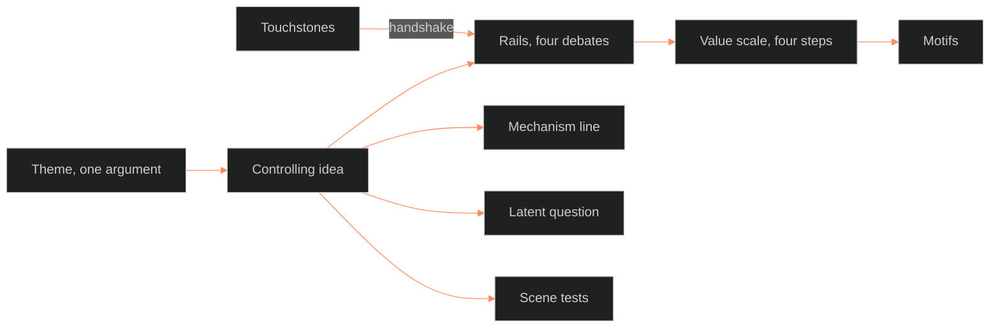

**Who it's for:** a writer or Chief who wants the why behind theme · **What it does:** explains why theme is one argument built from four parts · **Type:** concept

# The theme system: one argument, four parts

*The mind model: four parts build in order, and the live Touchstones check the rails.*

## Theme picks a fight

The character system (L1 to L12) and the setting system (S1 to S12) hold a record. They store everything true about a person or a place.

Theme does something else. Theme makes one argument, and the story spends its whole length making it.

One argument needs four moving parts, not twelve. The method builds them in this order: the controlling idea, the rails, the value scale, the motifs.

## The controlling idea is a value wired to a cause

The controlling idea is one sentence: *[value] happens because [cause]*. It follows Egri's premise and McKee's controlling idea.

A second sentence, the mechanism line, restates the how in the story's own idiom. The claim then reads as something the world does, not an abstraction.

OVEREXITOUT's idea is "Nobody has to be evil when everyone does their job." Chief ruled it on 2026-09-29, picked from 35 candidates.

The mechanism line says how the system does it: "It doesn't find out who you are. It trains you, measures you, then calls the result your nature." That line is Foucault's biopower register, distilled as MSX.36.

The idea says what the story argues. The mechanism line says how the system does it.

## The idea carries a latent question

After the sentence, the writer asks what the sentence might be covering. The stated key word may hide the real theme (CRE.06).

The theme doc keeps this question as the latent-theme line. OVEREXITOUT's latent-theme line is still parked for the phase 2 fill pass.

## The rails keep the argument two-sided

Each major point of view gets one debate. The debate is a plain question the story argues both sides of, scene by scene.

Each debate is the storyform's own locked Issue versus Counterpoint pair for that throughline. The four throughlines are world, protagonist, foil and relationship.

The debates must sum back to the controlling idea. Every scene declares which debate it tests.

Each rail also names one outside idea it meets. A theme meets outside texts (CRE.06).

Each rail lists its holders. A holder is the 08 track id of the character or world that carries the debate, such as `character:tori`. Tracking then binds each rail to a person or a place.

## The value scale makes each scene measurable

The value is the thing the idea turns on. It breaks into four steps: positive, contrary, contradictory, and the negation of the negation.

Any scene turn then reads as a step up or down a ladder. OVEREXITOUT's primary value is Freedom, and world scenes also read Fairness.

Each civilization runs its own value on the same four steps. Each one is a face of the controlling idea. Each one's last step is the lie it tells about itself.

## Motifs carry the argument without words

A motif is an image, object or action that recurs and carries a rail or a scale step. Nobody says it aloud.

Two checks apply to every motif. The image recurs, and its uses converge on one meaning. A motif gains meaning by recursion plus convergence (CRE.06).

A motif that ties to no rail and no step floats free. The method rejects it.

Each motif gets an id, `motif.<slug>`, that Tracking uses as the story point's field. A motif may also link to the world entry behind it. The Feed links to WB-TEC-0001.

## Theme argues and Touchstones hold

A rail may argue both sides of its debate. A rail may pressure-test a Touchstone hard.

No scene may write past what a live Touchstone locks. The handshake table checks every rail against every live Touchstone.

A new Touchstone gets the same row check against rails R1 to R4 the day it goes live.

## The idea describes the system, never the person

The scene tests carry the idea down to one scene. Every actor in a harm scene can name the rule they followed.

The tests run on the scene plan, not on the narrated text. The prose style rule that narration never states motive therefore does not clash with them.

The rider (Stangneth, PHI.04) limits the idea. It describes what the system allows, never what each person is. Anna stays a question, not an answer.

## The long read

The theme system started as a bootstrap on 2026-09-29. It held one ruled sentence, one mechanism line and a storyform map.

The same day Chief walked four debates, one value scale and three motifs. He picked each plain-word line by hand, and he amended one motif: the Feed replaced the legibility violation.

Version 1.0.0 added the general method ahead of any single story. OVEREXITOUT became the worked instance. The handshake with the Touchstones closed the last open call.

The 9/24 research verdict still holds. Foucault supplies the mechanism: power produces the person. The moral claim that ordinary people carry out evil belongs to Arendt, Bauman, Milgram and Browning.

The ruled sentence is that moral claim. The mechanism line is Foucault's. Chief's 9/24 phrasing, "the system enables evil; the person is a symptom," stays on record as the Overall Story's world-claim.

EVIL CHECK is a second story in the same universe. Its controlling idea is parked for wave 2. The method applies to it unchanged when wave 2 opens.

See the [reference](2-reference.md), the [how-to](3-how-to.md) and the [tutorial](4-tutorial.md).
