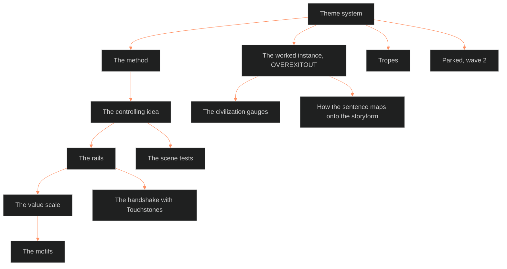

**Who it's for:** a writer or script author looking things up · **What it does:** lists every theme-system component, field and value · **Type:** reference

# The theme system: reference

*The structure: the method builds four parts in order; the scene tests and the handshake check them.*

Front matter facts: trunk BLACK, tier narratology, applies to OVEREXITOUT (EVIL CHECK parked, wave 2, per 80-D). Dependencies: oxo-storyform, ssot_01_story_spine_comparative_tree (L6), ssot_01_touchstones_register. Sources: MSX.36, BVX.0236, BVX.0193, CRE.06, the BOLO 80 DISTILL and RESEARCH-BIOPOWER files.

## THE METHOD — how any story builds its theme

Four parts, built in this order. Each part has what it is, how to build it, and a done-test. The doc cites no new theory.

**(a) The controlling idea.** One sentence, *[value] happens because [cause]*, plus a mechanism line.
- Build: draft candidates until cutting the story to one sentence leaves one survivor. Then answer "how does the system pull this off, concretely."
- Done-test: a reader rebuilds the story's shape from the sentence. The mechanism line explains the how without repeating the what.
- Latent-theme line: after the sentence, ask what it might be covering (CRE.06).
- Seed: the author reads genre G4 `core_binary` as the idea's seed and drafts the first candidate from it. Reads from 01 (IF-01-06-08).
- Spine link: the spine's L6 theme points at this controlling idea (IF-01-06-10).
- CT11 verdict: the author asks whether each 05 catalog entry argues the idea. The author sets the answer in `ct11_verdict` (IF-05-06-06).
  - `argues`: the entry shows the idea working.
  - `neutral`: the entry neither backs the idea nor works against it.
  - `undercuts`: the entry works against the idea, so the author rewrites it or marks it as the exception.
- Seed and CT11 verdict land with IF catalog calls 2 and 3, ruled 2026-10-05.

**(b) The rails.** 3 to 5 debates, one per major point of view. Each debate argues both sides across the whole story.
- Build: take each throughline's storyform Issue/Counterpoint pair and phrase it as a question a character could ask aloud.
- Done-test: every debate has scenes for each side, and the set sums to the controlling idea.
- `meets`: each rail names one outside idea the debate touches (CRE.06).

**(c) The value scale.** One or two gauges, four steps: positive, contrary, contradictory, negation of the negation.
- Build: name the value, then write plain words for each step. Write them best to worst: positive first, the negation of the negation last.
- Done-test: every scene's value turn (plot card value-in and value-out) names a step. The steps read as a ladder.
- Add a second gauge only when one point of view runs on a different value.

**(d) The motifs.** 2 to 4 recurring images that carry a rail or a scale step.
- Build: pick images already in the setting or character material. Tie each to one rail or step.
- Done-test: a reader who never saw the sentence can point at the pattern. No motif floats free.
- Two motif checks: the image recurs, and its uses converge on one meaning (CRE.06).

## THE WORKED INSTANCE — OVEREXITOUT

The marker section for OVEREXITOUT's instance. It runs through THE MOTIFS. It holds one controlling idea with mechanism line, four rails, two gauges and three motifs. EVIL CHECK gets its own instance later; it is parked.

## THE CONTROLLING IDEA — OVEREXITOUT

The sentence, ruled 2026-09-29 by Chief from 35 candidates:

> **Nobody has to be evil when everyone does their job.**

It fuses two sentences Chief short-listed: "When the rules are the problem, following them is the trap" and "Evil at scale is a working system full of ordinary people, and integrity is the refusal to be the part that fits."

### The mechanism line (how the system does it)

> *It doesn't find out who you are. It trains you, measures you, then calls the result your nature.*

Chief kept it 2026-09-29 as the biopower register. Source: Foucault's biopower, distilled as MSX.36. The idea says what; the mechanism line says how.

## HOW THE SENTENCE MAPS ONTO THE LOCKED STORYFORM

| Storyform cell (`oxo-storyform.md`) | Where it lives in the sentence |
|---|---|
| OS Problem to Solution: Equity to Inequity | "everyone does their job": the fairness premise is the system's cover |
| MC Growth: Stop | Tori stops doing her job, stops fitting, stops performing for the score |
| Outcome Failure / Judgment Good | the system wins the board; she wins herself by refusing to be one of "everyone" |
| IC: Anna (Steadfast) | Anna does her job perfectly and ascends: the sentence's proof |

## THE RAILS — four debates (80-B.1, RULED 2026-09-29)

One debate per point of view. Each is the storyform's locked Issue versus Counterpoint pair. Every scene declares which debate it tests. Plot card fields P3, P5 and P9 read from these rows.

| # | Point of view | Storyform pair | Debate | Problem to Solution | Meets | `holders` |
|---|---|---|---|---|---|---|
| 1 | The world (factions, DCUS) | Interdiction vs. Prediction | *They already know how you'll turn out. Can you prove them wrong?* | Equity to Inequity | parked | `world:dcus` |
| 2 | Tori | Interpretation vs. Senses | *Believe the story, or believe your eyes?* | Equity to Inequity | parked | `character:tori` |
| 3 | Anna | Circumstances vs. Situation | *Don't fight the game. Win it.* | Projection to Speculation | parked | `character:anna` |
| 4 | Tori and Anna | Suspicion vs. Evidence | *Whose memory of what happened counts?* | Equity to Inequity | parked | `character:tori`, `character:anna` |

The four sum to the controlling idea. Every Meets cell and the latent-theme line hold the mark "OXO theme fill pass (phase 2)".

`holders:` lists the 08 track ids (IF catalog call 2, ruled 2026-10-05; IF-02-06-04). The ids name the characters or worlds that carry each rail's debate.

The theme record is 06's output on the scene card (03) and the plot card (04) (IF-04-06-03, IF-04-06-04). It holds:
- `rail_tested`: the rail, R1 to R4, that the unit tests.
- `side_argued`: the side of that rail's debate the unit argues.
- `gauge`: a gauge name plus its step.
- The citation and transcript tests, defined under the scene tests.

08 stores it per time code under `subject.kind` `theme` and `gauge` (IF-06-08-04).

Interfaces:
- Reads from 02 (IF-02-06-02): L11 `growth_axis`, `growth_requirement` and `resistance_index`. L11's `rail_ref` names the rail.
- Reads from 02 (IF-06-09-01). The Dramatica ingest's Theme Report throughline variable sets feed the rails' pairs (IF catalog call 9).
- Writes to 01 (IF-01-06-09): the rails' pairs source the scale ladder's thematic motif thread.
- Reads from 08 (IF-06-08-05): Anna's reader track lives in 08 §9A. 06 cites it and does not copy it.

> **OPEN:** the `meets` values and the latent-theme line for OVEREXITOUT wait for the phase 2 theme fill pass.

## THE VALUE SCALE — the per-scene gauge (80-B.2)

The primary value is Freedom, ruled 2026-09-29. Every scene moves Freedom up or down. Plot card P3 and P5 name the step.

| Step | Name | Plain words |
|---|---|---|
| + Positive | Freedom | *Your life is yours.* |
| - Contrary | Conformity | *You go along to get along.* |
| -- Contradictory | Control | *You're managed, not free.* |
| --- Negation of the negation | Control that feels like freedom | *The cage feels like home.* |

Second gauge: Fairness, for world scenes (80-G, ruled 2026-09-29). World scenes read Fairness; Tori's scenes read Freedom.

| Step | Name | Plain words |
|---|---|---|
| + Positive | Fairness | *Everyone gets a real shot.* |
| - Contrary | Unfairness | *Some people get a head start.* |
| -- Contradictory | Injustice | *They change the rules when you start winning.* |
| --- Negation of the negation | A rigged game that calls itself fair | *They cheat you and give you a grade for it.* |

The theme record's `gauge` field names one gauge beside the step (IF catalog call 2). The gauge is Freedom, Fairness or a civilization's value.

08 holds each gauge as a value lane under a character or world track (IF-06-08-03, IF-06-08-06).

## THE CIVILIZATION GAUGES — one value per power (RULED 2026-09-29)

Ruled in BOLO 93 (calls 2 Keep and 3 Split). Every civilization runs its own value on the same four steps. The rule lives here. Each civilization's catalog entry in 05 holds its four steps (IF catalog call 3; IF-05-06-04). The entry's `gauge:` field carries them. World scenes may read a civilization's gauge beside Fairness.

| Civilization | Catalog entry | Value | Last step (the lie it tells) |
|---|---|---|---|
| The Delta Coast / DCUS | WB-INS-0002 | Worth | A score that calls itself your nature |
| The Narco Republic / Real Federale | WB-GRP-0004 | Belonging | A racket that calls itself a nation |
| The Deepstate North | WB-GRP-0007 | Liberty | Tyranny that calls itself liberty |
| Providence, the techno-corpo state | WB-GRP-0006 | Safety | A prison that calls itself protection |
| The Kudzu | WB-GRP-0005 | Life | A death that calls itself life |
| The Power Line | WB-INS-0004 | Protection | A wall that calls itself a shield |

The Kudzu is the idea made literal: no one in it is evil; it only grows. The plain words are drafts for Chief to re-pick.

## THE MOTIFS — three images (80-B.3, RULED 2026-09-29)

Motifs feed the texture system. Each appearance moves the Freedom scale. The Feed replaced the legibility violation the same night. The Sync score and clothing glow stay as setting.

| Motif | `motif.<slug>` | What it carries | Rail / step | `motif_ref` |
|---|---|---|---|---|
| The uniform and the mirror | `motif.uniform_mirror` | Seeing yourself as they made you | the mechanism line; --- *The cage feels like home* | none |
| A door she could walk out of | `motif.open_door` | Freedom in reach, never taken until the Stop | Tori's Growth (Stop); + *Your life is yours* | none |
| The Feed | `motif.the_feed` | The system watching and scoring you, always on | debate 1; -- *You're managed, not free* | WB-TEC-0001 |

Motif ids: 06 mints each `motif.<slug>` id (IF catalog call 2; IF-06-08-01, IF-06-08-02). 08 uses it as the story point `field: motif.<id>`.

`motif_ref` links a motif to the catalog id of the setting object behind it (IF catalog call 3; IF-05-06-03, IF-05-06-05). The clothing glow links to WB-WDR-0001 and stays setting.

Interfaces: writes to 07 (IF-06-07-01, IF-06-07-02). 07.1 routes sensory detail through this list when the detail touches theme.

## PROVENANCE

- 1.3.0 cite: CRE.06 *Thematics: New Approaches* (Bremond, Landy and Pavel, 1995) backs the latent-theme line. It also backs the two motif checks and `meets`.
- The 9/24 verdict: Foucault supplies the mechanism. Arendt, Bauman, Milgram and Browning supply the moral claim. The ruled sentence is the moral claim.
- Chief's 9/24 phrasing, "the system enables evil; the person is a symptom," stays on record as the Overall Story's world-claim.
- Research file: `_tools/bolostatus/work/80/RESEARCH-BIOPOWER.md`.

## RULED 2026-09-29 (Chief: "go on all those recs")

- **80-B, the shape:** fully walked.
- **80-C, theme vs. the Touchstones (BOLO 81):** two docs joined by a handshake table. Theme is what the story argues; Touchstones are what it never breaks. `cost_and_meaning` sits in both.
- **80-E, which books:** held books only (Egri, McKee, Coyne, Truby, Dramatica, Foucault as MSX.36). No Weiland.
- **80-G, Fairness as a second gauge for world scenes:** yes.

## THE SCENE TESTS — the controlling idea on the scene card (RULED 2026-10-04, BOLO 80, "all recs")

Three tests carry the idea down to the scene. They ride the scene card in [ssot_03](../../../_SSOT/03_SETTING_SYSTEMS/📐%20ssot_03_setting_system.md) as two new fields. The plot card in 04 carries the same theme record (IF-04-06-03).

| Test | Source | Rule |
|---|---|---|
| Citation test | Vaughan, TEC.06 | In a scene where the system does harm, every actor can name the rule they followed. A scene needing a hidden evil motive argues a different idea. |
| Knowledge gradient | Zimbardo, PSY.49 | A field inside the citation test. The card names who knows better. A character who knows better and complies is the hard case. |
| Two-transcripts test | Scott, PHI.03 | The card says whether the scene plays on the public script or the hidden transcript, and what changes between them. |

Where the tests run (IF catalog call 7, ruled 2026-10-05). The citation test and the knowledge gradient run on the scene plan, not on the narrated text. 07.1's "narration never states motive" does not clash with them. The author shows the rule in speech or action (IF-06-07-06, IF-06-07-07).

**The rider** (Stangneth, PHI.04): the idea describes what the system allows, never what each person is. Anna stays a question: cog, believer or mask. Her reader track in 08 §9A holds it open (IF-06-08-05).

## TROPES

Added 2026-09-29 (BOLO 89). Every TV Tropes trope in the theme domain is keyed to rails R1 to R4. The [trope register](../../../_SSOT/01_NARRATIVE_FRAMEWORKS/📐%20ssot_01_trope_register.md) holds the keys. The pull list is `_tools/tropes/data/domains/LAYERS.md`, under theme. The sub-index pass is keying as of 2026-09-29: Death, Family, Betrayal, Revenge, Authority, Memory, The Secret, Promises and Vows.

## THE HANDSHAKE — theme × Touchstones (BOLO 81)

Themes argue; Touchstones hold. No scene writes past a live Touchstone. Live ones are in [the Touchstones register](../../../_SSOT/01_NARRATIVE_FRAMEWORKS/📐%20ssot_01_touchstones_register.md).

| Rail | Debate | Live Touchstone | How the rail argues around it |
|---|---|---|---|
| R1, the world | *They already know how you'll turn out. Can you prove them wrong?* | TS 1:1 (soft) | Stages erotic or ritual power as uncontained, for dread. The container lives outside the book. |
| R2, Tori | *Believe the story, or believe your eyes?* | TS 1:1 (soft) | Dramatizes a container failing her. That is the Touchstone working. |
| R3, Anna | *Don't fight the game. Win it.* | TS 1:1 (soft) | Stages power inside a bounded rite with a clear end. |
| R4, Tori and Anna | *Whose memory of what happened counts?* | TS 1:1 (soft) | Contests whose account of a contained scene is true. |

**The rule:** a new Touchstone gets this row check against R1 to R4 the day it goes live. No carded scene counts as bound by it before then.

## 1.0 BAR (RULED 2026-09-29, BOLO 80)

This doc's own 1.0 list retires (IF catalog call 10, ruled 2026-10-05). The bar is SOP §5's six at equal weight (IF-06-09-03):
- Shape: cleared. The method, the worked instance and the handshake are written.
- Shelf: cleared. The method cites Egri, McKee, Coyne, Truby, Dramatica and Foucault (MSX.36).
- Proof: cleared. OVEREXITOUT carries the instance. A theme read sits on all 7 cards: M1-skeleton, M2-grief-summary, M2-row9, M3-crash-analepsis, M4-skeleton, M5-skeleton, M6-skeleton, in `_CANON_NODES/` as `oxo-scene-card-*.md`.
- Ruled: cleared. No OPEN call remains in the source, and EVIL CHECK is parked.
- Wired: written in 1.4.0. `holders`, the motif ids, `motif_ref`, the theme record and the CT11 verdict name the neighbours.
- Store: open. The rails' `meets` values and the latent-theme line are stubs until the OXO theme fill pass.

## PARKED (wave 2)

EVIL CHECK's controlling idea sits outside the 1.0 bar (80-D). It has no idea, rails, scale or motifs drafted. The method applies unchanged when wave 2 opens.
