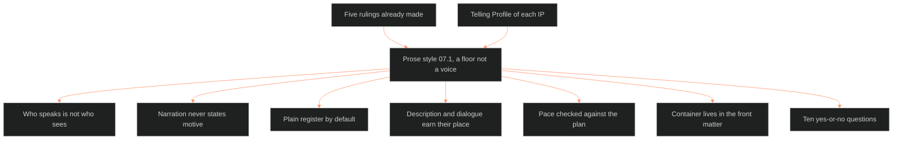

**Who it's for:** a writer or reviewer judging a page of story prose · **What it does:** explains why 07.1 sets a floor, not a house voice · **Type:** concept

# Prose style: why the guide is a floor

*The mind model: a floor built on five rulings, under each IP's Telling Profile, ending in a ten-question check.*

## The guide asks one question

07.1 asks what must be true of a page of prose, in any IP. The answer comes before anyone judges the page on its own merits. It is a floor. It is not a voice.

An IP is one story line in the universe: OVEREXITOUT, EVIL CHECK, LAKAD, ASTRO7EX, and every later one. Each IP answers the telling questions in its own Telling Profile. The guide sits under those answers.

## The guide borrows its authority

The guide invents no house voice. It draws on five rulings already made. They are the texture system's discourse layers, Modern Poetics, the medium grammars, the Touchstones register, and the genre system. Every rule cites its source. Where canon is silent, the guide writes a question marked OPEN with one recommendation.

## A ruled profile beats the default

A Telling Profile wins for its own IP. The medium grammars say the profile "applies verbatim" once ruled. So 07.1 fails a draft in only two cases. No profile has ruled the question, or the rule is universe-wide.

OXO's Telling Profile is the worked instance. It proves the guide can be instanced. It is never the universe default.

## Who speaks is not who sees

The texture system's one load-bearing law separates the voice from the eye. Voice covers person, level, reliability and time of narration. Sight covers focalization.

The universe sets no default person or tense. Each IP records its own. The universal default for sight is internal fixed: one focal character per scene. A profile may license more.

## Narration never states motive

The narrator never says why a character acts. The reader infers it from what the character does, says and refuses. A line that explains motive fails the guide.

The character's wound and drive set the motive. The page shows only its effects.

## Plain is the default, heavy is licensed

The guide defaults to the plain register: name first, short sentences, active verbs. A story may license a heavier register on its own profile. That register belongs to the story, not the universe.

Sentences run short to medium. Length follows duration, not the writer's mood. Stretch beats such as a Sync-dive, a trance or dread may run long.

## Description and dialogue must earn their place

Every description is motivated. A detail earns its place by pointing at theme or distinctiveness, or by routing through the story's own motifs. A description that fits any scene has failed.

Every line of dialogue discharges at least one of Kempton's seven functions, or the writer cuts it. Each IP rules its own dialogue registers.

## Pace is checked against the plan

A draft's duration pattern is checked against its own planned tempo curve. The guide sets no universal beats-per-1,000-words number. Each IP sets that on its own tracking lanes.

## The container lives outside the story

Touchstone TS 1:1, "the bounded container," says erotic or ritual power holds inside a container. Chief refined it: the container lives outside the story, in a front-matter disclaimer. The scenes inside stay free of it.

So every book carries one line in its front matter. It is a paratext rule, not a content rule. P3 SATURATION judges the scenes: sexuality is aesthetic, earned, and never worked around.

## The guide is a style bible

A style bible is a meta-genre: a document about a genre's social life. 07.1 is that home for the universe. Each IP's Telling Profile is an instance under it.

## The long read

The guide holds each decision in tension with the IP's freedom. It rules only what the whole universe must share. It leaves taste to the profile.

The check at the end turns the rules into ten yes-or-no questions. A reviewer asks them in order. See the [reference](2-reference.md) for each rule and the [how-to](3-how-to.md) for the steps.

Source: `ShroomsQ/_CANON/_SSOT/07_STYLE_GUIDES/📐 ssot_07_1_prose_style.md`.
