**Who it's for:** a writer or reviewer looking up one prose rule · **What it does:** lists every component of 07.1 with its rules · **Type:** reference

# Prose style: reference

*The structure: twelve components in source order, then the ten-question check a reviewer reads against a draft.*

```mermaid
%%{init: {"theme": "dark", "themeVariables": {"primaryColor": "#2A1A12", "primaryBorderColor": "#FF5A1F", "primaryTextColor": "#F2EDE6", "lineColor": "#FF8F62", "fontFamily": "Atkinson Hyperlegible, sans-serif"}}}%%
flowchart TD
  R["Prose style reference"] --> A["Scope"]
  R --> B["Voice and person"]
  R --> C["Focalization"]
  R --> D["Motive on the page"]
  R --> E["Register and diction"]
  R --> F["Sentence craft"]
  R --> G["Description and the sensorium"]
  R --> H["Dialogue"]
  R --> I["Pace on the page"]
  R --> J["Explicit content and paratext"]
  R --> K["Genre register"]
  R --> L["Meta-genre, the style bible"]
  R --> M["The check, ten questions"]
```

One entry per component of the source, in source order. T1 to T12 are the texture system's discourse layers. A Telling Profile is one IP's answers to them. OXO's is the worked instance. See the [concept](1-concept.md) for the why.

## Scope

- **What it is:** the reach of the guide. It covers OVEREXITOUT, EVIL CHECK, LAKAD, ASTRO7EX and every future IP.
- **Rule:** a per-story Telling Profile is an instance of the guide, never an exception. Where a profile rules a question differently, the profile wins for that IP.
- **Why:** M1 PROSE holds that "the Telling Profile applies verbatim" once ruled.
- **Fails a draft when:** no profile has ruled the question, or the rule is universe-wide. The paratext disclaimer is the clearest universe-wide case.
- **Connects to:** [07.2 Documents](../ssot_07_2_documents_style/2-reference.md), which governs how the Command writes its own docs and replies. The split was set by the CDR on 2026-09-29.

## Voice & person

- **What it is:** T1 WHO SPEAKS. It separates four decisions: person, level, reliability, and time of narration.
- **Person:** homodiegetic or heterodiegetic.
- **Level:** extradiegetic, intradiegetic, or metadiegetic.
- **Time of narration:** subsequent, simultaneous, prior, or interpolated.
- **Rule:** the universe has no default person or tense. Each IP records its own T1 line before its prose is judged. A draft with no ruled T1 has not cleared the guide.
- **Reliability:** judged against the implied author, not the real author or the narrator's claims.
- **OXO instance:** heterodiegetic, subsequent narration, "reliable narrator with a reliability gap reserved for the Administration's documents" (RULED 2026-09-23).
- **Chief's tense and person default:** past tense, single internal-fixed focalization as the starting menu item for a new IP. Each IP strikes or keeps it.

## Focalization

- **What it is:** T2 WHO SEES. It is a separate decision from T1.
- **The law:** who speaks is not who sees.
- **Default:** internal fixed, one focal character per scene. Variable or multiple focalization needs an explicit license on the Telling Profile.
- **OXO instance:** Tori fixed by default. One licensed second lens, the Feed's surveillance eye, external and never a character POV. Anna gets no POV.
- **Distance dial:** cinematic, light, or deep. It sets how close prose sits to the focal mind. The writer records each scene's setting on its telling line (T6).
- **Sources:** Card, *Characters and Viewpoint* (BVX.0061); Hall, *Writing Deep Point of View* (BVX.0273).

## Motive on the page

- **What it is:** the tyranny of motive, a numbered universal prose rule.
- **Rule:** narration never states a character's motive outright. The reader infers it from what the character does, says and refuses. A narrator line that says why a character acts fails.
- **Where motive lives:** the character's L5 WOUND and L6 DRIVE set it. The page shows only the effects.
- **Source:** Corbett (BVX.0196). Moved here from the character system, OPEN call 3, on 2026-10-04.
- **Check item:** 10.

## Register & diction

- **What it is:** T6 IN WHAT WORDS. It covers diction, syntax, distance policy, and free indirect discourse.
- **Default:** the plain register. Name first, define terms on first use, short sentences, active verbs.
- **License:** a story may rule a heavier register on its own profile. It is never a universe default.
- **OXO instance:** three dialogue registers (Axiom, Noise, Truth) plus Southern Gothic diction for the Delta Coast bloc.
- **Profanity:** the universe sets no ceiling. Profanity follows the speaker and the story's T6 register.
- **Check item:** 3.

## Sentence craft

- **What it is:** the house sentence style. No canon doc rules it yet. The section runs on the shelf alone.
- **Rule:** short-to-medium sentences are the base gait. Length varies with T4 DURATION, not the writer's mood.
- **Stretch beats:** Sync-dive, trance and dread may run long. OXO's T4 already reserves stretch for Sync.
- **Sources:** Johnston, *Word Up!*; Klinkenborg, *Several Short Sentences About Writing* (BVX.0166); Clark, *Writing Tools*.
- **Check item:** 4.

## Description & the sensorium

- **What it is:** T4's pause and stretch machinery meeting setting layer S3, the sensorium.
- **Rule:** description is motivated, never ornamental. A detail earns its place by pointing at theme or distinctiveness.
- **Test:** Bal's threefold motivation test: delimitation, motivation, rhetorical binding.
- **Show, don't tell:** a distance dial, not a commandment (McKee, BVX.0175).
- **Motif rule:** sensory detail routes through the story's own motifs when it touches theme. OXO's motifs are the uniform and the mirror, a door she could walk out of, and the Feed.
- **Fails when:** the description could belong to any scene.
- **Check item:** 5.

## Dialogue

- **What it is:** the cut test for spoken lines.
- **Rule:** every line discharges at least one of Kempton's seven functions, or the writer cuts it (BVX.0084).
- **Registers:** each IP rules its own on its Telling Profile T6 line. Registers stay keyed to canon, never generic.
- **OXO instance:** Axiom is declarative with no questions. Noise is overlapping and unfinished. Truth is few words, all true, costly to say.
- **Check item:** 6.

## Pace on the page

- **What it is:** T4 AT WHAT SPEED. It names five speeds: scene, summary, stretch, pause, ellipsis.
- **Two tempos:** story tempo (world time per beat) and audience tempo (beats per 1,000 words for prose). Both come from the tracking system §7.
- **Rule:** the writer checks a draft's duration pattern against its own planned tempo curve before calling it done.
- **No universal number:** each IP sets beats per 1,000 words per movement on its own lanes.
- **OXO instance:** the Ban is a hard cut, "a person removed mid-scene and never returned to."
- **Check item:** 7.

## Explicit content & paratext

- **Touchstone TS 1:1, "the bounded container":** soft strength, RULED 2026-09-29. Erotic or ritual power tends to hold inside a container.
- **Rule (T8 THRESHOLDS):** every book carries a front-matter disclaimer as its bounded container. This is a paratext rule, not a content rule.
- **The disclaimer, verbatim** (RULED 2026-10-04): every book prints exactly this line, unchanged.

> Fantasy, not a how-to: what happens in these pages stays in them. Reader discretion advised.

- **P3 SATURATION:** sexuality is aesthetic, woven in, mastered, earned. Forbidden: working around it, spectacle without depth, refusing it outright.
- **Default:** explicit is allowed, written as fantasy first. A story may dial down on its own genre contract.
- **Check item:** 8.

## Genre register (cultcore)

- **G1 LABEL:** cultcore, OXO's series genre (RULED 2026-09-29).
- **G3 conventions:** outsiders against an identity-shaping institution; the cult as container; the newcomer-versus-group induction beat. The list ends with visibility as currency and belonging and selfhood trending opposite.
- **G6 DELIVERY:** immersive. The reader is a native. Prose never stops to explain its own world's vocabulary.
- **Rule for cultcore IPs:** the institution's voice reads as a register distinct from the outsider's own. OXO's Axiom against Truth is the case.
- **Scope:** only IPs whose G1 rules cultcore or a related institutional-dystopia label.
- **Check item:** 9.

## Meta-genre: the style bible

- **What it is:** this guide, as the Command's style bible. Bawarshi and Reiff call a style bible a meta-genre.
- **Rule:** each IP's Telling Profile is a meta-genre instance under it.
- **Noted, unused elsewhere:** kairotic coordination (timing) and typification (cognition).
- **Source:** BVX.0581. Ruled 2026-09-16 as genre OPEN 9; landed 2026-10-04.

## The check

A ten-question pass a reviewer reads against a draft before it counts as ready.

1. **Voice & person:** is T1 ruled on this IP's Telling Profile?
2. **Focalization:** does every scene know only what its one focal character knows, unless licensed?
3. **Register:** is it plain unless the profile rules heavier?
4. **Sentence gait:** is the base short-to-medium, varied only where T4 licenses stretch?
5. **Description:** does every sensory detail point at theme, distinctiveness or a named motif?
6. **Dialogue:** does every line discharge one of Kempton's seven functions?
7. **Pace:** does the measured tempo match the planned curve, scene by scene?
8. **Paratext:** does the book carry the one-line front-matter disclaimer?
9. **Genre (cultcore IPs only):** does the institution's voice read distinct from the outsider's?
10. **Motive:** does the narration leave every motive unstated?

> **OPEN:** the source's SOURCES table lists Booth, Genette, Rimmon-Kenan, Pinker, Clark and Johnston with no BVX id ("—").
