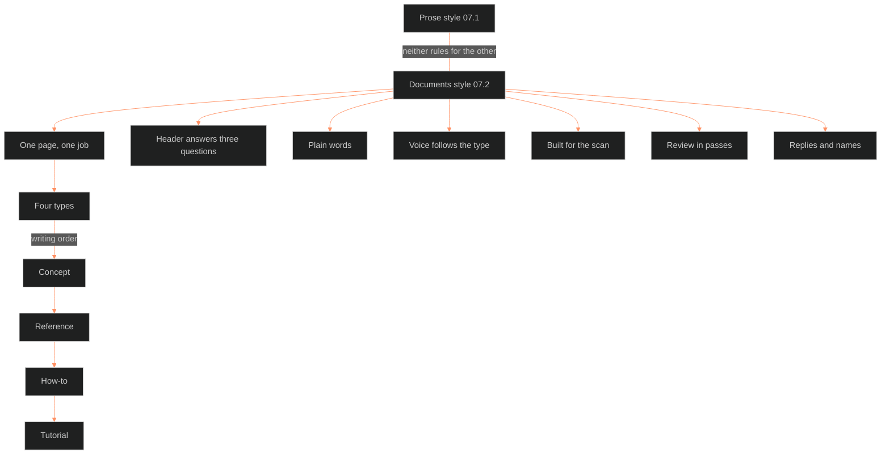

**Who it's for:** anyone writing for the Command · **What it does:** explains why documents style 07.2 works as it does · **Type:** concept

# Documents style: why every page has one job

*The mind model: one job per page leads to four types, and the other rules serve that page.*

## Two things are called style

The Command uses the word "style" for two separate things. Prose style, 07.1, governs the fiction. Documents style, 07.2, governs everything the Command writes about itself: replies to Chief, readbacks, and the SSOT documentation.

Neither guide rules for the other. The CDR drew that split on 2026-09-29.

## A page does one job

Every document does one job. A page that tries two becomes two pages. The job is either doing or understanding.

A doing page is for a reader who skims for a step and stops. An understanding page is for a reader who reads it through. Mixing the two fails both readers.

## Four types cover the jobs

Tutorial, how-to, reference and concept are the four types. A tutorial is a lesson learned by doing. A how-to is a recipe for one task. A reference is facts the reader looks up and leaves. A concept is the why.

The writer builds them in one order: concept, reference, how-to, tutorial. The reader meets them in the opposite order. The writer must know the why before listing the facts.

## The header answers three questions first

A page first tells the reader who it is for, what it does, and which type it is. Those three sit in one thin strip at the top. Owner, state and reviewed sit one click away.

The reader decides in seconds whether the page is theirs. The upkeep fields serve the keeper, not the reader.

## The words stay plain

One word names one thing, and the writer defines it on first use. One idea fills a sentence. Every sentence names who does what. The check is 20 words, and the writer reads each sentence aloud.

Plain does not mean thin. The rich description has a home: "The long read," one marked section at the foot of a concept page. Story prose follows 07.1.

## Voice follows the type

Doing pages use practical voice. Concept pages use classic voice: one voice, state it, no hedges, show the evidence. Session notes and logs stay out of classic voice, because they exist to show the work.

## A page is built for the scan

Headings state ideas, not labels such as "Background." Each list passes the plural-noun test and has a named order. The opening holds only what the reader already accepts. A hinge sentence joins sections and repeats the last key word.

## Review runs in passes

The reviewer checks facts, then words, then reads aloud. A ruled page is never edited quietly. Chief rules the change, and the reviewed date updates.

## Replies and names follow the same law

The reply format lives in SOP §7. This guide only locates its rules. The naming rulings apply to every document, this one included. They are the plain register, the Command format, clickable file links, Touchstone, and the Command.

## A visual says the same thing a second way

A visual gives the reader the shape of a page before the sentences. Every concept page opens with a mind model. The job picks the picture: a flow for a process, a tree for a hierarchy. A visual never carries a claim the words lack, because a reviewer checks the picture against the text.

## The long read

Chief locked each documentation rule by teach-back between 2026-09-30 and 2026-10-03. The record is the DOC-SOP. Where the older guides 07.2a and 07.2b disagree with the core, the core wins. All five merge calls were ruled on 2026-10-04 and now live in those two guides.

The [reference](2-reference.md) gives each rule. The [how-to](3-how-to.md) covers tasks. The [tutorial](4-tutorial.md) walks a worked page.

Source: `ShroomsQ/_CANON/_SSOT/07_STYLE_GUIDES/📐 ssot_07_2_documents_style.md`.
