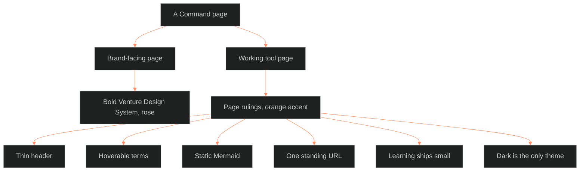

**Who it's for:** anyone building a Command page or artifact · **What it does:** explains why pages style 07.3 sets two layers · **Type:** concept

# Pages style: two layers, one line between them

*The mind model: a page is brand-facing or a working tool, and the page rulings govern the tool side.*

## Every page answers to two layers

Every artifact and tool page the Command publishes answers to two layers. The foundation is the Bold Venture Design System. It serves DARKROOM and anything public-facing. The page rulings are the internal-tool layer. They serve every sit rep, DOPE SHEET, SOI and TM.

The two layers do not compete. A page is brand-facing and follows the foundation, or it is a working tool and follows the rulings. The default-colorway ruling draws that line.

## Brand and tool use different color

The brand uses rose. The internal tool uses the creator-cases palette, with an orange accent. Rose belongs to DARKROOM and public surfaces only.

DARK is the only theme. There is no toggle. A forced light face is E-INK Kindle gray, never white.

## The top of a page stays thin

A page header is one thin strip. Metadata sits behind a button. The reader sees content in the first 100 pixels. This ruling came from the SOI masthead, which was unusable when it ran across the top.

## Every term is hoverable

Every Command page is dense with the CK3 hover-term pattern. Every system term hovers, tooltips nest, Space locks, and click pins. A section with no hover terms is a blocking finding.

The pattern lets the reader meet a term in place instead of leaving the page.

## Diagrams must be static

A Mermaid diagram goes into static markup at build time. A page script never injects it. The host's Mermaid pass runs once over the DOM it receives. A script-injected diagram arrives too late.

## One standing URL per board

A sit rep and its siblings, the DOPE SHEET and the SOI, republish to one standing URL. They never get a new one. The reader always opens the same page.

## Learning material ships small first

Learning pages for Chief ship as the head version. They hold the sentence and the buttons, nothing else, and a score at the end. The complete machine version comes only on request. Dense learning pages read as noise.

## The long read

Type is three faces: Barlow Condensed for display, Atkinson Hyperlegible for body, IBM Plex Mono for codes and counts. The source also holds eleven reference books on design, held but not yet distilled into rules. Each rule so far came from Chief's own feedback or a build finding.

See the [reference](2-reference.md), the [how-to](3-how-to.md) and the [tutorial](4-tutorial.md).

Source: `ShroomsQ/_CANON/_SSOT/07_STYLE_GUIDES/📐 ssot_07_3_pages_style.md`.
