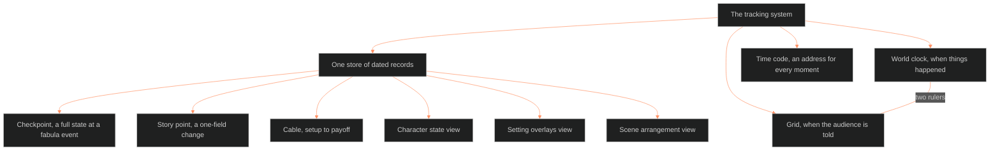

**Who it's for:** a writer or tool builder who wants the why · **What it does:** explains why one store feeds many views · **Type:** concept

# The tracking system: one store, many views

*The mind model: one store of dated records sits under two rulers and feeds the views; the time code addresses every moment.*

## Tracking writes down what is true, then what changed it

Tracking means writing down what's true at one moment, and the event that changed it. A moment can belong to a character, a place, a trope or the story world.

A state query reads a starting record. It then applies every change up to the moment asked about.

## Every dated fact lives in one store

Checkpoints, story points and cable ends are all records in one store. Character state, setting overlays and the arrangement of scenes are views onto those records.

The model is Ableton's. Session and Arrangement views read the same clips. The tracking system owns the grid, the time code, the two rulers and the record shapes.

Nothing is stored twice. A second tool would drift from the first.

## A story keeps two clocks, so it needs two rulers

The world clock says when things happened. The fabula runs on it, dated by movement: M1, M2 and so on. It has no bars and no tempo, because nobody experiences world time at a pace.

The grid says when the audience is told. The told order runs on it: ticks, beats, bars, time signature and tempo.

Every told unit points at a fabula event. A flashback is a cable running backward between the two rulers.

One key flips the ruler. A split view stacks both.

## Music supplies the grid

The Command ruled that music theory is the basis for the story's structural layer (BOLO 35). The grid builds that layer out.

A tick is the smallest thing that happens. A beat is McKee's beat, one action and its reaction. A bar is a run of beats that lands one push.

A time signature is a scene's meter. 4/4 is steady, 3/4 lilting, 7/8 a lurch.

The grid belongs to the tracking system, not the scale ladder. The ladder is unchanged; the grid is the clock its containers sit on.

## Every moment gets an address

A time code names one moment: movement, sequence, scene, then bar, beat and tick. Every story point, cable end and state change carries one.

The code sorts as numbers. A different told order never changes world-clock order.

Zoom follows the ladder. Zoomed out, the tool draws bundles and counts. Zoomed in, it fans out to the exact tick. The cost is drawing, not storing.

## Two kinds of record keep the cost low

A checkpoint is a full state at a fabula event. A story point is a one-field change at any time code.

The character state doc's rule of one state per narrative moment is too heavy at tick level. The split mirrors Ableton's clips and automation points.

A value steps by default. A value marked as a ramp slopes between two points, for tension, attraction or dread.

## Cables tie setup to payoff

A cable links a setup to its payoff at any distance on the grid. It rides on the fabula's `enable` edge.

A cable with a missing end is an orphan. The system flags it and never drops it silently.

## Tempo and the reader are lanes too

The grid itself is automated. Two tempos exist because the story has two clocks: story tempo and audience tempo.

A proportion lane tracks how much of the story each act takes. A reader track records what the audience believes and how far it trusts that belief.

The gap between the character record and the reader track is the source of dramatic irony.

## The long read

The tracking system started as BOLO 90 on 2026-09-29. Chief asked whether fabula needed its own store. The answer was one store, two rulers, not two tools.

The grid took "bar", not "measure". That was Chief's pick over the recommendation. Ticks are counted in order, with no fixed number per beat.

The time code gained a sequence segment in 0.2.0 after the field trial showed a two-grammar gap. Cables gained a `provisional` orphan value. It covers the case where both ends exist narratively but a time code is still unset.

Version 0.3.0 moved the audience trust ledger here from the character system. Version 1.0.0 closed the method gaps: theme and trope hooks, tempo and meter shapes, and the ordering rule.

Version 1.1.0 added the proportion lane (BVX.0236) and a reversibility score on stakes. A world calendar is a ruled non-goal. The world clock stays movement-relative.

See the [reference](2-reference.md), the [how-to](3-how-to.md) and the [tutorial](4-tutorial.md).
