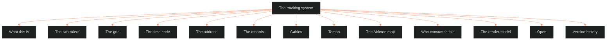

**Who it's for:** a writer or tool builder looking things up · **What it does:** lists every tracking component, field and value · **Type:** reference

# The tracking system: reference

*The structure: thirteen numbered components under one system, from the two rulers to the version history.*



Front matter facts: trunk BLACK, tier fabula, applies to OVEREXITOUT, ASTRO7EX and LAKAD. Dependencies: ssot_01_scale_ladder, ssot_02_character_state_architecture, ssot_03_setting_system, ssot_04_fabula, ssot_04_plot_system, ssot_05_worldbuilding_system, ssot_01_trope_register. Sources: the BOLO 90 DISTILL file and BVX.0236 (Coyne).

## 1. What This Is

Tracking writes down what's true at one moment and the event that changed it. A moment can be a character, a place, a trope or the story world.

- **Root claim:** one store, many views. Checkpoints, story points and cable ends are records in one store.
- Character state, setting overlays (Axis 4) and scene arrangement are views onto it.
- This doc owns the grid, the time code, the two rulers and the record shapes.

## 2. The Two Rulers

One store, two rulers, not two tools (DISTILL §12).

| Ruler | Answers | Rules |
|---|---|---|
| World clock | When things happened | Dated by movement (`M1`, `M2`). No bars, no tempo. Locked until finer precision is needed. Events before M1 carry the tag `backstory`; their ids read `backstory_<slug>`. |
| Grid | When the audience is told | Ticks, beats, bars, time signature, tempo. Every told unit points at a fabula event. |

- **Flip or stack:** one key flips the ruler. A split view stacks both, with a cable from each told unit to its world event. A flashback is a cable running backward.
- **Resources:** records are small text. The cost is drawing, so semantic zoom draws bundles and counts when zoomed out.
- Connects to: [ssot_04_fabula](../../../_SSOT/04_PLOT_SYSTEMS/📐%20ssot_04_fabula.md) (the world clock), [ssot_04_plot_system](../../../_SSOT/04_PLOT_SYSTEMS/📐%20ssot_04_plot_system.md) (the told order).

## 3. The Grid

The musical time layer under the timeline (BOLO 35).

| Unit | Music | Story |
|---|---|---|
| Tick | Smallest subdivision of a beat | One line, gesture or look |
| Beat | One count | McKee's beat: one action and its reaction. The ladder's R1 |
| Bar | A group of beats | A run of beats that lands one push. Sits between beat and scene |
| Time signature | Beats per bar (4/4, 3/4, 7/8) | A scene's meter. 4/4 steady, 3/4 lilting, 7/8 a lurch. Per scene; default 4/4 |
| Tempo (BPM) | Speed | Pace. Optional; an automation lane (§7) |
| Scene and up | Sections | R2 SCENE, R3 SEQUENCE, R4 MOVEMENT and up |

Ruled 2026-09-29:
- "Bar", not "measure".
- Time signature per scene, default 4/4.
- Ticks are counted in order; no fixed ticks per beat.
- The grid belongs to tracking, not the scale ladder. BEAT stays R1.

## 4. The Time Code

The address of one moment on the grid.

```
M2 · Q1 · S04 | 012.3.2
```

| Segment | Format |
|---|---|
| `M<n>` | Movement number, no padding |
| `Q<n>` | Sequence number, no padding (the R3 unit) |
| `S<nn>` | Scene number, zero-padded to 2 digits |
| `<bar>.<beat>.<tick>` | Bar zero-padded to 3 digits; beat and tick unpadded |
| ` \| ` | Joins the scene half to the bar half |

Examples: `M1 · Q1 · S02 | 004.1.1` and `M3 · Q2 · S09 | 041.2.3`.

**Ordering rule.** Compare movement, then sequence, scene, bar, beat, tick. Each compares as a number: `M2` before `M12`, `S04` before `S23`. A different told order never changes world-clock order.

**Zoom stops.** The scroll wheel zooms time (semantic zoom).

| Rung | What the time code shows |
|---|---|
| R1 BEAT | Single ticks inside one beat |
| R2 SCENE | Full bar.beat.tick inside one scene |
| R3 SEQUENCE | The `Q<n>` segment names it; scenes bundle under it; bar counts collapse to a badge |
| R4 ACT/MOVEMENT | Scenes bundle under the movement |
| R5 STORY | Movements end to end |
| R6 NESTED | A nested storyform's own code in a sub-lane |
| R7 SERIES | Stories end to end |
| R8 UNIVERSE | IPs end to end; fabula-only, no grid |

Zoomed out, overlapping story points and cables bundle into a count badge. Zoomed in, they fan out to the exact tick.

## 4A. The Address

The time code is the one address for anything dated in any system (IF catalog call 1, ruled 2026-10-05). Each owning document holds its field. This doc gives only the address.

| Ladder address segment | Time code segment |
|---|---|
| `OXO.primary` (IP · form) | None; the track or record that holds the code names the story |
| `M2` (movement) | `M2` |
| `q3` (sequence) | `Q3` |
| `s12` (scene) | `S12` |
| `b4` (beat) | `bar.beat`, for example `012.4`; a tick may follow |

`OXO.primary.M2.q3.s12.b4` reads `M2 · Q3 · S12 | bar.beat`. Write the address at the rung the fact lives at. Add the bar half only when the fact sits inside a scene.

| Field | Owner | Replaces |
|---|---|---|
| `STT.narrative_moment`, `STT.movement`, `STT.mc_distance_temporal`, `STT.mc_distance_narrative` | 02 character state | The free-text "when" |
| Relationship `state_history.moment` | 02 character state | Movement tags such as `m1a` |
| Fabula event `time` | 04 fabula | Nothing; the code sits beside the calendar year |
| P11 `order_told`, T3 `order_baseline` and its anachronies, medium T3 order | 04 plot, 01 texture and mediums | A bare position in the telling |
| T4 `duration_mode`, T12 `story_point`, medium T4 speed | 01 texture and mediums | Tempo reads the §7 `tempo_point`; a T12 point is a §5 story point |
| Genre `contract_state` `from_unit` | 01 genre | A bare unit name |
| Collision records and state diffs | 01 collision engine | A ladder address or span; a diff is a §5 story point |
| LEDGER_DUE future states | 03 setting state | A free-text due date |
| Hook ledger, Touchstone breach log (§9A) | 08 | The ladder address |
| Catalog `narrated_in` | 05 worldbuilding | Free text |
| CT5 bookends | 05 worldbuilding | The one `era` range; founding and current endpoints are two checkpoints |

- **Retired aliases:** free text and movement tags retire as aliases. A record that holds one is read as its time code. The `backstory` tag (§2) is not an alias and stays.
- **No SC class:** a time code takes no Base 60 SC class (IF catalog call 8). An address is not a scale.

## 5. The Records

Two kinds. Rule 6 of the character state doc is too heavy for tick level.

- **Checkpoints:** full states at fabula events. Shape is defined in [ssot_02_character_state_architecture](../../../_SSOT/02_CHARACTER_SYSTEMS/🔮ssot_02_character_state_architecture.md) §State Record Format, unchanged here.
- **Story points:** one-field changes at any time code.
- **Value behavior:** a value steps by default. `ramp: true` slopes to the next point.

Story point shape:

```yaml
story_point_id: "<slug>"
subject:
  kind: character | trait | trope | place | relationship | theme | gauge | group | belief | custom | tech | wardrobe | architecture | world
  id: "<subject_id>"
field: "<field path>"                  # or motif.<slug>
value: "<new value>"
at: "M2 · Q1 · S04 | 012.3.2"
origin_event: "<fabula event_id>"   # optional
ramp: false
repeat_count: "<int>"               # optional, frequency_mode: iterative only
span: "<time-code range>"           # optional, frequency_mode: iterative only
```

- **Iterative field:** `repeat_count` and `span` serve a story point whose `frequency_mode` reads `iterative` (Genette: told once, happened many times). `span` names the grid stretch the repeats cover.
- **Subject kinds (IF catalog calls 2 and 3):** the first five are the original set. The rest are new.

| `subject.kind` | Holds | Id form |
|---|---|---|
| `theme` | A theme track. A point at a scene's time code records the rail tested (R1 to R4) and the side argued | 06 rails name 08 track ids in `holders:`; motif points use `motif.<slug>` |
| `gauge` | A continuous value lane under a character or world track: Freedom, Fairness, civilization; one of four steps | The gauge name |
| `group`, `belief`, `custom`, `tech`, `wardrobe`, `architecture` | A catalog thing from 05 | `<kind>:<slug>`; catalog id `WB-<TYPE>-<nnnn>` |
| `world` | The story world: a rebrand or a world rule | `world:<slug>` |

- **Which fields change:** a story point changes only fields the 02 field-tag table marks Dynamic. It never changes Static fields. Derived values are never stored.
- **Theme and trope hooks:** a trope is a track of `kind: trope`. Its points use the trope's `id` as `subject.id`. A theme motif is a story point whose `field` is `motif.<id>`. The trope register owns trope ids. 06 mints the `motif.<slug>` ids.

## 6. Cables

A cable links a setup to its payoff. It rides the fabula `enable` edge and runs between any two tracks at any distance.

```yaml
cable_id: "<slug>"
type: setup_payoff
setup:
  track: "<thread id>"
  at: "M1 · Q1 · S02 | 004.1.1"
payoff:
  track: "<thread id>"
  at: "M3 · Q2 · S09 | 041.2.3"
edge: enable
orphan: none      # none | setup_no_payoff | payoff_no_setup | provisional
```

| `orphan` value | Meaning |
|---|---|
| `none` | Both ends logged |
| `setup_no_payoff` | Setup with no logged payoff |
| `payoff_no_setup` | Payoff with no logged setup |
| `provisional` | Both ends exist narratively; at least one time code is still unset |

`none` and `provisional` both mean "not an orphan". `provisional` flags that a real time code is owed before the cable is load-bearing. A/B version compare (take lanes) is deferred.

## 7. Tempo

The grid is automated, like Ableton's tempo lane.

- **Tempo curve:** speed-ups, slow-downs and ramps on the ruler.
- **Time-signature markers:** a change is a marker on the ruler.
- **Two tempos:** story tempo is world time per beat. Audience tempo is beats per 1,000 words (prose) or per minute (screen).
- **Planned vs measured lanes:** Chief sets the plan; the tool measures the draft. The gap is the readout. 07.1 reads the planned audience tempo and sets the beat-boundary mark the tool counts.

```yaml
tempo_point:
  at: "M2 · Q1 · S04 | 012.1.1"
  story_bpm: "<beats per unit of world time>"
  audience_bpm: "<beats per 1,000 words, or per minute>"
  ramp: false

meter_marker:
  at: "M2 · Q1 · S04 | 012.1.1"
  beats_per_bar: 4      # holds until the next marker
```

- **Proportion lane:** plans and measures each act's or third's share. Default plan 25/50/25 (BVX.0236). Measured from P1 percentage addresses. The readout is drift.

```yaml
proportion:
  span: act            # act | third
  planned_share: 0.25
  measured_share: 0.31
```

- **Reversibility score:** P9 `stakes_delta` takes an optional `reversibility` score, 1 to 10. The "trend up" test then runs on numbers.

## 8. The Ableton Map

| Ableton concept | Tracking equivalent |
|---|---|
| Tracks | Threads: one lane per character, trait, trope, place or relationship |
| Clips / locators | Rungs: the ladder's containers R1 to R8 |
| Automation lanes | Continuous values under a track, including a gauge (§5) |
| Session and Arrangement | Fabula and told order: the two rulers |
| Reader track | An automation lane per character for belief and trust (§9A) |
| Take lanes | A/B version compare, deferred |

## 9. Who Consumes This

- **Character state** (ssot_02 v1.2): checkpoints keep their shape. `told_at` and `mc_distance_temporal` read time codes from here.
- **Setting overlays (Axis 4):** dated like fabula, on the §2 world clock.
- **Fabula:** supplies the world clock and the `enable` edge.
- **Reader track:** character state reads `disclosure` (§9A). Character OPEN call 9 closed here.
- **The story workspace (BOLO 79):** the arrangement view is this doc's shell. 07.3 rules its hover and Info View behavior.
- **The timeline tool (BOLO 35):** its store-shape fork is answered: one store.

Interfaces:
- Reads from 00 (IF-00-08-01): `T3.IMPRINT.primary_attachment_object` is a field a story point may change.
- Read by 05 (IF-05-08-02, IF-05-08-03): each catalog entry's `state` is a `<kind>:<slug>` subject; the world-view compiler reads its points and checkpoints.
- Read by 09 (IF-08-09-01): the character pipeline writes a single-field change as a §5 story point, never a checkpoint.
- Read by 01 texture (IF-01-08-04): the T7 payoff ledger reads `character_id` and `shifted_at` from §9A.
- Read by 07.1 (IF-07-08-01): 07.1 reads audience tempo and the planned and measured lanes.

## 9A. The Reader Model

The audience trust ledger (RULED 2026-10-04, BOLO 100). It sits outside the twelve character layers. Each entry is one story point on a reader track, with these fields and no others.

```yaml
reader_entry_id: "<slug>"
character_id: "<subject_id>"
belief: "<what the reader believes about the character>"
trust: 0                       # 0-10
shifted_at: "M2 · Q1 · S04 | 012.3.2"
disclosure: revealed | concealed
```

- Value steps by default. A scene that moves belief or trust writes a new entry.
- A `concealed` entry with high `trust` marks a lie the reader still holds. The reveal scene flips it to `revealed` and drops `trust`.
- A cable can run from the planting scene to the overturning scene.
- **Anna's reader track:** it lives here. 06 cites it to hold open whether she is a cog, a believer or a mask.
- **Hook ledger (IF catalog call 6):** sits beside the T7 payoff ledger. Each entry holds `hook_id`, `type` (P6 hook type), `container` (the unit that closes on the hook) and `payoff_at` (a time code; unset while open).
- **Touchstone breach log (IF catalog call 6):** each entry holds `breach_at` (a time code), `touchstone_id` (a TS id) and `invalidated_units` (downstream time codes that trusted the breached unit).
- Sources: BVX.0279 (Iglesias), BVX.1147 (Doležel).

## 10. Open

The method is complete. Remaining items are build work or phase 2.

| Item | Status |
|---|---|
| Setting state full doc (step 3) | Phase 2; the setting system owns it |
| Timeline-tool data model (step 4) | Answered: one store, every track a view |
| Trope-graph movements-to-acts map (step 5) | Phase 2; the trope register owns it |
| Workspace shell (step 6) | Tool build; arrangement view first |
| Inspector wiring (step 7) | Tool build; connects the query-assembly protocol to the inspector |
| World calendar | Ruled non-goal; the world clock stays movement-relative |

> **OPEN:** setting state full doc and the trope-graph act map are marked phase 2 in the source.

## 11. Version History

| Version | Date | Change |
|---|---|---|
| 1.2.0 | 2026-10-05 | New §4A, The Address; `subject.kind` gains `theme`, `gauge`, 05's kinds and `world`; §9A gains Anna's track, hook ledger and breach log; Interfaces lines |
| 1.1.1 | 2026-10-04 | Sources line added to §9A |
| 1.1.0 | 2026-10-04 | Proportion lane; reversibility score; BVX.0236 cited |
| 1.0.0 | 2026-10-04 | Theme and trope hooks; tempo and meter shapes; ordering rule; reader track; §10 rewritten |
| 0.3.0 | 2026-10-04 | New §9A, the reader model |
| 0.2.0 | 2026-09-29 | `Q<n>` segment; `repeat_count` and `span`; `provisional`; `backstory` tag |
| 0.1.0 | 2026-09-29 | Initial document: BOLO 90 steps 1 and 2 |
