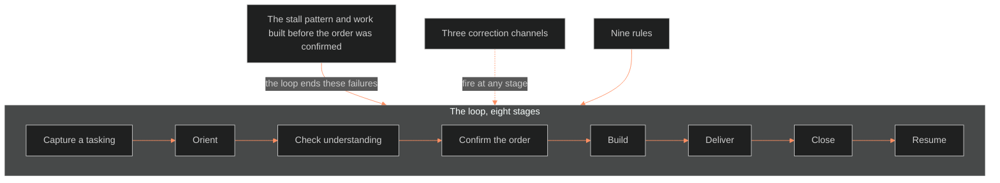

**Who it's for:** Chief or an agent who runs work inside a session. That reader wants to know why the loop has its stages · **What it does:** explains why the development standard exists and how its loop ends the stall pattern · **Type:** concept

# The loop turns one exchange into a built thing

*The mind model: the loop runs eight stages from capture to resume, and it exists to end two failures.*

The **Development Standard** states how one exchange between Chief and Claude becomes a built thing. It covers everything from a single turn to a project. It governs the **loop**. The project flow governs the project the loop runs inside. The SOP governs the session that contains it.

## The loop exists to end two failures

The first failure is **the stall pattern**: a finished design blocked on one unanswered decision, then rebuilt from scratch later. It happens because nobody named and dated the block. The second is its cousin: work built before anyone confirmed the order. That work spends effort on a shared image that was never shared.

## The loop is iterative-incremental development

The Command loop is iterative-incremental development. Five outside parents describe pieces of it. They are the ISO/IEC/IEEE 12207 and 15288 life-cycle standards and the Agile Manifesto with Scrum's inspect-and-adapt. They also include Deming's PDCA, Boyd's OODA, and MCDP 6. The standard states each in one line and claims no more than the record supports.

The Command names its own three grains. The increment is one turn's delivery. The iteration is one session. The release is a project's gate.

## Eight stages carry the order from capture to resume

The loop captures a tasking, orients, checks understanding, confirms the order, builds, delivers, closes, and resumes. Three correction channels fire at any stage: abort abort abort, break-break with buttonhook back, and BOLO capture.

## Nine rules keep the loop honest

Each rule comes from a source read for the standard. The rules say: confirm the order before building, write the tasking the same turn, end a stall with a ruling. The rules also say: run defaults marked provisional, use one reviewer, keep the abort line. They add: land every increment as a FRAGO, close with one word, and use the Command format on every transmission.

## The standard is still on trial

The standard is v0.1 working. It promotes to canonical after two project uses. The next revision strikes any rule unused across those uses. Its rung on the BOLO 50 ladder is procedure.

For every component, read the [reference](2-reference.md). For the tasks, read the [how-to](3-how-to.md). For a worked run, read the [tutorial](4-tutorial.md).

## The long read

The standard's reasoning rests on nesting. A turn equals an engagement equals a task. A session equals an operation equals one OODA cycle. A project equals a campaign. The loop is the engagement-level cycle running inside the project flow's phases. The SOP's blocks are the loop's orient stage. That placement is why the standard can stay small: it does not restate the project's gates or the session's blocks. It only says how a single increment moves.
