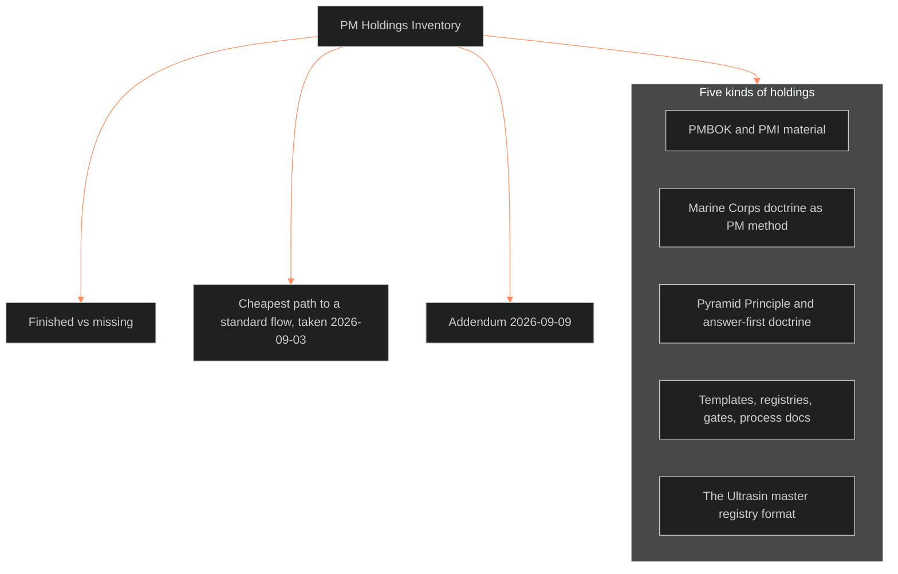

**Who it's for:** an agent or Chief looking up where a PM instrument, template, or source lives in the repo · **What it does:** lists every section of the PM Holdings Inventory and the holdings each one records · **Type:** reference

# PM Holdings Inventory: reference

*The structure: five sections sort the holdings; three more name the gap, the path taken and the addendum.*

The source has type `register / survey`, version 1.1.0, tier operations, domain 09_OPERATIONS. Status: survey banked 2026-09-03, feeding BOLO 25. Date 2026-09-03. Method: an Explore-agent sweep of the repo and archive at medium breadth, with paths verified where load-bearing. Trunk: BLACK (systems), serving every trunk. Related: BOLO.md #25, SOP.md, STATE.md, PROJECTS.md, DOCTRINE-0-INVARIANTS.md, BVX-ULTRASIN-twin-track.md, oscar-mike/lab-venture.md.

**Interfaces.** The 05 compiler `_tools/worldview/build.py` generates `catalog/_INDEX.md` and the world view page from the catalog files (IF-05-09-01).

The Command keeps the inventory, and Chief owns it. The Command re-sweeps it when BOLO 25, the standard PM flow, builds a step. It also re-sweeps whenever a listed holding changes state. Chief decides any other re-sweep. The author verifies each path before listing it.

**The finding:** the method is already written; what is missing is assembly.

Each table below has columns: path, what it is, state, reuse for the standard flow. `…/` stands for `_CLAUDE_ARCHIVE_2026-08-15/` in the source.

## 1 · PMBOK / PMI material

| Path | What it is | State | Reuse |
|---|---|---|---|
| `projects/pmbok-6th-edition/_project.md` | Claude-project shell, no docs | stub | pointer only |
| `files/2026-03-19_step1-warmup-study-guidemd.md` | Vargas reading flow step 1: definitions, 5 process groups, 10 KAs, EEF/OPA, PMO types | finished distill | the vocabulary layer |
| `files/…step2-knowledge-areas-study-guidemd.md` | all 10 KAs, process tables, agile considerations | finished distill | pick-list of KAs for a solo flow (Scope, Schedule, Risk) |
| `files/…step3-process-groups-study-guidemd.md` | process groups and the 49-process flow map | finished distill | closest ready-made process backbone |
| `files/…step4-processes-detail-study-guidemd.md` | all 49 processes, EVM, risk responses, ITTO reference | finished distill | rigor layer, too heavy for daily use |
| `files/…step5-optional-reading-study-guidemd.md` | agile/adaptive continuum, tailoring, 132 tools catalog, glossary | finished distill | the tailoring appendix licenses stripping PMBOK to one person |
| `files/2026-03-19_bvipds-project-chartermd.md` | real PMBOK 4.1 charter for BVIPDS: 13 sections, 15 requirements, 7 risks, M-001 to M-007 deliverable-gated milestones, exit criteria | finished distill | best template in the repo: gates keyed to artifacts, not dates |
| `files/2026-03-19_bvipds-assumption-logmd.md` | 12 assumptions x 6 fields, status OPEN / VALIDATED / INVALIDATED / REVISED | finished distill | drop-in assumption/risk instrument |
| `_1.2.EMIRU/1.2.EMIRU/test documents/BVIPDS_project_charter.md` | in-repo charter copy, frontmatter collapsed, anchors rewritten to chat URLs | damaged | use the archive copy |
| `conversations/2026-03-19_bold-venture-initiative-project-charter-planning.md` | the session behind the charter; PM-tool landscape ending in a ClickUp mapping | raw, rich | the reasoning behind each charter choice and the tool-layer decision (ClickUp tracks, Git canonical) |
| `conversations/2026-03-19_pmbok-6th-edition-study-guide-creation.md` | build session for the five guides; format contract | raw | reusable distill spec |
| `conversations/2026-03-28_work-breakdown-structure-in-pmbok.md` | WBS, 100% rule, work packages, WBS dictionary | stub | only WBS material in the corpus |
| `artifacts/2026-02-25_pmbok-and-ricardo-vargas-doctrine-grade-research-for-solo-.md` | PMBOK 6, 7, 8; 12 principles tiered by solo relevance; "WBS is MECE is problem framing"; Vargas 5-80% human-AI rule; PMBOK 7 performance domains to the six-phase lifecycle | finished distill | the synthesis: which parts of PMBOK survive a team of one |
| `conversations/2026-02-12_3d-printing-business-models-and-market-entry.md` | complaint research, differentiation, limited-batch drop, unit economics, 12-week launch | raw, rich | a worked venture-launch sequence |
| `files/2026-07-04_spindle-master-business-plan-v01md.md` | 14-section master plan on a five-layer section architecture; Appendix C frames it as a reusable template | finished template | the venture-side counterpart to the charter |
| `files/2026-07-04_ultrasin-master-plan-architecture-v01md.md` | master-plan architecture only: horizons 0-6 / 6-18 / 18-36 months, question sets | partial | the phase/horizon skeleton |
| `files/2026-06-16_fl-food-business-launch-checklistmd.md` | jurisdiction launch checklist | finished | example of the checklist artifact type |

The source adds: no agile/scrum/kanban thread exists on its own. Agile appears only inside the PMBOK guides and the four-domains artifact's CDPR section (9-week milestones x three 3-week sprints).

## 2 · Marine Corps doctrine as PM method

| Path | What it is | State | Reuse |
|---|---|---|---|
| `OVER_EXIT_OUT_OBSIDIAN/OVEREXITOUT/00_IMPORTED_JOPLIN/MARINE CORPS DOCTRINAL PUBLICATIONS/` | MCDP knowledgebase summaries (Dec 2025), one per publication: 1, 1-1, 1-2, 1-3, 2, 3, "4 Security," 5, 6, 7, "8 Logistics" | UNVERIFIED (9/3 repair pass): the 4 and 8 summaries were generated from filenames, not texts; MCDP 7's chapter list does not match the real book; the whole Dec-2025 set is suspect | superseded by the MIL.01 to MIL.11 one-sheets (built 9/3 from the full PDFs, `KNOWLEDGE_AREAS/`); audit the other 9 summaries before citing |
| same folder | 4 and 8 repaired 9/3: both originals retagged UNVERIFIED; real MCDP 4 Logistics (2023) and MCDP 8 Information (2022) summaries generated from source; index lists all 11 | done | none |
| same folder, `1 PROMPT TEMPLATE spec.md` and `2 KNOWLEDGEBASE spec.md` | the summarizer prompt (exact-replication, no invention) and KB spec | finished template | a distill pipeline reusable for PMBOK |
| `BVX-ULTRASIN-twin-track.md` §Doctrinal spine | the "Marine standard": Feb-9 SSOT Writing Guide canon, MCDP hierarchy to doctrine stack, MCDP 7 to BVX-LEARN, MAGTF to full-stack company, acquisition queue | finished | the doctrine-to-operation mapping; its decision table is a ledger pattern |
| `DOCTRINE-0-INVARIANTS.md` | seven rules for what qualifies as a rule (earned by 2+ uses, written-only, names what it forbids, every scale, names derivation, fewer than seven, dies by countermand) | RATIFIED 2026-09-03 (rename bench still open) | the governance layer; the project flow promotes under it |
| `SOP.md` | the de-facto PM operating system: prowords, sit rep blocks, Ready Rack/Magazine handoff, reading order, Command format | finished, enforced | already a project-control cadence; governs the session, not the project |
| `STATE.md` | "Blocked on you" decision table (# / Decision / Unblocks) plus dated Moved blocks | living | decision log and change log; "Unblocks" is a dependency field |
| `BOLO.md` | numbered task register, issued date, status flags, in-place addenda | living | task register with audit trail |
| `oscar-mike/` | parking lot: frontmatter contract, park/sweep | finished | backlog / WIP discipline |
| `_CACHE/` and `_LOG/` | Ready Rack to Magazine flush | finished | the session-close step |
| `files/2026-02-09_ssot-writing-guide-marine-corps-standardmd.md` | Marine Corps Doctrine Standard v1.0.0 for SSOT docs | finished | Command style every process doc is written to |
| `conversations/2026-06-08_marine-corps-documentation-and-narrative-production.md` | BVMC coined; MCDP 1 as structural template; MCDP 7 and MAGTF as the applicable frameworks | raw | origin record |
| `conversations/2026-07-21_bvx-quartermaster-protocol.md` | the Quartermaster: car-and-cargo rule, 2+ concrete uses promotion gate, tripwires | raw, rich | source of the DOCTRINE-0 promotion gate; an AAR-capture pattern |

## 3 · Pyramid Principle / answer-first doctrine

| Path | What it is | State | Reuse |
|---|---|---|---|
| `artifacts/2026-02-25_four-domains-converge-on-a-bold-venture-development-doctri.md` | the Feb-2026 four-domains artifact: USMC mission command, McKinsey MECE / Pyramid / 7-S, AAA pipelines (CDPR sprints, vertical slice), DoD gates, five shared patterns, and a full-lifecycle doctrine for solo dev plus AI: Phase 0 Problem Framing, 1 Concept and Intent, 2 Design and War-Gaming, 3 Vertical Slice, 4 Production, close, with a decision gate at each boundary | finished distill, never promoted | this is the standard flow, already written |
| `artifacts/2026-02-25_pmbok-and-ricardo-vargas-…` §mapping | PMBOK 7 performance domains bolted onto the six phases | finished distill | matched pair with the above |
| `SOP.md` §7 | answer-first codified; ten-second test | finished v0.1 | the document standard for every PM artifact |
| `SOP.md` §1 boresight | readback, read, questions; no delivery until cleared | finished | the requirements sign-off gate |
| `STATE.md` Pyramid audit | source text absent from all libraries; `BVX.1107` reserved | earmark | known gap, slot held |
| `conversations/2026-03-28_the-pyramid-principle-explained.md`, `2026-04-04_mckinsey-pyramid-model-explained.md` | one-shot recalls | stub | superseded by the artifact |
| `07_STYLE_GUIDES/_history/📐 ssot_06_legacy_styleguide_2024.md` | the 2024 ancestor style and naming guide | historical | naming section only |

## 4 · Templates, registries, gates, process docs

| Path | What it is | State | Reuse |
|---|---|---|---|
| `PROJECTS.md` | the board: ten projects x trunk/volume/state, re-ranked by leverage with cost-to-unblock and what-it-releases | living (regen 8/16) | the portfolio-prioritisation mechanic |
| `oscar-mike/lab-venture.md` §3 | stage-gate sheet: G1 90 days consistent output to gear; G2 $1-2k/mo x3 to collab/testing; G3 60-70% of living x3 to full-time; metrics (rebill >60%, ARPU, conversion 1-5%) | parked, unruled | the cleanest gate pattern: a measured condition authorises a specific spend |
| `ShroomsQ/_CANON/_SSOT/09_OPERATIONS/` | SSOT_CREATION v1.8.0, writing guide, retrieval dossier protocol, AI instruction protocol, variable registry, setup guide, two `Untitled` orphans | mostly finished | where a PM SSOT belongs; the dossier protocol adapts to status reporting |
| `ShroomsQ/_CANON/_TEMPLATES/ssot/♨️_template_ssot_09_operations_standard_structure_template.md` | mandatory 8-component SSOT structure | canonical | the container for any new process doc |
| `ShroomsQ/_CANON/_TEMPLATES/authoritative/📋 BVX Learning Template v2.md` | one-sheet generator: invariants, heuristics, core concepts | finished | distill format for PMBOK/MCDP operator cards |
| `_0.1_BVX_LEARN/_meta/SPEC.BVX-LEARN.v3.md` | pipeline spec with §9 Quality Gates and §14 open decisions | draft | a spec carrying its own gates and decisions |
| `_0.1_BVX_LEARN/_meta/DECISIONS.md`, `REVIEW-QUEUE.md`, inventory/orphans/gap reports | per-subsystem decision log, review queue, reports | finished | the proven per-project document set |
| `_0.1_BVX_LEARN/KNOWLEDGE_AREAS/*.md` | one-sheets with `Invariants` and a structured `feeds:` block | finished | traceability (requirement to artifact) in YAML |
| `files/2026-03-28_research-to-knowledgebase-templatemd.md` | two-stage prompt pipeline (research to KB) | finished template | the intake half of a research-driven flow |
| `02_CHARACTER_SYSTEMS/📐 ssot_00_process_illustration_character_pipeline.md` | worked end-to-end pipeline illustration; moved from 09 to 02 on 2026-10-05 (the Bold Venture Design System moved to 00 the same day) | finished | the "flow, illustrated once" artifact |
| `files/2026-02-25_ssot-00-system-architecture-mapmd.md` | components mapped, every undefined interface marked | finished | an interface-gap register is a risk log |

## 5 · The Ultrasin master registry format

The registry is `files/2026-08-05_ultrasin-master-registrymd.md` (v0.1, living). Its five-flag status vocabulary is declared up front on every row: 🟢 locked · 🟡 in motion · 🔴 open decision · ⚪ parked · 📄 artifact in old chat. Its shape runs: Goal Layer (gates), Systems Registry (§A to §M one-liners pointing at deep docs), Cross-System Principles. It continues with Open Decisions Ledger (`# | Decision | Blocking?`), Chat Census (distill priority H/M/L), Known Gaps, Maintenance. Governance: the canon rule (not written means it does not exist) and rescission by dated strikethrough.

## 6 · Finished vs missing

- **Finished:** the six-phase lifecycle and gates (four-domains artifact), the PMBOK-7 mapping, the charter instance, the assumption log. The finished list continues with the decision ledger (STATE and registry), the task register (BOLO), the portfolio board (PROJECTS). It also holds backlog discipline (oscar-mike), session handoff (Ready Rack), stage gates (lab venture). It then adds the document container (SSOT template) and Command style (Marine standard and SOP §7). It ends with 11 MCDP summaries (numbering drift on 4 and 8).
- **Missing (as of 2026-10-05):** the list now reads as follows. Closed 2026-09-03: ~~one document that says how a project runs here~~ (the project flow). Also closed: ~~a project lifecycle in the repo proper~~ (the flow's P0 to P6). Also closed: ~~a sprint/cadence layer beyond the CDPR paragraph~~ (the flow's section F). Also closed: ~~the DOCTRINE-0 ratification~~ (ratified). Blank charter and gate templates also closed 2026-09-03 (the flow's blank brief and gate checklist). The blank close-out template stays open.
- **Known gaps already flagged:** the Pyramid Principle source text (BVX.1107 reserved); 7 of 11 MCDP PDFs (BOLO 1). Summaries exist for all 11, and the PDFs feed the catalog, not the method. DOCTRINE-0 was ratified 2026-09-03, and that gap closed 2026-10-05 (BOLO 102 batch A).

## 7 · Cheapest path to a standard flow — TAKEN 2026-09-03 → 📐 ssot_09_operations_project_flow.md v0.1

The path: promote the four-domains six-phase lifecycle into a `09_OPERATIONS` SSOT; strip the BVIPDS charter and assumption log into blanks. Generalise the G1/G2/G3 gate pattern. Adopt the registry's five-flag status and `# | Decision | Blocking?` ledger as the schema. Every input is a finished artifact today. The successor is the [Project Flow](../ssot_09_operations_project_flow/2-reference.md).

## 8 · Addendum 2026-09-09 — the Business-ops cluster, closed out (true-ancients R8)

PROJECTS rank 10 "Business ops" is retired as a label. Of its six conversations, four are already in section 1. They are PMBOK study guides, the BVI charter, WBS, and the 3D-printing market entry. Output covers one (the SPINDLE master plan). One was not previously cited: `_CLAUDE_ARCHIVE_2026-08-15/conversations/2026-06-06_buying-and-reselling-unpublished-content-rights.md` (BOTH, 37k, 1 artifact). It is the adult-industry entry consult: creator-led economics, LTV:CAC, §2257, Visa VAMP, three capital tiers, flagship to network. The consult assesses the third-party repository as funnel-only. BOLO 27 / ULTRA DARK (9/3) reached the same funnel-only conclusion from §N and registry §E without this file. The next Ultrasin entry question starts here.
