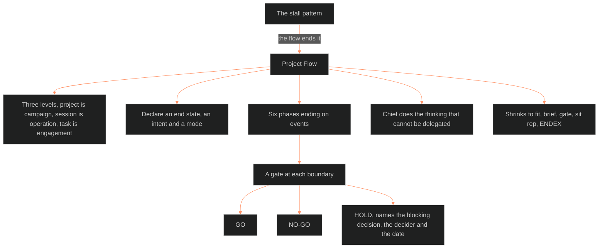

**Who it's for:** Chief or an agent starting, running, or closing a project in the Command · **What it does:** explains why the project flow exists and how its phases, brief, and gates end the stall pattern · **Type:** concept

# A project runs on events, a brief, and gates

*The mind model: three levels size the work, event gates end each phase, and the flow ends the stall pattern.*

The **Project Flow** states how a project runs in the Command. It assembles instruments that already exist into one flow. They are the six-phase lifecycle of the Bold Venture Development Doctrine and the brief. They also include the gate, the decision ledger, and the session protocol. It governs the **project**. The SOP governs the **session**.

## The flow ends one failure above all others

The failure is a finished design blocked on one unanswered decision, then rebuilt from scratch. The source calls it the stall pattern. A project is complete when its exit criteria are true, and a session is complete at ENDEX.

## Three levels give every piece of work a size

MCDP 1-2 supplies the levels: campaign equals project, operation equals session, engagement equals task. Sessions accumulate tasks. Without an operational design that turns tasks into a strategic result, the operation collects tactical victories and finishes nothing. The flow is that design.

## Every project declares an end state, an intent, and a mode

The end state says what the finished thing changes in the world. The intent is the "in order to" that outlasts any task. The mode is annihilation or erosion. A project that declares neither has failed before it starts.

## Phases end on events, and each boundary is a gate

The six phases end on events, never dates. Each boundary is a gate, and a gate is a decision, not a meeting. A gate returns GO, NO-GO, or HOLD. A HOLD names the blocking decision, the decider, and the date it converts to a call. It does so because an unnamed hold is the stall pattern.

## The commander does the thinking that cannot be delegated

P0 and P1 belong to Chief. MCDP 5 rules that the organization plans, and that the commander words the intent personally. The AI partner facilitates, drafts, and challenges.

## The flow shrinks to fit

A standardized process is a departure point, not the strategy. The compressed default is brief, gate, sit rep, ENDEX. The S, M, and L sizes expand from there, never compress from an elaborate model.

For every component, read the [reference](2-reference.md). For the tasks, read the [how-to](3-how-to.md). For a worked run, read the [tutorial](4-tutorial.md).

## The long read

The flow is v0.1 working. DOCTRINE 0, ratified 2026-09-03, is its promotion mechanic: it earns canonical status after two project uses. The next revision strikes a rule unused across two projects. Its sibling, the Development Standard, governs the loop inside a session; this flow governs the project the loop runs in. The flow's controlling idea comes from MCDP 6. Control is the feedback returning from the action, not the orders going out. The Command's prowords are that feedback system.
