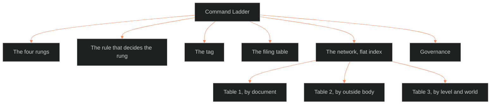

**Who it's for:** an agent or Chief. They look up a rung, the deciding rule, the tag, a filed document, or an index row · **What it does:** lists every component of the Command Ladder · **Type:** reference

# Command Ladder: reference

*The structure: six components, with the network split into three tables.*

The source has type `ssot_procedure`, category operations, frontmatter version 0.2.3 (the 1.0.0 stamp of 2026-10-04 is withdrawn). Its last update is 2026-10-05. It applies to BOLD_VENTURE, ULTRASIN, OPERATOR. Rung: procedure. Status: ruled 2026-09-15 by Chief ("let's go with the NASA four"); the filing table grows a row per document. BOLO 50. Its purpose line: it "names the four rungs every Command document sits on, the shall/should rule that decides the rung, the frontmatter tag that records it, and the filing table of record." Read the Touchstones register first (the source's front-door line).

## The four rungs

| Rung | NASA parent | What it answers | Carries "shall"? | Command examples |
|---|---|---|---|---|
| **policy** | NPD | What the Command does and why. Signed at the top. | yes, at the level of the whole Command | DOCTRINE 0 |
| **procedure** | NPR | How the Command does it. Mandatory. Who does what. | yes | SOP · the project flow · the development standard · the marking SOP · this ladder |
| **standard** | NASA-STD | The measurable "shall" for a class of product or process. | yes | the WATCH register · the variable registry · the writing guide |
| **handbook** | NASA-HDBK | Guidance. "Should." Forbids nothing. | no | the MCDP one-sheets · the CK3 IA study · the explainers · the DOPE SHEET pattern |

**Spec** is a tag, not a rung: one document saying what one specific product must be (DoD's MIL-SPEC). In the Command a spec is a node or a charter. Examples are the BOLO 24 charter, every canon node's invariants (Touchstones), and a persona sheet.

## The rule that decides the rung

1. If it forbids nothing, it is a **handbook**. Handbooks say "should."
2. If it measures a product, it is a **standard**. Its "shall" is testable against the thing.
3. If it governs how the Command works, it is a **procedure**. Its "shall" is testable against the transcript and the record.
4. If it says what the Command is and why, it is **policy**. The rung stays tiny: DOCTRINE 0 and nothing else until something earns it (Invariant I).

## The tag

Every document carries one frontmatter line, the first line after the opening fence:

`rung: procedure · NASA four, ruled 2026-09-15 (BOLO 50)`

A document with no frontmatter gets a three-line block holding only the tag. Read-only files are listed in the filing table and stamped when next opened for a change.

## The filing table · 2026-09-15

| Document | Rung | Status |
|---|---|---|
| `DOCTRINE-0-INVARIANTS.md` | policy | stamped |
| `SOP.md` | procedure | stamped |
| `📐 ssot_09_operations_project_flow.md` (09_OPERATIONS) | procedure | stamped |
| `📐 ssot_09_operations_development_standard.md` (09_OPERATIONS) | procedure | stamped |
| `📐 ssot_07_2b_markdown_marking.md` (07_STYLE_GUIDES) | procedure | stamped |
| `📐 ssot_00_variable_registry.md` (00_EPISTEMOLOGY) | standard | stamped |
| `_0.1_BVX_LEARN/_meta/WATCH-REGISTER.md` | standard | stamped |
| `_0.1_BVX_LEARN/_meta/CK3-IA-STUDY.md` | handbook | stamped |
| `_PRIVATE/BOLO-24-charter.md` | spec | stamped |
| MIL.01 to MIL.11, the eleven MCDP one-sheets in `_0.1_BVX_LEARN/KNOWLEDGE_AREAS/` (MCDP 1, 1-1, 1-2, 1-3, 2, 3, 4, 5, 6, 7, 8) | handbook | stamped (each) |
| `📐 ssot_07_2a_writing_guide.md` (07_STYLE_GUIDES) | standard | read-only file, listed here only |
| `📐ssot_SSOT_CREATION.md` (09_OPERATIONS) | procedure | read-only file, listed here only |
| `_CANON_NODES/dcus-standards-body.md` | spec | stamped at birth, 2026-09-15 (BOLO 50 phase 5) |
| `_CANON_NODES/oxo-trash-land-standards-body.md` | spec | stamped at birth, 2026-09-15 (BOLO 50 phase 5) |
| `_CANON_NODES/astro7ex-standards-body.md` | spec | stamped at birth, 2026-09-15 (BOLO 50 phase 5) |
| `_CANON_NODES/*.md` (34 files) | spec | listed by folder; tagged one by one as each node is next touched |

## The network · flat index (phase 6, 2026-09-15)

The index links all 26 filed Command documents to the level or project they govern. It also links them to the filed documents they depend on, and to their outside parents in the standards register. Read Table 1 document by document, Table 2 body by body, Table 3 level by level. A browsable page comes later, once the count earns it.

### Table 1 · By document

| Document | Rung | Governs | Command parents | Outside parents |
|---|---|---|---|---|
| `DOCTRINE-0-INVARIANTS.md` | policy | the Command | none | none in the register |
| `SOP.md` | procedure | the session | none | none in the register |
| project flow | procedure | the project (BOLD_VENTURE, ULTRASIN, OPERATOR) | SOP, DOCTRINE 0, development standard, PM holdings inventory, MIL.01, MIL.03, MIL.07, MIL.08, MIL.09, MIL.11 | PMI standards: PMBOK Guide (8th ed.) + Practice Guides + global standards |
| development standard | procedure | the build loop inside a session | SOP, project flow, DOCTRINE 0, `standards.register.md` | none in the register |
| standards ladder (this document) | procedure | the Command, document rung classification | DOCTRINE 0, SOP, project flow, development standard, `standards.register.md` | NASA NODIS directives; DLA Defense Standardization Program |
| `📐 ssot_07_2b_markdown_marking.md` | procedure | BVX-LEARN · OVEREXITOUT · ASTRO7EX · SSOT | 07.2a writing guide, SSOT creation, the novel-summary template | none in the register |
| `📐ssot_SSOT_CREATION.md` | procedure | unscoped (applies_to blank) | none | none in the register |
| `📐 ssot_00_variable_registry.md` | standard | unscoped | none | none in the register |
| `WATCH-REGISTER.md` | standard | WARROOM | none | MIL-STD-1472H, DoD Design Criteria Standard: Human Engineering |
| `📐 ssot_07_2a_writing_guide.md` | standard | OVEREXITOUT · ASTRO7EX · LAKAD | `📐_ssot_09_operations_standard_structure_template.md` | none in the register |
| `CK3-IA-STUDY.md` | handbook | the MCDP Doctrine Browser (a planned tool) | none | none in the register |
| MIL.01 to MIL.11 (eleven rows) | handbook | the project (MIL.01 feeds the project flow's methodology) | none | USMC MCDP corpus (outside the register) |
| `BOLO-24-charter.md` | spec | ORANGE | project flow (type field: "first live instance of") | none in the register |
| `dcus-standards-body.md` | spec | DCUS | none | none in the register |
| `oxo-trash-land-standards-body.md` | spec | Trash Land | none | none in the register |
| `astro7ex-standards-body.md` | spec | ASTRO7EX | none | none in the register |

### Table 2 · By outside body

| Body / family | What the Command takes from it | Command documents that cite it | Free or paid |
|---|---|---|---|
| NASA | The NPD, NPR, NASA-STD/NASA-HDBK directive tiers, borrowed as the policy/procedure/standard/handbook ladder | this ladder | Free, public NODIS library (266 current directives); some need internal NASA access |
| DoD (DSP/DLA) | The MIL-STD, MIL-HDBK, MIL-SPEC/MIL-DTL, MIL-PRF tiering, for the spec-as-tag concept; separately, MIL-STD-1472H's human-engineering criteria for the WATCH register's day/night polarity rule | this ladder, `WATCH-REGISTER.md` | Free via ASSIST (116,970 documents indexed) |
| PMI | The PMBOK Guide's project/program/portfolio body of knowledge, folded into the six-phase project-flow methodology | project flow | Free overview; full text needs membership/purchase |

### Table 3 · By level and world

| Level or world | Its standards body | Documents on its rungs | Gaps |
|---|---|---|---|
| the Command | HOTLINE ACTUAL | policy: DOCTRINE 0; procedure: this ladder | standard and handbook empty |
| the session | HOTLINE ACTUAL | procedure: SOP, development standard | policy, standard, handbook, spec empty |
| the project | HOTLINE ACTUAL | procedure: project flow; handbook: all 11 MIL one-sheets | standard and spec empty (specs are filed per instance, such as ORANGE) |
| BLACK | HOTLINE ACTUAL | none on any rung | all four rungs empty; the name appears only in the register's Command-area column, as BVX |
| ORANGE | HOTLINE ACTUAL | spec: `BOLO-24-charter.md` | policy, procedure, standard, handbook empty |
| OPERATOR | HOTLINE ACTUAL | procedure: project flow, development standard, this ladder | policy, standard, handbook, spec empty |
| DCUS | The Administration | spec: `dcus-standards-body.md` | policy, procedure, standard, handbook empty |
| Trash Land | the border itself (no named institution; region name UNRULED, per spec node) | spec: `oxo-trash-land-standards-body.md` | policy, procedure, standard, handbook empty |
| ASTRO7EX | unnamed life-support/certification authority (working title; unkeyed to a place until the moon question is ruled) | spec: `astro7ex-standards-body.md` | policy, procedure, standard, handbook empty |
| DARKROOM | HOTLINE ACTUAL | none on any rung | all four rungs empty; the name appears only in the register's Command-area column |
| WARROOM | HOTLINE ACTUAL | standard: `WATCH-REGISTER.md` | policy, procedure, handbook, spec empty |

**Gaps the index shows** (the source's list):

- `WATCH-REGISTER.md` cites both MIL-STD-1472H and FAA HF-STD-001B, but only MIL-STD-1472H is a register row.
- No other filed document's frontmatter names five of the eleven MCDP one-sheets. They are MIL.02, MIL.04, MIL.05, MIL.06, and MIL.10. Only MIL.01, MIL.03, MIL.07, MIL.08, MIL.09, and MIL.11 are wired into the project flow.
- BLACK and DARKROOM have no governing document among the 26.
- Twelve of the 26 documents carry no outside parent.
- The Command's generic handbook rung is empty. Handbooks sit only at the project level or govern the unbuilt MCDP Doctrine Browser.
- Trash Land and ASTRO7EX have no named standards-body entity yet. Both spec nodes record the body as a working title.

## Governance

DOCTRINE 0 governs. The ladder is v0.1, ruled, and promotes to canonical after two filing passes. Phase 4 of BOLO 50 was the first pass. The next document written in the Command carries the tag from birth. A document found without one is filed at the next sit rep.
