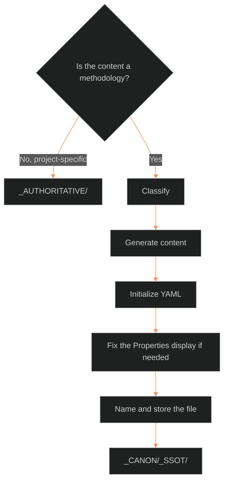

**Who it's for:** a writer or Chief creating or checking an SSOT document · **What it does:** explains why SSOT creation follows one fixed process and a manual Obsidian fix · **Type:** concept

# An SSOT is made by a fixed process

*The flow: a sorting question sends methodology down five phases to its file and sends project-specific content elsewhere.*

The **SSOT creation guide** defines the structural and linguistic requirements for **Single Source of Truth (SSOT)** documentation. Its job is to keep every framework canonical, precise, and integrated into the Obsidian knowledge base.

## The language carries the authority

An SSOT states how a system works as a fact. The guide therefore bans hedges, allows contractions, requires present tense, and bolds the first use of each technical term. The reader meets a rule, not an opinion.

## The process starts with a sorting question

The first phase asks one question: is the content a methodology? If it is project-specific content, the writer sends it to `_AUTHORITATIVE/`. Only methodology continues into `_CANON/_SSOT/`.

## Five phases take the content to its file

The writer classifies, generates content, initializes YAML, fixes the Properties display if needed, and names and stores the file. The order matters: the YAML needs the content's type, and the name needs the category.

## One tool failure has a manual fix

Obsidian sometimes shows pasted YAML as a code block. The guide teaches a manual trick: retype the first three dashes so the Properties panel recognizes the block. The source calls it the most reliable way to keep the knowledge base clean and indexed.

For every rule, read the [reference](2-reference.md). For the tasks, read the [how-to](3-how-to.md). For a worked run, read the [tutorial](4-tutorial.md).

## The long read

The source is titled "SSOT Writing Guide: Marine Corps Doctrinal Standard," and its file name says SSOT creation. It grew from 1.0.0 on 2026-02-10 to 1.8.0 on 2026-02-12 as the Obsidian metadata problem surfaced. Version 1.7.0 added metadata troubleshooting, and 1.8.0 integrated the Manual UI Kickstart Protocol. The text ends with a chat-style pro-tip about the Templater plugin, which the source says could automate the dash trick. It also ends with a line asking for the next document. The newer 07.2 style guide now carries the current writing rules.
