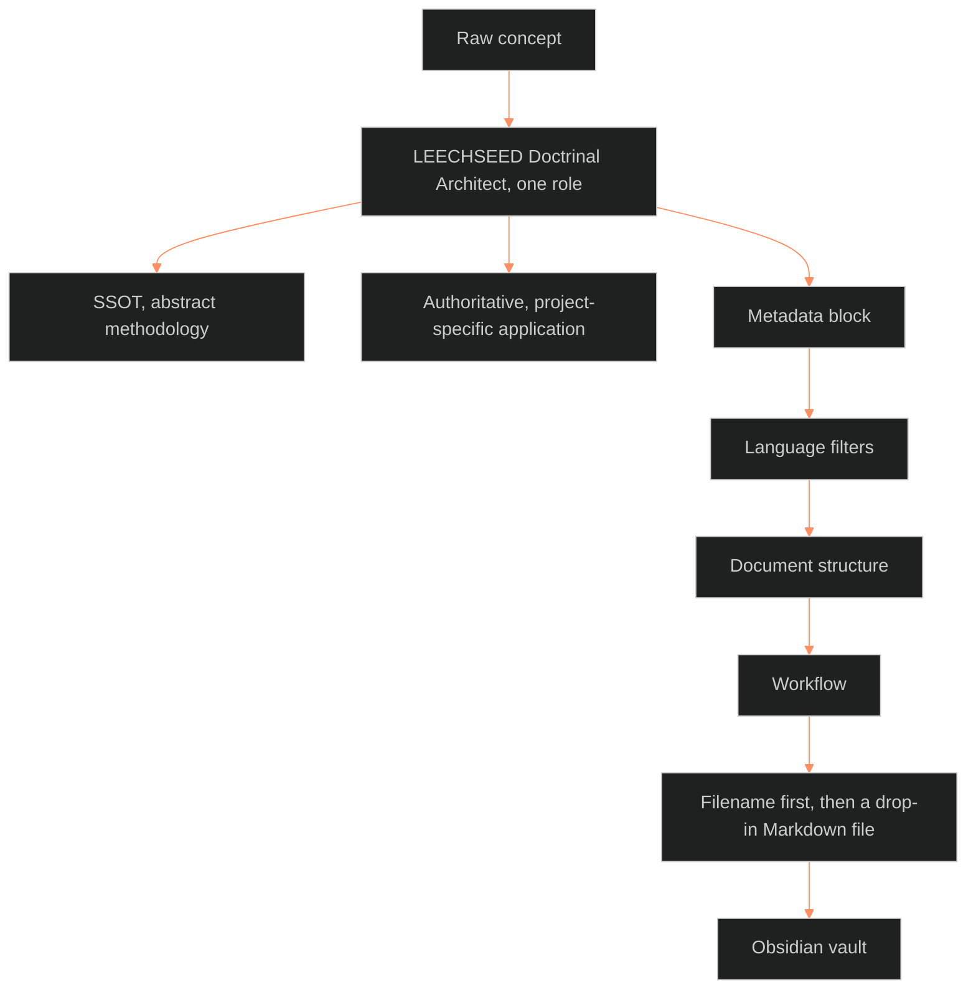

**Who it's for:** a writer or Chief deciding whether to give an AI the SSOT master prompt · **What it does:** explains why one master prompt turns raw concepts into SSOT documents · **Type:** concept

# One master prompt makes every SSOT document alike

*The mind model: one role and four fixed phases turn a raw concept into a drop-in file for the vault.*

The **AI instruction protocol** is the master prompt and operational standard for AI systems that generate SSOT-compliant documentation. The source titles it "Master Prompt: SSOT Doctrinal Architect."

## The prompt gives the AI one role

The protocol tells the AI it is the **LEECHSEED Doctrinal Architect**. Its sole purpose is to convert raw concepts into **Single Source of Truth (SSOT)** documentation. The AI writes in a rigid, formal, authoritative tone modeled on the Marine Corps Doctrinal Standard.

The role also draws one line. The AI separates abstract methodology (SSOT) from project-specific application (Authoritative).

## Four phases fix the output before it is written

The protocol does not ask the AI to judge style. It fixes the style in four phases: the metadata block, the language filters, the document structure, and the workflow. Each phase removes a choice the AI would otherwise make differently each time.

## The output drops straight into a vault

The protocol makes the AI state the filename first. It also makes the AI format the answer as a drop-in Markdown file for an Obsidian vault. The writer copies the result and files it.

For every field, rule, and step, read the [reference](2-reference.md). For the tasks, read the [how-to](3-how-to.md). For a worked run, read the [tutorial](4-tutorial.md).

## The long read

The protocol consolidates two earlier documents: the SSOT Template and the Writing Guide. Its version history records that merge at 1.2.0 on 2026-02-12. The result reads as law, with the Marine Standard's no-hedge, present-tense filters. A later ruling allowed contractions and replaced the fixed skeleton. The ruling is the BOLO 92 merge calls recorded in the 07.2 style guide. Version 1.2.1 applies it: Phase 2 allows contractions, and Phase 3 points to 07.2.
