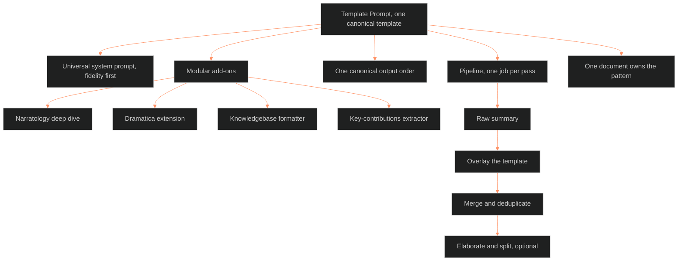

**Who it's for:** a writer or agent about to summarize a novel or book into a knowledgebase entry · **What it does:** explains why one template prompt governs every book summary and how its parts fit · **Type:** concept

# One template governs every book summary

*The mind model: a fixed prompt, flexible add-ons, one output order and a pass-by-pass pipeline make every book summary alike.*

The **Template Prompt for Summarizing Novels and Books** is one canonical template. It consolidates every summarization prompt pattern found across the vault. It replaces the scattered "professional summarizer" prompt, the "Understanding" report template, the wicked_figures process order, and the MCDP doctrinal summary spec. Any future book or novel summary begins here.

## The prompt is fixed, and the add-ons flex

The universal system prompt carries the rules every summary shares. The writer appends modular add-ons for the kind of book. The choices are a narratology deep dive, a Dramatica extension, a knowledgebase formatter, or a key-contributions extractor. The base stays the same, so every summary has the same skeleton.

## Fidelity comes first

The prompt tells the summarizer to rely strictly on the provided text. It forbids external information, invention, speculation, and editorializing. When the source is silent, the summarizer writes "Not explicitly stated in provided material."

## The output has one canonical order

Every summary follows one section order, from metadata through abstract, TL;DR, contents, breakdown, concepts, and synthesis. Add-on sections come after. A section with nothing to say stays in as an empty section and is never dropped without instruction.

## The pipeline refines in passes

The writer runs a raw summary, overlays the template, merges and deduplicates, and optionally elaborates and splits. Each pass has one job.

## One document owns the pattern

Usage rule 1 makes this document the SSOT. Nobody creates a new summarization prompt elsewhere in the vault. A new pattern joins as a modular add-on.

For every component, read the [reference](2-reference.md). For the tasks, read the [how-to](3-how-to.md). For a worked pass, read the [tutorial](4-tutorial.md).

## The long read

The document derives from batch extraction across several vaults and builds. Its header names `.ASTRO7EX.SYNC.JOPLIN`, `OVER_EXIT_OUT_OBSIDIAN`, `_wicked_figures_dir`, `_DIRECTORY OF DIR`, Logseq journals, and RC builds. Its frontmatter was stamped canonical on 2026-10-04 (BOLO 100 D6), while the body still carries "Version: 1.0". The reference sources directive lists the lenses a summary may use. They are McKee, Bloom, Campbell, Lyons, Lukeman, Edgerton, and Maass. They also include Alderson and Rosenfeld, Iglesias, late-2000s sci-fi anime archetypes, and Narrative Astrology. The writer edits that list per task.
