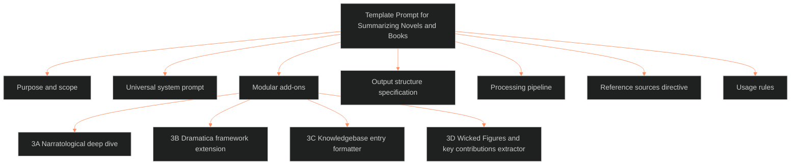

**Who it's for:** a writer or agent. They look up a rule, add-on, section, pass, or usage rule of the book-summary template · **What it does:** lists every component of the Template Prompt for Summarizing Novels and Books · **Type:** reference

# Template Prompt for Summarizing Novels and Books: reference

*The structure: seven components; the add-ons split into four.*

The source has type `ssot_09_operations`, version 1.1.0, tier operations, last updated 2026-10-05. Status: canonical (frontmatter stamped 2026-10-04, BOLO 100 D6; the body carried "Version: 1.0"). The body header names it a Single Source of Truth with scope "Novel & Book Summarization — All Formats," derived from batch extraction. The extraction ran across `.ASTRO7EX.SYNC.JOPLIN`, `OVER_EXIT_OUT_OBSIDIAN`, `_wicked_figures_dir`, `_DIRECTORY OF DIR`, Logseq journals, and RC builds.

## 1. Purpose & Scope

The document consolidates every summarization prompt pattern in the vault into one template. It replaces the scattered "professional summarizer" prompt and the "Understanding" report template instructions. It also replaces the wicked_figures process order and the MCDP doctrinal summary spec. It covers novels, screenwriting craft books, narratology theory texts, literary criticism, workbooks, and any long-form prose requiring structured extraction.

## 2. Universal System Prompt

The writer copies the block as the foundational prompt and appends add-ons from section 3. Its role line: "a professional summarizer and knowledgebase architect." It has three parts.

**Core Rules (seven):**

1. **Depth and Clarity:** detailed, thorough, in-depth, and complex, while clear and concise.
2. **Fidelity:** rely strictly on the provided text; no external information, invention, speculation, or editorializing.
3. **Signal Extraction:** incorporate main ideas and essential information; eliminate extraneous language.
4. **Formatting:** Markdown throughout; bold headers, bullets, nested bullets, and tables where they help.
5. **Section Summaries:** every major section opens with a 3-5 sentence summary paragraph before the bullets.
6. **Key Idea Closure:** every major section ends with a `**Key Idea**` line of one sentence.
7. **No Commentary, No Filler:** output only the structured summary; no preamble, sign-off, or meta-discussion.

**Output Format:** a bold header, then `**Summary**:` (3-5 sentences), then sub-topic bullets with nested details, then `**Key Idea**:`.

**Global Structure (in order):** Title and Metadata Block (title, author, material type, page count if known) · Abstract (one paragraph, no bullets) · TL;DR (6-12 bullets, one sentence each) · Table of Contents (numbered, linked anchors, two-level maximum) · Chapter-by-Chapter or Section-by-Section Breakdown · Key Concepts and Definitions (10-25 one-line definitions as `- **TERM**: Definition.`) · Structural / Thematic Synthesis.

## 3. Modular Add-Ons

The writer appends any add-on to the Universal System Prompt depending on the type of book.

### 3A. Narratological Deep Dive

Use for narratology theory, literary criticism, or composition craft books (the source names Bal, McKee, Eagleton, Cron, Gavins). For each concept, model, or framework the summarizer gives a short definition (1-2 sentences). It also gives an explanation of mechanics and internal logic. It adds its relevance to a writer, and the lineage if the author builds on prior theorists. Each model uses the format: `### Title: **[Author's] [Framework/Model Name]**` with Definition, Explanation, Relevance to Writer, and Lineage. The writer files each model as one distill on the 01 narratology shelf (`ShroomsQ/_CANON/_SSOT/01_NARRATIVE_FRAMEWORKS/_narratology_shelf/`), under `frameworks/Tier N/<CODE> <Competency>/`. The writer then adds the model's row to the shelf's `UID_index.md` (IF-01-09-05; IF catalog call 9, ruled 2026-10-05).

### 3B. Dramatica Framework Extension

Use when the summary feeds Dramatica methodology development (ASTRO7EX throughline reports, storyforming, storyweaving). After the standard summary the summarizer appends:

- **Dramatica Summary:** one continuous paragraph, no bullets. It maps the material to the Overall Story, Main Character, Impact Character, and Relationship Story throughlines. If the material does not map to all four, the summary states which apply and why.
- **Dramatica-to-Narrative Translation Notes:** for each applicable element (Concern, Issue, Problem, Solution, Symptom, Response, Benchmark, Signpost). The note says whether the material illuminates, contradicts, or extends the current storyform.

### 3C. Knowledgebase Entry Formatter

Use when the output goes directly into an Obsidian vault, Hugo build, or similar system.

- The output carries YAML front matter with `id` (auto-generate or blank), `title` ("[Book Title] — Summary"), and `author`. The front matter also holds `type: summary`, `source_type` (book, paper, article, or workbook), `tags`, `status: draft`, and `updated` (YYYY-MM-DD).
- Internal headers use `##` or `###`.
- Concepts that cross-reference other vault entries use `[[wikilinks]]`, with suggested link targets in brackets.
- The output ends with a `## Related Entries` section of 3-5 suggested bidirectional links.

### 3D. Wicked Figures / Key Contributions Extractor

Use for a single-author theoretical work when the goal is to extract that author's unique models and propositions. After the standard summary the summarizer appends `### [Author Name]'s Key Contributions`. Each contribution carries:

- **Title:** academic-style (the source's example: "Genette's Metalepsis Model").
- **Type:** Framework, Model, Proposition, Taxonomy, or Heuristic.
- **Core Claim:** 1-2 sentences.
- **Components:** bullet list of sub-elements.
- **Application:** how the contribution is used in analysis or practice.
- **Cross-References:** related theorists or competing models.

The section takes an unlimited number of contributions with a consistent structure.

## 4. Output Structure Specification

The canonical section order. Every summary conforms to this skeleton. Sections may be empty when not applicable but are not omitted without explicit instruction.

| # | Section | Required | Notes |
|---|---|---|---|
| 1 | YAML Front Matter | If 3C | Only when knowledgebase formatting is active |
| 2 | Title & Metadata Block | Always | Title, Author, Type, Page Count |
| 3 | Abstract | Always | One paragraph, no bullets |
| 4 | TL;DR | Always | 6-12 bullets, one sentence each |
| 5 | Table of Contents | Always | Numbered, linked anchors, 2-level max |
| 6 | Section-by-Section Breakdown | Always | Each section: summary paragraph, bullets, Key Idea |
| 7 | Key Concepts & Definitions | Always | 10-25 entries, `**TERM**: Definition` format |
| 8 | Structural / Thematic Synthesis | Always | Cross-cutting patterns and overarching thesis |
| 9 | Narratological Models (3A) | If 3A | Definition / Explanation / Relevance / Lineage |
| 10 | Dramatica Summary (3B) | If 3B | Continuous paragraph plus translation notes |
| 11 | Key Contributions (3D) | If 3D | Per-model extraction with academic titles |
| 12 | Related Entries (3C) | If 3C | Suggested bidirectional links |

## 5. Processing Pipeline

The end-to-end sequence for a new book:

1. **Pass 1 — Raw Summary:** run the Universal System Prompt against the full text.
2. **Pass 2 — Template Overlay:** run the same text against the Universal System Prompt plus the relevant add-on(s). The output is an enriched summary.
3. **Pass 3 — Merge & Deduplicate:** combine Pass 1 and Pass 2, remove redundancy, and match the Output Structure Specification exactly.
4. **Pass 4 — Elaboration** (optional): run the merged document with the directive "Fully elaborate, contextualize, and provide additional supporting information for the following text."
5. **Pass 5 — Split** (optional): if the output holds multiple discrete models or propositions, split them into individual `.md` files. Name each `[author_last]_[model_short_name].md`.

## 6. Reference Sources Directive

When a task needs cross-referencing, the writer appends a "Reference Sources" block to the system prompt. The writer edits the list per task. It tells the summarizer to use the listed texts and authors as analytical lenses to reinforce, contextualize, or challenge claims. It gives bulleted examples. The source's list: Robert McKee (*Story*); Harold Bloom (*Themes in American Literature*); Joseph Campbell (studies of myth). It continues with Jeff Lyons (*Rapid Story Development*, *Anatomy of a Premise Line*); Noah Lukeman (*The First Five Pages*). It adds Les Edgerton (*Hooked*); Donald Maass (*The Emotional Craft of Fiction*); Martha Alderson and Jordan Rosenfeld (*Writing Deep Scenes*). It also lists Karl Iglesias (*Writing for Emotional Impact*) and late 2000s sci-fi anime archetypes and tropes. Its last entry is Narrative Astrology (Natal Chart, Transits, Progressions).

## 7. Usage Rules

1. **This document is the SSOT.** Nobody creates new summarization prompts elsewhere in the vault. The writer adds a new pattern as a modular add-on in section 3.
2. **No commentary in output.** No preamble, sign-off, or meta-discussion.
3. **Preserve numbering and structure.** If the source has chapters, parts, or numbered sections, the summary mirrors them.
4. **Paraphrase doctrinally.** No long verbatim quotes; paraphrase with precision and fidelity.
5. **State uncertainty explicitly.** Write "Not explicitly stated in provided material."
6. **Tag everything.** Every output destined for the vault carries tags in YAML front matter.
7. **One book = one summary file.** Do not combine books unless instructed.
