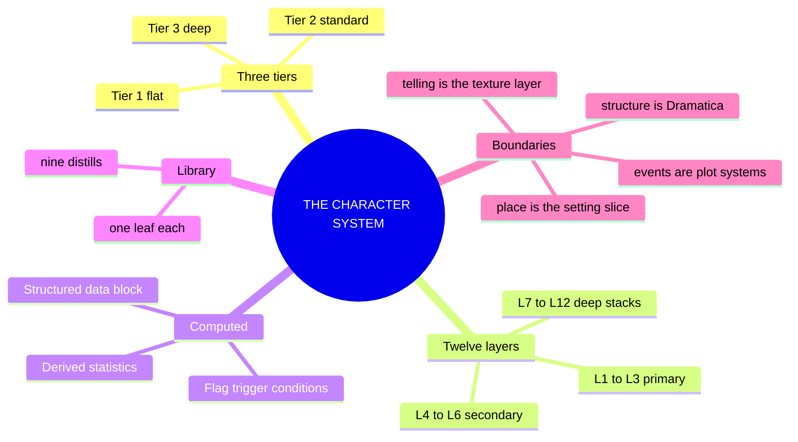
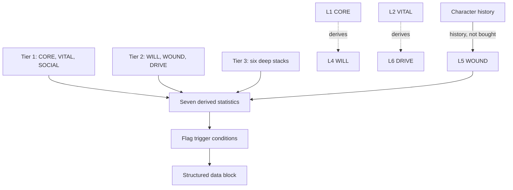
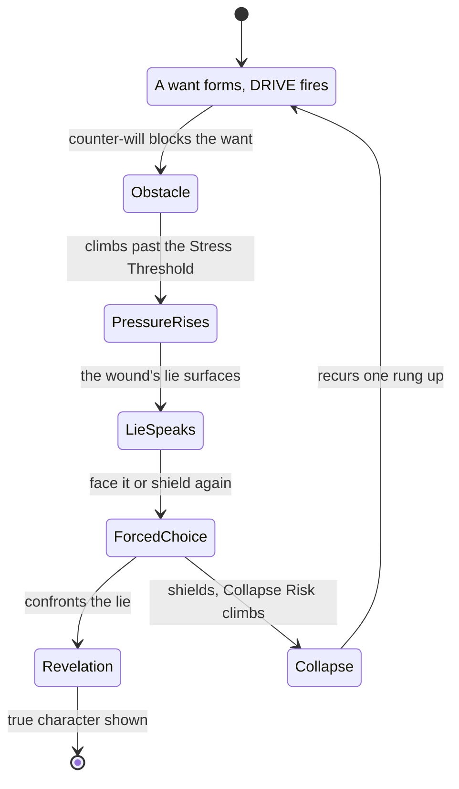

# 📐 SSOT · THE CHARACTER SYSTEM · the LEECHSEED vertical slice

**What this is:** the LEECHSEED Character System promoted from a numbering scheme to a system, the second top-layer model in the lattice beside 03 (setting) and 04 (plot). Three tiers, twelve layers, seven derived statistics, and a set of flag trigger conditions, all terminating in one machine-readable structured data block. The **vertical slice**, one character walked through all twelve layers, is both the validation instrument (do the numbers produce the character canon already says exists) and the seed record for eventual database ingestion. Written first against a single locked example, Victoria Midnight; now with nine distills of the character shelf underneath it.

**Touchstones:** read [the Touchstones register](../01_NARRATIVE_FRAMEWORKS/📐%20ssot_01_touchstones_register.md) first.

**What the character system owns:** who a character *is*. The twelve domain declarations (CORE through FUNCTION), the derived statistics computed from them, the flag states those statistics trip, and the structured data block that makes all of it queryable.

**What it does not own:** structure is Dramatica's ([[BVX.0089]]), the storyform, the four throughlines, the eight archetypes that key L12 FUNCTION are consumed here, not authored here. Events are plot_systems' (04), the turn, the value-in/value-out engine, the twelve P-layers a character's choices fire into. Place is the setting slice's (03), S1 through S12. Viewpoint, person, and tense are the telling, not the person, per Card's explicit exclusion ([[BVX.0061]]): the texture layer, never one of the twelve. The chart feed, the twelve-house astrological mapping onto these same twelve layers, is `ssot_02_character_astrology`'s own document, cited here, not repeated.

**Root claim:** a character is not a trait list, it is a wound-shaped want revealed under pressure. Every model on the shelf, however it names its parts, converges on this one engine. Davis's want meets its counter-will ([[BVX.0075]]); McKee's true character is the choice made under pressure when it costs something ([[BVX.0064]]); Corbett's ghost anchors the failure the tyranny of motive forbids explaining away ([[BVX.0196]]); the wound thesaurus's wound-lie-fear-shielding chain is the same mechanism given a severity dial and a field list ([[BVX.0209]]); Pelican's Big Five profile runs an evolutionary motivation that a dated event converts from external to internal, revealing the personality underneath rather than replacing it ([[BVX.0233]]). The twelve layers store the person; the derived statistics and flags compute what pressure does to them. WOUND, DRIVE, WILL, and SHADOW acting on CORE, VITAL, and SOCIAL is not one reading of the library among several, it is the one engine the stack already implements.

---

## MIND MODELS

**Diagram 1, the whole system on one screen.**



**Diagram 2, the central mechanism.**



**Diagram 3, the recurring engine.**



*The same want, obstacle, pressure, forced-choice cycle recurs at every rung: L5 WOUND sets the lie's content, L4 WILL sets how hard it resists, and Stress Threshold is the number where the choice stops being optional.*

---

## PART A · THE CHARACTER SLICE, twelve layers, the stack the setting and plot slices mirror

One table, twelve layers, the same architecture the SETTING SLICE and the PLOT SLICE mirror: surface to depth to structural function, L12 fed independently from the storyform exactly as S12 and P12 are.

| Layer | Name | Question it answers | Source | Field it writes | Tier |
|---|---|---|---|---|---|
| **L1** | **CORE** | How much cognitive and ideological mass does the mind carry? | [[BVX.0075]], [[BVX.0233]] the Big Five, [[BVX.1123]] Egri's psychology dimension, [[PSY.05]] neurotype | `CORE`, `psychology_stack`, `assigned_labels`, `neurotype` (3.3.0) | Tier 1 |
| **L2** | **VITAL** | How much physical and energetic presence does the body carry? | [[BVX.0075]], [[BVX.0233]] the stress-response cascade, [[BVX.1123]] Egri's physiology dimension | `VITAL`, `physiology_stack`, `body_capital` (adults only) | Tier 1 |
| **L3** | **SOCIAL** | How does the character project into and read the social world? | [[BVX.0233]] the interpersonal circumplex (optional scored dial, 3.0.0), [[BVX.0061]] reputation, [[BVX.1123]] Egri's sociology dimension, [[MSX.12]] and [[MSX.13]] standing by conduct | `SOCIAL`, `sociology_stack`, `community_membership` (+ `standing`, 3.3.0; `catalog_ref`, 3.4.0), `circumplex` (optional), `pair_register`, `civic_standing` (+ `catalog_ref`, 3.4.0), `disclosure_posture` (outness), `voice_sheet` | Tier 1 |
| **L4** | **WILL** | How much resistance holds under pressure, and where does the capacity to decide bend? | [[BVX.0075]] counter-will, [[BVX.0045]] coping strategy, [[BVX.1123]] strength of will | `WILL`, `coping_strategy`, `locus_of_control`, `system_stance` | Tier 2 |
| **L5** | **WOUND** | What accumulated damage failed to resolve, and how severe is it? | [[BVX.0209]] the wound card, [[BVX.0196]] the ghost, [[BVX.0075]] back-story placement | `WOUND`, `severity`, `triggers` (incl. type `minority_stress`), `relational_refs` (+ `mentor_state`), `wound_kind`, `wound_work` | Tier 2 |
| **L6** | **DRIVE** | What fuels the active goal-pursuit, and from what source? | [[BVX.0075]] super-objective, [[BVX.0233]] the fifteen motivations, [[BVX.0045]] cares-about/motivates | `DRIVE`, `futurity_stance`, `want_need` | Tier 2 |
| **L7** | **ORIGIN** | What birth context and formation set the starting conditions? | [[BVX.0075]] birth marks, [[BVX.0061]] justification, [[BVX.1123]] heredity | `origin_class`, `origin_stability`, `family_coherence`, `origin_wound_seed`, `tech_level` (+ `catalog_ref`, 3.4.0), `system_exposure` (+ `layers`, whose `regime` takes `catalog_ref`, 3.4.0), `origin_event` (optional, 3.4.0), `hereditary_predisposition`, `life_script` | Tier 3 |
| **L8** | **IMPRINT** | What formative conditioning locked in before the story began? | [[BVX.0075]], [[BVX.0233]] life-stage emotional concerns, [[BVX.1127]] attachment theory | `attachment_style`, `attachment_style_score`, `attachment_dimensions`, `protest_behaviors`, `deactivating_strategies`, `emotional_range`, `conditional_patterns`, `imprint_flexibility`, `secure_base_object` (was `primary_attachment_object`, kept as a read alias), `appeasement_strategies` | Tier 3 |
| **L9** | **EROS** | How is desire structured, armored, and made safe? | [[BVX.0075]] sexuality as attitude, the L9 v2 doc, [victoria-midnight-L9-eros.md](../../../../_CANON_NODES/victoria-midnight-L9-eros.md), the 3.3.0 craft and exchange books ([[MSX.11]]–[[MSX.15]], [[PSY.02]]), and the L9 EROS synthesis (RULED 2026-09-29, MSX.18–MSX.36, PSY.08–PSY.13), [ssot_02_l9_eros_synthesis.md](📐%20ssot_02_l9_eros_synthesis.md) | `erotic_blueprint_type` (+ `arousal_curve`), `desire_vector` (+ `resolution_type`, `group_size`, `group_position`), `erotic_craft`, `power_exchange`, `consent_posture`, `client_script`, `signal_fluency`, `shame_index` (+ `exposure_shame`, `role_shame`), `armor_index`, `satisfaction_cycle_truncation`, `erotic_safety_precondition` (+ `erotic_safety_precondition_scope`), `intimacy_mode`, `disclosure_posture` (sexual-health register), `template_origin`, `compersion`, `fantasy_ledger`, `desire_object`, `pleasure_evidence`, `sex_creed`, `touch_rule`, `dissolution`, `compartment_practice`, `attraction_channels`, `risk_role`, `risk_account` | Tier 3 |
| **L10** | **SHADOW** | What is repressed, projected, or denied, and what does it generate? | [[BVX.0064]] true character vs characterization, [[BVX.0196]] secrets and the adaptation hierarchy, [[BVX.0045]] the shadow face, [[BVX.0233]] the Dark Triad and Light Triad (optional scored dials, 3.0.0) | `shadow_density`, `projection_tendency`, `regression_pattern`, `shadow_content`, `dark_triad` (optional), `light_triad` (optional), `disinhibition_context` | Tier 3 |
| **L11** | **DESTINY** | What is the character building toward, not where they stand? | [[BVX.0045]] the two journeys, [[BVX.0196]] growth vs transformation, [[BVX.0061]] the four causes of change | `growth_axis`, `resistance_index`, `soul_evolution_archetype`, `karmic_memory`, `growth_requirement`, `arc_type`, `change_cause`, `catalyst_archetype`, `rail_ref` (3.4.0) | Tier 3 |
| **L12** | **FUNCTION** | What narrative role and mechanical function does the character discharge? | [[BVX.0089]] the eight archetypes, [[BVX.0061]] the hierarchy, [[BVX.0064]] the cast map, [[BVX.1123]] the pivotal character | `dramatica_archetype`, `mc_problem_element`, `methodology_element`, `evaluation_element`, `purpose_element`, `touchstone`, `story_outcome`, `story_judgement`, `limit_type`, `resolve`, `convention_role` | Tier 3 |

**Binding rule (mirror of the plot and setting bindings):** L12 FUNCTION is fed independently from the storyform, keyed by `storyform_id`, exactly as P12 FUNCTION and S12 FUNCTION are. A character with no storyform link may run L1 through L11 only; L12 filled is what makes a character load-bearing to the argument, not merely present. **The L12 field list lives in one place only:** the [Dramatica integration protocol](🔮%20ssot_02_dramatica_integration_protocol.md) (module, 1.2.0). This table names the fields; that doc defines them and owns the cascade when a storyform is revised. It also defines `convention_role` (3.2.0, CL15), an advisory genre-casting field that never overrides `dramatica_archetype`.

**Interfaces (IF catalog, ruled 2026-10-05).** Each line names one wiring by its IF id.

- Reads from 05 (IF-02-05-02): WB-GRP ids from a catalog entry's `groups` field. A person points at a group through `community_membership.catalog_ref`. The group's style and customs stay in 05.
- Read by 05 (IF-02-05-03): the 05 L02 link check resolves each catalog group or person pointer to a 02 node. A missing node is owed by 02.
- Read by 03 (IF-02-03-04): 03 reads the four flag states for place flags: ACTIVE, PENDING, FIRED_PRE_STORY and INACTIVE. The record computes them and never assigns them.
- Read by 01 (IF-01-02-14): the trope register reads Tori's L5 WOUND instance (the car crash that kills her brother Jebb) as its SIGNATURE WOUND record.
- Read by 06 (IF-02-06-01): 06 reads images already present in the character material as motif candidates.
- Read by 07.1 (IF-02-07-01): 07.1 reads L5 WOUND and L6 DRIVE, which set a character's motive. The page shows only its effects.


### Field tags · every field

Every field in the Structured Data Block carries one of three tags. **Static** fields are set once, at origin, and never change; a revision makes a new base record. **Dynamic** fields change across the story, and the [state architecture](🔮ssot_02_character_state_architecture.md) module records each change as a state diff. **Derived** values are computed statistics and flag states. The system recomputes them from the current layer values. It never stores a derived value as a state diff. The state module reads this table. **No new field ships without a tag.** Static or dynamic follows the state module's Decision Test: would the value differ if we froze the character at two points in the narrative? Before 3.3.0, 44 of the 103 keys in the block had no tag. They are all tagged now (FU-1, 3.3.0). The four header lines (`CHARACTER_ID`, `IP`, `STATUS`, `VERSION`) are record metadata. Each is Static. The 3.2.0 pass (CL31) tagged three older fields other calls depend on: `intimacy_mode` Dynamic, `desire_vector` Dynamic, `system_exposure` Static.

| Tag | Fields |
|---|---|
| **Static** | `CHARACTER_ID` · `IP` · `STATUS` · `VERSION` · `source_confidence` · `hereditary_predisposition` · `triggers` · `arc_type` · `change_cause` · `catalyst_archetype` · `resolution_type` · `arousal_curve` · `template_origin` · `vandalism_event` · `origin_disciplinary_formation` · `sexual_script_acquisition` · `wound_kind` · `system_exposure` · `layers` (under `system_exposure`) · `convention_role` · `life_script` (`source`, `version`) · `neurotype` (`label`, `known_to_self`) · `power_exchange` · `erotic_craft` (`training`) · `origin_class` · `origin_stability` · `family_coherence` · `origin_wound_seed` · `tech_level` · `attachment_style` · `attachment_style_score` · `emotional_range` · `conditional_patterns` · `imprint_flexibility` · `erotic_blueprint_type` · `satisfaction_cycle_truncation` · `regression_pattern` · `growth_axis` · `growth_requirement` · `soul_evolution_archetype` · `karmic_memory` · `dramatica_archetype` · `mc_problem_element` · `methodology_element` · `evaluation_element` · `purpose_element` · `touchstone` · `rail_ref` · `origin_event` · `story_outcome` · `story_judgement` · `limit_type` · `resolve` · `necessity` · `motivation_quad` |
| **Dynamic**, L1–L4 | `CORE` · `VITAL` · `SOCIAL` · `WILL` · `psychology_stack` · `physiology_stack` · `sociology_stack` · `body_capital` · `circumplex` · `knowledge_map` · `community_membership` · `standing` (under `community_membership`) · `agreement_style` · `risk_management_practice` · `self_presentation` · `identity_frame` · `coping_strategy` · `resistance_mode` · `locus_of_control` · `assigned_labels` · `pair_register` · `civic_standing` · `disclosure_posture` (L3, outness) · `voice_sheet` · `system_stance` · `neurotype` (`masked_by`, `attention_pattern`) |
| **Dynamic**, L5–L8 | `WOUND` · `DRIVE` · `severity` · `relational_refs` · `motivation_stack` · `drive_texture` · `futurity_stance` · `attachment_dimensions` · `protest_behaviors` · `deactivating_strategies` · `secure_base_object` · `somatic_archive` · `wound_work` · `mentor_state` · `want_need` · `appeasement_strategies` · `life_script` (`stance`, `cost`) |
| **Dynamic**, L9–L11 | `consent_posture` · `client_script` · `signal_fluency` · `exposure_shame` · `shame_index` · `role_shame` · `armor_index` · `erotic_safety_precondition` · `erotic_safety_precondition_scope` · `disclosure_posture` · `orientation_dimensions` · `charmed_circle_position` · `resonance_profile` · `polarity_role` · `love_lust_cleft` · `moral_incongruence` · `shadow_density` · `projection_tendency` · `shadow_content` · `dark_triad` · `light_triad` · `intimacy_mode` · `desire_vector` · `group_size` · `group_position` · `compersion` · `fantasy_ledger` · `desire_object` · `pleasure_evidence` · `sex_creed` · `touch_rule` · `dissolution` · `compartment_practice` · `attraction_channels` · `risk_role` · `risk_account` · `concordance` · `refractory_minutes` · `disinhibition_context` · `erotic_craft` (`domains`, `level`, `flow_access`) · `power_exchange` (`stage`) · `resistance_index` |
| **Derived** | `basic_damage_resistance` · `social_legibility` · `narrative_momentum` · `stress_threshold` · `collapse_risk` · `truth_exposure_index` · `expressive_range` · `SHADOW_DENIAL` · `TRUTH_VULNERABILITY` · `OPTIONLOCK_PROGRESSION` · `EARNED_JUDGEMENT` · `KINSHIP_COLLAPSE` |
| **Static**, sub-fields (3.3.1) | `setting_ref` · `character_id` |
| **Dynamic**, sub-fields (3.3.1) | `noticing_filter` · `false_belief` · `wound_belief_set` · `audience` · `container` · `triangle_position` · `reversal_wish` |

**Exceptions (CL19, CL29, CH-1, CH-2, CH-5).** `arousal_curve` stays Static. Two of its sub-fields, `concordance` and `refractory_minutes`, are Dynamic. `life_script` splits the same way: `source` and `version` Static, `stance` and `cost` Dynamic. `erotic_craft` is Dynamic, except `training`, which is Static. `power_exchange` is Static per bond, except `stage`, which is Dynamic. `neurotype` is Static for `label` and `known_to_self`, and Dynamic for `masked_by` and `attention_pattern`. Every other sub-field inherits its parent's tag. `catalog_ref` (3.4.0) inherits the tag of the field it sits on. `rail_ref` and `origin_event` are Static. The `event_id` stored beside a PENDING or FIRED_PRE_STORY flag is Static. It is not a derived value.

**Derived values are recomputed, never stored.** The seven statistics and the five flags are computed from layer values. A state diff changes the layer values. The system then recomputes the derived values from them.

The weakest calls are `dark_triad`, `light_triad` and the three Egri stacks. They read dynamic here because a story can move them; a writer who holds one fixed for a character notes it on the instance.

---

## Core Methodology

### The Three-Tier Structure

The 12-Layer system is modular. Tier depth determines character complexity and database weight.

|Tier|Layers|Character Class|Point Budget|
|---|---|---|---|
|**Tier 1**|L1–L3|Flat|~75 pts|
|**Tier 2**|L4–L6|Standard|~140 pts|
|**Tier 3**|L7–L12|Deep|Uncapped|

Tier 1 is sufficient for background characters. Tier 2 is sufficient for recurring supporting characters. Tier 3 is mandatory for all protagonists and antagonists.

---

### The Hierarchy Rule

*(call 4, [[BVX.0061]] Card's hierarchy, [[BVX.0064]] McKee's cast map — APPLIED 2.1.0, RULED 2026-09-29)*

Characterization effort tracks narrative rank. Tier depth already encodes this loosely — Tier 1 for background, Tier 2 for recurring support, Tier 3 mandatory for protagonists and antagonists — and this states it as a rule rather than a convention: a character earns deeper tiers and denser Tier 3 sub-field population in proportion to how much load-bearing weight the story places on them, not by default completeness. Filling every field on a background character is not thoroughness, it is a schema error in the other direction.

---

### Erotic Pacing

*(the L9 EROS synthesis, RULED 2026-09-29, Chief: "Rex" — [[MSX.26]] Maes ed., [[MSX.33]] Waldrep — APPLIED 2.2.0, no new field)*

A four-device toolkit — withhold, fragment, bound, interrupt — governs how any L9-driven scene is narrated, parallel to how the 9/16 wave resolved the tyranny of motive as a house writing rule rather than schema (OPEN call 3). The devices are craft, not character data: they describe how the prose paces a scene the twelve-layer values already justify, not a new value assigned to a character.

---

### Library-pass rules

*(CL1, CL10, CL18, CL25 — APPLIED 3.2.0, RULED 2026-10-04, BOLO 100 library pass, "rec")*

1. **Scoping (CL1).** Four fields accept a list of {ref: character_id or audience name, value}: `intimacy_mode`, `disclosure_posture`, `love_lust_cleft`, `self_presentation`. The bare value is the default. The list is Dynamic.
2. **Shame (CL10).** Shame intensity reads as norm distance times the stigmatizer's power over him.
3. **Disinhibition (CL18).** Only `disinhibition_context` scope shadow_driven feeds Collapse Risk.
4. **Stance (CL25).** A stated `system_stance` is a performance until a second source checks it.

---

### The Villain-Arc Fork

*(call 7, [[BVX.0196]] growth vs transformation, [[BVX.0061]] the four causes of change — APPLIED 3.0.0, RULED 2026-10-04, Chief: "all rec")*

An L5 WOUND feeds an L8 IMPRINT, and in an antagonist that pipeline stalls. The wound hardens into imprint instead of resolving. The character meets one fork, and three paths open. **Path (a), the wound is refused:** L5 stays high, L8 `imprint_flexibility` stays low, and its `conditional_patterns` calcify into belief. L10 SHADOW grows with the denial, and L12 `resolve` holds its stance. This is the villain arc. **Path (b), the wound is faced:** L5 `severity` falls, L8 loosens, L10 `shadow_content` surfaces, and L11 `change_cause` fires. L12 `resolve` reads Change, and this is the change arc. **Path (c), the wound is staged and never resolves (3.2.0, CL22):** `severity` holds or oscillates, SHADOW_DENIAL falls, and `shadow_content` surfaces on stage. L5 `wound_work` reads reenacted_in_play. Healing is never done, and that is a field value, not a failed arc. A writer tells the fork by reading `resistance_index`, `change_cause` and flag SHADOW_DENIAL together. A cause the character defeats, with SHADOW_DENIAL still ACTIVE at the climax, marks path (a). A cause the character accepts, with the shield collapsing, marks path (b).

---

### The 12 Layers: Domain Declarations

Each layer governs one and only one domain. Overlap between layers constitutes a schema error, not a character note.

**L1 — CORE:** Cognitive and psychological mass. Governs all mental skill defaults, ideological frameworks, and problem-solving capacity. Default value: 10. Point cost: 20 pts per level above 10 (IQ equivalent). Carries `psychology_stack` (call 12, [[BVX.1123]] Egri — APPLIED 2.1.0): the psychology third of Egri's bone structure (moral standards, ambition, frustrations, temperament, attitude toward life, complexes, extrovert/introvert, abilities, qualities, IQ) as an auditable text checklist beneath the number, not replacing it. **Added 2.5.0 (RULED 2026-10-04, the schema pass, "all recommendations"):** `identity_frame` (the frame he names himself by: gender persona, orientation label, era category, and the gender script he plays for each audience). **Added 3.2.0 (RULED 2026-10-04, BOLO 100 library pass, "rec"):** `assigned_labels` under `identity_frame` (CL5, Dynamic): list of {label: text, by: law | medicine | church | state | buyer | family | peers, year: integer, accepted: bool}. It holds the label an institution or buyer gives him, beside the one he names himself. **Added 3.3.0 (RULED 2026-10-04, BOLO 100 follow-up, "rec", CH-5):** `neurotype` (Static for `label` and `known_to_self`, Dynamic for the rest): {label: text, known_to_self: bool, masked_by: novelty | effort | none, attention_pattern: hyperfocus | scattered | mixed}. It records a stable cognitive pattern that shapes attention, follow-through and desire (PSY.05). The first months hide it behind novelty and hyperfocus. Later it surfaces as drift, forgotten tasks and resentment. Method line: store the condition as one cause among others, never as the explanation. The condition is never the only problem.

**L2 — VITAL:** Physical and energetic presence. Governs body precision, endurance, reaction capacity, and physical expressiveness. Default value: 10. Point cost: 20 pts per level above 10 (DX equivalent). Carries `physiology_stack` (call 12, [[BVX.1123]] Egri — APPLIED 2.1.0): the physiology third of the bone structure (heredity, appearance, defects, posture, health) as the same kind of text checklist. Heredity itself resolved to L7's `hereditary_predisposition`, not here — see L7. **Added 3.0.0 (RULED 2026-10-04, BOLO 100, "all rec"):** `body_capital`, adults only: what the body is worth in the character's world, and to whom. **Defined 3.2.0 (CL14, RULED 2026-10-04, BOLO 100 library pass, "rec"):** `body_capital` (Dynamic, adults only) is {price_factors: list of {factor: masculinity | build | race | role, direction: up | down}, window: {curve, start_age, end_age}, venue_tier: integer, trust_signal: text, working_body_gap: text, embodied_cost: text}.

**L3 — SOCIAL:** Relational interface. Governs projection into the world, reception of others, social legibility, and reaction modifier math. Default value: 10. Point cost: 10 pts per level above 10 (HT equivalent). Carries `sociology_stack` (call 12, [[BVX.1123]] Egri — APPLIED 2.1.0): the sociology third of the bone structure (class, occupation, education, home life, political affiliation) as text. **Promoted 3.0.0 (RULED 2026-10-04, call 8):** the interpersonal circumplex ([[BVX.0233]]) is now an optional scored dial, `circumplex` {agency, communion}, each −5..+5 (agency: yielding to dominant; communion: cold to warm). It is null by default. Victoria's stays null with the ⏸ marker. **Added 2.4.0 (RULED 2026-10-04, wave 3, "all rec"):** `knowledge_map` (Sedgwick, [[MSX.68]]), per relationship: what each knows, what each knows the other knows, and who may claim not to know; reveal, near-reveal and refusal scenes come from changes in the map. Shared with L9. **Added 2.5.0 (RULED 2026-10-04, the schema pass, "all recommendations"):** `community_membership` (the chosen community, its places, press and codes, and the rooms he belongs in, with each room's code) · `agreement_style` (relationship agreements: fuzzy or legalistic, open or closed) · `risk_management_practice` (the safety rules he makes and keeps; shared with L6) · `self_presentation` (the desirable self he builds for a public: apps, sites, a brand). **Added 3.2.0 (RULED 2026-10-04, BOLO 100 library pass, "rec"):** Four fields accept a list of {ref, value} (CL1; see Library-pass rules). `pair_register` (CL1, Dynamic): list keyed by character_id, each {attachment_dimensions {anxiety, avoidance}, pacing: slow | goal, rules: list of {rule: text, form: spoken | tacit, status: kept | bent | broken}, rule_gap: text or null}. `agreement_style` gains form: spoken | unspoken_pretense; symmetry: symmetric | asymmetric; veto: held | given | none, plus a cost note; reopen_triggers: list of text (CL3). Per-pair rule text lives in `pair_register.rules`. `civic_standing` (CL6, Dynamic): {category: text, rank_or_score: number or null, rights_held: list, what_can_be_taken: list, by_whom: text, exemptions: list, last_reranked: story_beat}. Class modifies it. L3 `disclosure_posture` (CL7, Dynamic) is outness: list of {audience, concealed_trait, strategy: open | selective | covering | double_living | none, stake: text}, plus stages: list of {stage: self_recognition | circle | public, year}, cost_ledger: list of text, hiding_incentive: text or null. It is a view onto `knowledge_map`, not a second store. L9 keeps its own `disclosure_posture` for the sexual-health register. `knowledge_map` gains `cover` (CL8, Dynamic): list of {kind: overcompensation | double_life | passing | hidden_in_plain_view, sized_to: text, cost: text}. For a double life, the writer picks one home per case, `cover` or `shadow_content`. `voice_sheet` (CL28, Dynamic): {register: text, dialect: text, native_pace: slow | even | fast, tic_with_reason: text, noticing_filter: list}. Derive `noticing_filter` from `sociology_stack` and L8 `conditional_patterns`. Texture keeps how the voice is narrated. **Added 3.3.0 (RULED 2026-10-04, BOLO 100 follow-up, "rec", CH-3):** `standing` on `community_membership` (Dynamic): {earned_by: list of dated acts, vouched_by: list of character_ids, cost_to_lose: text}. It is the rank he earned inside the community, built on reliable conduct (MSX.12, MSX.13). Keep it apart from `civic_standing`, which is what the state assigns. A reputation he can lose is a plot handle. **Added 3.4.0 (IF catalog call 3, ruled 2026-10-05):** `community_membership` and `civic_standing` each take `catalog_ref`, a list of 05 catalog entry ids (`WB-<TYPE>-<nnnn>`), such as the community's WB-GRP entry or the regime that ranks him. The free text stays as the gloss until the entry exists. **`story_beat` (IF catalog call 5, ruled 2026-10-05):** a `story_beat` is a fabula `event_id`, in the grammar `<movement>_<slug>` or `backstory_<slug>` before M1. `civic_standing.last_reranked` stores one.

**L4 — WILL:** Redefined 2026-09-29 (call 13, [[BVX.1123]] strength of will): the capacity to decide under pressure, not raw toughness. Psychological resistance to coercion, manipulation, and systemic pressure is still what it governs, but the number measures whether a choice can be made at all, not how much punishment the character can absorb before bending. Derives from CORE by default (`WILL = CORE`). Buyable up or down at 5 pts per level. Carries `coping_strategy` (call 10, [[BVX.0045]] Schmidt's five strategies — APPLIED 2.1.0, sited on L4 rather than L8 per the 2026-09-29 ruling). **Added 2.5.0 (RULED 2026-10-04, the schema pass, "all recommendations"):** `resistance_mode` (everyday tactics against a system: dress, space, passing, hidden worlds; 17 distills). **Added 3.0.0 (RULED 2026-10-04, BOLO 100, "all rec"):** `locus_of_control` (internal ↔ external, −5..+5; −5 is fully internal, +5 fully external). **Added 3.2.0 (RULED 2026-10-04, BOLO 100 library pass, "rec"):** `system_stance` (CL25, Dynamic): cog | believer | mask | bystander | resister, plus offstage_audience: text. `resistance_mode` covers how he resists. This field covers how he sits inside a system he does not resist.

**L5 — WOUND:** Accumulated psychological damage that failed to resolve. Assigned during character history entry. High WOUND reduces effective WILL and SOCIAL under trigger conditions. Scale: 0 (undamaged) to 10 (functional collapse threshold) — this scale is now named `severity` (call 6, [[BVX.0209]] the wound card's severity dial — APPLIED 2.1.0), the same number under Puglisi & Ackerman's name for it, not a second value. Carries `triggers` (call 6, a list of the conditions that fire the wound) and `relational_refs` (call 1 folded into call 15, [[BVX.0196]] ghost/revenant — APPLIED 2.1.0): a list of `{kind: ghost|revenant|mentor|shapeshifter, character_id, note}` entries, one relational field for every meaning this layer keys to another character, superseding the separate `ghost_ref`/`revenant_ref` fields originally proposed. **Added 3.0.0 (RULED 2026-10-04, BOLO 100, "all rec"):** `minority_stress` is a trigger TYPE under `triggers`, not a field; a trigger of that type fires the wound through the strain of belonging to a stigmatized group. **Added 3.2.0 (RULED 2026-10-04, BOLO 100 library pass, "rec"):** `wound_kind` (CL22, Static): injury_suffered | error_committed | loss_unrecognized, plus a note. `wound_work` (CL22, Dynamic): none | avoided | reenacted_in_play | processed, plus terminating: bool. `relational_refs` kind also takes helper | opponent | sender | receiver | rival | beloved (CL15). `mentor_state` (CL15, Dynamic): present | absent | flawed. Each `triggers` entry takes an optional `setting_ref` {setting_id, S-layer} (CL30).

**L6 — DRIVE:** Narrative motivation fuel. Derives from VITAL by default (`DRIVE = VITAL`). Spent on active goal-pursuit; recovered through narrative resolution. Buyable at 3 pts per level. **Added 2.5.0 (RULED 2026-10-04, the schema pass, "all recommendations"):** `motivation_stack` (ordered motives, stated versus real) · `drive_texture` (the felt shape of the drive: more, risk, novelty, abundance). **Added 3.0.0 (RULED 2026-10-04, BOLO 100, "all rec"):** `futurity_stance` (how the character holds the future: planned, hoped, foreclosed, or none). **Added 3.2.0 (RULED 2026-10-04, BOLO 100 library pass, "rec"):** `want_need` (CL16, Dynamic): {want: text, need: text, false_belief: text, need_kind: psychological | moral, cost: text, fusion_beat: story_beat or null}. `false_belief` links to L5 `wound_belief_set`, so one belief is stored once. `motivation_stack` entries gain `audience` (CL17, Dynamic): list of {who, named: bool}. `futurity_stance` gains the values refused and horizon (CL27): planned, hoped, foreclosed, none, refused, horizon. Foreclosed means taken. Refused means he turns it down. **Added 3.3.0 (RULED 2026-10-04, BOLO 100 follow-up, "rec", CH-5):** a note on `drive_texture`. Where the drive is hyperfocus, record when it fades. Write the fade as a state diff keyed to a checkpoint. **Added 3.4.0 (IF catalog call 5, ruled 2026-10-05):** `want_need.fusion_beat` stores a `story_beat`, which is a fabula `event_id` (see L3).

**L7 — ORIGIN:** Birth context, socioeconomic class, family architecture, environmental formation, and system exposure timing. Numeric variables feed WOUND base and SOCIAL defaults. Carries `hereditary_predisposition` (call 12, [[BVX.1123]] Egri's one homeless field — APPLIED 2.1.0; "provisional" dropped 3.0.0, RULED 2026-10-04, a full L7 field): the trait or tendency inherited rather than formed, the field that fit neither ORIGIN nor VITAL cleanly and is parked here on the origin side of that seam. **Added 2.5.0 (RULED 2026-10-04, the schema pass, "all recommendations"):** `origin_disciplinary_formation` (the institution that bonded and policed him: team, unit, club, church). **Added 3.2.0 (RULED 2026-10-04, BOLO 100 library pass, "rec"):** `layers` under `system_exposure` (CL6, Static): list of {regime: text, years: range, trace_still_showing: bool}. `system_exposure` holds when he met the system. L3 `civic_standing` holds the standing it gives him now. `life_script` (CL29): {source: text, version: text, stance: accept | bend | refuse, cost: text}. `source` and `version` are Static. `stance` and `cost` are Dynamic. L11 `growth_requirement` may read `stance`. `origin_class` and `origin_disciplinary_formation` entries take an optional `setting_ref` {setting_id, S-layer} (CL30). **Added 3.4.0 (IF catalog call 3, ruled 2026-10-05):** `system_exposure.layers.regime` and `tech_level` each take a `catalog_ref`, a 05 catalog entry id (`WB-<TYPE>-<nnnn>`). `tech_level` reads the scale of the TEC entry it points at. Where the entry states a scale, the entry wins and the writer types no per-character number. **`origin_event` (IF catalog call 5, ruled 2026-10-05):** an optional Static L7 pointer to the fabula `event_id` that begins the character's existence. A copy, such as Anna Colson (the copy), carries one.

**L8 — IMPRINT:** Formative emotional conditioning. Attachment architecture, emotional range, and operational belief patterns established prior to story entry. The field list is now [[BVX.1127]] Levine & Heller, *Attached* (call 14, APPLIED 2.1.0): `attachment_style` as a four-way enum (secure · anxious · avoidant · fearful_avoidant), a two-dimension `attachment_dimensions` {anxiety, avoidance} beside the existing scalar `attachment_style_score`, and new list fields `protest_behaviors` and `deactivating_strategies`. `primary_attachment_object` is renamed `secure_base_object`; the old name is kept as a read alias, the only rename in this bump. **Added 2.3.0 (RULED 2026-10-04, wave 2, "rec"):** `vandalism_event` (Money, [[PSY.54]]): the dated early event that bent the lovemap, paired with L9's `template_origin`; `somatic_archive` (Paasonen, [[MSX.67]]): what the body has learned to answer, built up by habit, with no trauma story required. **Added 2.5.0 (RULED 2026-10-04, the schema pass, "all recommendations"):** `sexual_script_acquisition` (who and what taught him what sex means, and at which level). **Added 3.2.0 (RULED 2026-10-04, BOLO 100 library pass, "rec"):** `vandalism_event` gains Static sub-fields (CL21): valence: taught | rewired | wounded | mixed; what_it_taught: text; what_it_still_powers: text; place; year. Adult formative scenes live here, per the 10/4 merge. `appeasement_strategies` (CL23, Dynamic): list of text, beside `protest_behaviors` and `deactivating_strategies`. It covers self-erasure by submission. Cross-reference L9 `polarity_role`, so a chosen submissive role is told apart from a defense.

**L9 — EROS:** Psycho-sexual conditioning. Desire structure, erotic patterning, shame architecture, body armor, satisfaction-cycle integrity, safety preconditions, and intimacy mode. Nine sub-fields added 2026-09-29 (the L9 EROS synthesis, RULED 2026-09-29, Chief: "Rex" — APPLIED 2.2.0), read against the 9/29 sexuality distill shelf (MSX.18–MSX.36, PSY.08–PSY.13), full derivation in [ssot_02_l9_eros_synthesis.md](📐%20ssot_02_l9_eros_synthesis.md): `consent_posture` alongside `desire_vector`, distinct from `erotic_safety_precondition` — a "yes" and a want are different facts (cites MSX.18, MSX.22, MSX.27, PSY.11); `client_script` — scripted↔spontaneous, revisable mid-scene, for staged or paid intimacy (cites MSX.18, MSX.19, MSX.27); `signal_fluency` — fluent / functional / illiterate, nonverbal desire-and-consent literacy independent of desire's content (cites MSX.21, MSX.22, MSX.29); `resolution_type` under `desire_vector` — terminating / additive, for desire that accumulates without a finish line (cites MSX.24, MSX.32, PSY.13); `exposure_shame` and `role_shame` splitting `shame_index`, both on SC-12 (0–12) like `shame_index` (3.3.2) — `shame_index` kept as a read alias for `exposure_shame`, the same pattern as L8's `secure_base_object` rename (cites MSX.23, MSX.25, MSX.34); `arousal_curve` under `erotic_blueprint_type` — spike / plateau / current (cites MSX.23, MSX.30, MSX.32); `erotic_safety_precondition_scope` on `erotic_safety_precondition` — internal / external, for a chemical or structural precondition invisible to the scene itself, e.g. PrEP, U=U (cites MSX.18, MSX.24, MSX.29); `disclosure_posture` on L9 — the sexual-health disclosure register, cross-linked to but distinct from L3's own `disclosure_posture` (cites MSX.28, MSX.29, MSX.31, MSX.35); and `template_origin`, a relational pointer from L9 to the L8 imprint event a character's adult desire is downstream of, echoing L5's `relational_refs` pattern (cites PSY.08, PSY.13, MSX.23). `erotic_pacing` (MSX.26, MSX.33) is adopted as a Core Methodology writing rule above, not a field. **Added 2.3.0 (RULED 2026-10-04, wave 2, "rec"):** `orientation_dimensions` (Laumann, [[PSY.53]]): behavior · desire · identity as three separate settings, so a character can want and never act, or act and never name it; Kinsey's 0–6 rides along as a per-age score ([[PSY.50]]). `template_origin` now also holds the lovemap design itself, the fixed erotic template (Money, [[PSY.54]]). `charmed_circle_position` (Rubin, [[MSX.46]]): for each act the character wants, which side of the world's good-sex line it falls on and how they carry it; it reads beside `consent_posture`; adults only. `resonance_profile` (Paasonen, [[MSX.67]]): what lands now, how it shifts, and how it goes stale through habit. **Added 2.4.0 (RULED 2026-10-04, wave 3, "all rec"):** `template_origin` gains `core_erotic_theme`, one sentence per lead, worded from its wound (Morin, [[PSY.63]]); `arousal_curve` gains an excitation/inhibition setting, SES · SIS1 · SIS2 (Bancroft, [[PSY.58]]); `consent_posture` gains three sub-fields, `negotiation` · `signals` · `debrief`, plus the consent model the character works from (Wiseman, [[MSX.80]]; Barker, [[PSY.65]]), kept inside the one variable; L9 reads L3's `knowledge_map`. **Added 2.5.0 (RULED 2026-10-04, the schema pass, "all recommendations"):** `polarity_role` (top · bottom · switch · dom · sub, chosen or assigned) · `love_lust_cleft` (how he settles saintly love against sinful lust). **Added 3.2.0 (RULED 2026-10-04, BOLO 100 library pass, "rec"):** `intimacy_mode` values (CL2): partnered_merge | parallel_presence | solo_directed | bounded_no_strings. The separate {mode, context} pairs are dropped, because the {ref, value} list does that job. L9 `disclosure_posture` is the sexual-health register only (MSX.28). L3 holds outness (CL7). `consent_posture` gains (CL4, all Dynamic): scope: per_act | per_scene | standing; redefended_per_scene: bool; enthusiasm_standard: required | not_required; precommitments: list of text; veto_points: list of named checkpoints; limits: {hard: list, soft: list}; recall: match | diverge. The consent-model values extend to affirmative | SSC | RACK | negotiated_safety | limit | consensual_minimalism. `compersion` under `desire_vector` (CL3, Dynamic): {level 0–10, kind: erotic | emotional | none, learned: bool}. `exposure_shame` gains direction: self | partner | group | down_hierarchy | none, and coping_style: attack_self | withdrawal | attack_other | avoidance. `role_shame` gains target: erection | orgasm | pretense | receiving | initiative | femininity | other (CL10). `resonance_profile` holds fantasy and practice as two registers that may differ, plus type_tags: list of text and exceeds_type: bool (CL11). `fantasy_ledger` under `desire_vector` (CL11, Dynamic): list of {theme, told_to: list, acted: yes | no, real_vs_imagined: text}. Theme values (PSY.62): multipartner | power_control | novelty | taboo | partner_sharing | passion_romance | non_conventional. A fantasy that fails the consent or risk test stays fantasy. CL12 moves `pleasure_evidence` out of `resonance_profile` to a sub-field of `desire_vector`: {asks_for: text, accepts: text}. Beside it, `desire_object`: pleasure | activity | being_wanted | the_others_pleasure; and `sex_creed`: reproductive | romantic | pleasure | communication. All three are Dynamic. `polarity_role` gains reason: proof | giving | release | rank | market; reversal_wish: text (feeds `shadow_content` as denied_wish); history: list of {role, when, taught_by, outcome}; stage: beginner | working | fluent (CL13). `touch_rule` {gives: text, receives: text, no_touch: bool} and `dissolution` {depth 0–10, with: text} join it, both Dynamic. `arousal_curve` stays Static (CL19). Its Static sub-fields: signature {amplitude 0–10, areas: list, speed: slow | medium | fast, time_to_peak_min: integer, spasm_size 0–10} and climb_rule (a closing signal drops the climb one step). Its Dynamic sub-fields: concordance: aligned | decoupled | variable; refractory_minutes: integer or null. `erotic_safety_precondition` gains `risk_role` (CL20, Dynamic): precondition | spark | trust_token. `risk_management_practice` gains `risk_account` (CL20, Dynamic): justification | excuse | informed_consent_frame | none. `compartment_practice` (CL24, Dynamic): {technique: schedule | dissociation | ritual_boundary | rule_set, reserved_act: text, leak_point: text}. The leak point feeds SHADOW. `attraction_channels` under `orientation_dimensions` (CL26, Dynamic): sexual, romantic, sensual, platonic, aesthetic, each integer 0–10 or null, each with its own target gender. A null sexual channel makes `desire_vector` run non-terminating. **Added 3.3.0 (RULED 2026-10-04, BOLO 100 follow-up, "rec"):** `erotic_craft` (CH-1, Static for `training`, Dynamic for the rest): {domains: list, level: novice | competent | expert | master, training: self | partner | teacher | tradition, flow_access: reliable | sometimes | blocked}. It records how good he is at the acts and whether he can reach the absorbed state that makes skill work (MSX.11, MSX.14, MSX.15). Read it beside `sexual_script_acquisition`, which says who taught him what sex means. `power_exchange` (CH-2, Static, with `stage` Dynamic): a list keyed by `character_id`, like `pair_register`. Each entry is {scope: [physical, mental, financial], protocol: list of named rules, container: {space, ritual, time_bound}, duration: scene_bound | standing, stage: trial | trained | owned, function: free text, role_integrity: the rule against slipping out of role}. Cite [Touchstone 1:1](../01_NARRATIVE_FRAMEWORKS/📐%20ssot_01_touchstones_register.md), the bounded container, on `container`. `polarity_role.reason` gains the top's rewards as values: empathy, creativity, bigness, nurturing, bullying, control, competence. Role bleed keeps its home in `compartment_practice`, which walls off what `power_exchange` structures. **CH-4, narrow fix (3.3.0, merge kept):** the `triangle_position` merge into `desire_vector` stands. Two sub-fields under `desire_vector` carry the group parts the books need (PSY.02). `group_size` (Dynamic) is the number of people in the group, with 3 as a triad. `group_position` (Dynamic) is {structure: couple_plus_third | triad | group, standing: primary | equal | guest | disposable, rule_setter: character_id, motives: list of identity | novelty | partner_wish | relationship_test | power, script_followed: FFM | MMF | other | none}. Pair `group_position` with the veto and symmetry rules in `agreement_style` and with `compersion`.

**L10 — SHADOW:** Repressed, projected, and denied content. High SHADOW values generate active disadvantage clusters and modify stress-state behavior. **Promoted 3.0.0 (RULED 2026-10-04, call 8):** [[BVX.0233]]'s Dark Triad is now an optional scored dial, `dark_triad` {narcissism, machiavellianism, psychopathy}, each 0–10. The Light Triad joins it as `light_triad` {kantianism, humanism, faith_in_humanity}, each 0–10. Both are null by default. Victoria's stay null with the ⏸ marker. **Added 2.4.0 (RULED 2026-10-04, wave 3, "all rec"):** `moral_incongruence` (Burke, [[MSX.84]]): the gap between what a character believes about his desire and what he does; a ready-made secret for scenes to test. **Added 3.2.0 (RULED 2026-10-04, BOLO 100 library pass, "rec"):** Each `shadow_content` entry carries a kind (CL9): denied_wish | assigned_by_world | feared_double | standing_alarm | scrubbed_bond | imposed_self_image. The tag stays as it was. `reversal_wish` (L9 `polarity_role`) feeds denied_wish. `disinhibition_context` (CL18, Dynamic): {triggers: list of travel | venue | peers | substance | sanctioned_alter_state, scope: self_permitted | shadow_driven, authentic: bool}. Chemical effects on the body stay in `arousal_curve`.

**L11 — DESTINY:** Directional growth vector. The MC Solution element, growth requirement, resistance index, and soul evolution archetype. Describes what the character is building toward, not where they currently stand. Carries `arc_type` and `change_cause` (call 2, [[BVX.0196]] growth vs transformation, [[BVX.0061]] the four causes of change — APPLIED 2.1.0) and `catalyst_archetype` (call 10, [[BVX.0045]] growth-pairing — APPLIED 2.1.0). **Added 3.4.0 (IF catalog call 2, ruled 2026-10-05):** `rail_ref` (Static) lists the 06 theme rails (R1 to R4) this character carries, for example R2 for Tori. 06 lists the character in each rail's `holders:`, and `rail_ref` is the character side of the same link. `growth_axis`, `growth_requirement`, `resistance_index` and the MC Solution element stay the character-side carrier of the theme's proposition. 06 reads them through `rail_ref`.

**L12 — FUNCTION:** Dramatica narrative role, objective story function, throughline assignment, and mechanical purpose in the story engine. Bridges psychological construction to narrative mechanics. Rule (call 13, [[BVX.1123]] the pivotal character — APPLIED 2.1.0): a Protagonist assignment requires a documented necessity, not just a storyform assignment — the character must be shown forced into the role, not merely placed there. **Added 3.2.0 (RULED 2026-10-04, BOLO 100 library pass, "rec"):** `convention_role` (CL15, Static, advisory): {genre_role: text, actant_slot: subject | object | sender | receiver | helper | opponent}. It stays blank when no genre applies. It never overrides `dramatica_archetype`. The [Dramatica integration protocol](🔮%20ssot_02_dramatica_integration_protocol.md) defines it. **Added 3.4.0 (IF catalog call 4, ruled 2026-10-05):** `touchstone` holds the Touchstone's TS n:m id (for example `TS 1:1`), the id the [Touchstones register](../01_NARRATIVE_FRAMEWORKS/📐%20ssot_01_touchstones_register.md) uses, so a query joins the two. The old slug stays as an alias and reads back to the id. A slug with no minted id stays as the value until the register mints one.

---

### Derived Statistics

Derived statistics are computed columns. They are not entered — they are calculated from primary layer values. All fractions round down.

|Derived Stat|Formula|
|---|---|
|Basic Damage Resistance|`WILL - (WOUND / 2)`|
|Social Legibility|`SOCIAL - (SHADOW.projection_tendency / 3)`|
|Narrative Momentum|`DRIVE + (DESTINY.resistance_index / 2)`|
|Stress Threshold|`WILL - WOUND`|
|Collapse Risk|`(WOUND + SHADOW.shadow_density) / 2`|
|Truth Exposure Index|`SOCIAL + max(0, 10 - EROS.shame_index)`|
|Expressive Range|`12 - EROS.armor_index`|

**Truth Exposure Index** is the primary systemic legibility metric. A score above 15 indicates a character who cannot effectively manage their own signal visibility. This metric directly feeds antagonist targeting logic and systemic response escalation.

**Expressive Range** (added 2026-08-24, L9 v2 propagation) is the deliberate-signal metric. TEI measures what leaks; Expressive Range measures what the character can intentionally send. Low Expressive Range with high TEI is the armored-but-readable paradox: the system gets everything and the character gets nothing out.

**Stress Threshold** (redefined 2026-09-29, call 13, [[BVX.1123]]) reads as decision-capacity under load now that L4 WILL is the capacity to decide rather than raw toughness: the number is where the choice stops being avoidable, not where the character physically breaks. The formula is unchanged (`WILL - WOUND`); only the reading changes.

---

### Flag Trigger Conditions

**Status Flags** are boolean conditions that fire automatically when numeric thresholds are satisfied. Flags represent derived character states — they are not assigned, they are computed. Each flag is a valid SQL WHERE clause against the character record.

Four flag states exist:

- **ACTIVE** — Condition is currently met. Behavior consequences are in force.
- **PENDING** — Condition will be met at a defined narrative event. Used for climax-dependent flags.
- **FIRED_PRE_STORY** — Condition was met before story entry. Documents the character's pre-existing state.
- **INACTIVE** — Condition is not met. Flag is dormant.

**Flag event (IF catalog call 5, ruled 2026-10-05).** A PENDING flag stores the `event_id` of the fabula event that fires it, beside the flag state. A FIRED_PRE_STORY flag stores the `event_id` of the event that fired it. The key reads `<FLAG>_event_id`. ACTIVE and INACTIVE flags store none. A PENDING flag whose event is not yet in the fabula reads `null`, marked ⏸. The `origin_event` of the state record that fires the flag matches this `event_id`.

---

### The Structured Data Block

Every Vertical Slice terminates in a machine-readable structured data block. This block is the database seed record. It contains all primary values, derived statistics, and flag states in a queryable format. When the system transitions from AI generation to hard-coded database infrastructure, the structured data block is the ingestion artifact.

---

## Implementation

### Step 1 — Source Verification

Run the [Step 1 source verification gate](🔮ssot_02_step_1_source_verification_protocol.md) (module, 1.1.0) before assigning any value. It checks three things: the authority document, the [Dramatica ingest](📐%20ssot_02_template_dramatica_ingest.md) and the [astrology ingest](📐%20ssot_02_template_astrology_ingest.md). A red result stops the slice. Numeric instability in the source produces unstable values.

### Step 2 — Tier 1 Assignment

Assign CORE, VITAL, and SOCIAL. Read the Tier 1 values first and verify they produce a recognizable character outline without reference to any other layer. If Tier 1 alone does not suggest the character, the primary values are wrong.

### Step 3 — Tier 2 Derivation

Derive WILL from CORE, then adjust up or down based on documented resolve behavior. Assign WOUND from the character's history — this is the only value that is not a choice or a buy, it is a record of what happened. Derive DRIVE from VITAL, then adjust based on documented motivation source (ambition-driven characters maintain DRIVE = VITAL; meaning-driven characters reduce DRIVE below VITAL ceiling). **Check (CL16, 3.2.0):** a Tier 2 or 3 character with an empty `want_need.need` is incomplete.

### Step 4 — Tier 3 Variable Population

Populate L7 through L12 variable stacks from canonical source documentation. Each variable requires a documented source. If the source does not exist, mark the variable as `[INFERRED]` and note the basis for inference. Inferred values require a follow-up extraction query before the layer is considered complete. **Setting rule (CL30, 3.2.0):** where the setting has a matching S4, S6 or S8 entry, cite it through `setting_ref`.

### Step 5 — Derived Statistic Computation

Compute all seven derived statistics. Read the Truth Exposure Index and Collapse Risk values first — these two stats most reliably indicate whether the numeric assignments are coherent.

### Step 6 — Flag Evaluation

Evaluate each flag trigger condition against the computed values. Document flag state and narrative timing. Store the fabula `event_id` beside each PENDING or FIRED_PRE_STORY flag. Flags that fire unexpectedly indicate a schema inconsistency — investigate the contributing layer values before proceeding.

### Step 7 — Structured Data Block Generation

Produce the structured data block in the format defined in THE INSTANCE. This block is the output artifact. All preceding documentation is human-readable justification for the values in this block.

---

## THE INSTANCE · Victoria Midnight, the full slice

| Layer | Victoria Midnight |
|---|---|
| **L1** | CORE 13, merit earns freedom, a sound architecture on a wrong premise |
| **L2** | VITAL 14, motion under pressure, never ornamental |
| **L3** | SOCIAL 10, accurate in a world that cannot process accuracy |
| **L4** | WILL 14 (CORE+1), resolve is change, bends only at maximum pressure |
| **L5** | WOUND 8/10, the pace-notes, the choice not to listen that killed him |
| **L6** | DRIVE 12 (VITAL-2), meaning-driven, the tank is dented not destroyed |
| **L7** | ORIGIN working_criminal_adjacent, the salvage economy before system awareness |
| **L8** | IMPRINT secure_anxious, brother as navigator, attachment lost pre-story |
| **L9** | EROS kinesthetic, low shame, high armor, control as the safety precondition |
| **L10** | SHADOW density 7, the choice not the grief, control escalation under stress |
| **L11** | DESTINY inequity axis, resistance 8, certainty toward accepted asymmetry |
| **L12** | FUNCTION Protagonist, mc_problem Equity, Optionlock, resolves via Change |

**IP:** OVEREXITOUT (The Outliers) **Character Status:** Canonical / Locked **Slice Version:** 1.0.0

Her blank fields are parked as the VM fill pass, phase 2 of BOLO 100. The schema is complete without them. Each blank carries the marker `⏸ VM fill pass (phase 2)` (RULED 2026-10-04, Chief: "all rec").

**3.3.0 fields (BOLO 100 follow-up).** `neurotype`, `standing` (on `community_membership`), `erotic_craft`, `power_exchange`, `group_size` and `group_position` all read ⏸ VM fill pass (phase 2). No value is invented.

**3.2.0 fields (BOLO 100 library pass).** Every new field is blank with the marker, and no value is invented. Two values come from the rec or the record. `wound_kind` is error_committed (CL22): she chose not to listen. `civic_standing` is the Ban plus her Sync-era standing (CL6), with numbers ⏸. L1 `assigned_labels`, L3 `pair_register`, `disclosure_posture` (outness), `voice_sheet`, L4 `system_stance`, L5 `wound_work` and `mentor_state`, L6 `want_need`, L7 `layers` and `life_script`, L8 `appeasement_strategies`, L10 `disinhibition_context`, L12 `convention_role` and the L9 fields all read ⏸ VM fill pass (phase 2).

---

### Tier 1 — Primary Layers

**L1 CORE: 13**

Victoria Midnight operates a sophisticated causal model (merit earns freedom), applies it consistently across conditions, and updates it only under catastrophic contradictory evidence. Her MC Problem is Equity — a philosophical framework error, not an intellectual failure. The cognitive architecture is sound; the premise is wrong. Score above average but not maximum. Point cost: 60 pts.

`psychology_stack`: ⏸ VM fill pass (phase 2) — the Egri checklist has not been run against her yet; the paragraph above covers the ground informally.

`neurotype`: ⏸ VM fill pass (phase 2) — not documented, null.

**L2 VITAL: 14**

Racing driver. Reaction time, spatial processing, mechanical intuition, and physical courage are primary operational tools pre-crash. Post-crash hardware requires a VITAL ceiling high enough to carry the manifestation load. "Motion under pressure, never ornamental" is a 14. Point cost: 80 pts.

`physiology_stack`: ⏸ VM fill pass (phase 2) — not yet run.

`body_capital` (adults only): ⏸ VM fill pass (phase 2) — not scored, null.

**L3 SOCIAL: 10**

Her MC Critical Flaw is Truth — when she speaks truth, it desyncs her hardware and triggers Noise. Her social interface is not weak. It is accurate in a world that cannot process accuracy. She does not lack social intelligence; she lacks the capacity for social dishonesty. Average SOCIAL with a specific catastrophic exploit vector is more precise than a modified score. Point cost: 0 pts.

`sociology_stack`: ⏸ VM fill pass (phase 2) — not yet run. `circumplex` (call 8): ⏸ VM fill pass (phase 2), null. `standing` (under `community_membership`, CH-3): ⏸ VM fill pass (phase 2) — not documented, null.

**Tier 1 Total: 140 pts**

---

### Tier 2 — Secondary Layers

**L4 WILL: 14 (CORE + 1)**

Resolve is Change — she bends eventually. The story arc requires maximum systemic pressure to achieve that change. She survives the crash, the brother's death, the academy intake, and the Ban before breaking. WILL sits one point above CORE: she is slightly more stubborn than she is intelligent. Buy-up cost: 5 pts. Read under the 2026-09-29 definition (call 13), this is decision-capacity, not hardness — 14 is how much pressure she can absorb before a choice becomes unavoidable, not how much damage she can take.

`coping_strategy`: ⏸ VM fill pass (phase 2) — no documented match to one of Schmidt's five named strategies yet.

`locus_of_control`: ⏸ VM fill pass (phase 2) — not scored, null.

**L5 WOUND: 8 / 10**

The wound is the pace-notes. She ignored her brother's guidance during the rally. The car exploded. He died. She survived. The wound is not grief — it is the knowledge that she chose not to listen. That choice killed him. Score 8 because the story requires her to continue functioning as protagonist. Score 9 or 10 produces behavioral collapse incompatible with protagonist load-bearing. `severity`: 8 — the same number, the call-6 name for this scale.

Active wound triggers: mechanical failure events; guidance she is inclined to refuse; her brother's name; scenes where listening would prevent harm and she does not. Formalized as `triggers`: [mechanical_failure_events, guidance_she_is_inclined_to_refuse, brothers_name, scenes_where_listening_would_prevent_harm].

`relational_refs`: ⏸ VM fill pass (phase 2) — the brother (`brother_deceased`, L8) reads as the ghost this wound orbits, but he carries no formal `character_id` of his own yet in this slice; not populated until that card exists, to avoid inventing one here.

**L6 DRIVE: 12 (VITAL - 2)**

Meaning-driven characters burn below their physical ceiling because their fuel source is already damaged at story entry. The crash did not destroy her DRIVE — it dented the tank. Reduction reflects the compromised fuel source, not reduced physical capacity. Buy-down return: 6 pts.

`futurity_stance`: ⏸ VM fill pass (phase 2) — not documented, null.

**Tier 2 Total (net): 139 pts**

---

### Tier 3 — Deep Variable Stacks

**L7 ORIGIN**

|Variable|Value|
|---|---|
|`origin_class`|working_criminal_adjacent|
|`origin_stability`|4|
|`family_coherence`|7|
|`origin_wound_seed`|6|
|`tech_level`|6|
|`system_exposure`|early_pre_awareness|
|`hereditary_predisposition`|⏸ VM fill pass (phase 2) not yet populated|
|`layers` (under `system_exposure`)|⏸ VM fill pass (phase 2) regimes not yet listed|
|`life_script`|⏸ VM fill pass (phase 2) not documented|

Her origin is outside institutional legibility. The salvage economy phase (M1A) precedes system awareness. The Delta Coast racing scene is the first context in which her output becomes visible at scale. The system's attention during M1B is acquisition, not admiration. She does not know the difference until the Ban is already in motion.

---

**L8 IMPRINT**

|Variable|Value|
|---|---|
|`attachment_style`|secure_anxious — predates the four-way enum (call 14), locked value retained, not reclassified|
|`attachment_style_score`|6|
|`attachment_dimensions`|⏸ VM fill pass (phase 2) {anxiety, avoidance} not yet scored|
|`protest_behaviors`|⏸ VM fill pass (phase 2) not yet documented|
|`deactivating_strategies`|⏸ VM fill pass (phase 2) not yet documented|
|`appeasement_strategies`|⏸ VM fill pass (phase 2) not yet documented|
|`emotional_range`|9|
|`conditional_patterns`|[merit_earns_freedom, loyalty_to_kinship, distrust_of_institution]|
|`imprint_flexibility`|3|
|`secure_base_object`|brother_deceased|

*Renamed 2026-09-29 (call 14, RULED "Rex"): `primary_attachment_object` → `secure_base_object`; the old name is kept as a read alias, the value unchanged.*

Her secure base object was her brother. He functioned as navigator to her driver — the pace-notes were not technical data, they were the communication system of two people in complete mutual trust. When she overrode them, she did not commit a driving error. She violated the founding logic of her attachment architecture. WOUND at L5 is the damage. IMPRINT at L8 is why the damage is catastrophic rather than survivable.

---

**L9 EROS** — v2, AUTHORED 2026-08-15 · propagated 2026-08-24 · widened 2026-09-29 (L9 EROS synthesis, RULED 2026-09-29, Chief: "Rex")

|Variable|Value|
|---|---|
|`erotic_blueprint_type`|kinesthetic|
|`arousal_curve` (under `erotic_blueprint_type`)|⏸ VM fill pass (phase 2) — not named in the sources that authored her; `satisfaction_cycle_truncation` is a related but distinct taxonomy, not spike/plateau/current|
|`desire_vector`|3|
|`resolution_type` (under `desire_vector`)|⏸ VM fill pass (phase 2) — the sources read her chase of Desire as a foreclosed signal (victoria-midnight-L9-eros §4), not documented as terminating or additive|
|`consent_posture`|⏸ VM fill pass (phase 2) — not documented|
|`shame_index`|2 (kept, read alias for `exposure_shame`)|
|`exposure_shame`|2 — same value and text as the held `shame_index`: the Administration's primary weapon is public Desyncs and legibility, and she is immune to it (§1)|
|`role_shame`|⏸ VM fill pass (phase 2) — not documented|
|`armor_index`|8|
|`satisfaction_cycle_truncation`|reach|
|`erotic_safety_precondition`|control|
|`erotic_safety_precondition_scope`|internal — "control... internal to her" (victoria-midnight-L9-eros §4)|
|`intimacy_mode`|parallel_presence|
|`client_script`|⏸ VM fill pass (phase 2) — not documented, no staged/paid-intimacy register in her canon|
|`signal_fluency`|⏸ VM fill pass (phase 2) — not documented|
|`disclosure_posture`|⏸ VM fill pass (phase 2) — not documented|
|`compersion`, `fantasy_ledger`, `desire_object`, `pleasure_evidence`, `sex_creed`, `touch_rule`, `dissolution`, `compartment_practice`, `attraction_channels`, `risk_role`, `risk_account`|⏸ VM fill pass (phase 2) — none documented|
|`erotic_craft`|⏸ VM fill pass (phase 2) — not documented, null|
|`power_exchange`|⏸ VM fill pass (phase 2) — not documented, null|
|`group_size`, `group_position` (under `desire_vector`)|⏸ VM fill pass (phase 2) — not documented, null|
|`template_origin`|L8 `secure_base_object` (brother_deceased) — her erotic template, the pace notes / `parallel_presence`, is explicitly sourced to the brother/navigator bond (§3)|

Source: AUTHORED against catalogued sources (PSY.01 Walker · MSX.17 Perel · PSY.04 Rehor & Schiffman) — full derivation in [victoria-midnight-L9-eros.md](../../../../_CANON_NODES/victoria-midnight-L9-eros.md), which supersedes the v1 INFERRED block. The load-bearing distinction: low shame with high armor. She cannot be shamed into compliance, so the system reads her instead. Widened 2026-09-29 against the sexuality distill shelf (MSX.18–MSX.36, PSY.08–PSY.13) — full derivation in [ssot_02_l9_eros_synthesis.md](📐%20ssot_02_l9_eros_synthesis.md); three of the nine new sub-fields backfill from text already on record (`exposure_shame`, `erotic_safety_precondition_scope`, `template_origin`), the rest hold the ⏸ marker pending documentation, no canon invented.

---

**L10 SHADOW**

|Variable|Value|
|---|---|
|`shadow_density`|7|
|`projection_tendency`|6|
|`regression_pattern`|control_escalation|
|`shadow_content`|[culpability_for_brother, distrust_of_own_judgment, fear_of_being_right_and_wrong_simultaneously]|
|`dark_triad`|⏸ VM fill pass (phase 2) — optional dial, null|
|`light_triad`|⏸ VM fill pass (phase 2) — optional dial, null|
|`disinhibition_context`|⏸ VM fill pass (phase 2) — not documented|

The shadow is the choice, not the grief. She heard the pace-notes and decided she knew better. Processing that choice fully requires accepting that she is capable of catastrophic error while certain she is correct. Her MC Problem (Equity) is the conscious-layer version of this recognition failure. Under stress, she doubles down on control behaviors rather than accepting input — the shadow content is the precise mechanism that makes the Optionlock activate.

---

**L11 DESTINY**

|Variable|Value|
|---|---|
|`growth_axis`|inequity|
|`resistance_index`|8|
|`soul_evolution_archetype`|tactical_disruptor|
|`karmic_memory`|meritocratic_certainty|
|`growth_requirement`|accept_asymmetry|
|`arc_type`|⏸ VM fill pass (phase 2) transformation reads likely (a premise reversal, not incremental growth) but not formally classified against [[BVX.0196]]'s pair yet|
|`change_cause`|⏸ VM fill pass (phase 2) not yet mapped to [[BVX.0061]]'s four causes|
|`catalyst_archetype`|⏸ VM fill pass (phase 2) not yet mapped to Schmidt's growth-pairing|

Her Destiny vector points toward a specific disillusionment that becomes precision rather than cynicism. The arc moves: "Merit earns freedom" → "Visibility invites ownership" → "Control is the only form of safety left" → [story climax] "Rigged is not the same as wrong." Resistance index 8 is why the arc requires the full story duration. She is constitutionally opposed to her own solution.

---

**L12 FUNCTION**

|Variable|Value|
|---|---|
|`dramatica_archetype`|Protagonist|
|`mc_problem_element`|Equity|
|`methodology_element`|Proaction|
|`evaluation_element`|Result|
|`purpose_element`|Actuality|
|`touchstone`|cost_and_meaning|
|`story_outcome`|Failure|
|`story_judgement`|Good|
|`limit_type`|Optionlock|
|`resolve`|Change|

*Renamed 2026-08-24 (STATE #4 ruling): `motivation_element` → `mc_problem_element`, holding the MC Problem. The Motivation-quad primary (`Consider`) relocates to `L12_DRAMATICA_EXTENDED.motivation_quad`.*

**Necessity (call 13 rule, RULED 2026-09-29):** satisfied. She is the storyform's sole MC anchor — the Protagonist assignment is load-bearing to the Optionlock and the Equity throughline, not an unforced narrative placement; the wound-and-resistance combination in L5/L11 is what forces her into the role.

The Optionlock fires because her wound and resistance index combination systematically eliminates exits. The Truth-is-Enough Veto, the Heroic Recognition Veto, and the Reset Veto are narrative invariants that correspond directly to flag logic — each veto closes one option class permanently.

---

### Derived Statistics

|Stat|Formula|Result|
|---|---|---|
|Basic Damage Resistance|`14 - (8 / 2)`|**10**|
|Social Legibility|`10 - (6 / 3)`|**8**|
|Narrative Momentum|`12 + (8 / 2)`|**16**|
|Stress Threshold|`14 - 8`|**6**|
|Collapse Risk|`(8 + 7) / 2`|**7**|
|Truth Exposure Index|`10 + max(0, 10 - 2)`|**18**|
|Expressive Range|`12 - 8`|**4**|

Truth Exposure Index 18 is the primary diagnostic value. It quantifies why the Ban activates against her and not against other characters with equivalent capability profiles. She is maximally legible to the system because she carries low shame and average social masking. The system cannot categorize a signal it can read completely and that refuses to self-regulate.

---

### Active Flags

**FLAG: SHADOW_DENIAL — ACTIVE**

Trigger: `WOUND > 6 AND SHADOW.projection_tendency >= 5 AND IMPRINT.conditional_patterns contains "merit_earns_freedom"`

She routes causal responsibility for the crash toward systemic injustice. "The institution is unfair" is factually correct. It also functions as a shield against "I chose not to listen and he died." Both propositions are simultaneously true. Her arc is the collapse of the shield — the moment she holds both at once is the Judgement: Good inflection point.

---

**FLAG: TRUTH_VULNERABILITY — ACTIVE**

Trigger: `SOCIAL < 12 AND FUNCTION.mc_problem_element = "Equity" AND SHADOW.shadow_density > 6`

When she speaks truth, wound content surfaces through her social interface. She does not code-switch, does not manage her signal, does not perform legibility. The Ban is the system's response to this flag firing in a public context. Truth is not her virtue — it is her exploit vector.

---

**FLAG: OPTIONLOCK_PROGRESSION — ACTIVE**

Trigger: `WOUND > 7 AND DESTINY.resistance_index > 7 AND FUNCTION.limit_type = "Optionlock"`

Exits close because of who she is, not because a clock runs out. Each Veto Rule in the canonical documentation corresponds to one option class closing permanently. This flag confirms the Optionlock structure by numeric derivation independent of the narrative documentation.

---

**FLAG: EARNED_JUDGEMENT — PENDING**

Trigger: `FUNCTION.dramatica_archetype = "Protagonist" AND FUNCTION.story_outcome = "Failure" AND WILL > 10`

Fires at story climax (`event_id`: `null`, ⏸ the fabula has no climax event yet). WILL 14 provides sufficient internal structure to assign meaning to total systemic defeat. She finds Meaning in the wreckage because the architecture to do so remains intact even after everything external is stripped.

---

**FLAG: KINSHIP_COLLAPSE — FIRED_PRE_STORY**

Trigger: `IMPRINT.attachment_style_score > 5 AND secure_base_object = "deceased" AND WOUND > 7` *(field renamed 2026-09-29, call 14; was `primary_attachment_object`, kept as a read alias)*

This flag fired at the crash (`event_id`: `m1b_crash_jebb_death`). The character enters the story in a post-collapse attachment state. No secure base object is currently active. All relational behavior post-crash operates without a secure base.

---

### Structured Data Block

```
CHARACTER_ID: victoria_midnight
IP: overexitout
STATUS: locked
VERSION: 1.0.0

TIER_1:
  CORE: 13
  psychology_stack: null   # ⏸ VM fill pass (phase 2) Egri checklist not yet run
  VITAL: 14
  physiology_stack: null   # ⏸ VM fill pass (phase 2) not yet run
  SOCIAL: 10
  sociology_stack: null    # ⏸ VM fill pass (phase 2) not yet run
  circumplex: null         # ⏸ VM fill pass (phase 2) optional dial {agency, communion}, each -5..+5
  body_capital: null       # ⏸ VM fill pass (phase 2) L2, adults only; structure per CL14
  assigned_labels: null    # ⏸ VM fill pass (phase 2) L1, list of {label, by, year, accepted}
  neurotype: null          # ⏸ VM fill pass (phase 2) L1, {label, known_to_self, masked_by, attention_pattern}
  pair_register: null      # ⏸ VM fill pass (phase 2) L3, list keyed by character_id
  standing: null           # ⏸ VM fill pass (phase 2) L3, under community_membership, {earned_by, vouched_by, cost_to_lose}
  civic_standing: {category: "the Ban; Sync-era standing", rank_or_score: null, catalog_ref: null}   # ⏸ VM fill pass (phase 2) L3, numbers not yet documented
  disclosure_posture: null # ⏸ VM fill pass (phase 2) L3 outness; L9 keeps the sexual-health register
  voice_sheet: null        # ⏸ VM fill pass (phase 2) L3

TIER_2:
  WILL: 14
  coping_strategy: null    # ⏸ VM fill pass (phase 2) no documented match to Schmidt's five strategies
  locus_of_control: null   # ⏸ VM fill pass (phase 2) L4, -5 internal .. +5 external
  WOUND: 8
  DRIVE: 12
  futurity_stance: null    # ⏸ VM fill pass (phase 2) L6, planned | hoped | foreclosed | none | refused | horizon
  system_stance: null      # ⏸ VM fill pass (phase 2) L4
  want_need: null          # ⏸ VM fill pass (phase 2) L6, {want, need, false_belief, need_kind, cost, fusion_beat}; motivation_stack entries carry audience

L5_WOUND:
  severity: 8              # same scale as TIER_2.WOUND, named per Puglisi & Ackerman (call 6)
  triggers: [mechanical_failure_events, guidance_she_is_inclined_to_refuse, brothers_name, scenes_where_listening_would_prevent_harm]   # trigger types now include minority_stress (3.0.0); none documented for her
  relational_refs: []      # ⏸ VM fill pass (phase 2) brother_deceased (L8) is the likely ghost, no character_id carded yet
  mentor_state: null       # ⏸ VM fill pass (phase 2) L5
  wound_kind: error_committed   # CL22: she chose not to listen
  wound_work: null         # ⏸ VM fill pass (phase 2) L5

L7_ORIGIN:
  origin_class: working_criminal_adjacent
  origin_stability: 4
  family_coherence: 7
  origin_wound_seed: 6
  tech_level: 6
  system_exposure: early_pre_awareness
  hereditary_predisposition: null   # ⏸ VM fill pass (phase 2) not yet populated (call 12)
  layers: null             # ⏸ VM fill pass (phase 2) under system_exposure, list of {regime, years, trace_still_showing}
  life_script: null        # ⏸ VM fill pass (phase 2) L7, {source, version, stance, cost}
  origin_event: null       # ⏸ VM fill pass (phase 2) L7, a fabula event_id; no origin event is carded for her yet
  # origin_class, origin_disciplinary_formation and triggers entries take an optional setting_ref {setting_id, S-layer}, null
  # community_membership, civic_standing, layers.regime and tech_level take an optional catalog_ref (WB-<TYPE>-<nnnn>), null

L8_IMPRINT:
  attachment_style: secure_anxious   # predates the four-way enum (call 14); locked value retained, not reclassified
  attachment_style_score: 6
  attachment_dimensions: null        # ⏸ VM fill pass (phase 2) {anxiety, avoidance} not yet scored
  protest_behaviors: []              # ⏸ VM fill pass (phase 2) not yet documented
  deactivating_strategies: []        # ⏸ VM fill pass (phase 2) not yet documented
  appeasement_strategies: []         # ⏸ VM fill pass (phase 2) not yet documented
  emotional_range: 9
  conditional_patterns: [merit_earns_freedom, loyalty_to_kinship, distrust_of_institution]
  imprint_flexibility: 3
  secure_base_object: brother_deceased   # renamed 2026-09-29 from primary_attachment_object (read alias kept)

L9_EROS:
  erotic_blueprint_type: kinesthetic
  arousal_curve: null            # ⏸ VM fill pass (phase 2) not named in Tori's sources; satisfaction_cycle_truncation is a related, distinct taxonomy
  desire_vector: 3
  resolution_type: null          # ⏸ VM fill pass (phase 2) not documented as terminating or additive
  group_size: null               # ⏸ VM fill pass (phase 2) under desire_vector (CH-4, merge kept)
  group_position: null           # ⏸ VM fill pass (phase 2) under desire_vector, {structure, standing, rule_setter, motives, script_followed}
  consent_posture: null          # ⏸ VM fill pass (phase 2) not documented
  shame_index: 2                 # kept as read alias for exposure_shame (same pattern as L8 secure_base_object)
  exposure_shame: 2              # same value/text as shame_index -- immunity to public Desync/legibility shaming
  role_shame: null               # ⏸ VM fill pass (phase 2) not documented
  armor_index: 8
  satisfaction_cycle_truncation: reach
  erotic_safety_precondition: control
  erotic_safety_precondition_scope: internal   # "control... internal to her" (victoria-midnight-L9-eros §4)
  intimacy_mode: parallel_presence
  client_script: null            # ⏸ VM fill pass (phase 2) no staged/paid-intimacy register in her canon
  compersion: null               # ⏸ VM fill pass (phase 2) under desire_vector
  fantasy_ledger: null           # ⏸ VM fill pass (phase 2) under desire_vector
  desire_object: null            # ⏸ VM fill pass (phase 2) under desire_vector
  pleasure_evidence: null        # ⏸ VM fill pass (phase 2) under desire_vector (moved out of resonance_profile, CL12)
  sex_creed: null                # ⏸ VM fill pass (phase 2) under desire_vector
  touch_rule: null               # ⏸ VM fill pass (phase 2) beside polarity_role
  dissolution: null              # ⏸ VM fill pass (phase 2) beside polarity_role
  compartment_practice: null     # ⏸ VM fill pass (phase 2) {technique, reserved_act, leak_point}
  attraction_channels: null      # ⏸ VM fill pass (phase 2) under orientation_dimensions
  risk_role: null                # ⏸ VM fill pass (phase 2) under erotic_safety_precondition
  risk_account: null             # ⏸ VM fill pass (phase 2) under risk_management_practice
  erotic_craft: null             # ⏸ VM fill pass (phase 2) {domains, level, training, flow_access}
  power_exchange: null           # ⏸ VM fill pass (phase 2) list keyed by character_id, {scope, protocol, container, duration, stage, function, role_integrity}
  signal_fluency: null           # ⏸ VM fill pass (phase 2) not documented
  disclosure_posture: null       # ⏸ VM fill pass (phase 2) not documented (sexual-health register)
  template_origin: "L8.secure_base_object=brother_deceased"   # erotic template traces to the brother/navigator bond (§3)
  source_confidence: canonical   # AUTHORED 2026-08-15 — victoria-midnight-L9-eros v2; widened 2026-09-29, L9 EROS synthesis

L10_SHADOW:
  shadow_density: 7
  projection_tendency: 6
  regression_pattern: control_escalation
  shadow_content: [culpability_for_brother, distrust_of_own_judgment, fear_of_being_right_and_wrong]
  dark_triad: null         # ⏸ VM fill pass (phase 2) optional dial {narcissism, machiavellianism, psychopathy}, each 0-10
  light_triad: null        # ⏸ VM fill pass (phase 2) optional dial {kantianism, humanism, faith_in_humanity}, each 0-10
  disinhibition_context: null   # ⏸ VM fill pass (phase 2) L10, {triggers, scope, authentic}

L11_DESTINY:
  growth_axis: inequity
  resistance_index: 8
  soul_evolution_archetype: tactical_disruptor
  karmic_memory: meritocratic_certainty
  growth_requirement: accept_asymmetry
  arc_type: null            # ⏸ VM fill pass (phase 2) not yet formally classified (call 2)
  change_cause: null        # ⏸ VM fill pass (phase 2) not yet mapped to the four causes (call 2)
  catalyst_archetype: null  # ⏸ VM fill pass (phase 2) not yet mapped to Schmidt's growth-pairing (call 10)
  rail_ref: [R2, R4]        # 06 rails: R2 Tori, R4 Tori and Anna (IF catalog call 2)

L12_FUNCTION:
  dramatica_archetype: Protagonist
  mc_problem_element: Equity      # renamed from motivation_element 2026-08-24 (STATE #4)
  methodology_element: Proaction
  evaluation_element: Result
  purpose_element: Actuality
  touchstone: cost_and_meaning   # slug alias; the TS n:m id is not minted, the register parks it (phase 2)
  story_outcome: Failure
  story_judgement: Good
  limit_type: Optionlock
  resolve: Change
  convention_role: null     # ⏸ VM fill pass (phase 2) {genre_role, actant_slot}; advisory, never overrides dramatica_archetype
  necessity: satisfied      # call 13 rule (RULED 2026-09-29): sole MC anchor, load-bearing to the Optionlock

L12_DRAMATICA_EXTENDED:
  motivation_quad: [Consider, Pursuit]   # quad primary relocated here 2026-08-24 (STATE #4)

DERIVED:
  basic_damage_resistance: 10
  social_legibility: 8
  narrative_momentum: 16
  stress_threshold: 6
  collapse_risk: 7
  truth_exposure_index: 18
  expressive_range: 4

FLAGS:
  SHADOW_DENIAL: ACTIVE
  TRUTH_VULNERABILITY: ACTIVE
  OPTIONLOCK_PROGRESSION: ACTIVE
  EARNED_JUDGEMENT: PENDING
  EARNED_JUDGEMENT_event_id: null   # ⏸ no climax event in the fabula yet
  KINSHIP_COLLAPSE: FIRED_PRE_STORY
  KINSHIP_COLLAPSE_event_id: m1b_crash_jebb_death
```

**Anna Colson (the copy) · record stub (IF catalog call 5, ruled 2026-10-05).** The fabula gives the copy her own origin event, `backstory_colson_copy_made`. She is a person apart from Anna Colson, so she gets her own record and never a state diff on the original. Only L7 is authored. L8, L9 and L10 wait on the author. A relationship record, not either character record, holds the tie between the two Colsons.

```
CHARACTER_ID: anna_colson_copy
IP: overexitout
STATUS: stub
VERSION: 0.1.0

L7_ORIGIN:
  origin_event: backstory_colson_copy_made   # the fabula event that begins her; a story_beat id
  # every other field: not started, author pending
```

---

## THE SCHEMA PASS — aliases and drops (RULED 2026-10-04, BOLO 88, "all recommendations")

The three 10/4 waves coined 155 variable names. Twelve became fields (2.5.0 notes on L1, L3, L4, L6, L7, L8, L9). Four were added 3.0.0 as ruled (RULED 2026-10-04, BOLO 100, "all rec"): `body_capital` (L2, adults only), `locus_of_control` (L4), `futurity_stance` (L6), and `minority_stress` as a trigger type under L5 `triggers`, not a field. The rest are read aliases: a distill that names one maps to the field shown, so one idea keeps one name (07.2 rule 3.1). Source: `_tools/bolostatus/work/drop1004/SCHEMA-PASS.md`. The variable registry cites this table for every alias it does not carry itself (IF-00-02-28, IF catalog call 4, ruled 2026-10-05).

| Coined name | Layer | Call |
|---|---|---|
| `gender_performance` | L1 | MERGE INTO `gender_performance_register` |
| `identity_coherence_effect` | L1 | MERGE INTO `identity_frame` |
| `orientation_components` | L1 | MERGE INTO `orientation_dimensions` |
| `preference_spectrum_position` | L1 | MERGE INTO `orientation_dimensions` |
| `shame_free_pleasure_value` | L1 | MERGE INTO `psychology_stack` |
| `straight_acting_frame` | L1 | MERGE INTO `gender_performance_register` |
| `body_boundary_marking` | L2 | MERGE INTO `charmed_circle_position` |
| `body_marketability_window` | L2 | MERGE INTO `body_capital` |
| `body_price` | L2 | MERGE INTO `body_capital` |
| `sexual_response_physiology` | L2 | MERGE INTO `physiology_stack` |
| `belonging_in_difference` | L3 | MERGE INTO `community_membership` |
| `body_display` | L3 | MERGE INTO `self_presentation` |
| `breastplate_compensation` | L3 | MERGE INTO `knowledge_map` |
| `camp_register` | L3 | MERGE INTO `gender_performance_register` |
| `chain_network` | L3 | MERGE INTO `community_membership` |
| `chosen_family` | L3 | MERGE INTO `community_membership` |
| `class_position` | L3 | MERGE INTO `sociology_stack` |
| `contact_capacity` | L3 | MERGE INTO `community_membership` |
| `contested_zone` | L3 | MERGE INTO `venue_belonging` |
| `counterpublic_membership` | L3 | MERGE INTO `community_membership` |
| `digital_self_presentation` | L3 | MERGE INTO `self_presentation` |
| `elder_transmission` | L3 | MERGE INTO `community_membership` |
| `era_legal_exposure` | L3 | MERGE INTO `system_exposure` |
| `homosocial_continuum_position` | L3 | MERGE INTO `intimacy_mode` |
| `imposed_value_system` | L3 | DROP |
| `masculinity_market_value` | L3 | MERGE INTO `body_capital` |
| `master_status_signals` | L3 | MERGE INTO `sociology_stack` |
| `mate_value_matching` | L3 | DROP |
| `moral_tribe` | L3 | MERGE INTO `community_membership` |
| `networking_posture` | L3 | DROP |
| `partnering_network` | L3 | MERGE INTO `community_membership` |
| `public_secret` | L3 | MERGE INTO `knowledge_map` |
| `relation_to_women` | L3 | MERGE INTO `intimacy_mode` |
| `relationality_style` | L3 | MERGE INTO `intimacy_mode` |
| `scene_responsibility` | L3 | MERGE INTO `risk_management_practice` |
| `sex_as_status_declaration` | L3 | MERGE INTO `charmed_circle_position` |
| `sexual_citizenship` | L3 | MERGE INTO `system_exposure` |
| `sexual_script` | L3 | MERGE INTO `sexual_script_acquisition` |
| `social_code_gate` | L3 | DROP |
| `stranger_address` | L3 | MERGE INTO `self_presentation` |
| `subcultural_venue_stratification` | L3 | MERGE INTO `venue_belonging` |
| `tribe_entry_by_attitude` | L3 | MERGE INTO `community_membership` |
| `venue_exposure` | L3 | MERGE INTO `venue_belonging` |
| `control_relinquishment` | L4 | MERGE INTO `locus_of_control` |
| `emotion_ownership` | L4 | MERGE INTO `locus_of_control` |
| `label_stance` | L4 | MERGE INTO `identity_frame` |
| `perceived_control` | L4 | MERGE INTO `locus_of_control` |
| `proof_of_capacity` | L4 | DROP |
| `resistance_tradition` | L4 | MERGE INTO `resistance_mode` |
| `self_authorship` | L4 | MERGE INTO `resistance_mode` |
| `speech_act_silence` | L4 | MERGE INTO `resistance_mode` |
| `will_that_it_be_different` | L4 | MERGE INTO `resistance_mode` |
| `abuse_history_link` | L5 | MERGE INTO `wound` |
| `betrayal_trigger` | L5 | MERGE INTO `triggers` |
| `comorbid_wound` | L5 | MERGE INTO `wound` |
| `cost_of_openness` | L5 | MERGE INTO `wound` |
| `insecurity_worked_in_play` | L5 | MERGE INTO `wound` |
| `internalized_treatment_wound` | L5 | MERGE INTO `minority_stress` |
| `jealousy_mask` | L5 | MERGE INTO `projection_tendency` |
| `spectator_fear` | L5 | MERGE INTO `exposure_shame` |
| `wound_source` | L5 | MERGE INTO `wound` |
| `boredom_and_repetition` | L6 | MERGE INTO `drive_texture` |
| `money_meaning` | L6 | MERGE INTO `motivation_stack` |
| `motive_for_use` | L6 | MERGE INTO `motivation_stack` |
| `partner_gender_neutrality` | L6 | MERGE INTO `orientation_dimensions` |
| `scarcity_or_abundance_economy` | L6 | MERGE INTO `drive_texture` |
| `value_scale` | L6 | MERGE INTO `intimacy_mode` |
| `work_motive_pattern` | L6 | MERGE INTO `motivation_stack` |
| `class_origin` | L7 | MERGE INTO `origin_class` |
| `desire_template_origin` | L7 | MERGE INTO `sexual_script_acquisition` |
| `forbidden_fruit_first_contact` | L7 | MERGE INTO `vandalism_event` |
| `genre_setting_contract` | L7 | DROP |
| `historical_situatedness` | L7 | MERGE INTO `system_exposure` |
| `initiation_rite` | L7 | MERGE INTO `origin_disciplinary_formation` |
| `marginal_formation` | L7 | MERGE INTO `origin_disciplinary_formation` |
| `monogamy_norm_origin` | L7 | MERGE INTO `agreement_style` |
| `origin_cultural_script` | L7 | MERGE INTO `sexual_script_acquisition` |
| `origin_generational_script` | L7 | MERGE INTO `sexual_script_acquisition` |
| `origin_open_secret` | L7 | MERGE INTO `knowledge_map` |
| `origin_polis_formation` | L7 | MERGE INTO `origin_disciplinary_formation` |
| `origin_social_level_pattern` | L7 | MERGE INTO `origin_class` |
| `origin_status_pattern` | L7 | MERGE INTO `origin_class` |
| `place_formation` | L7 | MERGE INTO `origin_disciplinary_formation` |
| `sex_law_exposure` | L7 | MERGE INTO `system_exposure` |
| `sexual_regime_formation` | L7 | MERGE INTO `system_exposure` |
| `sexual_script_origin` | L7 | MERGE INTO `sexual_script_acquisition` |
| `state_category_exposure` | L7 | MERGE INTO `system_exposure` |
| `venue_etiquette_code` | L7/L9 | MERGE INTO `venue_belonging` |
| `erotic_education_source` | L8 | MERGE INTO `sexual_script_acquisition` |
| `first_experience_conditioning` | L8 | MERGE INTO `vandalism_event` |
| `racial_sexual_stereotype_imprint` | L8 | MERGE INTO `polarity_role` |
| `scene_as_imprint` | L8 | MERGE INTO `vandalism_event` (3.2.0, CL21: pointed straight, no chain) |
| `sensory_imprint_rewiring` | L8 | MERGE INTO `vandalism_event` |
| `utopian_memory_imprint` | L8 | MERGE INTO `vandalism_event` (3.2.0, CL21: pointed straight, no chain) |
| `aftercare_practice` | L9 | MERGE INTO `consent_posture` |
| `attraction_fluidity` | L9 | MERGE INTO `orientation_dimensions` |
| `authentic_pleasure_standard` | L9 | MERGE INTO `pleasure_evidence` (now under `desire_vector`) |
| `chemical_disinhibition` | L9 | MERGE INTO `arousal_curve` |
| `compulsion_cycle` | L9 | MERGE INTO `satisfaction_cycle_truncation` |
| `cruising_signal_literacy` | L9 | MERGE INTO `signal_fluency` |
| `cue_profile` | L9 | MERGE INTO `resonance_profile` |
| `disclosure_practice` | L9 | MERGE INTO `disclosure_posture` |
| `excitation_inhibition_balance` | L9 | MERGE INTO `arousal_curve` |
| `fantasy_exchange` | L9 | MERGE INTO `client_script` |
| `fantasy_register` | L9 | MERGE INTO `resonance_profile` |
| `kink_identity` | L9 | MERGE INTO `orientation_dimensions` |
| `known_unknown_pairing` | L9 | MERGE INTO `knowledge_map` |
| `negotiated_role_play` | L9 | MERGE INTO `consent_posture` |
| `orientation_position` | L9 | MERGE INTO `orientation_dimensions` |
| `position_persona` | L9 | MERGE INTO `polarity_role` |
| `psychosexual_arousal_range` | L9 | MERGE INTO `arousal_curve` |
| `public_sex_as_world_making` | L9 | MERGE INTO `venue_belonging` |
| `risk_account_style` | L9 | MERGE INTO `risk_management_practice` (3.2.0, CL20: kept as sub-field `risk_account`) |
| `safety_practice_repertoire` | L9 | MERGE INTO `risk_management_practice` |
| `scene_vocabulary` | L9 | DROP |
| `self_shattering_capacity` | L9 | MERGE INTO `arousal_curve` |
| `sex_gender_desire_alignment` | L9 | MERGE INTO `orientation_dimensions` |
| `sex_versus_affection_split` | L9 | MERGE INTO `love_lust_cleft` |
| `shame_architecture` | L9 | MERGE INTO `exposure_shame` |
| `sociosexual_orientation` | L9 | MERGE INTO `love_lust_cleft` |
| `triangle_position` | L9 | MERGE INTO `desire_vector` (narrow fix, 3.3.0, merge kept: sub-fields `group_size`, `group_position` added under `desire_vector`) |
| `venue_comfort_and_practice` | L9 | MERGE INTO `venue_belonging` |
| `deactivated_love_shadow` | L10 | MERGE INTO `love_lust_cleft` |
| `disappointment_shadow` | L10 | MERGE INTO `shadow_content` |
| `disgust_shame_pull` | L10 | MERGE INTO `shadow_content` |
| `double_life_structure` | L10 | MERGE INTO `shadow_content` |
| `hidden_in_plain_view` | L10 | MERGE INTO `knowledge_map` |
| `internalized_homonegativity` | L10 | MERGE INTO `minority_stress` |
| `passing_cover` | L10 | MERGE INTO `knowledge_map` |
| `shadow_double` | L10 | MERGE INTO `shadow_content` |
| `ecstasy_and_balance` | L11 | MERGE INTO `growth_requirement` |
| `horizon_not_yet_here` | L11 | MERGE INTO `futurity_stance` |
| `protagonist_antagonist_role` | L12 | DROP |
| `trust_signal_strategy` | L12 | MERGE INTO `body_capital` |
| `venue_belonging` | L3 | MERGE INTO community_membership |
| `gender_performance_register` | L3 | MERGE INTO identity_frame |
| `formative_scene` | L8 | MERGE INTO vandalism_event (adult history only) |
| `wound_belief_set` | L5 | MERGE INTO L5 WOUND (sub-field) |
| `pleasure_evidence` | L9 | MOVED 3.2.0 (CL12): sub-field of `desire_vector`, no longer merged into `resonance_profile`; `authentic_pleasure_standard` still points here |

## CHARACTER × LIBRARY

`feeds:` for this limb. The first twelve rows were read in full for this document. The rows after BVX.1124 were added 3.2.0 (BOLO 100 library pass): the books behind CL1–CL31 and the Cite list. The last twelve rows were added 3.3.0 (BOLO 100 follow-up): the books behind CH-1 to CH-5 and the character cite lines. Each row names the layers it feeds and what it gives.

| ID | Book | Feeds hardest | What it gives the stack |
|---|---|---|---|
| [[BVX.0064]] | McKee, *Character* | L12 FUNCTION, L10 SHADOW | the cast map's concentric-circle characterization budget and the true character / characterization / subconscious split |
| [[BVX.0075]] | Davis, *Creating Compelling Characters* | L6 DRIVE, L4 WILL | the super-objective and counter-will, the want-versus-opposition engine |
| [[BVX.0193]] | Truby, *The Anatomy of Story* | L4 WILL, L5 WOUND | the 22 steps as a WILL-layer plan/battle/reveal sequence, and the ghost as WOUND's structural name |
| [[BVX.0089]] | Dramatica | L12 FUNCTION | the eight archetypes and the storyform binding that keys L12 independently, exactly as P12 and S12 are keyed |
| [[BVX.0196]] | Corbett, *The Art of Character* | L10 SHADOW, L5 WOUND | the adaptation hierarchy, the ghost/revenant pairing, and the tyranny of motive as a cross-cutting narration rule |
| [[BVX.0061]] | Card, *Characters and Viewpoint* | L12 FUNCTION, L6 DRIVE | the hierarchy's characterization budget, elaboration of motive, and viewpoint declared out of scope |
| [[BVX.0209]] | Puglisi & Ackerman, *The Emotional Wound Thesaurus* | L5 WOUND, L6 DRIVE | the wound-lie-fear-shielding chain and a nine-factor severity dial for WOUND's 0–10 scale |
| [[BVX.0233]] | Pelican, *The Science of Writing Characters* | L6 DRIVE, L1 CORE, L3 SOCIAL | the fifteen evolutionary motivations, the Big Five as CORE's substrate, and the interpersonal circumplex |
| [[BVX.0045]] | Schmidt, *45 Master Characters* | L10 SHADOW, L11 DESTINY | the light face / shadow face pairing and the two nine-stage soul-evolution journeys |
| [[BVX.1123]] | Egri, *The Art of Dramatic Writing* | L4 WILL, Tier 1 (via [[the-bone-structure|the bone structure]]) | the 27-field descriptive ancestor of the stack, [[strength-of-will|strength of will]] as L4's definition, [[the-premise|the premise]] as L6's single proposition |
| [[BVX.1127]] | Levine & Heller, *Attached* | L8 IMPRINT | the attachment-style enum, the two-dimension score, [[protest-behaviors|protest behaviors]] and [[deactivating-strategies|deactivating strategies]] |
| [[BVX.1124]] | Vogler, *The Writer's Journey* | L12 FUNCTION, L10 SHADOW | [[archetypes-as-masks|archetypes as masks]] beside Dramatica's eight, the Shadow as a mask any character wears |
| [[BVX.0054]] | Jeff Lyons, *Anatomy of a Premise Line* | L6 | CL16 `want_need` |
| [[BVX.0084]] | Gloria Kempton, *Write Great Fiction* | L3 | CL28 `voice_sheet`; feeds L3 `voice_sheet` (CL28) |
| [[BVX.0163]] | Blake Snyder, *Save the Cat! The Last Book on Screenwriting You'll Ever Need* | L6 | CL16 `want_need` |
| [[BVX.0175]] | Robert McKee, *Story* | L4, L6 | feeds L6 `drive` Narrative Momentum (the Gap as escalation engine); L4 WILL Stress Threshold (the Crisis Decision) |
| [[BVX.0191]] | John Truby, *The Anatomy of Genres* | L5, L6, L12 | CL15 `convention_role` and `relational_refs` kinds; CL16 `want_need` |
| [[BVX.0258]] | Clarissa Pinkola Estés, *Women Who Run with the Wolves* | L1, L3, L5, L8, L10, L11 | feeds L5 `severity` and `triggers`; L3 `community_membership`; L10 `shadow_content`; L11 `soul_evolution_archetype`; L8 `attachment_style`; L1 `psychology_stack` |
| [[BVX.0273]] | Rayne Hall, *Writing Deep Point of View* | L3 | CL28 `voice_sheet` |
| [[BVX.0399]] | Mike Pondsmith, *Cyberpunk 2020 (Version 2.0)* | L5, L6, L7 | CL16 `want_need`; CL30 `setting_ref` on origin and triggers |
| [[BVX.0576]] | Jule Selbo, *Film Genre for the Screenwriter* | L5, L12 | CL15 `convention_role` and `relational_refs` kinds |
| [[BVX.0596]] | Mieke Bal, *Narratology in Practice* | L5, L12 | CL15 `convention_role` and `relational_refs` kinds |
| [[BVX.0614]] | Tzvetan Todorov, *The Fantastic* | L9 | feeds L9 `charmed_circle_position` |
| [[BVX.0822]] | David Adams Leeming, *Mythology* | L11 | feeds L11 `soul_evolution_archetype` (eight monomyth stages as alternate vocabulary) |
| [[BVX.1125]] | Jessica Brody, *Save the Cat! Writes a Novel* | L6 | CL16 `want_need` |
| [[BVX.1126]] | Aristotle, *Poetics* | L5 | CL22 `wound_kind` and `wound_work` |
| [[BVX.1129]] | Salem Harry-Hernández et al., *Sex Tourism, Condomless Anal Intercourse, and HIV Risk Among Men Who Have Sex With Men* | L10 | CL18 `disinhibition_context` |
| [[BVX.1130]] | Dianne Elise, *Creativity and the Erotic Dimensions of the Analytic Field* | L5, L8 | CL22 `wound_kind` and `wound_work`; CL23 `appeasement_strategies` |
| [[BVX.1131]] | Patrick O'Byrne & Dave Holmes, *Desire, drug use and unsafe sex* | L10 | CL18 `disinhibition_context` |
| [[BVX.1132]] | Todd M. Solomon et al., *Sex Parties among Young Gay, Bisexual, and Other Men Who Have Sex with Men in New York City* | L10 | CL18 `disinhibition_context` |
| [[BVX.1133]] | Wynward H. Oliver, *The Gooner's Handbook* | L3, L9, L10 | CL1 per-pair scoping and `pair_register`; CL2 `intimacy_mode` values; CL18 `disinhibition_context` |
| [[BVX.1134]] | Anthony M. A. Smith, Jeffrey W. Grierson & Henry von Doussa, *Gay men's sex venues, the men who use them, and gay community perceptions* | L3 | CL7 L3 `disclosure_posture` as outness |
| [[BVX.1135]] | Candace Parrish et al., *No Strings Attached* | L3, L9, L10 | CL1 per-pair scoping and `pair_register`; CL2 `intimacy_mode` values; CL18 `disinhibition_context` |
| [[BVX.1148]] | Michel Foucault, *The History of Sexuality, Vol. 1* | L4 | feeds L4 `resistance_mode` (resistance inscribed inside the power it opposes) |
| [[BVX.1149]] | Michel Foucault, *Society Must Be Defended* | L3, L7 | CL6 `civic_standing` and regime `layers` |
| [[BVX.1150]] | Hannah Arendt, *Eichmann in Jerusalem* | L4, L10 | feeds L10 `dark_triad` / `light_triad` and the Villain-Arc Fork; L4 WILL |
| [[BVX.1151]] | Gilles Deleuze, *Postscript on the Societies of Control* | L6 | feeds L6 `drive_texture` and `futurity_stance` |
| [[BVX.1152]] | Steffen Mau, *The Metric Society* | L3, L7 | CL6 `civic_standing` and regime `layers` |
| [[BVX.1154]] | Ursula K. Le Guin, *The Ones Who Walk Away from Omelas* | L4 | feeds L4 `resistance_mode` |
| [[BVX.1155]] | Ursula M. Franklin, *The Real World of Technology (CBC Massey Lectures, revised ed.)* | L7 | feeds L7 `origin_disciplinary_formation` |
| [[BVX.1158]] | Marc Miller & Matthew Sprange, *Traveller Core Rulebook (Update 2022)* | L7 | feeds L7 `origin_disciplinary_formation`; also supports CL30 |
| [[BVX.1172]] | Kaitlin Tremblay, *Collaborative Worldbuilding for Video Games* | L12 | feeds L12 Protagonist-necessity rule |
| [[BVX.1175]] | Wizards RPG Team, *Player's Handbook (5th ed.)* | L5, L7 | feeds L5 WOUND and L7 `origin_wound_seed` (forced "what changed?" prompt, Step 4) |
| [[CRE.05]] | Kenneth Burke, *A Grammar of Motives* | L4 | feeds L4 WILL as decision-capacity |
| [[CRE.07]] | A.-J. Greimas, *Structural Semantics* | L5, L12 | CL15 `convention_role` and `relational_refs` kinds |
| [[MSX.28]] | People Living with HIV/AIDS, *Sex Pigs* | L3 | CL7 L3 `disclosure_posture` as outness |
| [[MSX.37]] | Jennifer Leigh Syvertsen, *Dangerous Love* | L3, L9 | CL1 per-pair scoping and `pair_register`; CL3 `agreement_style` mechanics and `compersion`; CL20 `risk_role` and `risk_account`; and 1 more calls |
| [[MSX.38]] | ed. Natalie West, *We Too* | L3, L5, L9 | CL1 per-pair scoping and `pair_register`; CL4 `consent_posture` scope, limits and recall; CL22 `wound_kind` and `wound_work`; and 1 more calls |
| [[MSX.39]] | ed. Matilda Bickers, *Working It* | L3, L9 | CL1 per-pair scoping and `pair_register`; CL4 `consent_posture` scope, limits and recall; CL24 `compartment_practice` |
| [[MSX.40]] | Rebecca Saunders, *Bodies of Work* | L2 | CL14 `body_capital` structure |
| [[MSX.41]] | Angela Jones, *Camming* | L3, L9 | CL1 per-pair scoping and `pair_register`; CL20 `risk_role` and `risk_account` |
| [[MSX.42]] | Linda Williams, *Hard Core* | L9 | CL11 `fantasy_ledger` and fantasy against practice; CL12 `desire_object`, `pleasure_evidence`, `sex_creed` |
| [[MSX.43]] | David M. Halperin, *One Hundred Years of Homosexuality* | L1, L2, L10 | CL5 `assigned_labels`; CL9 kinds of `shadow_content`; CL14 `body_capital` structure |
| [[MSX.44]] | Eve Kosofsky Sedgwick, *Between Men* | L3, L5, L10, L12 | CL8 `cover` under `knowledge_map`; CL9 kinds of `shadow_content`; CL15 `convention_role` and `relational_refs` kinds |
| [[MSX.45]] | George Chauncey, *Gay New York* | L8 | CL21 `vandalism_event` valence |
| [[MSX.47]] | Dossie Easton, Janet W. Hardy, *The Ethical Slut* | L3, L9 | CL3 `agreement_style` mechanics and `compersion`; CL4 `consent_posture` scope, limits and recall |
| [[MSX.48]] | Judith Butler, *Gender Trouble* | L1, L4 | feeds L1 `identity_frame` and L4 `resistance_mode` |
| [[MSX.49]] | Michael Warner, *Publics and Counterpublics* | L3, L9 | feeds L3 `community_membership` and L9 `intimacy_mode` |
| [[MSX.50]] | Lee Edelman, *No Future* | L6, L10 | CL9 kinds of `shadow_content`; CL27 `futurity_stance` values |
| [[MSX.51]] | José Esteban Muñoz, *Cruising Utopia* | L6, L8 | CL21 `vandalism_event` valence; CL27 `futurity_stance` values |
| [[MSX.52]] | Judith Halberstam, *Female Masculinity* | L9, L10 | CL9 kinds of `shadow_content`; CL13 `polarity_role` reason, history, `touch_rule`, `dissolution` |
| [[MSX.53]] | Staci Newmahr, *Playing on the Edge* | L3, L5, L9 | CL1 per-pair scoping and `pair_register`; CL13 `polarity_role` reason, history, `touch_rule`, `dissolution`; CL22 `wound_kind` and `wound_work` |
| [[MSX.54]] | John D'Emilio and Estelle B. Freedman, *Intimate Matters* | L3, L7 | CL6 `civic_standing` and regime `layers`; CL7 L3 `disclosure_posture` as outness |
| [[MSX.55]] | Jonathan Ned Katz, *Gay American History* | L1, L3, L7, L10 | CL5 `assigned_labels`; CL6 `civic_standing` and regime `layers`; CL8 `cover` under `knowledge_map`; and 1 more calls |
| [[MSX.56]] | Jeffrey Weeks, *Coming Out* | L1, L3, L7, L10 | CL5 `assigned_labels`; CL6 `civic_standing` and regime `layers`; CL7 L3 `disclosure_posture` as outness; and 1 more calls |
| [[MSX.57]] | Matt Houlbrook, *Queer London* | L1, L3, L7 | CL5 `assigned_labels`; CL6 `civic_standing` and regime `layers` |
| [[MSX.58]] | Margot Canaday, *The Straight State* | L1, L3, L7 | CL5 `assigned_labels`; CL6 `civic_standing` and regime `layers`; CL7 L3 `disclosure_posture` as outness; and 1 more calls |
| [[MSX.59]] | Trevon D. Logan, *Economics, Sexuality, and Male Sex Work* | L2, L10 | CL9 kinds of `shadow_content`; CL14 `body_capital` structure |
| [[MSX.60]] | Laud Humphreys, *Tearoom Trade* | L3, L7, L9 | CL6 `civic_standing` and regime `layers`; CL8 `cover` under `knowledge_map`; CL20 `risk_role` and `risk_account`; and 1 more calls |
| [[MSX.61]] | Samuel R. Delany, *Times Square Red, Times Square Blue* | L3, L4 | feeds L3 `community_membership` and L4 `resistance_mode` |
| [[MSX.62]] | Martin P. Levine, *Gay Macho* | L2, L3, L9 | CL1 per-pair scoping and `pair_register`; CL11 `fantasy_ledger` and fantasy against practice; CL14 `body_capital` structure; and 1 more calls |
| [[MSX.63]] | Geoff Mains, *Urban Aboriginals* | L5, L8, L9 | CL13 `polarity_role` reason, history, `touch_rule`, `dissolution`; CL21 `vandalism_event` valence; CL22 `wound_kind` and `wound_work` |
| [[MSX.64]] | Jeffrey Escoffier, *Bigger Than Life* | L9 | CL11 `fantasy_ledger` and fantasy against practice |
| [[MSX.65]] | John Mercer, *Gay Pornography* | L9 | CL11 `fantasy_ledger` and fantasy against practice |
| [[MSX.66]] | Richard Dyer, *The Culture of Queers* | L1, L3, L7, L9, L10 | CL5 `assigned_labels`; CL6 `civic_standing` and regime `layers`; CL7 L3 `disclosure_posture` as outness; and 2 more calls |
| [[MSX.69]] | Rusty Barrett, *From Drag Queens to Leathermen* | L9, L10 | feeds L9 `signal_fluency` and L10 `shadow_content` |
| [[MSX.70]] | Jeremy Atherton Lin, *Gay Bar* | L5, L8, L9, L12 | CL15 `convention_role` and `relational_refs` kinds; CL20 `risk_role` and `risk_account`; CL21 `vandalism_event` valence |
| [[MSX.71]] | Leo Bersani, *Homos* | L1, L9 | CL5 `assigned_labels`; CL13 `polarity_role` reason, history, `touch_rule`, `dissolution` |
| [[MSX.72]] | Guy Hocquenghem, *Homosexual Desire* | L1, L9, L10 | CL5 `assigned_labels`; CL9 kinds of `shadow_content`; CL11 `fantasy_ledger` and fantasy against practice |
| [[MSX.74]] | Peter Aggleton and Richard Parker, eds., *Men Who Sell Sex* | L1, L2 | CL5 `assigned_labels`; CL14 `body_capital` structure |
| [[MSX.75]] | Tristan Taormino, *Opening Up* | L3, L9 | CL1 per-pair scoping and `pair_register`; CL3 `agreement_style` mechanics and `compersion`; CL4 `consent_posture` scope, limits and recall |
| [[MSX.76]] | Pat Califia, *Public Sex* | L3, L9 | CL7 L3 `disclosure_posture` as outness; CL8 `cover` under `knowledge_map`; CL24 `compartment_practice` |
| [[MSX.77]] | Michel Dorais, *Rent Boys* | L2, L3, L9 | CL1 per-pair scoping and `pair_register`; CL12 `desire_object`, `pleasure_evidence`, `sex_creed`; CL14 `body_capital` structure |
| [[MSX.78]] | Alan Soble, ed., *Sex from Plato to Paglia* | L9 | CL4 `consent_posture` scope, limits and recall; CL12 `desire_object`, `pleasure_evidence`, `sex_creed` |
| [[MSX.79]] | John D'Emilio, *Sexual Politics, Sexual Communities* | L1, L3, L7 | CL5 `assigned_labels`; CL6 `civic_standing` and regime `layers`; CL8 `cover` under `knowledge_map` |
| [[MSX.81]] | Kane Race, *The Gay Science* | L8 | CL21 `vandalism_event` valence |
| [[MSX.82]] | Larry Townsend, *The Leatherman's Handbook (Silver Jubilee Edition)* | L9 | CL13 `polarity_role` reason, history, `touch_rule`, `dissolution` |
| [[MSX.83]] | Shira Tarrant, *The Pornography Industry* | L3, L6, L9 | feeds L6 `motivation_stack` and `disclosure_posture` |
| [[MSX.85]] | Jack Halberstam, *The Queer Art of Failure* | L7 | CL29 `life_script` |
| [[MSX.86]] | Michael Warner, *The Trouble with Normal* | L9 | CL10 shame direction, coping and target |
| [[MSX.87]] | Meg Barker and Darren Langdridge, eds., *Understanding Non-Monogamies* | L3, L9 | CL1 per-pair scoping and `pair_register` |
| [[MSX.88]] | Michael S. Kimmel, *Manhood in America* | L6 | CL17 `motivation_stack` audience |
| [[MSX.SET.01]] | FagMasterPDX, *The FagMasterPDX Progression* | L9 | CL4 `consent_posture` scope, limits and recall; CL13 `polarity_role` reason, history, `touch_rule`, `dissolution` |
| [[PHI.03]] | James C. Scott, *Domination and the Arts of Resistance* | L4 | CL25 `system_stance` |
| [[PHI.04]] | Bettina Stangneth, *Eichmann Before Jerusalem* | L4 | CL25 `system_stance` |
| [[PSY.14]] | Salt and Sage Books, *Writing Asexual Characters* | L3, L9 | CL7 L3 `disclosure_posture` as outness; CL26 `attraction_channels` |
| [[PSY.15]] | Stephane Hemon, *Intro to Female Ejaculation* | L9 | feeds `arousal_curve`, `signal_fluency`; a named bad `consent_posture` value (override pattern) |
| [[PSY.16]] | Margot Weiss, *Techniques of Pleasure* | L9 | feeds `consent_posture` model values and `signal_fluency` |
| [[PSY.17]] | Sheri Winston, *Women's Anatomy of Arousal* | L9 | CL19 `arousal_curve` signature and concordance |
| [[PSY.18]] | Yvonne K. Fulbright, *The Secrets of Great Sex* | L9 | feeds `signal_fluency` and `client_script` |
| [[PSY.19]] | Quiver, *The Complete Photo Guide to Great Sex* | L9 | feeds `arousal_curve` and `consent_posture` |
| [[PSY.20]] | Violet Blue, *The Ultimate Guide to Fellatio* | L9 | feeds `arousal_curve` and `desire_vector` (also CL11) |
| [[PSY.23]] | Elizabeth Groeneveld, *Lesbian Porn Magazines and the Sex Wars* | L3, L9 | feeds `community_membership` and `disclosure_posture` |
| [[PSY.24]] | ed. Harold Bloom & Blake Hobby, *Bloom's Literary Themes* | L9 | CL10 shame direction, coping and target |
| [[PSY.25]] | Silva Neves, *Sexology* | L9 | CL19 `arousal_curve` signature and concordance |
| [[PSY.26]] | ed. Katherine M. Hertlein, *Systemic Sex Therapy, Third Edition* | L9 | CL19 `arousal_curve` signature and concordance |
| [[PSY.27]] | Jack Morin, Ph.D., *Anal Pleasure and Health* | L9 | CL4 `consent_posture` scope, limits and recall; CL10 shame direction, coping and target |
| [[PSY.28]] | Harry Fisch, MD, with Karen Moline, *The New Naked* | L9 | CL4 `consent_posture` scope, limits and recall |
| [[PSY.29]] | ed. Thaddeus Birchard and Joanna Benfield, *The Routledge International Handbook of Sexual Addiction* | L9 | CL10 shame direction, coping and target |
| [[PSY.30]] | ed. Brittany C. Slatton & Kamesha Spates, *Hyper Sexual, Hyper Masculine? Gender, Race and Sexuality in the Identities of Contemporary Black Men* | L3 | CL7 L3 `disclosure_posture` as outness |
| [[PSY.31]] | Luciana Parisi, *Abstract Sex* | L9, L11 | feeds `resolution_type`; `growth_requirement` |
| [[PSY.32]] | The Kinsey Institute, Indiana University, *Kinsey Institute Annual Report 2022* | L9 | CL4 `consent_posture` scope, limits and recall |
| [[PSY.33]] | Hugh B. Urban, *Magia Sexualis* | L9 | feeds `template_origin` and `erotic_safety_precondition` |
| [[PSY.35]] | Avgi Saketopoulou, *Sexuality Beyond Consent* | L9 | CL4 `consent_posture` scope, limits and recall |
| [[PSY.36]] | ed. SJ Dodd, *The Routledge International Handbook of Social Work and Sexualities* | L3, L9 | CL3 `agreement_style` mechanics and `compersion`; CL4 `consent_posture` scope, limits and recall; CL26 `attraction_channels` |
| [[PSY.37]] | Barbara G. Brents, Crystal A. Jackson, and Kathryn Hausbeck, *The State of Sex* | L9 | CL4 `consent_posture` scope, limits and recall; CL10 shame direction, coping and target |
| [[PSY.38]] | Ian Kerner, Ph.D., *DSI* | L3, L8 | feeds `knowledge_map` and `sexual_script_acquisition` |
| [[PSY.39]] | ed. Thomas G. Bauer and Bob McKercher, *Sex and Tourism* | L9 | feeds `erotic_safety_precondition_scope` |
| [[PSY.40]] | Meredith G. F. Worthen, *Sexual Deviance and Society* | L3, L9 | CL4 `consent_posture` scope, limits and recall; CL7 L3 `disclosure_posture` as outness; CL10 shame direction, coping and target |
| [[PSY.49]] | Philip Zimbardo, *The Lucifer Effect* | L4 | CL25 `system_stance` |
| [[PSY.51]] | Alfred C. Kinsey et al., *Sexual Behavior in the Human Female* | L9 | CL19 `arousal_curve` signature and concordance |
| [[PSY.52]] | William H. Masters, Virginia E. Johnson, *Homosexuality in Perspective* | L3, L9 | CL1 per-pair scoping and `pair_register` |
| [[PSY.55]] | Kane Race, *Pleasure Consuming Medicine* | L3 | feeds `consent_posture.negotiation` and `risk_management_practice` |
| [[PSY.60]] | Jessica Fern, *Polysecure* | L3, L9 | CL1 per-pair scoping and `pair_register` |
| [[PSY.61]] | Christopher Ryan and Cacilda Jethá, *Sex at Dawn* | L8, L9 | feeds `sexual_script_acquisition` and `love_lust_cleft` |
| [[PSY.62]] | Justin J. Lehmiller, *Tell Me What You Want* | L9 | CL11 `fantasy_ledger` and fantasy against practice |
| [[PSY.67]] | William H. Masters & Virginia E. Johnson, *Human Sexual Response* | L9 | CL10 shame direction, coping and target; CL19 `arousal_curve` signature and concordance |
| [[MSX.11]] | FagMasterPDX, *How to Suck Cock Like a Pro* | L9 | CH-1 `erotic_craft`: the absorbed zone, mindset over mechanics, technique switches |
| [[MSX.12]] | FagMasterPDX, *The Faggot Bible* | L3, L9 | CH-2 `power_exchange` deference protocol; CH-3 `standing` on `community_membership` (reputation by conduct) |
| [[MSX.13]] | FagMasterPDX, *ALPHA-BETA* | L3, L9 | CH-2 `power_exchange` domains, ladder and role integrity; CH-3 `standing` (a slave is vetted by his record) |
| [[MSX.14]] | Easton & Hardy, *The New Bottoming Book* | L9 | CH-1 `erotic_craft` (receptive skill); CH-2 `power_exchange` (power-with against power-over) and the `polarity_role.reason` values |
| [[MSX.15]] | Easton & Hardy, *The New Topping Book* | L9 | CH-1 `erotic_craft` (competence as a reward); CH-2 `power_exchange` container and the top's rewards |
| [[PSY.02]] | Scoats, *Understanding Threesomes* | L9 | CH-4 `group_size` and `group_position` under `desire_vector` (couple-third hierarchy, layered motives, the gendered script) |
| [[PSY.03]] | Dean, *Unlimited Intimacy* | L3, L9 | feeds `community_membership` (kinship made by shared risk) and `risk_role` (trust_token); backs `motivation_stack` (many motives at once) |
| [[PSY.05]] | Tuckman, *ADHD After Dark* | L1, L6 | CH-5 `neurotype`; the `drive_texture` fade note |
| [[PSY.06]] | Downing, Morland & Sullivan, *Fuckology* | L1, L8 | feeds `assigned_labels` (a label given by medicine) and `vandalism_event` (Money's lovemap) |
| [[PSY.07]] | Parry & Johnson, *Sex and Leisure* | L9 | backs `motivation_stack` (sex as leisure, not duty or work); CH-1 `erotic_craft` (skill and community from practice) |
| [[PHI.01]] | Anand, *The Art of Sexual Ecstasy* | L9 | feeds `resolution_type` (additive desire against tension-release) and `erotic_safety_precondition` (sacred space); CH-1 `erotic_craft` |
| [[PHI.02]] | Blavatsky, *Phallicism and Phallic Worship* | L9 | feeds `love_lust_cleft` (spirit against sex as two readings of one energy) and `template_origin` (a belief system as origin) |

The L5 shelf holds 82 items keyed 9/16 (BOLO 18), twelve distilled to date, this document's twelve sources. The next wave's top candidates: BVX.0202 (Corbett, *The Compass of Character*), BVX.0271 (Weiland, *Archetypal Arcs*), BVX.0135 (Jorstad, *Character Arcs*), BVX.0207 (Dunne, *Dramatic Writer's Companion*), BVX.0229 (Smith, *Psychology Workbook*).

---

## TROPES

Added 2026-09-29 (BOLO 89). Every TV Tropes trope in the **character** domain is keyed to L1–L12 in the [trope register](../01_NARRATIVE_FRAMEWORKS/📐%20ssot_01_trope_register.md). The pull list, every layer with every trope keyed to it, is [LAYERS.md](../../../../_tools/tropes/data/domains/LAYERS.md) under **character**. A layer that needs a known pattern pulls from its list; the register holds each trope's one-line definition. Sexuality tropes key onto these same layers (mostly L9 EROS) and are listed under **sexuality** in the pull list.

## OPEN

Numbered calls surfaced by the five new distills' own "For the character system" sections, RULED 2026-09-16 (Chief: "character calls go") as recommended, at the next schema bump. **RULED 2026-09-29 (Chief: "Rex" — recs): that bump is this version.** Calls 1, 2, 4, 6, 8, 10, 12, 13, 14, 15 APPLIED at 2.1.0 as below; calls 3, 5, 7, 9 HELD exactly as ruled 9/16; call 11 CLOSED. Provisional a week like every ruling. **Update 3.0.0 (RULED 2026-10-04, Chief: "all rec"):** every held call is now closed. Call 3 moved to 07.1, call 5 closed, call 7 applied, call 9 moved to 08, call 8 promoted, call 12 made full.

1. **Ghost and revenant cross-links on L5.** APPLIED 2.1.0 — folded into call 15's `relational_refs` (list of `{kind, character_id, note}`) rather than standalone `ghost_ref`/`revenant_ref` fields.

2. **A typed arc field on L11.** APPLIED 2.1.0 — `arc_type` and `change_cause` added as L11 sub-fields.

3. **The tyranny of motive as a narration rule, not schema.** MOVED 2026-10-04 to 07.1 prose — CLOSED. It was a house writing rule for narrating character queries, not a field on any layer; it now lives in [07.1 prose](../07_STYLE_GUIDES/📐%20ssot_07_1_prose_style.md) as a numbered rule.

4. **The hierarchy as an allocation rule over all twelve layers.** APPLIED 2.1.0 — stated explicitly in Core Methodology as "The Hierarchy Rule," no new field.

5. **Viewpoint declared out of scope, the texture layer's.** CLOSED 2026-10-04 — owned by the texture system, already stated above in "What it does not own." No further action.

6. **The wound card as L5's field list, plus a severity dial.** APPLIED 2.1.0 — `severity` (the existing 0–10 WOUND scale, now named per Puglisi & Ackerman) and `triggers` (a list) added as L5 sub-fields.

7. **The villain-arc fork, why an L5-to-L8 pipeline stalls.** APPLIED 3.0.0 (RULED 2026-10-04) — written now as a general method rule, no second instance needed: see Core Methodology, "The Villain-Arc Fork."

8. **The interpersonal circumplex and the Dark/Light Triad as dials.** APPLIED 2.1.0 as a pilot note only — documented in Core Methodology under L3 SOCIAL and L10 SHADOW as available dials, concrete enough to pilot on a future character; not scored, not retrofitted onto Victoria, no new field in the structured data block. **PROMOTED 3.0.0 (RULED 2026-10-04):** optional scored dials, null by default. `circumplex` {agency, communion}, each −5..+5, on L3; `dark_triad` and `light_triad`, each 0–10, on L10. Both are in the structured data block schema. Victoria's values stay null with the ⏸ marker.

9. **The audience trust ledger as a stack-external reader model.** MOVED 2026-10-04 to 08 tracking — CLOSED. It sits outside the twelve layers; it now lives in [08 tracking](../08_TRACKING_SYSTEMS/📐%20ssot_08_tracking_system.md) §9A, the reader model.

10. **Growth-pairing and a coping-strategy field.** APPLIED 2.1.0 — `catalyst_archetype` added on L11; `coping_strategy` added on L4 (RULED 2026-09-29, not L8).

11. **Attachment theory absent from the shelf.** CLOSED — distilled: [[BVX.1127]], Levine & Heller, *Attached*, now folds in directly at call 14. No longer an acquisition target.

12. **[[the-bone-structure|The bone structure]] as Tier 1's text stack.** APPLIED 2.1.0 — Egri's descriptive checklist added as `psychology_stack` (L1), `physiology_stack` (L2), and `sociology_stack` (L3); `hereditary_predisposition` added on L7 ORIGIN. **"Provisional" dropped 3.0.0 (RULED 2026-10-04):** it is a full L7 field.

13. **[[strength-of-will|Strength of will]] and [[the-pivotal-character|the pivotal character]].** APPLIED 2.1.0 — L4 WILL redefined as the capacity to decide, not toughness (Stress Threshold now reads as decision-capacity under load, formula unchanged); L12 rule added: a Protagonist assignment requires a documented necessity, not just a storyform assignment.

14. **The L8 IMPRINT field list from *Attached*.** APPLIED 2.1.0 — `attachment_style` as a four-way enum (secure · anxious · avoidant · fearful_avoidant); a two-dimension `attachment_dimensions` {anxiety, avoidance} beside the existing scalar `attachment_style_score`; new list fields `protest_behaviors` and `deactivating_strategies`; `primary_attachment_object` renamed `secure_base_object`, old name kept as a read alias — the only rename in this bump.

15. **Masks, the Shapeshifter, and the Mentor.** APPLIED 2.1.0 — folded into one relational field, `relational_refs` (list of `{kind: ghost|revenant|mentor|shapeshifter, character_id, note}`), sited on L5, superseding call 1's separate `ghost_ref`/`revenant_ref` proposal and absorbing the Mentor and Shapeshifter pointers this call raised.

16. **L9 synthesis ruled and applied 2.2.0.** RULED 2026-09-29 (Chief: "Rex") — all ten PROPOSED CHANGES in the L9 EROS synthesis ([ssot_02_l9_eros_synthesis.md](📐%20ssot_02_l9_eros_synthesis.md)) applied: `consent_posture`, `client_script`, `signal_fluency`, `resolution_type` (under `desire_vector`), `exposure_shame`/`role_shame` (splitting `shame_index`, kept as a read alias), `arousal_curve` (under `erotic_blueprint_type`), `erotic_pacing` (Core Methodology rule, no field), `erotic_safety_precondition_scope`, `disclosure_posture` (on L9, cross-linked to L3's), and `template_origin` (an L9→L8 pointer). The shelf's WLW/lesbian desire-architecture gap (synthesis §6 Open questions — no source in the 9/29 wave addresses lesbian or WLW-specific desire architecture) is logged to the acquisition list; the whole-spectrum sexuality library sweep already running covers it.

## Version history

- **3.4.0 · 2026-10-05** — BOLO 102 stage 2 (Chief: "My word"): L11 `rail_ref` · `catalog_ref` on `community_membership`, `civic_standing`, `system_exposure.layers.regime` and `tech_level` · L12 `touchstone` holds the TS n:m id, slug as alias · `story_beat` is a fabula `event_id` · PENDING and FIRED_PRE_STORY flags store `event_id` · L7 `origin_event` · Anna Colson (the copy) record stub · six interface lines.
- **3.3.4 · 2026-10-05** — BOLO 102 batch A (Chief: "All recs go"): the Structured Data Block now reads `expressive_range: 4` (the 3.3.2 move) and `collapse_risk: 7` (15 / 2 rounds down); Step 5 says seven derived statistics; Step 7 points to THE INSTANCE.
- **3.3.3 · 2026-10-04** — BOLO 100 TOUCH BATCH 1, Chief "REC.": field `narrative_invariant` renamed `touchstone` incl. YAML example (TS-B3); front-door line (TS-B10).
- **3.3.2 · 2026-10-04** — RULED, Chief ("Rick" = rec, BOLO 100 base batch follow-up): Expressive Range is `12 - armor_index`, so it stays 0–12 on SC-12. `exposure_shame` and `role_shame` run SC-12 (0–12), matching their alias `shame_index`. Victoria Midnight's worked Expressive Range moves 2 → 4. Her canon nodes still say 2; they update in the VM fill pass (phase 2). Truth Exposure Index clamps its shame term: `SOCIAL + max(0, 10 - shame_index)` (RULED, Chief: "REC."), so it never goes negative and Victoria Midnight stays 18.
- **3.3.1 · 2026-10-04** — CDR: nine sub-fields the review page's every-field check found untagged now carry tags (`setting_ref`, `character_id` static; seven dynamic).

- **3.3.0 · 2026-10-04** — RULED, Chief ("rec", BOLO 100 follow-up): CH-1–CH-5 and FU-1 applied. New fields: `erotic_craft` (L9) · `power_exchange` (L9, with the top's rewards added to `polarity_role.reason`) · `standing` on `community_membership` (L3) · `neurotype` (L1, with a `drive_texture` fade note on L6) · `group_size` and `group_position` under `desire_vector` (CH-4 narrow fix, 3.3.0, merge kept: the `triangle_position` merge into `desire_vector` is not undone). FU-1: every key in the Structured Data Block now carries a tag in "Field tags · every field". 44 untagged keys added. New third tag **Derived** for computed statistics and flag states: recomputed, never stored as a state diff. Cite list: 12 books added to CHARACTER × LIBRARY and `sources:`. Victoria Midnight: new fields ⏸ VM fill pass (phase 2). State module not edited.

- **3.2.0 · 2026-10-04** — RULED, Chief ("rec", BOLO 100 library pass): CL1–CL31 applied from 85 books. New fields: `assigned_labels` · `pair_register` · `civic_standing` · `voice_sheet` · `system_stance` · `wound_kind` · `wound_work` · `mentor_state` · `want_need` · `layers` · `life_script` · `appeasement_strategies` · `compersion` · `fantasy_ledger` · `desire_object` · `sex_creed` · `touch_rule` · `dissolution` · `compartment_practice` · `attraction_channels` · `risk_role` · `risk_account` · `disinhibition_context` · `convention_role`. L3 `disclosure_posture` declared (outness). Sub-fields added to `consent_posture`, `agreement_style`, `exposure_shame`, `role_shame`, `resonance_profile`, `polarity_role`, `body_capital`, `vandalism_event`, `knowledge_map`, `futurity_stance`. Five reopened calls applied narrowly: CL6 (new field beside the merge) · CL8 (`cover` sub-field) · CL12 (`pleasure_evidence` moved to `desire_vector`) · CL19 (tag exceptions) · CL21 (sub-fields and alias fix). Villain-Arc Fork gains path (c). Field tags gain `intimacy_mode`, `desire_vector`, `system_exposure` (CL31). Cite list: 31 books added to CHARACTER × LIBRARY. Victoria Midnight: new fields ⏸ VM fill pass (phase 2), except `wound_kind` (error_committed) and `civic_standing` (the Ban plus Sync-era standing).

- **3.1.0 · 2026-10-04** — RULED (BOLO 100 character batch 2, "everything that you say recommend"): six sibling docs stamped as modules (astrology 1.1.0 · 12-layer mapping 1.1.0 · DAI 1.1.0 · Dramatica integration 1.2.0 · state architecture 1.3.0 · step 1 gate 1.1.0) · two ingest templates written (1.0.0) · Step 1 now points to the gate · L12 field list points to the integration module · field tags static/dynamic added (C17) · storyform cascade rule lives in the integration module (C19).

- **3.0.0 · 2026-10-04** — RULED ("all rec", BOLO 100 character batch 1): Victoria's blank fields parked as the ⏸ VM fill pass (phase 2) · call 3 moved to 07.1 · call 5 closed · call 7 applied as the Villain-Arc Fork · call 9 moved to 08 · call 8 promoted to optional dials (`circumplex`, `dark_triad`, `light_triad`) · `hereditary_predisposition` made full · added `locus_of_control`, `futurity_stance`, `minority_stress` (trigger type), `body_capital`.

- **2.5.0 · 2026-10-04** — RULED ("all recommendations", BOLO 88 schema pass): 12 new fields; 139 aliases and drops in THE SCHEMA PASS table; 4 held.

- **2.4.0 · 2026-10-04** — RULED ("all rec", BOLO 88 wave 3): knowledge_map · core_erotic_theme · SES/SIS on arousal_curve · consent_posture sub-fields · moral_incongruence.

- **2.3.0 · 2026-10-04** — RULED ("rec", BOLO 88 wave 2): orientation_dimensions · vandalism_event + the lovemap in template_origin · charmed_circle_position · resonance_profile + somatic_archive.

|Version|Date|Changes|
|:--|:--|:--|
|1.0.0|2026-02-17|Initial vertical slice protocol with Victoria Midnight as canonical example.|
|1.1.0|2026-08-24|STATE #3 executed: L9 v2 propagation (`armor_index` · `satisfaction_cycle_truncation` · `erotic_safety_precondition`; L9 AUTHORED via victoria-midnight-L9-eros). Expressive Range derived stat added. L12 rename `motivation_element` → `mc_problem_element` (STATE #4 ruling); `motivation_quad` → L12_DRAMATICA_EXTENDED. TRUTH_VULNERABILITY trigger updated.|
|2.0.0|2026-09-16|BOLO 18 character wave: proper YAML frontmatter (was a malformed single-line block); intro block (What this is / owns / does not own / Root claim); MIND MODELS (three diagrams); PART A slice table (twelve layers, Question/Source/Field/Tier columns) sourced against five new distills (Corbett, Card, Puglisi & Ackerman, Pelican, Schmidt) plus the four already in the library (McKee, Davis, Truby, Dramatica); THE INSTANCE gained a Victoria Midnight summary table ahead of the existing full slice; CHARACTER × LIBRARY table and shelf note; eleven OPEN calls. Schema, formulas, and every value in the Victoria Midnight instance are unchanged.|
|2.0.1|2026-09-16|The eleven OPEN calls ruled as recommended, applying at the next schema bump ("character calls go"). No schema change.|
|2.0.2|2026-09-16|The drop-folder intake folded in: three new CHARACTER × LIBRARY rows (Egri, Levine & Heller, Vogler); sources gained BVX.1123, BVX.1124, BVX.1127; four OPEN calls added (12-15), unruled. Schema, formulas, and the Victoria Midnight instance unchanged.|
|2.1.0|2026-09-29|RULED 2026-09-29, Chief: "Rex" (recs) — the schema bump the 9/16 calls were held for. Calls 1, 2, 4, 6, 8 (pilot note only), 10, 12, 13, 14, 15 applied; calls 3, 5, 7, 9 held exactly as ruled 9/16; call 11 closed (attachment theory distilled, BVX.1127). Schema additions: L1/L2/L3 gain an Egri text stack (`psychology_stack`, `physiology_stack`, `sociology_stack`); the Hierarchy Rule stated in Core Methodology; L4 WILL redefined as decision-capacity not toughness, gains `coping_strategy`; L5 WOUND gains `severity` (formalizing the existing 0–10 scale), `triggers`, and `relational_refs` (list of {kind: ghost\|revenant\|mentor\|shapeshifter, character_id, note}, superseding the separate `ghost_ref`/`revenant_ref` proposal and folding in calls 1 and 15); L7 ORIGIN gains provisional `hereditary_predisposition`; L8 IMPRINT gains `attachment_style` as a four-way enum, two-dimension `attachment_dimensions` {anxiety, avoidance} beside the scalar `attachment_style_score`, list fields `protest_behaviors` and `deactivating_strategies`, and the rename `primary_attachment_object` → `secure_base_object` (old name kept as a read alias, the only rename this bump); L11 DESTINY gains `arc_type`, `change_cause`, `catalyst_archetype`; L12 FUNCTION gains the Protagonist-necessity rule; the circumplex and Dark/Light Triad dials (call 8) documented as pilot-only under L3 and L10, not scored. Victoria Midnight instance kept valid throughout: every new field either carries an existing documented value (severity, triggers) or is marked null (blank, then open) with no canon invented; her locked scalar values (CORE 13, VITAL 14, SOCIAL 10, WILL 14, WOUND 8, DRIVE 12) and every Tier 3 value present before this bump are unchanged.|
|2.2.0|2026-09-29|RULED 2026-09-29, Chief: "Rex" — the L9 EROS synthesis (`ssot_02_l9_eros_synthesis.md`) applied in full, all ten PROPOSED CHANGES: L9 EROS gains `consent_posture` (distinct from `erotic_safety_precondition`, alongside `desire_vector`); `client_script` (the scripted↔spontaneous axis, revisable mid-scene); `signal_fluency` (fluent/functional/illiterate); `resolution_type` under `desire_vector` (terminating/additive); `exposure_shame` and `role_shame` splitting `shame_index` (both 0–10, `shame_index` kept as a read alias for `exposure_shame`); `arousal_curve` under `erotic_blueprint_type` (spike/plateau/current); `erotic_safety_precondition_scope` on `erotic_safety_precondition` (internal/external); `disclosure_posture` on L9 (cross-linked to, not replacing, L3's own field); and `template_origin`, a relational pointer from L9 to the L8 imprint event, echoing L5's `relational_refs` pattern. `erotic_pacing` (the withhold/fragment/bound/interrupt toolkit) adopted as a Core Methodology writing rule, not a field. All nine field additions are additive — no field removed, `shame_index` and `erotic_safety_precondition` both kept at their pre-bump values. Victoria Midnight instance kept valid: `exposure_shame` (2, same text as the held `shame_index`), `erotic_safety_precondition_scope` (internal), and `template_origin` (L8 `secure_base_object`=brother_deceased) backfilled from text already on record in this slice and in `victoria-midnight-L9-eros.md`; `consent_posture`, `client_script`, `signal_fluency`, `resolution_type`, `role_shame`, and `arousal_curve` marked null (blank, then open), no canon invented; her locked L9 scalars (`erotic_blueprint_type` kinesthetic, `desire_vector` 3, `shame_index`/`exposure_shame` 2, `armor_index` 8, `satisfaction_cycle_truncation` reach, `erotic_safety_precondition` control, `intimacy_mode` parallel_presence) unchanged. The shelf's WLW/lesbian desire-architecture gap logged to the acquisition list. `## TROPES` untouched.|
