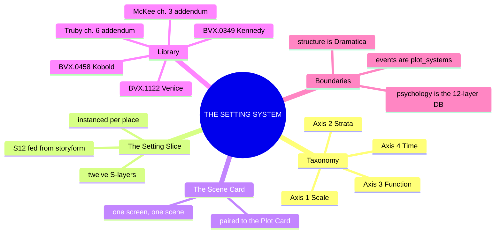
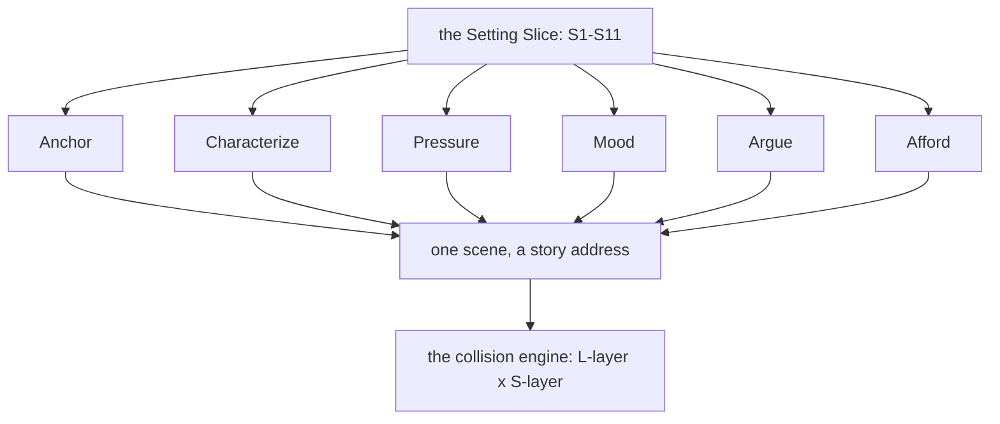
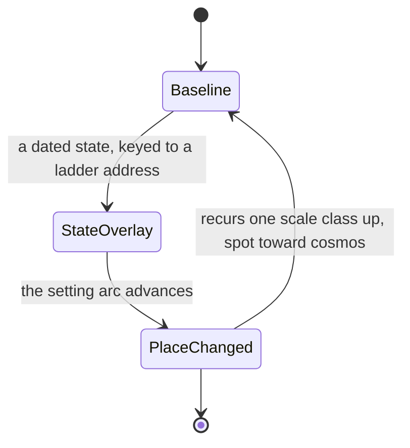

# 📐 SSOT: THE SETTING SYSTEM — place at character grade

**What this is:** setting promoted from backdrop to system — built B→A→instance per Chief's ruling: the **taxonomy** (what setting is), the **SETTING SLICE** (a 12-layer schema instanced per place, the architectural twin of the 12-Layer Character Database), the **SCENE CARD** (the notation slot reserved at ladder R2), and **DCUS instanced** as the proof of rig.

**Touchstones:** read [the Touchstones register](../01_NARRATIVE_FRAMEWORKS/📐%20ssot_01_touchstones_register.md) first.

**Root claim:** setting is the **pressure field** — the total state of the world at a story address, exerting force on every unit of the ladder. In spine terms: setting is where the argument becomes matter — a Domain embodied. A place that pressures nothing is scenery, not setting.

---

## MIND MODELS

**Diagram 1, the whole system on one screen.**



**Diagram 2, the central mechanism: the pressure field.**



**Diagram 3, the recurring engine: the setting arc.**



*Diagram 3 draws the setting arc (Axis 4), not the fill rule: the doc gives the arc a live instance (DCUS[M1] → DCUS[M4]) to diagram, while the fill rule is a policy note about depth, not a mechanism. The SETTING SLICE stays the same schema across every state; only its S12 FUNCTION record moves.*

---

## PART B · THE TAXONOMY — four axes

### Axis 1 · SCALE — places nest (rhymes with the ladder's 8 rungs)

spot → room → site → locale → settlement → region → world → cosmos

Every slice declares its scale class and its parent/child places. Address form: `DCUS.campus.hall3.room12`. A scene (ladder R2) plays on some span of setting scale exactly as it sits at some ladder address.

### Axis 2 · STRATA — what a place is made of

The twelve layers of the slice (Part A). Derived from the holdings: Buckham's active-setting functions, the worldbuilding shelf's category sets (Kobold/GURPS gazetteer structure — the TTRPG scaffolding Chief called), narratology's space/description theory (Bal, Chatman).

### Axis 3 · FUNCTION — what setting DOES (Buckham-derived deployment modes)

| Mode | The setting is... |
|---|---|
| **Anchor** | orienting — reader knows where/when they stand |
| **Characterize** | revealing — the room tells who lives in it |
| **Pressure** | opposing — obstacle, constraint, danger |
| **Mood** | emotional weather — valence before a word of dialogue |
| **Argue** | thematic — the place makes the story's argument in matter |
| **Afford** | action surface — what the space permits/forbids (fight, chase, hide; games call it level design) |

A scene deploys one or two modes deliberately; all six at once is noise. The SCENE CARD records which.

### Axis 4 · TIME — baseline and states (the setting arc)

A slice is the **baseline**; **states** are dated overlays keyed to ladder addresses. The *setting arc* (thread, Module 1) is the sequence of states: `DCUS[M1] → DCUS[M4]`. Mirrors the character state architecture in 02. This is how a place "evolves over the plot."

The full state architecture — base slice vs. state diffs, checkpoints and story points, the state record format, the DCUS rename lattice as the first instance — lands in [🔮 ssot_03_setting_state_architecture.md](🔮%20ssot_03_setting_state_architecture.md) (BOLO 90 step 3); the time code and the two rulers it dates against live in [📐 ssot_08_tracking_system.md](../08_TRACKING_SYSTEMS/📐%20ssot_08_tracking_system.md).

---

## PART A · THE SETTING SLICE — twelve layers, mirror of the character stack

Same architecture as the 12-Layer Character Database: surface → depth → structural function, S12 fed independently from the storyform exactly as L12 FUNCTION is fed from the Dramatica ingest. **Layer names RULED 2026-09-29 as they stand** (Chief, "I'll recommend"; house coinage, held through two waves and 42 distills).

| Layer | Name | Holds | Mirrors |
|---|---|---|---|
| **S1** | **BODY** | physical fabric: geography, terrain, architecture, dimensions, materials, layout; **border/seam sub-field** — a rated permeability between adjacent zones, the mechanism that lets incompatible terrain, genre, or era share one setting; **seam type `passageway`** — Truby's liminal threshold between subworlds, crossing it changes which rules bind (a rules change on crossing, noted on the SCENE CARD when a scene crosses one) [[BVX.1181]] [[BVX.0630]] [[BVX.1177]] [[BVX.1179]]; **`border_type`** — natural, national, contractual, or buffer, with the history that drew the line [[BVX.1161]] [[BVX.1146]] [[BVX.1141]] [[BVX.1137]]; the habitat limits what a culture builds [[BVX.1165]]; **`boundary_kind`** — border (divides two domains) or boundary (rings one) [[CRE.08]] | L1 CORE |
| **S2** | **WEATHER** | climate, seasons, light, temperature, atmosphere; the place's rhythms (day/night, tides, terms); the climate band sets a culture's temperament [[BVX.1163]]; **`climate_band`** — the band the place sits in, which sets a culture's temperament; **`seasons`** — the yearly cycle, with its temperature and atmosphere; **`light`** — how the place is lit across day and year; **`rhythms`** — the recurring cycles: day/night, tides, terms | L2 VITAL |
| **S3** | **SENSORIUM** | how it meets the senses: soundscape, smellscape, texture, palette — the presentation surface; **`governing detail`** — one defining sensory factor (canals, fog, a smell) that the rest extrapolates from; draft in sight, sound, and smell only, never what a character feels; concretize privately, then broadcast mood through color, sound, or word choice; links to the SCENE CARD `sensorium` line, three details max; measured physical facts (street width, wall thickness, lantern spacing) may be borrowed as texture [[BVX.0479]]; surface wear and patina [[BVX.0405]] [[BVX.0530]] [[BVX.1144]] [[BVX.1157]] [[BVX.1165]] | L3 SOCIAL |
| **S4** | **LAW** | the rules that bind: governance, institutional mechanics, permission/forbiddance systems; **`dials`** — five entries: (1) density, how many officials answer a crisis (low, mid, high); (2) ruling class; (3) source of legitimacy; (4) enforcer; (5) banned list, the categories forbidden at each severity step, priced out, never "strict"; **`material context`** — frontier or core, distance from help, how fragile the habitat is; government type and internal system are logged separately [[BVX.1140]] [[BVX.1146]] [[BVX.1158]] [[BVX.1159]] [[BVX.1161]] [[BVX.1162]] [[BVX.0405]]; **`strained_leg`** — coercion, capital, or legitimacy, whichever carries the most load now [[BVX.1162]] [[BVX.1161]]; **`power_mode`** — enclosure (one place, one rule, an outside exists) or modulation (everywhere, continuous, no outside); **`access_form`** — watchword (a rule to be understood) or password (works or fails) [[BVX.1151]] [[BVX.1152]] [[BVX.1155]]; visible score devices and compliance built into the division of labor [[BVX.1152]] [[BVX.1155]]; each rule carries a modality, a stated-volume, and a deviation outcome (PART A rules) [[BVX.1147]] [[CRE.09]] | L4 WILL |
| **S5** | **SCAR** | damage in the fabric: ruins, erasures, renames, sanded-off strata, what was demolished; **cross-ref S9** — one rupture can generate both the wound and the promise in a single causal move [[BVX.0575]] [[BVX.0822]]; **`record`** — five entries: (1) what it was; (2) what it cost per year to keep; (3) how it fell, by a named mechanism (upkeep stopped paying, information lost, single-resource dependency); (4) who has used it since; (5) why it is not picked clean; **`repeats_at`** — the smaller scales where the same wound recurs; an entry missing a builder or a fall trips RUIN_INERT [[BVX.1140]] [[BVX.1143]] [[BVX.1160]] [[BVX.1146]] [[BVX.1139]] [[BVX.1141]] [[BVX.1157]]; ruin damage may stay partly unexplained [[BVX.1165]]; each entry may carry `overwritten_by` and `trace_kept` (yes or no): was the old writing left visible on purpose [[CRE.08]] | L5 WOUND |
| **S6** | **ECONOMY** | what fuels it: resources, money, flows, traffic, who feeds and powers it; **`position`** — core, semi-periphery, or periphery, read as a process that can flip across states [[BVX.1161]] [[BVX.1162]] | L6 DRIVE |
| **S7** | **FOUNDING** | origin: who built it, why, the founding stack, the deep history; **present-tense-bite test** — a founding line counts as active canon only if it still bites *now*, checked with the grammar test of a car racing now versus a car that had already raced [[BVX.1190]]; **`founding_type`** — conquest, inheritance, or alliance; **`capital_type`** — organic, primate, or relocated, with the reason the seat sits there [[BVX.1162]] [[BVX.1161]]; a three-beat founding [[BVX.0399]]; for a religion, the symbol-to-literalism arc may shape the origin story [[PHI.02]] | L7 ORIGIN |
| **S8** | **HABIT** | attachment architecture: the patterned life — rituals, routines, belonging gradients, insider/outsider; **`reason_remembered`** — yes, partly, or no; a custom marked `no` that still binds behavior trips REASON_LOST [[CRE.09]]; the place's incorporation strategy toward newcomers (destroy-or-tribute, co-opt, assimilate) [[BVX.1162]] [[BVX.1161]]; up to three gauges (PART A rules) [[BVX.1156]] [[BVX.1139]]; self-tracking as belonging [[BVX.1152]] [[BVX.1155]]; locals, mobals, and globals as the insider/outsider gradient [[BVX.1163]]; a home base needs a named contact per civic function [[BVX.0479]]; **`price`** on each belonging tier — `{criterion: a testable test for belonging, cost: what a member gives up, witness: one named member who pays it}` [[BVX.1170]] | L8 IMPRINT |
| **S9** | **ALLURE** | the place's erotics: what it promises, what draws people in, its glamour and seduction; **cross-ref S5** — the same rupture that wounds a place can be the source of its promise [[BVX.0575]] [[BVX.0822]]; **`promise`** — what the place offers those who enter; **`draw`** — what pulls people in; **`glamour`** — the seduction on its surface; **`source_rupture`** — the S5 rupture that generates the promise | L9 EROS |
| **S10** | **UNDERSIDE** | what it represses: hidden zones, the unspoken, basements literal and social, what surfaces under pressure; **three tiers** — public (stated) / folk (known informally, unstated) / secret (buried, recoverable under pressure), sharper than the old binary public/personal split [[BVX.1184]] | L10 SHADOW |
| **S11** | **VECTOR** | trajectory: where the place is going — bloom, rot, collapse, redemption; feeds the setting arc; **optional forward-ledger sub-field** — dated future states fixed before they land (a dissolution date, a damage-status field) [[BVX.0362]] [[BVX.1176]] [[BVX.0387]] [[BVX.1184]]; **`phase`** — rising, plateau, declining, or past-disintegration, from the marginal-return curve; **`vacuum`** — yes or no, is a peer polity ready to absorb the place, which makes the fall slow instead of sudden [[BVX.1160]] [[BVX.1162]] [[BVX.1161]] [[BVX.1164]] [[BVX.0465]]; each state record carries a one-line `tone` (Light or Dark), judged after the fact and open to dispute; up to three gauges (PART A rules) [[BVX.1156]] [[BVX.1139]]; an escalation ceiling on faction war [[BVX.0399]] | L11 DESTINY |
| **S12** | **FUNCTION** | storyform binding, fed from the spine, independent of S1–S11: which throughline Domain the place embodies, its argument role, its charge; **conflict level** — McKee's altitude (subconscious · personal · institutional · environmental), read here as how high the place's pressure reaches, not a fifth axis (SCALE nests space, this reads force); **tone → mechanic sub-note** — a tone claim counts only once converted to a checkable mechanic, beside `commandments` on the SCENE CARD [[BVX.1184]] [[BVX.1170]] [[BVX.1185]] — **and its `touchstone` set** (place-scoped Touchstones, e.g. Ecclesial Laws; mirrors L12's `touchstone` field); **`contradiction`** — the real-world tension this arrangement lets an audience stop worrying about; **`salient surplus`** — the one element with no real-world correspondent, which carries the argument; a place with neither is scenery [[BVX.1164]] [[BVX.0100]]; **`link`** — `{character_id, kind: none | political | direct | metonymic}`, a ruler or protagonist tied to the place's condition; a direct or metonymic link seeds the collision engine [[CRE.08]] | L12 FUNCTION |

**Slice header (machinery, not a layer):** `place_id` · names/aliases (the rename lattice) · scale class · parent/child places · canon node link · state track (dated overlays per Axis 4) · `job` (the in-world function that makes the place legible: research, mining, instruction, extraction) · `dramatic role` (stage, repeated visit, or sound stage; it sets the depth of fill) [[BVX.1157]] [[BVX.1146]] · `adjacent` (neighbors listed with travel cost, time or price, not distance) [[BVX.1161]] [[BVX.1146]] [[BVX.1141]] [[BVX.1137]] · `canon_tier` per fact: core (narrated), semi (ruled, not yet onstage), or fringe (drafts, house rules, discarded ideas, kept, never deleted) [[BVX.0504]] [[BVX.0562]] [[BVX.0530]] · `real_anchor` (dynamic) — `{source, as_of date, categories kept (not just the total)}` for a place built on a real jurisdiction [[BVX.1128]]. For a real place, S4 LAW records the legal categories and S8 HABIT records the lived scene as two separate readings.

**Binding rule (mirror of the character-storyform binding):** a place that embodies a throughline Domain gets an S12 record per storyform, keyed by `storyform_id`. Places without argument roles (mere locations) may run S1–S11 only — S12 empty is legal; S12 filled is what makes a setting *load-bearing*.

**Fill rule (answers Kennedy, BVX.0349; RULED 1.4.0):** every place starts thin. Fill a layer only when a scene's pressure needs it; the header plus S12 (or the header alone, for a mere location) is a complete slice. A full twelve-layer fill is the encyclopaedic trap, not the goal.

**S12 working rule (TAW/TRW discipline):** only what's actually narrated is canon for a place's binding clause — a fact stays out of the S12 record until a scene puts it onstage [[BVX.0538]].

### PART A rules (added 1.9.0, RULED 2026-10-04)

**Fill rule, gap status** [[BVX.0100]] [[BVX.1147]] [[BVX.1137]]. Each detail carries one status: explicit (stated), implicit (implied), or gap (left blank on purpose). A gap stays a gap until a scene needs it. Then the writer rules a "small miracle" on the spot. It must agree with everything established. Where the past is unsettled, list two or three candidate pasts. Fix none until a scene needs one. The parked ⏸ marks are gaps with a named home.

**Canon tier and continuity** [[BVX.0504]] [[BVX.0562]] [[BVX.0530]]. A contradiction in the main storyline is fatal. A contradiction in background mechanics is tolerated and logged. One custodian keeps the continuity record. Fringe material is kept, never deleted.

**S4 codex sort** [[BVX.1147]] [[CRE.09]]. Tag each S4 rule with a modality: permitted, prohibited, or obligatory; or valued or known. Tag it with a stated-volume: formal, informal, or unspoken. Stated-volume is a separate axis from the S10 tiers. Record the outcome shape when a character deviates: fall (punished), test (rewarded), or predicament (unresolvable). A deviation scene then has a menu of outcomes before it is written.

**Gauges** [[BVX.1156]] [[BVX.1139]]. A place may carry up to three named gauges, such as belonging, crisis, or dread. Each declares a floor, a ceiling, and the effect at each rung. A state diff writes the tick. The flag GAUGE_AT_LIMIT watches the ends.

**Derivation check** [[BVX.1144]] [[BVX.1158]] [[BVX.1166]] [[BVX.0562]]. Run four checks. (1) Every settlement or fortress names its reason: water, food, resource, route, or choke point. (2) Every S6 resource or trade good traces to an S1 feature or an S4 rule. (3) Every invented rule has a cost and a limit, kept every time. (4) One changed variable is propagated across the other layers. When starting cold, fill in this order: S1, S2, S6, S4, S8, S7. Every filled layer closes on one character it touches. A layer that traces to nothing is scenery.

**Build order, premise ripple, derivation chain (1.10.0)** [[BVX.0480]] [[BVX.1180]] [[BVX.1188]]. Three construction checks.
(a) Build order: fill S1 first. Then S6 and S8 as derived from it. Then S4 and S7. Real physics bounds the invention. A departure from physical sense needs a one-line reason on the slice.
(b) Premise ripple: when a place rests on one premise, write one line per filled layer saying what the premise changes there. Stop at the layers a scene needs. The displaced old order leaves visible residue.
(c) Derivation chain: for a culture slice, write its means of living first (hunted, grown, mined, salvaged, synthesized). That then sets the S8 belonging rules and the S4 authority form.

---

## THE SCENE CARD — the R2 notation (slot reserved in the ladder, delivered here)

One card per scene. Ten fields, one screen:

```
SCENE CARD
address:        OXO.primary.M2.q3.s12        (ladder address)
setting:        DCUS.campus.hall3 @ state M2  (slice + state)
active strata:  S3 SENSORIUM · S4 LAW         (which layers are working)
function mode:  Pressure + Mood               (Axis 3, max two)
sensorium:      3 details max                 (Buckham's telling-detail discipline)
commandments:   II / TP / CR / CL / RES       (Coyne's five, one line each)
value turn:     safety + → −                  (McKee; no turn, no scene)
duration:       scene | summary | stretch | pause | ellipsis   (Genette)
telling:        voice + focalization for this scene            (per-scene override of the Telling Profile — Module 3)
threads:        tori.arc · rs.rivalry         (what advances through this container)
touchstones:     in-scope set, checked          (a breach means the scene is wrong, not the Touchstone)
collision:      seeding row(s), e.g. L9×S9     (a scene seeded by no row should justify itself — Module 5)
exit state:     what is now true that wasn't  (feeds the next card)
notes:          exit rule by S4 power_mode · prompt bank on demand   (see below)
crossing:       steps   (optional; only where the scene's pressure needs a staged entry)   [[CRE.08]]
citation:       each actor's rule · who knows better   (theme: the citation test + knowledge gradient, 07, 10/4)
transcript:     public | hidden · what changes        (theme: the two-transcripts test, 07, 10/4)
```

The card is the working notation for plot_systems when it opens; until then it documents any scene worth pinning.

**SCENE CARD `crossing` note (1.10.0).** `crossing: steps` names a staged entry, such as a five-stage approach. The return is the real trial. The plot doc lets P1 pair an entry unit with its exit unit. The SEAM_CROSSING flag fires on the crossing. This note tells the writer how to stage it [[CRE.08]].

**SCENE CARD notes (1.9.0).** *Exit rule.* The S4 `power_mode` sets how the scene ends. An enclosure ends on a gate walked through. A modulation ends on a code granted or a rate moved [[BVX.1151]]. *Sensorium.* The `sensorium` line takes the S3 `governing detail` first, then two more details at most. *Prompt bank.* S8 and S4 lines draw on a prompt bank of question sets only when a scene asks. The writer never fills it in advance [[CRE.09]].

---

## THE SEQUENCE CARD — the R3 notation (added 2026-09-29, BOLO 90 step 7 trial)

RULED 2026-09-29 (Chief, "line up the recs"): the field trial that ran a real R3 SEQUENCE unit (the M2 grief-outburst montage) through THE SCENE CARD found no card built for that grain — the ten-field template assumes an R2 floor (one value turn, one pass of Coyne's five commandments) and had to be stretched to cover a run of scenes answering one dramatic question (`_tools/bolostatus/work/90/TRIAL-M2-grief.md`, WHAT BROKE 1). THE SEQUENCE CARD is the thin card that grain actually needs, a sibling of THE SCENE CARD, not a replacement for it — a sequence still bundles N scene-slots, each of which may carry its own SCENE CARD when a scene needs one.

One card per R3 SEQUENCE unit. Seven fields, one screen:

```
SEQUENCE CARD
address:            OXO.primary.M2.q1              (ladder address, R3 SEQUENCE)
sequence question:  the dramatic question this run answers, usually replaced by a worse one  (Axis 1, ssot_04_plot_system.md)
scene-slots:        s1, s2                          (N scenes bundled under this sequence; each may stay thin or carry its own SCENE CARD)
rolled-up turn:     value in → value out, one line for the whole run                (McKee, read at sequence grain, not per scene)
commandments:       II / TP / CR / CL / RES         (Coyne's five, read across all scene-slots — one line each, not one pass per scene)
threads:            what advances through this container            (shared field with THE SCENE CARD)
exit state:         what is now true that wasn't    (feeds the next sequence, or the first SCENE CARD after it)
```

THE SEQUENCE CARD does not carry `active strata`, `sensorium`, `function mode`, `telling`, `touchstones`, or `collision` — those stay per-scene, filled on a SCENE CARD for whichever scene-slot actually needs them. A sequence with no scene-slot pressured enough to earn its own SCENE CARD is legal; the sequence card alone documents it, the same thin-by-default discipline as PART A's fill rule. A sequence may carry an optional `test_phase` (contract, contest, or consequence) when its role in a test is in doubt; the field lives on P4 in [ssot_04_plot_system.md](../04_PLOT_SYSTEMS/📐%20ssot_04_plot_system.md) [[CRE.07]].

---

## THE FACTION / NATION CARD — companion notation to the SCENE CARD

Added 2026-09-29 (synthesis change 1, RULED): nine sources independently converge on the same bounded stat block [[BVX.0343]] [[BVX.1170]] [[BVX.1171]] [[BVX.1177]] [[BVX.1179]] [[BVX.1181]] [[BVX.1174]] [[BVX.0483]] [[BVX.1168]]. The card reuses the corporate-profile stat block [[BVX.0399]]. One card per faction, nation, or bounded institution — a stub is legal, depth is reserved for whatever the story actually visits:

```
FACTION / NATION CARD
name:                 the entity's working name
founding sentence:    one line — who built it, why                   [[BVX.0343]] [[BVX.1174]]
binding principle:    the one rule that holds it together             [[BVX.1170]] [[BVX.0483]]
government:           form + who actually holds it                    [[BVX.1171]] [[BVX.1168]]
economy tier:         one rung on a lifestyle-expense ladder          [[BVX.1174]]
border/seam rating:   how porous its edge is to an adjacent zone      [[BVX.1181]] [[BVX.1177]] [[BVX.1179]]
one secret:           the single thing not on the public face         [[BVX.1177]]
goal:                 one line, what it wants now                     [[BVX.1140]] [[BVX.1141]] [[BVX.1142]]
clock:                progress track, 4 to 8 ticks, named milestones  [[BVX.1140]] [[BVX.1141]] [[BVX.1142]]
quotable wound:       the named event members cite, linked to an S5 entry   [[BVX.1167]] [[BVX.1139]]
claimed vs rewarded:  what it says it honors vs what it promotes or punishes   [[BVX.1167]] [[BVX.1139]]
folk tier:            the S10 folk row: what members know and never state   [[BVX.1167]] [[BVX.1139]]
fault line:           the one condition that makes the binding principle fail   [[BVX.1182]] [[BVX.1179]]
drift:                dated change: what it does now vs what it was founded to do   [[BVX.1180]] [[BVX.1182]]
```

The 1.9.0 fields: `goal` is one line. `clock` advances one tick on a state diff at a checkpoint. A full card needs both. A stub may skip them. Without a goal the card describes a statue. The 1.10.0 fields: `fault line` is the single condition that makes the binding principle fail, or its founding contradiction. A stub may leave it blank. `drift` is a state-diff note, tagged dynamic. It gives every faction the question the Polder test asks of a ringed place. `quotable wound` and `claimed vs rewarded` give fighting style and red lines an origin, not a trope.

Fed mainly by S4 LAW, S6 ECONOMY, S7 FOUNDING. Depth call: a stub — founding sentence + binding principle + one secret — for any place the story doesn't center; the full card is warranted only where the story actually visits, per the synthesis's read of the tension between BVX.0343's eight-field NATION block and BVX.1177/BVX.1179's stub argument.

---

## THE POLDER TEST — for an enclosed place (RULED 2026-10-04, BOLO 87, "all recs")

From Ekman, *Here Be Dragons* (CRE.08). Four questions for a ringed place like DCUS. Run it only where a scene's pressure needs it (the fill rule: thin by default).

1. **The ring (S1):** is there a boundary, and what is it made of?
2. **The keepers (S4):** who maintains it, and by what right?
3. **The flood (S11):** what outside force would collapse it? S11 records it as a threat clock.
4. **The inside law (S4):** what rules hold inside that do not hold outside?

## SETTING FLAGS — starter set (RULED 2026-10-04, Chief "REC", BOLO 100)

Setting flags work like character flags. The place record computes each flag. Nobody assigns one. A flag takes one of four states: ACTIVE (condition met now), PENDING (met at a named story event), FIRED_PRE_STORY (met before story entry), INACTIVE (dormant). The character form is in `ssot_02_character_systems_vertical_slice.md`, "Flag Trigger Conditions". Setting scores few fields, so each trigger reads fields this doc already names: the S1 border/seam rating, the S10 tiers, the S5 `record` and S9 entries, the S8 gauges and `reason_remembered`, the S11 forward-ledger sub-field, the S12 record per `storyform_id`, and the SCENE CARD fields `setting`, `function mode` and `active strata`. A state diff re-evaluates every flag (state architecture, Rule 4).

**SEAM_CROSSING**
- Trigger: the SCENE CARD `setting` spans two zones, and the S1 border/seam sub-field gives that pair a rating.
- Signals a writer: crossing changes which rules bind. Note the rules change on the card, with seam type `passageway` where it applies.
- Layers: S1 BODY, S4 LAW.

**SCAR_ACCRETED**
- Trigger: a state diff adds an entry to S5 SCAR.
- Signals a writer: the place took new damage or a new erasure. The old entries stay on record (Rule 1a). Check S11 VECTOR for a shift.
- Layers: S5 SCAR, S11 VECTOR.

**WOUND_PROMISE_FUSED**
- Trigger: one rupture appears in S5 SCAR and in S9 ALLURE through the cross-ref entry.
- Signals a writer: the same event made the wound and the draw. A scene can play both at once.
- Layers: S5 SCAR, S9 ALLURE.

**UNDERSIDE_SURFACING**
- Trigger: a state diff moves an S10 UNDERSIDE fact one tier, from secret to folk or from folk to public.
- Signals a writer: a hidden fact is now easier to find. Pair it with a scene that shows how it surfaced.
- Layers: S10 UNDERSIDE, S5 SCAR.

**LEDGER_DUE**
- Trigger: the S11 forward-ledger sub-field holds a dated future state, and the checkpoint's time code reaches that date.
- Signals a writer: a state fixed in advance now lands. Write the new state diff at this checkpoint. The flag reads PENDING until the date arrives.
- Layers: S11 VECTOR, S5 SCAR.

**LOAD_BEARING**
- Trigger: the place has an S12 FUNCTION record keyed by a `storyform_id`.
- Signals a writer: this place carries a throughline Domain. Every scene set here deploys one or two Axis 3 `function mode` values on purpose.
- Layers: S12 FUNCTION, plus the S4 and S9 layers that carry the argument.

**RUIN_INERT**
- Trigger: an S5 SCAR entry has no builder or no fall in its `record`.
- Signals a writer: the entry is decoration. Add the cause, the cost, and who reused it, or cut it.
- Layers: S5 SCAR, S7 FOUNDING.

**GAUGE_AT_LIMIT**
- Trigger: a declared gauge sits at its floor or its ceiling.
- Signals a writer: the effect of the end rung now applies. Play it in the next scene set here.
- Layers: S8 HABIT, S11 VECTOR.

**REASON_LOST**
- Trigger: an S8 custom has `reason_remembered: no` and still binds behavior.
- Signals a writer: a belief outlives its cause. Run the present-tense-bite test on S7.
- Layers: S8 HABIT, S7 FOUNDING.

A story may add its own place flags in its instance file.

---

## THE FREEDOM-AND-RESTRICTION CLAIM — the dystopia mechanism (ruled 2026-09-16, genre OPEN 11; landed 2026-10-04)

Truby's dystopia mechanism is a touchpoint on S12 FUNCTION. It names the claim a genre's world makes about freedom and restriction. The world offers apparent choice. Hidden restriction sits underneath. The writer records the claim in one line on the S12 entry, keyed by `storyform_id`. P10 records which obligatory beat fires. P10 does not record this claim. This field does.

## THE INSTANCE — DCUS starter slice (proof of rig) — worked example (phase 2 fills)

Filled entirely from existing canon ([delta-coast-ultra-school.md](../../../../_CANON_NODES/delta-coast-ultra-school.md) + storyform §9 + handoff bundle). Starter depth — full instance lives with the canon node when Movements 2–4 open.

**Header:** `dcus` · names: Delta Coast Ultra School / "DCUS" / the Ultra School / *Red Hills Academy* (legacy) / *Skeeter Creek* (founding, buried) / *Inner Spiral Academy* (pre-ruling) · scale: **site (campus)** · parent: the Middle Bands, Delta Coast, tri-state Spiral (FL/AL/GA) · role: Setting / Institutional Antagonist Vessel, Movements 2–4 · `job` · `dramatic role` · `adjacent` · `canon_tier` · `real_anchor` ⏸ DCUS faction fill pass (phase 2).

| Layer | DCUS |
|---|---|
| S1 BODY | century-old Southern prestige campus, Delta Coast; Middle-Bands address ("Inner Spiral" reverting to geography per provisional tissue) `border_type` · `boundary_kind` ⏸ DCUS faction fill pass (phase 2) |
| S2 WEATHER | Gulf-South heat, humidity, and hurricane season (June–November); Southern Gothic light under the live oaks, gold in M1 and the Feed's glow by M2–4 (tracks S3 clean → NEON-ROT). **The cooled-building split (RULED 1.4.1):** Feed-conditioned interiors, the Gulf heat left outside for whoever doesn't rate a cooled building: class by budget line, not verdict (the controlling idea as climate). Storms are the one variable the Administration did not create. Arc: brochure weather (M1, Anchor + Mood) → a cost (M2–4, Pressure + Argue). Draft: `_tools/bolostatus/work/87/dcus/DCUS-S2-FACTIONS.md` |
| S3 SENSORIUM | Southern Gothic register (ruled) — old brick and moss carrying a retrofit: Feed-linked clothing glow; the six-movement palette descent **clean → NEON-ROT** `governing detail` ⏸ DCUS faction fill pass (phase 2) |
| S4 LAW | the Administration as depersonalized OS · Star-Rating · Sync Cult mechanics · Feed-linked clothing as enforced legibility `dials` · `material context` · `strained_leg` · `power_mode` · `access_form` · codex tags ⏸ DCUS faction fill pass (phase 2) |
| S5 SCAR | the rename lattice — **Skeeter Creek → Red Hills → DCUS**: erasure done twice; legacy students saying "Red Hills" commit a small legibility violation every time they speak `record` · `repeats_at` · `overwritten_by` · `trace_kept` (does each rename leave a trace, so saying "Red Hills" may be a violation) ⏸ DCUS faction fill pass (phase 2) |
| S6 ECONOMY | Bishop acquisition capital; prestige converted to product; the ownership war (grandfather vs son — sold for spoils *to the Bishops*) `position` ⏸ DCUS faction fill pass (phase 2) |
| S7 FOUNDING | 100+ years of private prestige; the founding name sanded to "Red Hills" a century before the Bishops arrived `founding_type` · `capital_type` ⏸ DCUS faction fill pass (phase 2) |
| S8 HABIT | alumni-legacy bloc vs Sync-era students; split faculty loyalties; the ritual life of the Star-Rating `reason_remembered` · gauges · incorporation strategy · tier `price` (the Star-Rating tiers) ⏸ DCUS faction fill pass (phase 2) |
| S9 ALLURE | **the meritocratic promise** — the exact premise Tori must stop believing (Growth: Stop); flagship-Ultra prestige; the Feed's glamour |
| S10 UNDERSIDE | the first name under the second (Movement 3's forensic mode); what the rebrand-as-Boot-Sequence overwrote; the disruption→collapse skeleton |
| S11 VECTOR | the six-movement descent: clean → NEON-ROT → hunt; collapse trajectory `phase` · `vacuum` · state `tone` ⏸ DCUS faction fill pass (phase 2) |
| S12 FUNCTION | `storyform_id: oxo_primary_v1` — **the OS Domain embodied: Situation / The Past.** Goal = The Past, story_cost = Memories: the campus IS personal history deleted for programming space, done to a place. The rebrand is the world's Boot Sequence at institutional scale. **Touchstone set: the Institutional Invariants (Ecclesial Laws)** — `THE_ADMINISTRATION.md`, place-scoped `contradiction` · `salient surplus` · `link` ⏸ DCUS faction fill pass (phase 2) |

**DCUS faction cards (RULED 1.4.1, 2026-09-29; Chief, "go, all recommendations").** Full cards for the two factions the story centers, stubs for the rest. **The Administration and the Bishops are two factions** (the owners buy the school; the system runs it without them; THE_ADMINISTRATION.md's "(The Bishops)" parenthetical reads as the Bishops being its instrument, not its identity).

```
FACTION CARD · THE ADMINISTRATION (full)
founding sentence:    ⏸ DCUS faction fill pass (phase 2) none canon; always-already the Spiral's operating layer, "the 10th House gone sterile"
binding principle:    legitimacy is issued, not earned (the Sacrament of Verification)
government:           church-state bureaucracy; the holder is unnamed, the "Silent Hand" acting through the Bishops
economy tier:         ⏸ DCUS faction fill pass (phase 2) apex / unrated: it controls legibility, not currency
border/seam rating:   near zero: to be Un-Verified is excommunication from the infrastructure of survival
one secret:           its plan covers logic, fear, and rebellion, but not the exhaustion hunt, Noise that outlasts it
goal · clock · quotable wound · claimed vs rewarded · folk tier · fault line · drift:  ⏸ DCUS faction fill pass (phase 2)

FACTION CARD · THE BISHOPS (full)
founding sentence:    bought Red Hills Academy when the son sold his father's century of prestige for spoils; rebranded it DCUS
binding principle:    the Ultra School as a chain; DCUS is the flagship (provisional tissue)
government:           private acquisition capital; Quinn Bishop runs "Administrative Fixes" for the Administration; ⏸ DCUS faction fill pass (phase 2) no fuller hierarchy canon
economy tier:         acquisition capital converting inherited prestige into product
border/seam rating:   high friction at the seam they made: saying "Red Hills" is a legibility violation
one secret:           ⏸ DCUS faction fill pass (phase 2) CONDITIONAL: the sale "for spoils" was an inside deal dressed as a rescue; in only if M2–4 want an ownership-war reveal
goal · clock · quotable wound · claimed vs rewarded · folk tier · fault line · drift:  ⏸ DCUS faction fill pass (phase 2)

(Stubs may skip goal and clock.)
STUB · the alumni-legacy bloc: descends from Red Hills' 100+ year student body · loyalty to the old name, carried in speech · ⏸ DCUS faction fill pass (phase 2) may hold oral memory of Skeeter Creek (Movement 3's forensic target)
STUB · the faculty split: carried over from the ownership war · ⏸ DCUS faction fill pass (phase 2) legacy old guard vs Sync-era hires · secret not yet drawn
STUB · the Sync Cult: ⏸ DCUS faction fill pass (phase 2) HELD until it has its own canon node (binding principle and secret are both proposals)
```

Benched: the dueling bells (the Red Hills bell tower against the Feed's period signal), until a scene needs a bell.

**The proof reads:** every layer filled from canon on the first try, one authorable gap surfaced (S2), and S12 snapped onto the storyform without force — the schema fits the house.

---

## SETTING × LIBRARY

`feeds:` for this limb: Buckham 0268/0269/0270 (Active Setting 1–3) + 0267/0056 → Axis 3 + S3 · Rozelle 0081, Hall 0288 → S3 craft · Alderson 0274 → scene card · Kobold 0458/0541, GURPS 0447, Collaborative Worldbuilding 0067 → Axis 2 strata + R7/R8 scale · Against Worldbuilding 0349 → the counter-argument (worldbuilding serves pressure, not inventory — the doc's own root claim) · Bal 0591/0596, Chatman 0167 → space/description theory (deepens in Module 3) · Once Upon a Pixel 0144, narrative-design shelf → Afford mode (environmental storytelling).

**Synthesis, 2026-09-29:** 42 further setting-shelf distills were folded against this system on 9/29 — [ssot_03_setting_synthesis.md](📐%20ssot_03_setting_synthesis.md) v1.0.0 has the full per-layer register, nine cross-book recurring methods, ten changes to the taxonomy and slice (changes 1, 2, 3, 4, 6, 7, 8, 9 RULED and applied; change 5 RULED 1.4.0 and applied; change 10 reaffirmed), the DCUS application, and four read contradictions. Headline: ten of twelve S-layers move from adequate to deep; S3 SENSORIUM clears its flagged-thin status; S2 WEATHER's method gap closes but the DCUS instance itself stays unwritten; S12 FUNCTION gets its first non-DCUS worked instance.

**Genre-contract tool, 2026-09-29 (synthesis change 8, RULED):** Ryan's nine-axis ontological scoring [[BVX.0630]] is the primary L7 genre-contract tool; Baur's five-lineage taxonomy (Kobold, [[BVX.0458]]) stays as shorthand only — BVX.0630's own frontmatter states it supersedes the five-lineage tool, a sharpening, not a new concept.

**Library pass, 2026-10-04 (BOLO 100, v1.9.0):** the 1.9.0 fields cite these distills (KNOWLEDGE_AREAS). BVX.0100 *Fictional Worlds* · BVX.0399 *Cyberpunk 2020 (Version 2.0)* · BVX.0405 *Dungeon Master's Guide (5th ed.)* · BVX.0465 *Microscope* · BVX.0504 *Role-Playing Game Studies: Transmedia Foundations* · BVX.0530 *Tabletop Role-Playing Games and the Experience of Imagined Worlds* · BVX.0562 *Building Imaginary Worlds* · BVX.1137 *Ultraviolet Grasslands and the Black City (2nd ed.)* · BVX.1139 *Shadows over Vathak Campaign Setting* · BVX.1140 *Worlds Without Number* · BVX.1141 *Stars Without Number: Revised Edition* · BVX.1142 *Cities Without Number* · BVX.1143 *The Ultimate RPG Game Master's Worldbuilding Guide* · BVX.1144 *Worldbuilding: From Small Towns to Entire Universes* · BVX.1146 *GURPS Space (4th ed.)* · BVX.1147 *Heterocosmica* · BVX.1151 *Postscript on the Societies of Control* · BVX.1152 *The Metric Society* · BVX.1155 *The Real World of Technology* · BVX.1156 *Kingdom: A Role-Playing Game About Communities (2nd ed.)* · BVX.1157 *Those Dark Places* · BVX.1158 *Traveller Core Rulebook (Update 2022)* · BVX.1159 *Dark Skies* · BVX.1160 *The Collapse of Complex Societies* · BVX.1161 *Political Geography (5th ed.)* · BVX.1162 *The Dynamics of Ancient Empires* · BVX.1163 *The Power of Place* · BVX.1164 *Science Fiction, Fantasy, and Politics* · BVX.1165 *Fantasy World-Building* · BVX.1166 *30 Days of Worldbuilding* · BVX.1167 *Routledge Handbook of Strategic Culture* · CRE.09 *How to Build a Culture* (Trevena, 2022) · CRE.07 *Structural Semantics* (Greimas, 1983; plot cite, see the plot doc). BVX.1138 and BVX.1154 were already covered.

**Library follow-up, 2026-10-04 (BOLO 100, v1.10.0):** BVX.0479 *Pathfinder Roleplaying Game Beginner Box: Game Master's Guide* · BVX.0480 *Pathfinder Roleplaying Game: GameMastery Guide* · BVX.1128 *Gay Travel Index 2026 (incl. USA-Index 2026)* · BVX.1170 *Classic BattleTech Total Warfare* · BVX.1179 *Freeport: The City of Adventure* · BVX.1180 *Pure Steam Campaign Setting* · BVX.1182 *NeoExodus: A House Divided Campaign Setting* · BVX.1188 *The Masks of God, Volume I: Primitive Mythology* · CRE.08 *Here Be Dragons: Exploring Fantasy Maps and Settings* (Ekman, 2013) · PHI.02 *Phallicism and Phallic Worship* (Blavatsky, 1888).

## TROPES

Added 2026-09-29 (BOLO 89). Every TV Tropes trope in the **setting** domain is keyed to S1–S12 in the [trope register](../01_NARRATIVE_FRAMEWORKS/📐%20ssot_01_trope_register.md). The pull list, every layer with every trope keyed to it, is [LAYERS.md](../../../../_tools/tropes/data/domains/LAYERS.md) under **setting**. Most land on S1 BODY (place types); S2 WEATHER holds only 3, a gap in TV Tropes, not in the slice.

## OPEN

**From the setting wave, 2026-09-16 (BOLO 18; distills BVX.0458 · 0349 · 1122 + the Truby/McKee addenda):**
- **What the trade cannot supply** (BVX.1122): a professional gazetteer fills BODY · LAW · ECONOMY · FOUNDING · HABIT · VECTOR richly, leaves WEATHER · SENSORIUM · SCAR · ALLURE · UNDERSIDE thin, and cannot fill FUNCTION at all. The Command's slice asks for exactly the layers the trade leaves out; that is the differentiation, and the cost.


**RULED 1.4.0, 2026-09-29:** passageway (→ S1 seam type) · McKee's conflict level (→ S12 reading) · Kennedy's fill rule (→ PART A) · tone-to-mechanic, change 5 (→ S12 sub-note) · the twelve layer names (ruled as they stand) · `03_SETTING_SYSTEMS/` placement (kept) — all closed.

**Parked (authoring, not calls):**
- ⏸ OXO scene-card fill pass (phase 2) — the BOLO 90 M2 grief trial already ran the card; the first real OXO scene fills it.

**Landed:**
- **Setting state architecture — landed 2026-09-29** (BOLO 90 step 3): [🔮 ssot_03_setting_state_architecture.md](🔮%20ssot_03_setting_state_architecture.md) — base slice vs. state diffs, checkpoints and story points, the DCUS rename lattice instanced as three checkpoints.

## Version history

- **1.10.2 — 2026-10-04.** Chief "rec" (BOLO 100, call D4): S2 WEATHER names `climate_band`, `seasons`, `light`, `rhythms`; S9 ALLURE names `promise`, `draw`, `glamour`, `source_rupture`. No tag change.
- **1.10.1 — 2026-10-04.** BOLO 100 TOUCH BATCH 1, Chief "REC.": field and scene-card line renamed (TS-B3); prose swapped (TS-B4); front-door line (TS-B10).
- **1.10.0 — 2026-10-04.** RULED by Chief ("rec", BOLO 100 follow-up, calls SE-1 to SE-7). PART A gains build order, premise ripple, and the derivation chain. The FACTION / NATION CARD gains `fault line` and `drift`. S1 gains `boundary_kind`. The SCENE CARD gains `crossing`. S5 gains `overwritten_by` and `trace_kept`. S12 gains `link`. S8 tiers gain `price`. The slice header gains `real_anchor`. Cites added: BVX.0479 (S3, S8), PHI.02 (S7). Instance fields parked as `⏸ DCUS faction fill pass (phase 2)`.
- **1.9.0 — 2026-10-04.** RULED by Chief ("rec", BOLO 100 library pass, calls S-L1 to S-L18). FACTION / NATION CARD gains `goal`, `clock`, `quotable wound`, `claimed vs rewarded`, and a folk-tier row. S4 gains `dials`, `material context`, `strained_leg`, `power_mode`, `access_form`, and the codex sort. S5 gains `record` and `repeats_at`. S6 gains `position`. S7 gains `founding_type` and `capital_type`. S8 gains `reason_remembered` and an incorporation note. S11 gains `phase`, `vacuum`, and state `tone`. S12 gains `contradiction` and `salient surplus`. S3 gains `governing detail`. S1 gains `border_type`. The slice header gains `job`, `dramatic role`, `adjacent`, and `canon_tier`. PART A gains gap status, canon tier, gauges, and the derivation check. The SCENE CARD gains a notes line. Three flags added: RUIN_INERT, GAUGE_AT_LIMIT, REASON_LOST. Instance fields parked as `⏸ DCUS faction fill pass (phase 2)`.
- **1.8.0 — 2026-10-04.** RULED 9/16, landed 10/4 (BOLO 100 genre cross-doc): the dystopia mechanism written as method, new section THE FREEDOM-AND-RESTRICTION CLAIM (genre OPEN 11). No schema change.
- **1.7.0 — 2026-10-04.** RULED by Chief ("REC", BOLO 100 setting batch 1): the proposal-mark legend is gone; the seven DCUS faction-card gaps are parked as `⏸ DCUS faction fill pass (phase 2)`; SETTING FLAGS starter set added (SEAM_CROSSING, SCAR_ACCRETED, WOUND_PROMISE_FUSED, UNDERSIDE_SURFACING, LEDGER_DUE, LOAD_BEARING), with the rule that a story may add its own place flags in its instance file; the scene-card field trial is parked as `⏸ OXO scene-card fill pass (phase 2)`; `applies_to` is now all IPs and THE INSTANCE is labeled a worked example. This doc is the head of the setting lattice; the state architecture and the synthesis are its modules.
- **1.6.0 — 2026-10-04.** RULED by Chief ("all recs", BOLO 87 wave 1): THE POLDER TEST added (Ekman, CRE.08); the SCENE CARD gains `citation` and `transcript` fields from the theme system's scene tests (07 v1.2.0).
- **1.5.0 — 2026-09-29.** RULED 2026-09-29, Chief: "line up the recs" (BOLO 90 step 7 trial). THE SEQUENCE CARD added right after THE SCENE CARD: a thin seven-field card for R3 SEQUENCE units (sequence question, N scene-slots, one rolled-up turn, commandments read at sequence grain, threads, exit state), closing the field trial's WHAT BROKE 1 gap. No taxonomy or slice change.
- **1.4.2 — 2026-09-29.** BOLO 90 step 3, setting state architecture landed as its own doc: [🔮 ssot_03_setting_state_architecture.md](🔮%20ssot_03_setting_state_architecture.md) — base slice vs. state diffs mirroring `ssot_02_character_state_architecture` v1.2 layer for layer, checkpoints and story points per `ssot_08_tracking_system`, and the DCUS rename lattice (Skeeter Creek → Red Hills → DCUS) instanced as the first three checkpoints. OPEN list's "Setting state architecture" bullet moved to Landed; Axis 4 TIME gets one sentence pointing at the new doc and ssot_08. No taxonomy or slice change.
- **1.4.1 — 2026-09-29.** RULED by Chief ("go, all recommendations"): DCUS S2 WEATHER filled (the cooled-building split kept); DCUS faction cards added under THE INSTANCE, the Administration and the Bishops ruled as two factions, the Bishops' secret conditional, the Sync Cult held, the bells benched. No schema change.
- **1.4.0 — 2026-09-29.** RULED by Chief ("I'll recommend"): the six OPEN calls closed as recommended. S1 border/seam gains the `passageway` seam type (Truby). S12 gains McKee's conflict level as a reading and the tone-to-mechanic sub-note (synthesis change 5, unbenched). PART A gains the fill rule (Kennedy): thin by default. The twelve layer names ruled as they stand; `03_SETTING_SYSTEMS/` placement kept.
- **1.3.0 — 2026-09-29.** RULED by Chief ("go on all those recs"): synthesis changes 1, 2, 3, 4, 6, 7, 8, 9 applied. THE FACTION / NATION CARD added as a companion notation to the SCENE CARD (change 1). S1 BODY gets a border/seam sub-field (change 3). S7 FOUNDING gets the present-tense-bite grammar test (change 2). S5 SCAR and S9 ALLURE cross-reference each other (change 4). S12 FUNCTION gets the TAW/TRW binding-clause working rule (change 6). S10 UNDERSIDE upgraded from binary to three-tier public/folk/secret (change 7). Ryan's nine-axis ontological scoring named the primary L7 genre-contract tool, Baur's five-lineage taxonomy kept as shorthand (change 8). S11 VECTOR gets an optional forward-ledger sub-field (change 9). Change 5 (tone-to-mechanic conversion step) BENCHED, moved to OPEN. Change 10 reaffirmed — thin-by-default stays the rule, no structural change.
- **1.2.0 — 2026-09-29.** Synthesis of 42 setting distills linked; proposed changes pending ruling. SETTING × LIBRARY section gets an additive paragraph pointing to ssot_03_setting_synthesis.md v0.1.0. No taxonomy or slice change.
- **1.1.0 — 2026-09-16.** MIND MODELS section added (three diagrams: the system, the pressure field, the setting arc) so TM 03 renders; `sources:` declared. No taxonomy or slice change.
- **1.0.0 — 2026-08-25.** Module 2 of the lattice, B→A→instance per ruling: four-axis taxonomy, 12-layer slice mirroring the character stack layer-for-layer, scene card delivered to its reserved R2 slot, DCUS instanced as proof.
