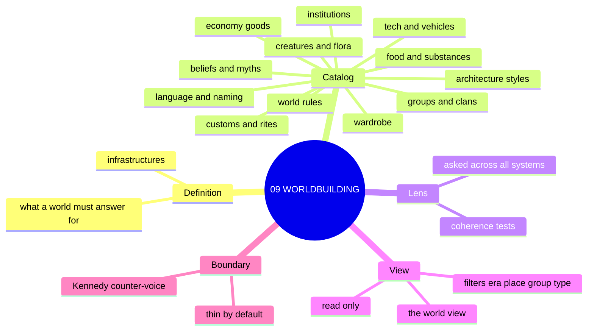
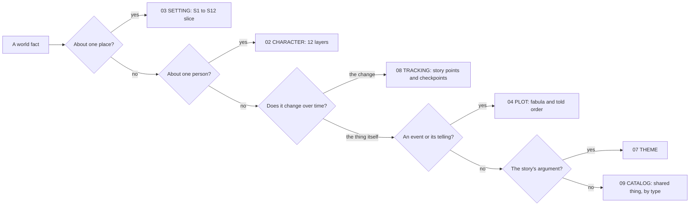
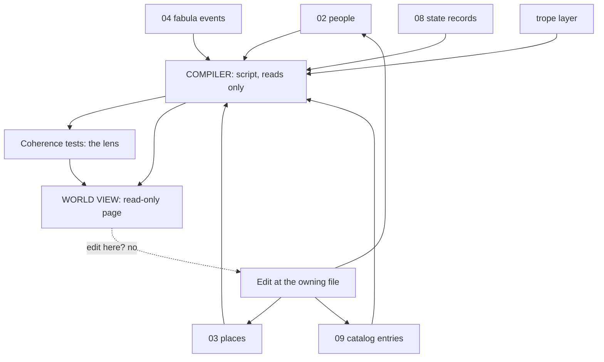

# 📐 SSOT: THE WORLDBUILDING SYSTEM — the world, defined once, built around a catalog

## What this is

This document says exactly what worldbuilding is in the Command. The Command already has systems for people (02), places (03), plot (04), theme (07), and state over time (08). None of them owns the shared things a world is made of: a clan, a style of building, a way of dressing, a vehicle, a custom, a school of thought. Those things sit between the systems and get lost. This system gives them one home, the **catalog**, and gives the world one set of rules to check against, the **infrastructures** and the **coherence tests**. A read-only page, the **world view**, compiles everything into one picture.

**Touchstones:** read [the Touchstones register](../01_NARRATIVE_FRAMEWORKS/📐%20ssot_01_touchstones_register.md) first.

**Root claim:** a world is the set of shared things plus the rules that make them fit. The systems that already exist keep what they own. Worldbuilding owns the shared things nobody else owns, and it reads the rest.

---

## THE DEFINITION

**Worldbuilding, in one sentence:** worldbuilding is the work of defining the shared things of a story's world (groups, styles, customs, tools, beliefs) and checking that they, and the places, people, and events the other systems hold, fit together as one world.

The books agree on this shape. They define it as building "a representation of a fictional world encompassing political and social forces, logistical questions of geography and economics" [BVX.0067], as "creating places, objects, characters, culture, and history" and "finding ways for concepts to exist in the same space" [NEW-ultimate-gm], and as asking detailed questions across nine areas whose parts "all interconnect" [NEW-anderson]. Every one of those lists mixes things that already have an owner in the Command (places, characters, history) with things that do not (culture, objects, groups, technology). The unowned half is the catalog.

### What this system owns

- **The catalog.** Entries for shared things, by type (see THE CATALOG). Data. Owned here.
- **The infrastructures.** The list of what a complete world has to answer for (see THE INFRASTRUCTURES). Reference, owned here.
- **The coherence tests.** The named checks run across the whole world (see THE COHERENCE TESTS). Owned here as a **lens** (they own no data; see vocabulary).
- **The world view.** The compiled read-only page. A **view** (see THE WORLD VIEW).

### What it does not own

| Thing | Owner | Why it stays there |
|---|---|---|
| Places, and the architecture of one place | 03 Setting: S1 BODY and the other eleven layers (ruled, v1.5.0) | 03 is "place at character grade." Places do not move out. |
| Individual people; a person's own outfit and habits | 02 Character (12-layer table) | A person's outfit is that person's record. |
| Anything that changes over time | 08 Tracking: "one store, many views" | Change is a record in 08. The catalog points to it and never copies it. |
| The order events happened and the order they are told | 04 Plot (fabula and told order) | The catalog entry's `origin` points to a fabula event. |
| The argument the story makes | 07 Theme | Theme is one argument, not a record of the world. |
| The list of stories | 01 registry (v0.1.7) | It lists stories, not things. It is not the catalog. |
| Tropes | The trope layer (BOLO 89) | A layer across every system. Catalog entries carry a `tropes` field that points at it. |

### How it relates to each system

| System | Relation | Direction |
|---|---|---|
| 01 Narrative | Registry lists stories; an entry's places and eras tell which stories it touches. | reads |
| 02 Character | A person belongs to a group in the catalog; the person's outfit and habits stay in 02. A group's style and customs live here. | catalog is pointed at by 02 |
| 03 Setting | Places name the styles and groups found there; the faction card notation stays in 03 (see OPEN 3). The catalog never restates a place's slice. | two-way pointers |
| 04 Plot | Each entry's `origin` names a fabula event. | catalog points to 04 |
| 05 Operations | Checked 9/29 by the CDR: owns procedures and registries, no world-fact type. It runs the compiler as a procedure. | none |
| 06 Style | Checked 9/29 by the CDR: 06.1 prose · 06.2 documents · 06.3 pages; no world-fact type. How a world thing is written up follows 06.1. | none |
| 07 Theme | The coherence lens asks whether mechanics, environment, and narrative reinforce the same theme [BVX.0144]. Theme owns the answer. | lens asks 07 |
| 08 Tracking | Every change over time is a 08 record. Entries hold a pointer, `state`. 08 holds a reader track per character in §9A; the catalog does not copy it. | catalog points to 08 |
| Trope layer | Every entry carries `tropes`; the register owns the trope. | catalog points to layer |

### Vocabulary (ruled 9/29)

**RULED 2026-09-29** (OPEN 1, "Adopt"); recorded in SOP §5.

- **System**: owns its data. 02, 03, 04, 07, 08, and this one.
- **Layer**: owns data that attaches across systems. The trope layer.
- **Lens**: owns no data. It is a set of questions asked across every system; the answers live where they belong. The coherence tests are a lens.
- **View**: a read-only arrangement of records other files own. The world view is a view. The plot workspace's "Fabula lens" and "Told lens" are views by this rule (see OPEN 2).

### The plain verdict

The books do not support calling all of worldbuilding one thing. Tested against them, it splits three ways:

1. **The catalog is a system.** It is data with no other owner. Nothing in 02 to 08 holds a clan, a dress code, or a vehicle.
2. **The coherence tests are a lens.** Every test in the books is a question asked across parts: "Do all four pillars work together?" [BVX.0067], "Would settlements arise where they do for logical reasons?" [NEW-anderson]. None stores anything. Answers belong to 02, 03, 08, and the catalog.
3. **The compiled page is a view.** It arranges records that live elsewhere.

So system 09 is a system because of the catalog. The lens and the view ride on it. If the catalog were dropped, 09 would be a lens and nothing else.

---

## MIND MODELS

**Diagram 1, the whole system on one screen.**



**Diagram 2, the owner map: which system owns which kind of world fact.**



**Diagram 3, the compile flow: every system plus the catalog into the world view.**



---

## THE INFRASTRUCTURES

An **infrastructure** here is one of the areas a complete world must be able to answer for. The list is the organizing model: it tells the compiler what to look for and tells the author what a world is missing.

**Sourcing note.** The brief expected Mark Wolf's infrastructures (BVX.0562, BVX.0575, BVX.0630) to be the spine. The shelf extraction does not contain Wolf's infrastructure list. PS-A gives Wolf's three mechanisms (Invention, Completeness, Consistency) and four realms (nominal, cultural, natural, ontological) from BVX.0562, and a nine-axis scoring from Ryan in BVX.0630. Wolf's own list is therefore not cited here. The check of BVX.0562 is closed in OPEN 8. The spine below is built from what the extraction does show. Nine sources list the same areas independently.

**Convergence check.** Anderson's nine [NEW-anderson], the four structures [BVX.0067], the six-part list [BVX.0144], the blueprint list [NEW-blueprint], the culture list [NEW-101prompts], and Tremblay's list [NEW-tremblay] all cover the same ground under different names. The table merges them into ten infrastructures. Column "Home" says where the data lives, not where it is discussed.

| # | Infrastructure | What it answers | Sources | Home |
|---|---|---|---|---|
| I1 | **Space** | Geography, climate, terrain, borders, settlements | NEW-anderson (Geography, Climate); NEW-tremblay (Geography); NEW-101prompts (Geography); BVX.0458 (nation-first terrain order); BVX.0480 (five-step terrain order); BVX.1161 (sovereignty and boundary types) | **03** S1, S2 |
| I2 | **Time** | History, founding, ruins, genealogy, events | NEW-anderson (History); NEW-pyramid341 (Historical Events); BVX.0458 (History and genealogy); BVX.0465 (bookend history); BVX.0405 (ancient ruins) | **04** events, **03** S5 S7, **08** change |
| I3 | **Peoples and groups** | Who lives here; clans, classes, factions, species, social divisions | NEW-tremblay (People); BVX.0144 (Peoples/Races); NEW-pyramid341 (Internal and External Actors, Social Divisions); BVX.0067 (Social Relations); BVX.0480 (society archetypes); BVX.1156 (Touchstone and Roles) | **09 catalog** (groups); **02** (individuals) |
| I4 | **Governance and law** | Who rules, by what right, how enforced | BVX.0067 (Governance); BVX.0405 (Forms of Government); BVX.0480; BVX.0458 (binding principle); BVX.1162 (coercion, rule-making, consent); BVX.1161 (sovereignty) | **03** S4 (place), **09 catalog** (institution forms) |
| I5 | **Economy and material life** | Trade, goods, money, food, subsistence, work | NEW-anderson (Economics); BVX.0067 (Economics); BVX.1138 (Trade Goods); BVX.0141 (Money, Food systems); BVX.1161 (core and periphery); BVX.0562 (completeness audit) | **03** S6 (place), **09 catalog** (goods, food) |
| I6 | **Belief, myth, and thought** | Religion, cosmology, philosophy, values | NEW-anderson (Religion); NEW-blueprint (Religion, Mythology, Philosophy; Values and Ethics); NEW-101prompts (Metaphysics); BVX.0141 (folk beside orthodox); BVX.0405 (mystery cults); BVX.1138 (Masks doctrine) | **09 catalog** |
| I7 | **Custom and belonging** | Rites, festivals, taboos, dress, daily habit | NEW-ultimate-gm (Culture); NEW-101prompts (Culture: customs, taboos, holidays); NEW-pyramid341 (Festival and Ceremony); BVX.0141 (Rites of passage, Wardrobe); BVX.0562 (custom-word as belonging); BVX.1165 (Wardrobe) | **09 catalog**; **03** S8 (a place's habit) |
| I8 | **Knowledge, craft, and technology** | Science, tech level, tools, transport, language, arts, education | BVX.0144 (Science/Technology, Languages); NEW-tremblay (Technology or Magic); NEW-blueprint (Science, Technology); NEW-anderson (Intellectual, Arts); NEW-101prompts (Technology: transportation, communication) | **09 catalog** |
| I9 | **Nature** | Flora, fauna, ecosystem, non-human beings | NEW-tremblay (Creatures and Ecosystem, Flora); NEW-blueprint (Fictional Beings); NEW-101prompts (Biology); BVX.1165 (Habitats as raw material) | **09 catalog** (kinds); **03** S1 (where) |
| I10 | **World rules** | Magic, physics, causality: how the world departs from ours | BVX.0630 (nine ontological axes); BVX.0562 (four realms of invention); NEW-101prompts (Fantasy conceits and analogue cultures; Physics/Magic); NEW-ultimate-gm (Magic: source, cost, potency) | **09 catalog** (rules) |

**Two dials that sit across all ten** (not infrastructures; measures):

- **Departure dial.** How far each infrastructure departs from our world: nominal, cultural, natural, ontological [BVX.0562], scored on nine axes as same, augmented, or different [BVX.0630]. Fantasy conceits are the departures; analogue cultures are the real-world baseline the audience carries in [NEW-101prompts].
- **Scale ladder.** World-economy, nation-state, locality [BVX.1161]. Pressure comes from one rung; the dial says which.

**What the extraction does not support as a separate infrastructure:** "Stars and Planets" [NEW-blueprint] is a place at S1 scale, so it goes to 03. "Urban Fantasy and Paranormal Romance" [NEW-blueprint] is a genre choice, not a world area, so it goes to the departure dial. "Game Mechanics" and "Audio-Visual Design" [BVX.0144] are for games; Audio-Visual maps to S3 SENSORIUM in 03; Game Mechanics is dropped.

**Method the infrastructures use:** bricolage. Pick underlying principles from real sources, combine them, transform the surface [BVX.0141]. Two build orders exist: top-down and bottom-up [NEW-blueprint]. Order matters: geography before culture [BVX.0458].

---

## THE COHERENCE TESTS

A **coherence test** is a named check stated so a reader or script can pass or fail it. The tests are a lens: they own no data. "Runs as" says whether the compiler can check it by script (S) or a person checks it by reading (R).

| # | Test | Rule, as checkable | Runs as | Source |
|---|---|---|---|---|
| CT1 | **Four pillars** | The world has at least a stub for governance, economics, social relations, and cultural influences, or an explicit "none by design." | S | BVX.0067 |
| CT2 | **Geography feeds economy** | Every economy line for a place names a resource the place supplies; every catalog building style names the habitat material it uses. | R | NEW-anderson; NEW-blueprint; BVX.1165; BVX.0480 |
| CT3 | **The gap-fill** | Every institution entry names the rupture or need it fills, and that rupture is a fabula event or a S5 SCAR. | S | BVX.0575 |
| CT4 | **Apocalypso** | Every ruin (S5) has a dated fall on the timeline, and every dungeon-like ruin has a builder. | S | BVX.0458; BVX.1137; BVX.0405 |
| CT5 | **Bookends** | Each place or group has a founding endpoint and a current endpoint; mid-history sits between them without contradiction; a founding line counts only if it still bites now (present-tense-bite, S7). | S | BVX.0465; ssot_03 S7 |
| CT6 | **Legitimacy** | Every governing entry states coercion, rule-making, and consent, or says which is missing. | S | BVX.1162 |
| CT7 | **Departure consistency** | Each departure from our world is scored on the nine axes once, and applied the same way wherever it appears. | R | BVX.0630; BVX.0562; NEW-101prompts |
| CT8 | **Distinctiveness** | An entry used in a scene either exerts pressure there or is marked scenery. Quality is distinctiveness, not volume. | R | BVX.0349; NEW-tremblay |
| CT9 | **Onstage canon** | A fact enters canon for a story's binding clause only when a scene narrates it. | S | BVX.0538 |
| CT10 | **Compossibility and retcon cost** | A new entry is checked against existing entries for whether both can hold; a change to a narrated entry is logged as a retcon with its cost. | R | BVX.0630 |
| CT11 | **Reinforcement** | Mechanics, environment, and narrative point at the same theme and tone. Answer lives in 07. | R | BVX.0144; BVX.0349 |
| CT12 | **Honest consequence** | When a rule or entry is in play, its consequences run as stated, not bent to convenience. | R | BVX.0530 |
| CT13 | **Scale source** | Every pressure names the rung it starts at: world-economy, nation-state, locality. | S | BVX.1161 |
| CT14 | **Referential density** | The world is dense at the center of the story and fuzzy at the edge; it feels whole without being complete. | R | BVX.0100 |
| CT15 | **What a character knows** | A character knows only history relevant to that person; a peasant does not recite royal genealogies. Owner: 02. | R | NEW-anderson |
| CT16 | **Tension generator** | The world's systems create built-in pressures a scene can use. | R | NEW-tremblay |

**Mechanic-only rule.** A test that cannot be turned into a checkable statement is not run. Tone claims follow 03's tone-to-mechanic sub-note.

---

## THE BOUNDARY

The books that teach building also warn against building too much. Every warning below is a limit on this system.

| # | Warning | Source |
|---|---|---|
| B1 | Never add a date without a good reason; a date binds you to get it right forever. | BVX.0349 |
| B2 | Never take the reader all the way; withholding creates allure, over-specifying destroys it. | BVX.0349 |
| B3 | Kennedy's counter-voice: encyclopaedic inventory rewards the wrong thing; felt, thematic, implied texture makes a place matter. Quality is distinctiveness, not expansiveness. | BVX.0349 |
| B4 | Thin by default, thick only where scene pressure needs it; a world can never be finished. | BVX.0100 |
| B5 | Completeness trades against consistency: more fill means more retcon risk, and a retcon costs audience trust. | BVX.0630 |
| B6 | A setting needs only enough economic logic that questions feel answerable, not a spreadsheet. | BVX.0562 |
| B7 | Only what is narrated is canon. | BVX.0538 |
| B8 | Do not chase full completeness despite the volume of material available. | BVX.0630 |
| B9 | Keep worldbuilding and storytelling apart as much as possible; build the engine, then tell stories inside it. But worldbuilding never finishes; it continues through development. | BVX.0067; NEW-tremblay |
| B10 | Do not put everything you designed into the story; history is seasoning. | NEW-anderson |
| B11 | Work with intention: no concept without a reason; "realism" or "tradition" alone is not a reason. | NEW-ultimate-gm |
| B12 | Audiences meet a world detail by detail, inside-out; small authentic details beat comprehensive plans. | NEW-101prompts |
| B13 | Not every question needs an answer if it does not affect the story. | NEW-blueprint |
| B14 | Some layers legitimately stay thinner than others, depending on focus. | BVX.1137 |
| B15 | Characters must be able to change their world, or the story loses meaning. | NEW-ultimate-gm |

**Tension the books leave open:** B9 says keep world and story apart; NEW-tremblay and NEW-ultimate-gm say the world keeps moving through the story. This document takes both: the catalog is a shared reference, and every change to it is a 08 record, not a rewrite.

**The fill rule for this system** (same shape as 03's ruled fill rule, BVX.0349):

1. Every catalog entry starts as a stub: id, type, name, one line.
2. An entry is filled only when a scene, a place, or a person needs it.
3. A stub is a complete entry. A fully filled entry is the encyclopaedic trap, not the goal.
4. No catalog type is built out ahead of the story that visits it.

Nine sources agree on a bounded stat block for factions [ssot_03, faction card]. A bounded block is the model for every type: a short fixed set of fields, not an open essay.

---

## THE CATALOG

The **catalog** is the set of entries for shared things. One entry is one thing. Entries are files. The compiler reads them; the author edits them.

### The entry schema

```yaml
id: "WB-<TYPE>-<nnnn>"        # e.g. WB-GRP-0001; type code in the table below
type: "<type code>"
name: "<working name>"
aliases: []                   # rename lattice, like 03's slice header
era: ["<time code range>"]    # eras it exists in; uses the 08 time code
places: ["<place_id>"]        # -> 03 setting slice(s) where it is found
groups: ["<WB-GRP id>"]       # groups or users who keep it; people point -> 02
origin: "<fabula event_id>"   # -> 04: the event that brought it into being
state: "<08 subject id>"      # -> 08: story points and checkpoints; never copy state here
tropes: ["<trope_id>"]        # -> trope layer; never restate the trope
one_line: "<a stub is one sentence>"
fields: {}                    # type-specific short fields (see each type); keep bounded
sources: ["<BVX / NEW / canon node>"]
status: "stub | filled | canon | provisional"   # provisional = not yet narrated; never a glyph
```

**How an inference is written.** An inferred field reads `inferred`. A field not yet narrated reads `—`. The `status` value is `provisional`, never a glyph, so the compiler reads plain words.

**Stub promotion.** A stub becomes `filled` when it has a source, a state id, and one era.

**Retired entries.** A retired entry keeps its file. It gets `status: retired` and a pointer to the doc that took it. Its id is never reused.

### The types

Each type says what it holds, its sources, and where it stops (so it does not steal from 02 or 03). The type code is the id prefix.

| Code | Type | Holds (one sentence) | Sources |
|---|---|---|---|
| GRP | **Groups, clans, factions, peoples** | A body of people with a shared identity, rule, and edge: clan, class, faction, nation, species. The faction card stays in 03 and is linked (OPEN 3). | NEW-pyramid341; BVX.0067; BVX.0480; BVX.1156; NEW-tremblay; BVX.0144; BVX.1162 |
| ARC | **Architecture styles** | A reusable way of building, with its materials and what it says about its makers; one specific building's fabric stays in 03 S1. | BVX.0141 (Palimpsest); BVX.1165 (Habitats); NEW-anderson (Arts); NEW-pyramid341 (Historical Landscape) |
| WDR | **Wardrobe and dress** | How a group dresses and adorns itself, keyed to class and role; one person's outfit stays in 02. | BVX.0141; BVX.1165 |
| CUS | **Customs, rites, and behaviors** | A patterned group practice: ritual, festival, taboo, rite of passage, etiquette. A place's habit stays in 03 S8. | BVX.0141 (Rites of passage); NEW-pyramid341 (Festivals); NEW-101prompts (Culture); NEW-ultimate-gm; BVX.0562 (custom-word) |
| BEL | **Beliefs and myths** | A religion, folk belief, cult, myth, or philosophy, including the hidden layer beneath the public one. | BVX.0141 (Folk Magic); BVX.0405 (Mystery Cults); BVX.1138 (Masks); NEW-blueprint; NEW-101prompts (Metaphysics); NEW-anderson |
| TEC | **Technology, tools, and vehicles** | A working technique or device, including how people move and carry things. Vehicles are merged in: the books treat transport as a sub-item of tech, not its own area. | NEW-101prompts (Technology, transportation, communication); NEW-blueprint; BVX.0144; NEW-tremblay |
| FSU | **Food and substances** | What people eat, drink, and take, and the system that supplies it. Merged from food, subsistence, and drug culture. | BVX.0141 (Food systems); BVX.0067 (Drugs and Drug Culture); NEW-101prompts (food); BVX.0562 (food-and-water audit) |
| INS | **Institutions and forms of rule** | A standing body or form of authority: a court, a school board, a guild, a standards body. | BVX.0405 (Forms of Government); BVX.0480; BVX.0458 (binding principle); BVX.1162; BVX.1138 (Trading Houses, Mercenary Companies) |
| ECO | **Goods, money, and trade** | A traded good, a currency, or a trade route as a thing in itself; a place's economy stays in 03 S6. | BVX.1138 (Trade Goods); BVX.0141 (Money); BVX.0458 (trade routes); BVX.1161 |
| LNG | **Language and naming** | A tongue, a naming custom, or a body of terms; untranslated words carry belonging. | BVX.0144 (Languages); NEW-101prompts (language); BVX.0562 (custom-word) |
| BIO | **Creatures and flora** | A kind of animal, plant, or non-human being, with where it fits in the food web. | NEW-tremblay; NEW-blueprint (Fictional Beings); NEW-101prompts (Biology); BVX.1165 |
| RUL | **World rules** | A rule that departs from our world: magic, physics, causality, with its source, cost, limits. Scored on the nine axes. | BVX.0630; BVX.0562; NEW-ultimate-gm; NEW-101prompts |

**Merged or dropped.** *Vehicles* merged into TEC. *Drug culture* merged into FSU. *Arts and education* [NEW-anderson] are folded into CUS and TEC until a story needs their own type; the books list them but give no distinct field set. *Stars and planets* go to 03. *Game mechanics* dropped. The brief's list (groups, architecture, wardrobe, vehicles, customs, tech, food, institutions) is fully covered; the books add BEL, ECO, LNG, BIO, RUL.

**Twelve types is the ceiling, not the plan.** The fill rule says a type opens when a story needs it (OPEN 4).

### Where the files live

```
ShroomsQ/_CANON/_SSOT/09_WORLDBUILDING_SYSTEMS/
  📐 ssot_09_worldbuilding_system.md        this doc
  catalog/<type code>/<id>.md               one file per entry, YAML frontmatter + a short body
  catalog/_INDEX.md                         generated by the compiler, never hand-edited
```

Rules: one entry, one file. The id never changes. An entry's file is the only place its fields are edited. The compiler builds `_INDEX.md` and the world view from the files.

### Seed entries (names only)

⏸ catalog fills (phase 2)

Named from the canon nodes; none is filled. Each is a stub to be created only when the Chief orders the catalog built.

| Seed | Type | Named in |
|---|---|---|
| The Administration (DCUS) | INS | `dcus-standards-body.md` ("The Administration as a Standards Body") |
| The Bishops (DCUS) | GRP | `ssot_03_setting_system.md` (DCUS faction cards, ruled 1.4.1) |
| Delta Coast Ultra School | INS | `delta-coast-ultra-school.md` (ruled 2026-08-24) |
| ASTRO7EX Standards Body | INS | `astro7ex-standards-body.md` |
| Trash Land Standards Body | INS | `oxo-trash-land-standards-body.md` |
| ASTRO7EX Space Cuisine (three rows) | FSU | `astro7ex-space-cuisine-seed.md` |
| The moon societies (May 2024) | GRP | `moon-saga-seed.md` ("The societies of the moon") |
| The MOON/SAGA Civ table (Jul 2025) | GRP | `moon-saga-seed.md` ("The Civ table") |
| ~~Tremor Cult~~ RETIRED 9/29 | BEL | `tremor-cult-seed.md`: a story (01 registry `tremor_cult`), not a belief |
| Sync Cult (held) | BEL | `ssot_03_setting_system.md` (DCUS faction cards, "held") |

---

## THE WORLD VIEW

The **world view** is the compiled, read-only page. A script reads 02, 03, 04, 08, the catalog, and the trope layer, then writes one page. It edits nothing.

**What it shows:**
- Each catalog entry as a row with its type, name, eras, places, and groups.
- For each place, the catalog entries found there (from `places`) beside the place's 03 slice header.
- For each group, its members (02), its customs, dress, and building styles (catalog), and its faction card (03).
- The result of every script-run coherence test (CT1, CT3, CT4, CT5, CT6, CT9, CT13): pass, fail, or "stub, not yet checkable."
- A gap list: infrastructures I1 to I10 with no entry, shown as gaps, not as failures.

**Filters:** era (the 08 time code) · place (03 `place_id`) · group (GRP id) · type (type code). Era and place are the two that every other system already keys on.

**Edits happen at the owning file.** Each row links to the file that owns the fact: a catalog entry to its file, a place to its 03 slice, a person to their 02 record, a change to its 08 story point. The world view has no input fields. The read-only rule is what keeps it a view and not a second store.

---

## THE PROOF — DCUS (1.0, 2026-09-29)

⏸ DCUS narration (phase 2)

The catalog proved itself on DCUS the way 03 did: filled from canon on the first pass, every inference marked `inferred`.

| Entry | Type | Era | Origin | Rung |
|---|---|---|---|---|
| WB-INS-0001 The Administration | INS | backstory → M4 | backstory_dcus_rebrand (inferred) | nation-state (inferred) |
| WB-GRP-0001 The Bishops | GRP | backstory → M4 | backstory_dcus_rebrand | locality |
| WB-INS-0002 Delta Coast Ultra School (institution) | INS | backstory → M4 | backstory_dcus_rebrand | locality |
| WB-ARC-0001 Southern Gothic prestige brick | ARC | backstory → M4 | backstory_skeeter_creek_founding | locality |
| WB-CUS-0001 The Star-Rating (ritual life) | CUS | M2 → M4 | backstory_dcus_rebrand (inferred) | locality |
| WB-TEC-0001 The Feed (DCUS) | TEC | M2 → M4 | backstory_dcus_rebrand (inferred) | locality |
| WB-WDR-0001 Feed-linked clothing | WDR | M2 → M4 | none in canon | locality |

**What the proof found.** Tremor Cult was misfiled as a belief; it is a story (01 registry) and its entry is retired, id never reused. Quinn Bishop has no 02 node yet: the L02 link check reports it as owed by 02, not a 09 failure. Every era ends at M4 because canon casts DCUS for Movements 2–4.

**State ids.** `state:` names the entry's 08 subject as `<kind>:<slug>`: `place:` · `group:` · `belief:` · `custom:` · `tech:` · `wardrobe:` · `architecture:`. A subject need not have story points yet.

**The lens, run 9/29.** Script tests: CT1 pass · CT3 pass on the filled set · CT4 no ruins yet · CT5 pass on the filled set · CT6 pass on the filled set · CT9 no canon claims yet · CT13 pass; link checks pass, L02 owed. Reader tests (a PS, by reading): CT10 · CT11 · CT14 · CT16 pass; CT2 · CT7 · CT8 · CT12 · CT15 stub (narration-blocked, or no departure scored yet). No fails. Stubs on the non-DCUS entries read "stub", never "fail".

**The 1.0 bar (SOP §5).** Shape ✓ · Shelf ✓ (27 books) · Proof ✓ (DCUS) · Ruled ✓ (OPEN 1–9) · Wired ✓ (02 · 03 · 04 · 08 · tropes) · Store ✓ (7 filled).

---

## WORLDBUILDING × LIBRARY

| Source | What it gave |
|---|---|
| BVX.0562 Wolf, *Building Imaginary Worlds* | Three mechanisms (Invention, Completeness, Consistency); four realms of invention; the food-and-water limit on economy detail. |
| BVX.0575 Wolf ed., *Exploring Imaginary Worlds* | The gap-fill rule (institutions exist because a rupture left a need). |
| BVX.0630 Wolf ed., *Routledge Companion* | Ryan's nine ontological axes; compossibility and retcon cost; portal vs. immersive delivery. |
| BVX.0100 Pavel, *Fictional Worlds* | The "will be taken as" link to our world; referential density; thin by default. |
| BVX.0349 Kennedy, *Against Worldbuilding* | The counter-voice; distinctiveness over expansiveness; no date without reason. |
| BVX.0530 Mizer, *Tabletop RPGs and Imagined Worlds* | Honest consequence; color and song as delivery of content. |
| BVX.0504 Zagal and Deterding, *RPG Studies* | World detail as belief. |
| BVX.0538 Cover, *Creation of Narrative in TTRPGs* | Only narrated is canon (TAW/TRW). |
| BVX.0458 *Kobold Guide to Worldbuilding* | Nation-first build order; binding principle by scale; economy in one page per culture; ruins imply a fall. |
| BVX.0141 Brennan, *New Worlds, Year One* | Bricolage; palimpsest; wardrobe; rites of passage; food systems; folk beside orthodox belief. |
| BVX.0405 *Dungeon Master's Guide* | Forms of government; settlement atmosphere; the ancient-world default; map scales. |
| BVX.0480 *GameMastery Guide* | Terrain order; society archetypes; settlement stat blocks. |
| BVX.0465 Robbins, *Microscope* | Bookend history; legacies; period tone. |
| BVX.1156 Robbins, *Kingdom* | Touchstone and Roles; the Crossroad procedure. |
| BVX.1137 Rejec, *Ultraviolet Grasslands* | Pointcrawl; reusable precursor fall; the strangeness gradient. |
| BVX.1138 Baur et al., *Midgard* | Trade goods; trading houses; the Masks doctrine; ley lines; founding dated by distance from now. |
| BVX.1161 Flint and Taylor, *Political Geography* | Scale ladder; core and periphery; sovereignty and boundaries; capital types. |
| BVX.1162 Morris and Scheidel, *Dynamics of Ancient Empires* | Coercion, rule-making, consent; three imperial strategies. |
| BVX.1165 Nelson, *Fantasy World-Building* | Habitats as raw material for architecture; wardrobe; texture and patina. |
| BVX.0067 *Collaborative Worldbuilding for Writers and Gamers* | Definition; four pillars; scope, sequence, perspective; separate world from story. |
| BVX.0144 *Once Upon a Pixel* | Six-part definition; theme and mechanic reinforcement. |
| NEW-tremblay *Collaborative Worldbuilding for Video Games* | Definition; the world as story engine; four principles; infrastructure. |
| NEW-blueprint *Essential Worldbuilding Blueprint* | Element list; top-down and bottom-up; not every question needs an answer. |
| NEW-pyramid341 *Pyramid 3-41 Fantasy World-Building* | Internal and external actors; historical landscape; festivals. |
| NEW-ultimate-gm *Ultimate RPG GM's Worldbuilding Guide* | Definition; intention rule; living process. |
| NEW-anderson *Worldbuilding: From Small Towns to Entire Universes* | The nine-part list; seasoning rule; what a character knows. |
| NEW-101prompts *101 Worldbuilding Prompts* | Fantasy conceits and analogue cultures; the culture list; inside-out audience. |

Twenty-seven books read through PS-A and PS-B. Not read for this draft: Wolf's infrastructure list (see OPEN 8), and the rest of the 03 and 08 shelf that those systems already cite.

---

## OPEN

Each call has one rec. The Chief rules in one word.

1. **The vocabulary: system / layer / lens / view.** **RULED 9/29 as recommended.** The draft in this document uses all four. Rec: adopt them as the doc's terms, and apply them to 09 as: catalog = system, coherence tests = lens, world view = view. One word: **Adopt**.

2. **The Fabula / Told rename.** **RULED 9/29 as recommended.** The plot workspace calls them "Fabula lens" and "Told lens." They read records 04 owns and store nothing, so by the draft vocabulary they are views. Rec: rename them "Fabula view" and "Told view" in the plot workspace. The rename is a change in 04's files and needs the Chief's word there. One word: **Rename**.

3. **The faction card's home: 03 or the catalog.** **RULED 9/29 as recommended.** 03 v1.5.0 holds the card, fed by S4, S6, S7. The group is a catalog thing; the card is a notation. Rec: the card notation stays in 03 as ruled. The catalog group entry (GRP) links to the card and copies nothing. One word: **Link**.

4. **The first type list.** **RULED 9/29 as recommended.** Twelve types are supported; building all now breaks the fill rule. Rec: open eight first: GRP, ARC, WDR, CUS, TEC (the Chief's named examples: wardrobe, architecture, behaviors, clans, groups, vehicles) plus INS, BEL, FSU, because the seed entries already sit in those three (the standards bodies, the Tremor Cult, the space cuisine). ECO, LNG, BIO, RUL wait for the first story that visits them. One word: **Eight**. *(CDR amendment 9/29: the draft rec was five, which left every seed but the groups without a type.)*

5. **The catalog file layout.** **RULED 9/29 as recommended.** Rec: one file per entry under `catalog/<type code>/<id>.md`, YAML frontmatter, generated `_INDEX.md`. One word: **Folders**.

6. **The compiler's first build.** **RULED 9/29 as recommended.** Rec: a script reads only the catalog files and the 03 place slice headers, writes a static filterable page with the four filters (era, place, group, type), and runs the script-tests CT1, CT3, CT5, CT9 only. Later builds add 02, 04, 08 reads. One word: **Thin**.

7. **The ID scheme.** **RULED 9/29 as recommended.** `WB-<TYPE>-<nnnn>` is drafted here; no other system uses this prefix. Rec: keep it. One word: **Keep**.

8. **Wolf's infrastructures.** CLOSED 9/29 by the CDR from BVX.0562's own distill: Wolf's eight are maps · timelines · genealogies · nature · culture · language · mythology · philosophy, each built atop the last. All eight land in the spine: maps → I1 · timelines and genealogies → I2 · mythology and philosophy → I6 · culture → I7 · language → I8 · nature → I9. The other books add I3 peoples, I4 governance, I5 economy and I10 world rules. No rec owed.

9. **The unread neighbors.** CLOSED 9/29 by the CDR: 05 and 06 own no world-fact type (relation rows updated). No rec owed.

---

## Version history

- **1.1.1 · 2026-10-04** BOLO 100 TOUCH BATCH 1, Chief "REC.": front-door line (TS-B10).
- **1.1.0 · 2026-10-04** · BOLO 100 tracking/worldbuilding batch 1 (Chief: "REC"). Stale marks stripped from the vocabulary, status, layout, and Wolf note. Inference rule written (`inferred`, `—`, `provisional`). Stub-promotion and retired-entry rules added to THE CATALOG. Seed entries and DCUS proof inferences parked as phase 2. Tracking dependency set to v1.0.0; reader-track pointer added to the 08 relation row.

- **1.0.0 · 2026-09-29** · "09 to 1.0" (Chief: "run the recs"). The 1.0 bar ruled into SOP §5. THE PROOF — DCUS added: seven entries filled from canon on an MS (three of them new: ARC, CUS, TEC). The world view compiler's second build reads 02 nodes, 04 fabula events, 08 tracking story points and the trope register; runs CT1 · CT3 · CT4 · CT5 · CT6 · CT9 · CT13 plus four link checks; folds in the reader tests. Tremor Cult entry retired (a story). State-id convention written.

- **0.2.0 · 2026-09-29** · OPEN 1–7 RULED as recommended (Chief: "all recommended"): the vocabulary adopted (SOP §5) · Fabula/Told renamed views in the plot workspace (`_tools/workspace/build.py`, labels only) · the faction card stays in 03, catalog entries link · eight types open (GRP ARC WDR CUS TEC INS BEL FSU) · `catalog/<TYPE>/<id>.md` with a generated `_INDEX.md` · the thin compiler `_tools/worldview/build.py` → the world view https://claude.ai/artifact/867xamh5LuEnqDegBdJoGa · `WB-<TYPE>-<nnnn>` ids. Eleven stubs seeded (the ten named plus WB-WDR-0001 Feed-linked clothing, from 03 DCUS S3/S4). OPEN 8 (Wolf) and 9 (05/06) closed by the CDR.

- **0.1.0 · 2026-09-29** — BOLO 93 first draft (MS). Definition, three mind models, ten infrastructures, sixteen coherence tests, fifteen boundary warnings, the catalog schema with twelve types and ten seed stubs, the world view, the library table, nine OPEN calls. Status provisional. Nothing ruled. Standing rulings quoted, not changed: 03 owns places; 02 owns people; 08 owns change over time; the trope layer crosses every system; 01 lists stories.
