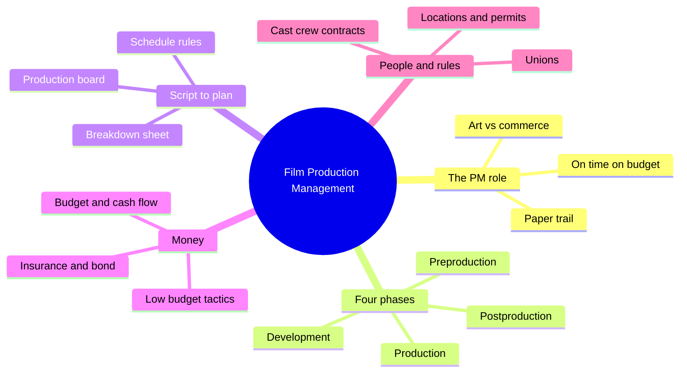
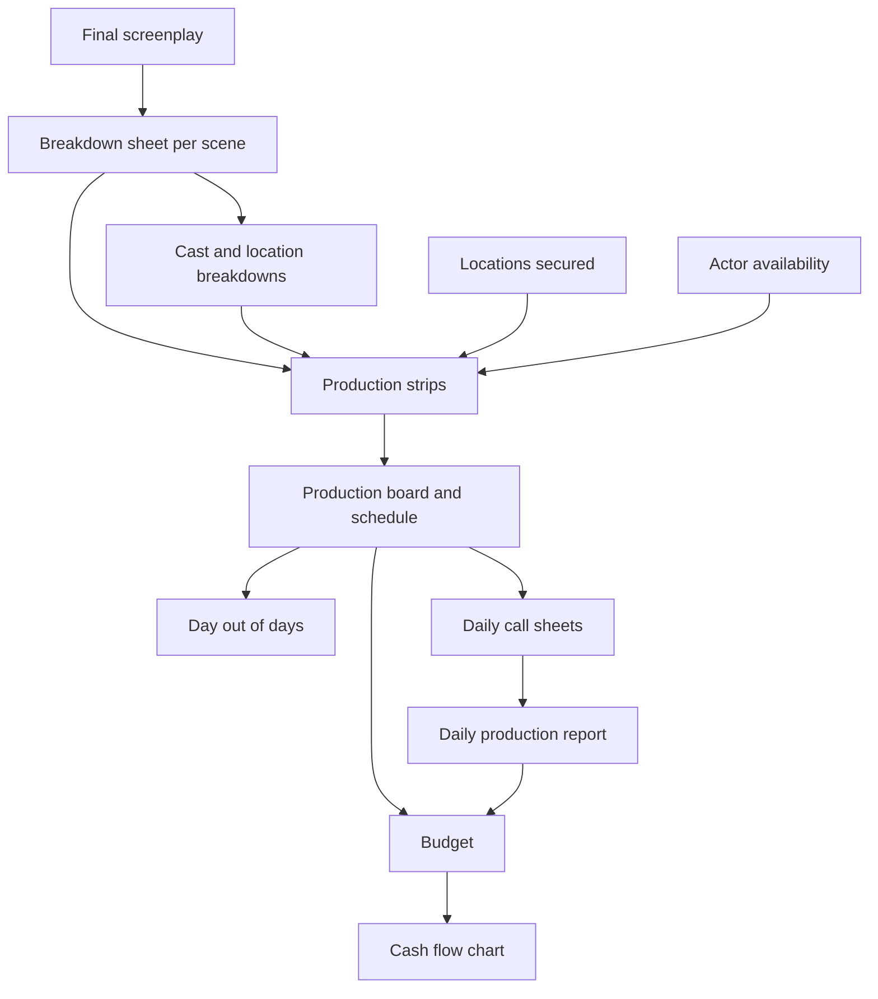
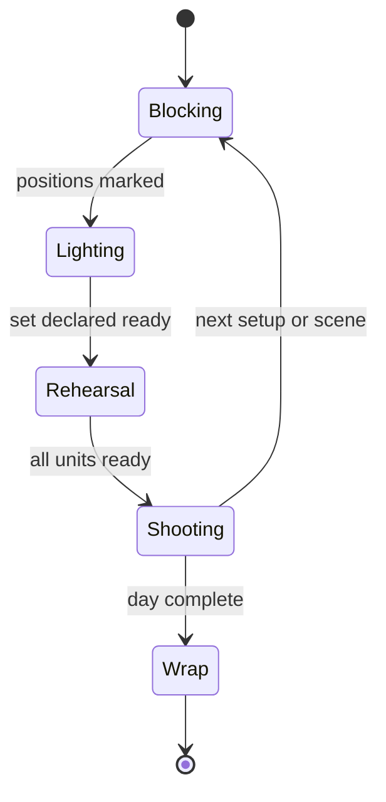
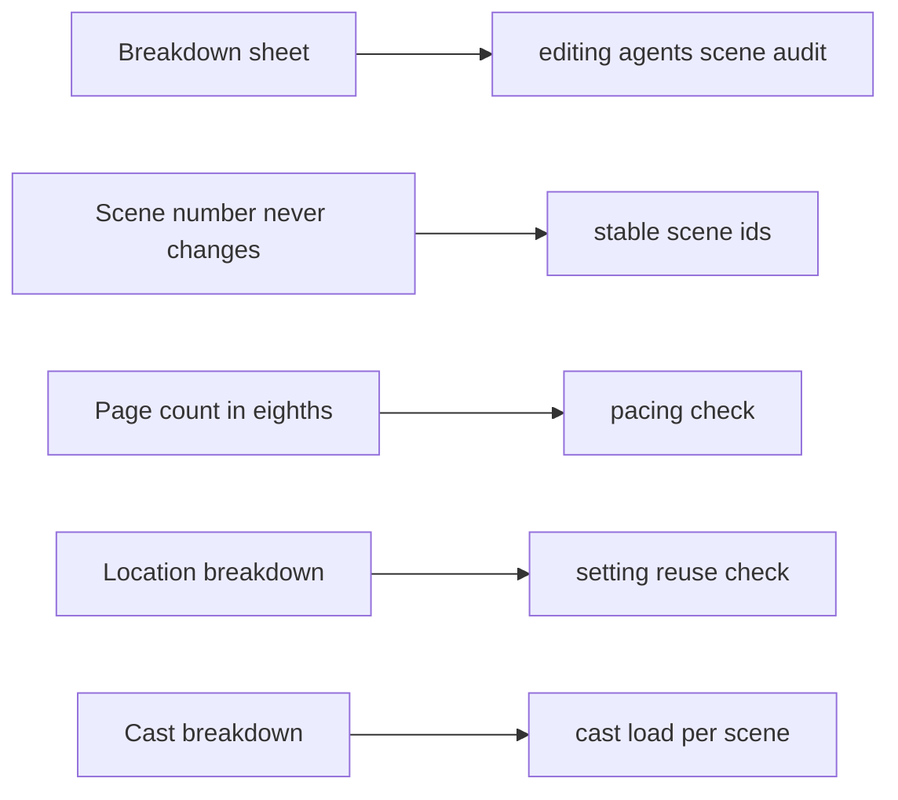

# BVX.0013 — Film Production Management — Bastian Cleve (2006)
### Knowledge Entry — Distill

A working handbook for the production manager (PM): how a screenplay becomes a scene-by-scene plan, a schedule, a budget and a set of contracts. It is in the library as craft basis for the OXO script editors, because the breakdown forces a script to answer "what does this scene cost to shoot?"

## TABLE OF CONTENTS
- [Core Thesis](#1-core-thesis)
- [Mind Models](#2-mind-models)
- [Framework](#3-framework--structure)
- [Key Concepts](#4-key-concepts)
- [Heuristics](#5-heuristics--decision-rules)
- [Invariants](#6-invariants)
- [Pitfalls](#7-pitfalls--myths)
- [Application](#8-application)
- [Cross-References](#9-cross-references)
- [Provenance](#10-provenance--confidence)

---

## 1 · CORE THESIS

A film is a product, and the screenplay is its only reliable cost estimate. Break every scene into its elements, schedule by place and cast availability rather than story order, and write every deal down. The production manager protects "on time, on budget" so artists can work inside a structure.

---

## 2 · MIND MODELS

**Diagram 1 — the whole argument.**
Read the book as one pipeline (script to plan to money to paper) with the PM as the person who holds it together.

**Diagram 2 — the central mechanism.**
Each scene is broken down once; every later document is derived from that sheet, so a missing element upstream is missing on screen.

**Diagram 3 — one shooting day on set.**
Blocking, lighting, rehearsal, shooting: the cycle repeats per setup, and the AD keeps the next scene ready before the last one ends.

**Diagram 4 — mapped onto the Command's systems.**
The breakdown fields double as a checklist the script editors can run on a page.

---

## 3 · FRAMEWORK / STRUCTURE

Cleve organizes by the order a PM meets the work:

1. **Role** (ch. 1). The PM is the go-between of art and commerce. Not a creative job: no say in script, casting or direction, but the person who answers every logistical question.
2. **Business of film** (ch. 2). Four phases: development (producer packages rights, script, names, money), preproduction (cheapest phase, all groundwork), production (blocking, lighting, rehearsal, shooting), postproduction (now often a production by itself because of digital effects).
3. **Preparing** (ch. 3). Script breakdown, then the production board and shooting schedule.
4. **Low budget** (ch. 4). What makes a film expensive and how to cut it without showing on screen.
5. **Locations, permits** (ch. 5), **unions** (ch. 6), **cast and crew** (ch. 7), **contracts and working permits** (ch. 8).
6. **Money and risk** (ch. 9 to 11). Budget and cash flow, insurance, completion bonds.
7. **Afterlife** (ch. 12 to 13). Festivals and markets, film schools.

The spine of the book is chapter 3. Everything after it consumes the breakdown and the schedule.

---

## 4 · KEY CONCEPTS

| Concept | What it is | Why it matters |
|---|---|---|
| PM / UPM / line producer | Same job, different titles by size and union | Owns logistics, finance, hiring; protects the company, even against the director |
| Above / below the line | Creative talent (writer, director, producer, cast) vs crew and costs | Above-the-line drives big budgets; below-the-line is stable and predictable |
| Script breakdown sheet | One form per scene, 24 fields (number, set, INT/EXT, day/night, page count, cast, extras, stunts, props, vehicles, wardrobe, effects, setups, time) | Anything missed here is missed on the shoot and the screen |
| Scene number | Fixed id; added scenes get A, B, C (23A); deletions are noted, never renumbered | All planning cross-references hang on it |
| Page count | Script page split in eighths | Rough effort measure; unreliable (an eighth-page battle can take days) |
| Setups | Distinct camera positions needed to cover a scene | Each one means moving gear, relighting, restaging: the real time cost |
| Production board and strips | One colored strip per scene: yellow day ext, white day int, green night ext, blue night int; black = day break, gray = free day | Schedule readable at a glance; shows turnarounds and day/night switches |
| Day out of days | Compact grid of which actor works which day | Basis for salary estimates and union paperwork |
| Day vs weekly player | Day players spaced under 10 days apart become weekly players | Scheduling that ignores it costs money |
| Turnaround | Minimum rest between shooting days (12 hours for SAG actors and for minors) | Violations carry fines |
| Call sheet / production report | Next-day orders; end-of-day record of progress, stock, delays | Early warning for overruns; evidence for insurers |
| Cover set | An interior scene held ready for bad weather | Keeps the day productive |
| Deal memo | Short binding summary of pay, dates, credit | Blueprint for the later contract; write it before work starts |
| Contingency / overhead | 10 percent contingency; about 7.5 percent overhead on low-budget nonunion | Standard padding lines in the budget |
| Cash-flow chart | Weekly schedule of money needed | Payroll is weekly; delay cash out because interest accrues |
| Completion bond | Guarantee the film is finished or investors are repaid; guarantor can take over | Standard above about $2 million; adds daily reporting burden |
| Errors and omissions | Liability cover for title, plagiarism, defamation, privacy claims | Distributors require it; needs clearance and releases first |
| SFX supervisor | Hired early for digital effects | Effects cost is only visible after post; plan with storyboards |

---

## 5 · HEURISTICS & DECISION RULES

| Situation | Do this | Not this |
|---|---|---|
| Starting a project | Get the finished screenplay, then break it down by scene | Budget from an outline or twenty-page treatment |
| Scene setting unclear | Ask author or director: day/night, interior/exterior, "front door" from which side | Guess; the answer changes schedule and cost |
| Naming things | Use the script's exact words ("old Viet Nam bus" everywhere) | Let "bus" and "old bus" drift between sheets |
| Script revised | Date the draft, redo affected sheets, keep scene numbers | Renumber scenes |
| Building the schedule | Group by shooting site, then actor availability | Shoot in story order |
| Interior night scene | Shoot by day with windows blocked if nothing outside shows | Pay for night shooting by default |
| Night exterior | Shoot at night | Fake it with day filters |
| First days of shooting | Easy dialogue scenes so the crew finds its rhythm | Open with effects-heavy action |
| Weather risk | Exteriors first, interiors later, keep a cover set | Save all exteriors for the end |
| Estimating scene time | About an hour set-up and a bit less to wrap, then walk the location with director and DP | Trust the rule of thumb alone |
| Low-budget script | Few locations, small cast, dialogue and character over stunts | Exotic places, crowds, destroyed cars |
| One-line parts under SAG | Make the waiter silent so an extra can play him | Write a two-word speaking part |
| Minors in cast | Check age, teacher, hours; casting 19 for an 18-year-old part avoids the teacher | Ignore minor rules until the day |
| Crew choices | Hire pros for DP, gaffer, key grip, sound, first AD; students for the rest | Hire friends who endanger the shoot |
| Treatment of people | Same food, same hotel for above and below the line | Pamper some, treat others as workers |
| Hiring reasons | Fire only for incompetence; pre-agree severance in the deal memo | Fire for personality without terms |
| Budget numbers | Include deferred pay at full value; count savings only once contracted | Pad the low end to please the producer |
| Special effects | Bring the SFX house in during development; storyboard precisely | Judge the effect only in post |
| Paperwork | Phone logs, countersigned memos, written deals | Verbal agreements |
| Location | Find the real owner; get written permission; clear early | Deal with a renter who cannot grant rights |

---

## 6 · INVARIANTS

1. The breakdown precedes the schedule, the schedule precedes the budget, the budget precedes financing certainty.
2. Scene numbers are never changed once set.
3. The director's word is law on set, but overtime is the producer's call.
4. Shooting order follows logistics, not story, except when a star's dates force it.
5. Every cost the audience cannot see on screen is wasted on a low-budget film.
6. Preproduction is cheap; production is where the money goes; mistakes found late cost multiples.
7. Insurance (workers' comp and liability) is not negotiable; permits need proof of it.
8. Value in the industry is financial: people and things are judged by whether they help sell and profit.
9. Perfect conditions never exist; schedules change daily and the PM improvises.

---

## 7 · PITFALLS / MYTHS

- **"We can budget from a treatment."** Props, sets, cast and extras appear during screenwriting.
- **"Page count equals shooting time."** It is only a rough guide.
- **"Software replaces the PM."** Cleve still recommends first passes by hand to learn the script.
- **"Food and video" deals are fair.** They are unenforceable and rely on goodwill.
- **Product placement saves money.** Small films get free donuts, not cash.
- **Friends and relatives as actors.** The audience must believe the people on screen.
- **Moving the crew every day.** Staying at one site saves time, permits and mood.
- **"Union means safe, nonunion means abuse."** Neither is guaranteed; SAG involvement at least structures the day.
- **Completion bond as quality guarantee.** It only guarantees physical completion.
- **Skimping on postproduction.** Sloppy edit and mix ruin everything before it.
- **Working on spec without paper.** The financier's nephew may get the job.

---

## 8 · APPLICATION

- **Spine level:** TEXTURE. The book is not about story structure. It supplies the physical, budgetary and procedural texture that makes a script producible.
- **12-layer character stack:** none. Cast appears only as a cost and availability item.
- **plot_systems:** none directly.
- **Setting:** useful for realism of any production setting in the OXO universe (shoots, crews, call sheets) if a scene ever depicts filmmaking.

**For the OXO script editors.** The breakdown sheet is a ready audit form. For each scene in a draft, an editor can fill the 24 fields from the page alone: set, interior/exterior, day/night, speaking cast, extras, minors, stunts, props that are plot-bearing, vehicles, effects, and estimated setups. Where a field cannot be filled, the scene is vague. Where the same place appears under three names, the continuity is loose (Cleve's bus example). Where a scene carries a one-eighth page but a battle's worth of action, the pacing and the page count disagree.

Three direct borrowings: (1) **stable scene ids** with lettered insertions, so edit notes stay valid across drafts; (2) **cast and location breakdowns** as a quick map of who appears where and how often a setting is reused, which exposes cast bloat and one-use locations; (3) the **low-budget screenplay tips** as a "constraint pass": which scenes could keep the same dramatic work with one fewer location, speaking part, or effect.

Caution: this is production craft, not story craft. A scene that is cheap is not thereby good. The editors should use the breakdown to ask clean questions about a page, not to prune story for cost.

Active Command systems touched: the `editing-*` agents and `reading-cold` for scene audit vocabulary. No change to the fabula or canon is implied (see the research-not-fabula ruling).

---

## 9 · CROSS-REFERENCES

| Related entry | Relation |
|---|---|
| [[BVX.0066]] | Cinematic storytelling for directors: the shot-level view that sets the "setups" count Cleve plans around |
| [[BVX.0197]] | Visual guide to planning shots and cuts: the technical-storyboard counterpart to Cleve's breakdown |
| [[BVX.0175]] | McKee, Story: story-side craft this book's production side sits beneath |

---

## 10 · PROVENANCE & CONFIDENCE

Sourced from the full text (pdftotext, 238 pages), read in sections. Read in full: introduction, chapters 1 to 8, chapter 9 prose and form structure, chapter 10, chapter 11 opening and bond requirements, chapters 12 and 13. Application section (§8) and the diagram 4 mapping are inference, not from the book.

**Not read in full (coverage concern):**
- Chapter 9 budget form account lines (roughly the middle of Figure 9.1): skimmed as a table of account codes.
- Chapter 11 completion bond contract text after the takeover letter (the long legal excerpt): not read line by line.
- Appendix 1 (addresses) and Appendix 2 (sample forms): not read; they are lists and blank forms.
- The book's figures (call sheets, sample breakdowns, production board images) come through only as captions in the text layer.

Dollar figures and union rules date from about 2003 to 2006 (SAG, DGA); treat as period examples, not current rates. Text layer has legacy-encoding noise (accented names, bullets).

## META
- Template: BVX-LEARN-v4.0
- Source classification: book, practitioner handbook (film production management), full text with noted gaps
- Created / Updated: 2026-10-30 / 2026-10-30
