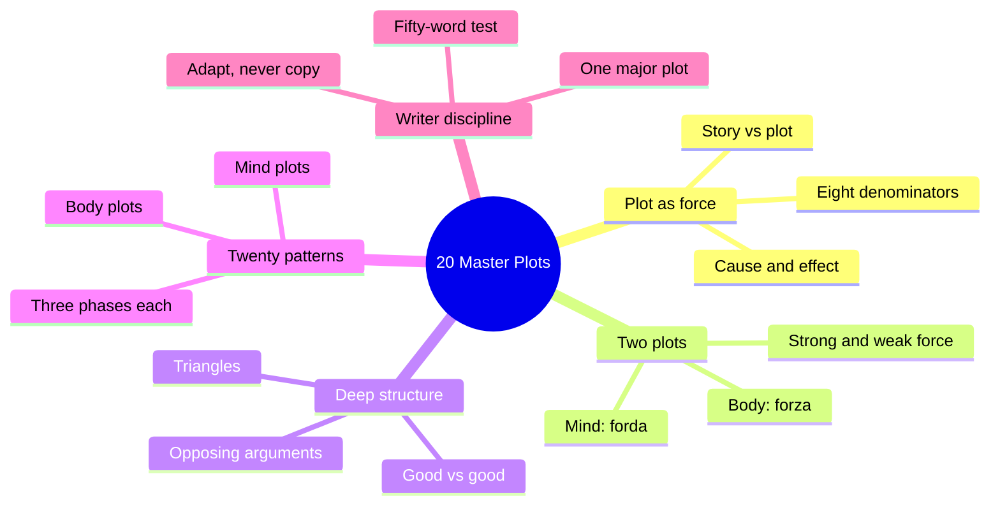
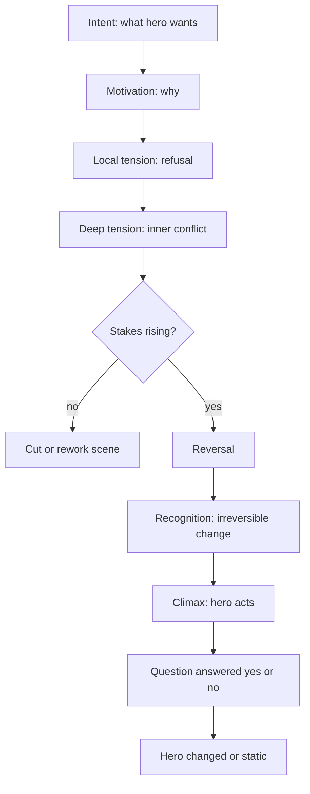
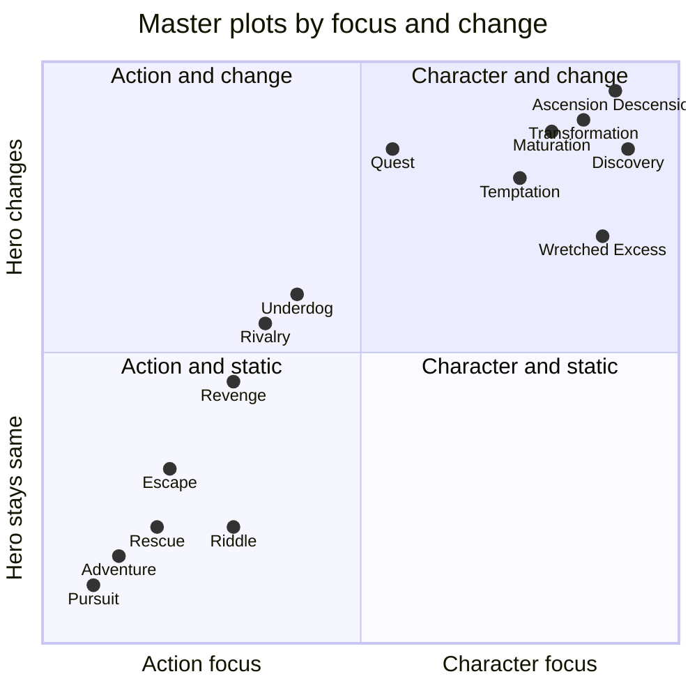

# BVX.0043 — 20 Master Plots: and How to Build Them — Ronald B. Tobias (1993)
### Knowledge Entry — Distill

A craft handbook that treats plot as cause-and-effect pressure, then gives twenty reusable plot patterns, each with three dramatic phases and a checklist. It is in the library as the craft basis for the OXO script editors: a plot-diagnosis vocabulary, not a character-psychology source.

## TABLE OF CONTENTS
- [Core Thesis](#1-core-thesis)
- [Mind Models](#2-mind-models)
- [Framework](#3-framework--structure)
- [Key Concepts](#4-key-concepts)
- [Heuristics](#5-heuristics--decision-rules)
- [Invariants](#6-invariants)
- [Pitfalls](#7-pitfalls--myths)
- [Application](#8-application)
- [Cross-References](#9-cross-references)
- [Provenance](#10-provenance--confidence)

---

## 1 · CORE THESIS

Plot is a force, not a skeleton: a chain of cause and effect that turns events into a "why" game. Every story picks a strong force, body or mind. Twenty patterns of three phases each show how to shape it, and the writer adapts them rather than copies them.

---

## 2 · MIND MODELS

**Diagram 1 — the whole argument.**
Read off the book's order: first the principles of plot, then the pick between body and mind, then twenty patterns, then the cautions.

**Diagram 2 — the central mechanism.**
Read off the loop: want, obstacle, escalation, climax by the central character, and the change that is the point.

**Diagram 3 — the twenty plots placed by focus and hero change.**
Read off the quadrants: top-left action plots rarely change the hero (sequel-friendly); right side is character plots where the hero change is the point.

---

## 3 · FRAMEWORK / STRUCTURE

**Part one, the principles (ch. 1 to 5).**
- Ch. 1 separates story (events in sequence) from plot (events linked by "why"). Plot has beginning, middle, end: setup and intent, rising action with reversal and recognition, then climax and resolution.
- Ch. 2 gives eight "lowest common denominators": tension fuels plot; tension comes from opposition; tension grows as opposition grows; change is the point; every event must matter; make the causal look casual; leave luck to the lottery; the central character performs the climax.
- Ch. 3 sets two master plots, force (plots of the body, action) and fraud (plots of the mind, character). Pick one as the strong force; the other becomes the weak force. Proportion and consistency follow from that choice.
- Ch. 4 adds deep structure: every work carries a moral argument. Build it as two opposing arguments that are each logical, valid and compelling, so the hero is between a rock and a hard place.
- Ch. 5 counts character dynamics: 2 characters give 2 relationships, 3 give 6, 4 give 12, 5 give 20. Use the Rule of Three. Action defines character.

**Part two, the twenty plots (ch. 6 to 25).** Each chapter runs: definition, famous examples, three dramatic phases, a checklist. Body plots: quest* (hybrid), adventure, pursuit, rescue, escape, revenge, riddle. Rivalry and underdog follow. Mind plots: temptation, metamorphosis, transformation, maturation, love, forbidden love, sacrifice, discovery, wretched excess, ascension, descension.

**Part three (ch. 26).** Combine plots only with one major and the rest minor. State the story in fifty words. Answer the twelve-question final checklist.

*Note: the book calls quest a character plot of the mind that is physical in motion.*

---

## 4 · KEY CONCEPTS

| Concept | What it is | Why it matters |
|---|---|---|
| Plot as force | Diffuse cause-effect pressure in every sentence, "a process, not an object" | Stops the skeleton/outline habit of bolting plot on |
| Story vs plot | Chronicle ("then") vs causal chain ("because") | Test for whether a draft has plot yet |
| Intent / motivation | What the hero wants vs why | Both must be stated; they drive every scene |
| Reversal / recognition | Event that blocks the goal; the irreversible emotional change it causes | The middle's engine |
| Local vs deep tension | Moment conflict vs conflict about who the hero is | Local alone gives equal roadblocks and boredom |
| Escalation | Stakes grow each beat (Fatal Attraction) | Prevents flat middles |
| Strong / weak force | Body or mind dominates, the other subordinates | Fixes proportion |
| Deep structure | The moral argument under the plot | Where depth and theme come from |
| Good vs good | Both sides valid, so no villain-by-default | Source of real dilemma (Kramer vs Kramer) |
| Propaganda | Author takes a side and lectures | Kills conflict; author is referee, not god |
| Character triangle / dynamic number | N people give N(N-1) relationships | Cast-size budget |
| Rule of Three | Two failures, third succeeds | Tension without boredom |
| Chekhov's shotgun / casual-causal | Plant it quietly, pay it off | Fair setups, no deus ex machina |
| Power curve | Rivals' standing moves inversely | Shape of rivalry and underdog |
| Confinement | Smaller space, more tension | Pursuit, Casablanca |
| Sentiment vs sentimentality | Earned feeling vs borrowed stock feeling | Love, sacrifice scenes |
| Proportion | Emotion matched to what the scene can carry | Defines melodrama |
| Fifty-word test | Whole plot in fifty words | Proof the writer knows the story |

---

## 5 · HEURISTICS & DECISION RULES

| Situation | Do this | Not this |
|---|---|---|
| Scene is brilliant but off-plot | Ask if it advances the plot or tests intent; cut if not | Keep it because it reads well |
| Hero's goal is met with no resistance | Add a refusal, then a deeper inner obstacle | Let a single fix (the A.A. meeting) resolve it |
| Middle feels flat | Raise the stakes each beat; make hero pay | Stack equal local obstacles |
| Helper or solution needed late | Plant the helper in act one | Drop in a convenient rescuer |
| Clue in a mystery | Hide in plain view, keep it ambiguous, play fair | Use red herrings that are not clues |
| Hero is passive at climax | Hero performs the central action | Let antagonist or events do it |
| Sympathy for a falling hero | Show his decline and give him the information early | Hide sympathetic facts until the end |
| Two valid sides to a dilemma | Give both equal logic, validity and feeling | Strawman the side you dislike |
| Adding a fourth or fifth major character | Count the relationships first | Add cast without budget |
| Sacrifice scene | Underplay; show cost through earlier character groundwork | Make a saint, or overplay emotion |
| Choosing a plot | Match idea to one primary plot; others are satellites | Graft two competing plots |
| Plot not working | Revisit, then leave the path | Force brilliant pages to fit |
| Pursuit scene | Keep pursued close, confine space, subvert type | Predictable chase cliches |
| Rivalry | Match strengths, vary who wins each round | One-sided contest |

---

## 6 · INVARIANTS

1. Every story needs tension, and tension is intention denied.
2. A unified action has a beginning, middle and end.
3. Events must be causal; fiction leaves no room for chance, although it may look casual.
4. The hero must be different at the end, except in plots built to stay static (adventure, pursuit).
5. The central character performs the central action of the climax.
6. Plot and character are inseparable; the division is only a matter of focus.
7. Chance may start a story but may not resolve it.
8. Every moral system implied by a work is an argument that needs an opposing argument to be convincing.
9. Rule of Three governs attempts and cast shape.
10. Originality is in expression, not in a new plot.

---

## 7 · PITFALLS / MYTHS

- "Plot is a skeleton." It saturates every sentence and cannot be deboned.
- Mistaking story for plot: strings of "and then" with no "why" (The Whale Husband).
- A pile of brilliant digressions: novels forgive them, screenplays rarely do.
- Red herrings that are not clues; false road signs cheat the reader.
- Deus ex machina and idiot plot: help from nowhere.
- White hats against black hats: no deep tension, a ready-made ending.
- Writing propaganda: author with a score to settle, stereotypes, a lecture.
- Raising the stakes without raising character: Fatal Attraction thrills but leaves a static hero.
- Sentimentality and melodrama: borrowed or inflated emotion.
- A tacked-on happy ending for a story that did not earn it (Pygmalion, Light That Failed).
- Treating the twenty as laws. Tobias says they are patterns, not templates.
- Number worship: the plot count is a packaging choice.

---

## 8 · APPLICATION

- **Spine level:** TEXTURE. The book supplies craft vocabulary for scene and sequence design, not a spine level of its own.
- **12-layer character stack:** none (`feeds: []`). It treats character as action and intent/motivation only.
- **plot_systems:** a diagnostic menu. Tag a scene or arc with a master plot and check its phases against the checklist.
- **Setting:** confinement and authentic detail rules (adventure, pursuit) feed setting scenes.

This is meant as an editing lens for the script editors in `.claude/agents/editing-*.md` and `reading-cold.md`. Suggested uses:

1. Identify the primary plot of an episode or arc, then check each of its three phases against the chapter's checklist.
2. Run the intent/motivation/obstacle/climax-agent test on every scene (final checklist, questions 3 to 12).
3. Count active major characters and relationship pairs when a cast grows.
4. Flag unplanted helpers, off-plot digressions, and a climax performed by someone other than the lead.
5. Use the strong/weak force call (action or character) to judge what an edit should protect.

Caution for use: the examples are 1990s Hollywood and canon literature, so the "happy ending preferred" and gender notes are period-bound. Use the structure, not the taste.

---

## 9 · CROSS-REFERENCES

| Related entry | Relation |
|---|---|
| [[BVX.0054]] | Premise line: the fifty-word and single-question test in ch. 26 is a premise exercise |
| [[BVX.0089]] | Dramatica: a heavier theory of the same cause, effect and argument structure; compare "good vs good" to its argument model |
| [[BVX.0064]] | McKee on character: complements Tobias's intent/motivation and cast-count rules |
| [[BVX.0044]] | Fiction blunders: overlaps the digression, coincidence and cliche pitfalls |

---

## 10 · PROVENANCE & CONFIDENCE

- Source: full pdftotext of the book at `_PRIVATE/distill_wave/BVX.0043.txt`, read in sections from front matter through ch. 26 and the final checklist. Chapters 1 to 26 all read. The back index was skimmed only (reference list, no argument).
- Everything in sections 1 to 7 is from the text. The quadrant placement in Diagram 3 is my judgment from the chapters' own statements about whether the hero changes; the book does not rank them that way. Section 8 is inference for Command use.
- Text encoding is legacy (smart quotes show as replacement characters); no content was lost.
- Confidence high for the framework and heuristics; medium for the quadrant positions.

## META
- Template: BVX-LEARN-v4.0
- Source classification: craft handbook, popular press (Writer's Digest Books)
- Created / Updated: 2026-10-30
