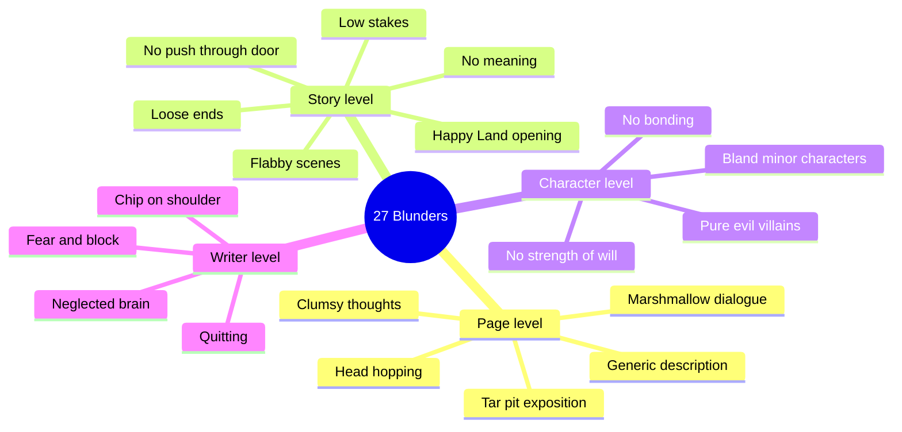
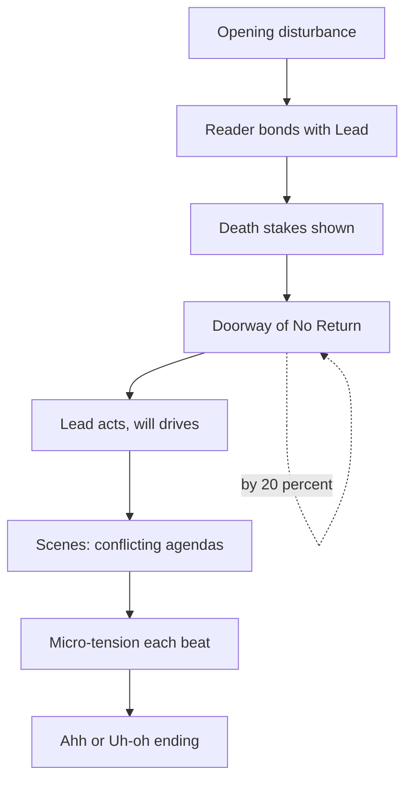
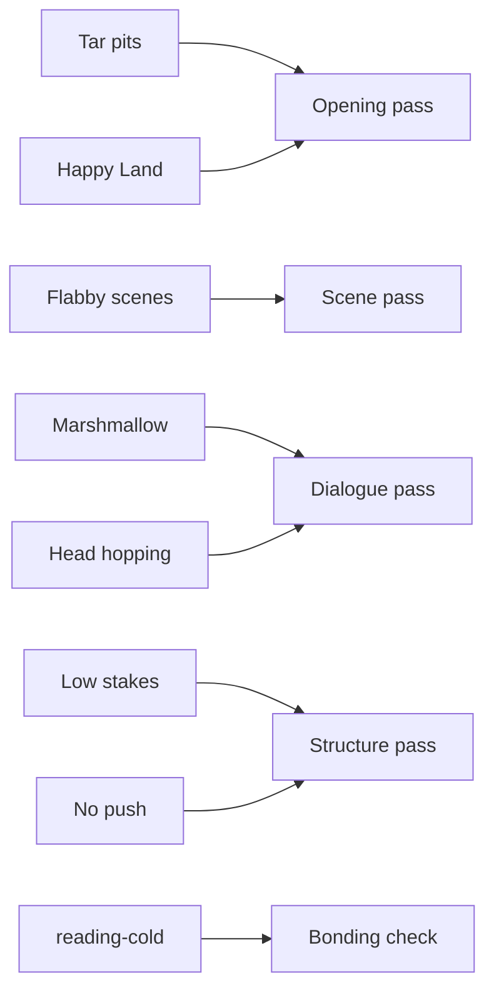

# BVX.0044 — 27 Fiction Writing Blunders - And How Not To Make Them! — James Scott Bell (2015)
### Knowledge Entry — Distill

A short craft checklist of 27 "speed bumps" that break a reader's dream state, plus the habits that keep a writer working. It is the working basis for the OXO script editors (`.claude/agents/editing-*.md`, `reading-cold.md`).

## TABLE OF CONTENTS
- [Core Thesis](#1-core-thesis)
- [Mind Models](#2-mind-models)
- [Framework](#3-framework--structure)
- [Key Concepts](#4-key-concepts)
- [Heuristics](#5-heuristics--decision-rules)
- [Invariants](#6-invariants)
- [Pitfalls](#7-pitfalls--myths)
- [Application](#8-application)
- [Cross-References](#9-cross-references)
- [Provenance](#10-provenance--confidence)

---

## 1 · CORE THESIS

A story is a Lead fighting death (physical, professional or psychological) through strength of will, and the reader stays only while worry holds. Every blunder is a speed bump that breaks that worry: no disturbance, no conflict, no bond, no stakes.

---

## 2 · MIND MODELS

**Diagram 1 — the whole argument.**
Read off the three families: page-level bumps, structure-level bumps, and writer-level bumps. Most fixes are the same move: add trouble.

**Diagram 2 — the central mechanism.**
Read off the chain: a disturbance plus a bonded Lead plus death stakes plus a forced entry produces sustained worry. Break any link and the reader leaves.

**Diagram 3 — mapped onto the Command's editors.**
Read off which blunder each OXO editing pass should hunt.

---

## 3 · FRAMEWORK / STRUCTURE

Bell's own organization is a flat list of 27 short chapters, each a named blunder with a fix. For use, regroup them:

1. **Opening (the hook):** Tar Pits (2), Happy People in Happy Land (10), No Character Bonding (24). Formula: disturbance gets interest, a bondable Lead gets investment.
2. **Spine of the plot:** Low Stakes (7), No Push Through the Door (14), No Strength of Will (26), Loose Ends (13), No Stinkin' Meaning (16).
3. **Scene and line craft:** Flabby Scenes (20), Marshmallow Dialogue (3), Generic Description (4), Fumbled Flashbacks (8), Head Hopping (11), POV Confusion (12), Clumsy Thoughts (23), Too Much Lyrical (21).
4. **Cast:** Pure Evil Villains (5), Bland Minor Characters (27).
5. **Surprise and ideation:** The Expected (6), Settling on First Ideas (19).
6. **The writer's life:** Fear (1), Brain (9), Chip on Shoulder (15), Block (17), Market Ignorance (18), Competing (22), Quitting (25). Plus a Scrivener bonus.

Bell's three-act skeleton: Act I ends at a forced entry (Doorway of No Return) by 1/5 of a novel or 1/4 of a film; Act II is the fight with death; the ending lands as Ahh or Uh-oh.

---

## 4 · KEY CONCEPTS

| Concept | What it is | Why it matters |
|---|---|---|
| Speed bump | Any flaw that jolts the reader out of the dream state | Too many and the reader quits or doesn't return |
| Act first, explain later | Start with something happening; backstory arrives later | Readers follow trouble a long time before needing why |
| Death stakes | Physical, professional or psychological death on the line for the Lead | Makes a case or quest personal, not just a job |
| Doorway of No Return | The forced, irreversible entry into Act II (action or emotion) | Without it the story feels weak and manipulative |
| Attitude and agenda | Attitude comes from backstory; agenda is the want in this scene | Every character, minors too, needs both |
| Marshmallow dialogue | Talk with no conflict, tension or fear | Reader detaches |
| Micro-tension | Conflict in every beat: action, speech, thought, description | The cure for flab; check in 100-word chunks |
| Telling detail | One specific, subtle sensory detail ("bacon fat hardening") | Carries mood without the author naming the feeling |
| Villain's closing argument | Villain defends his life as if on trial | Gives justification, so he is not pure evil |
| Back flash | Brief past info inside a present scene, by dialogue or thought | Safer than a full flashback scene |
| Sensory trigger | A strong detail enters and exits a flashback | Smooth transition, every time |
| POV intimacy range | First person most intimate, omniscient least, third limited/unlimited between | Choose by effect, then stay consistent |
| One POV per scene | Rule of thumb for close POV; switch at a break | Head hopping drains intimacy |
| Ahh / Uh-oh / Huh? | Satisfied ending, uncertain ending, dangling-thread ending | Only Huh? is a blunder |
| Meaning as two clashing values | Foster-Harris: Love v. Greed = Love | Know what the outcome says; plant the opposing argument in Act I |
| Return with the elixir | The Lead states the lesson learned | An interview exercise for finding meaning |
| Strength of will / no wimps | Lead acts rather than reacts | Reactive Leads can start passive but must change fast |
| Brain-set-free games | First lines, titles, killer scenes, newspaper, "Who are they?" | Weekly half-hour of solo play feeds ideas |
| Concentrate, relax, record, select | Four-step idea method | Many options, judged later |
| Stew, brew, do | Endings process: think, walk, then notebook | Loose ends fixed via a returning minor character |

---

## 5 · HEURISTICS & DECISION RULES

| Situation | Do this | Not this |
|---|---|---|
| Opening page has backstory | Cut all of it, restore only what is necessary; move rest into conflicting dialogue | Open with a recap or summary |
| Backstory in narrative | First ten pages: about three sentences; second ten: three paragraphs | Pour it in at once |
| Spot present-moment failure | Search the opening for "had" and derivatives | Trust a literary opening by default |
| Opening has no other character | Start where a second character and dialogue appear, or use the Chapter 2 Switcheroo | Open with a character alone, thinking |
| Dialogue is flat | Ask where the conflict, tension or fear is; cut mushy openers and echoing; add reactions and silence | Let both speakers agree and chat |
| Description is generic | Find one subtle, specific detail through the POV; use taste, smell, touch | Describe, then explain what it means |
| Revising description | Polish in revision; push on in first draft | Stall the draft on images |
| Villain | Write his closing argument; write his first bad choice; give one attractive trait | Abuse backstory only; or all crazy |
| Plot feels predictable | List what the reader expects, then do the opposite and justify it | Take the obvious turn |
| Scene dull | Add something unexpected: a person with trouble, a random line, a dictionary noun | Wait for inspiration |
| Cop or lawyer case feels flat | Put the Lead's job or soul on the line; stage one moment that shows it (The Verdict) | Make it only about the case |
| Flashback needed | Ask if it is necessary; write it as an immediate scene; enter and exit on a sensory detail; drop most "had" | Write "Jack remembered..." summary |
| Peaceful scene | Keep it short; add equal and opposite dread | Let happiness linger |
| POV | One close POV per scene; change at a break or chapter | Switch inside a scene |
| Facial expressions | Check that the POV character could see it | Describe own face |
| Thoughts | Italics sparingly for short intense ones; deep POV needs none | Paragraphs of italic thought |
| Act I ends | Force the Lead through by 20 percent of word count; no way back | A random event or a Lead who can leave |
| Meaning | Plant an Act I argument against the final lesson | Statement only at the end |
| Scene planning | Give each character a conflicting agenda; if alone, add obstacles or inner conflict | A scene where all agree |
| Scene check | Read in 100-word chunks; cut or fix any chunk lacking tension | Trust the total |
| Loose ends | Return a middle minor character to resolve it; plant setup afterward | Leave a question dangling |
| Character image | Reject the first mental picture; brainstorm a list; flip sex, build, look | Typecast the bartender |
| Minor character | Go extreme, then pull back to fit tone | Stereotypical lines |
| Block at the wall (about 30k words) | Step back at 20k: outline, reassess | Push blind |
| Block, no ideas | Write something deliberately bad; make ten ideas; three-paragraph pitch | Wait |

---

## 6 · INVARIANTS

1. Don't bore the reader; boredom is the mundane and the expected.
2. Trouble binds the reader to a story; worry is the engine.
3. A great story is the Lead's fight with death (physical, professional, psychological), driven by will.
4. Every character in every scene wants something, and the wants conflict.
5. Act first, explain later.
6. One POV per scene in close-POV fiction; omniscient may hop but costs intimacy.
7. The best villain has a justification, a choice, and some attraction.
8. Story comes first: "something happening to somebody you have been led to care about" (MacDonald). Prose serves it.
9. Specific beats generic; showing beats telling the feeling.
10. Writing is learnable by study; the only failure is quitting.

---

## 7 · PITFALLS / MYTHS

- Myth: readers must know the characters are happy before trouble arrives. They leave first.
- Myth: all backstory is bad. Bell allows it, in dialogue or in small doses.
- Myth: "never write flashbacks." Allowed with care.
- Myth: head hopping is illegal. Legal in omniscient; merely out of fashion.
- Pitfall: horrific villain backstory as the whole answer.
- Pitfall: "gild the lily", description followed by its explanation.
- Pitfall: lyrical prose without plot (Ulysses per Jung; the instructor's tanked novel).
- Pitfall: scenes like acting exercises (Cake): good acting, no designed story.
- Pitfall: a whining or passive Lead.
- Pitfall: group brainstorming; individuals produce more and better ideas (3M study).
- Pitfall: dated pop-culture references.
- Pitfall: second person POV (Bell says avoid).
- Pitfall: writing for the market only, or ignoring it entirely; the sweet spot is fresh within genre expectations.
- Pitfall: writer-side: ego, hostile review replies, competing with others instead of yourself.

---

## 8 · APPLICATION

- **Spine level:** TEXTURE (page-level craft) and L4 (stakes, forced entry, scene design).
- **12-layer character stack:** none directly; `feeds: []`. Villain closing argument, attitude/agenda, and "no wimps" are craft tools, not psychology models.
- **plot_systems:** Doorway of No Return placed at 20 percent or earlier; death-stake type per Lead.
- **Setting:** none.

Use for the OXO editors. A cold reader can run a short checklist per pass. Opening pass: is there a disturbance within the first page, how many "had" words, is there backstory in the first ten pages beyond three sentences. Scene pass: name each character's agenda and whether they conflict; 100-word tension check. Dialogue pass: marshmallow test, echoing, mushy openers. Structure pass: death-stake type, the one moment showing it, the Doorway before 20 percent, and a Lead who acts. POV pass: one head per scene, no self-seen expressions. Ending pass: Ahh, Uh-oh or Huh?

For the Outliers, the villain closing-argument exercise and the minor-character flip fit the cast work, but those belong in the editors' notes, not as canon. Bell's advice is genre-fiction craft (thriller and mystery weighted); treat his percent marks as guidelines.

---

## 9 · CROSS-REFERENCES

| Related entry | Relation |
|---|---|
| [[BVX.0064]] | McKee, Character: dimension and cast structure; complements Bell's villain and minor-character advice |
| [[BVX.0045]] | Another structure source; compare Bell's Doorway of No Return with act-turn models |

---

## 10 · PROVENANCE & CONFIDENCE

Full text read from the pdftotext file (all 27 chapters and the Scrivener bonus; the closing resource list skipped). Quotations paraphrased. Bell's percent marks and rules of thumb are his own heuristics, not research. Interpretation in §8 is inference. Zotero key and page count not supplied in the brief. BVX.0045 relation is assumed from its spine tags, not read.

## META
- Template: BVX-LEARN-v4.0
- Source classification: popular craft guide, full text read
- Created / Updated: 2026-10-30
