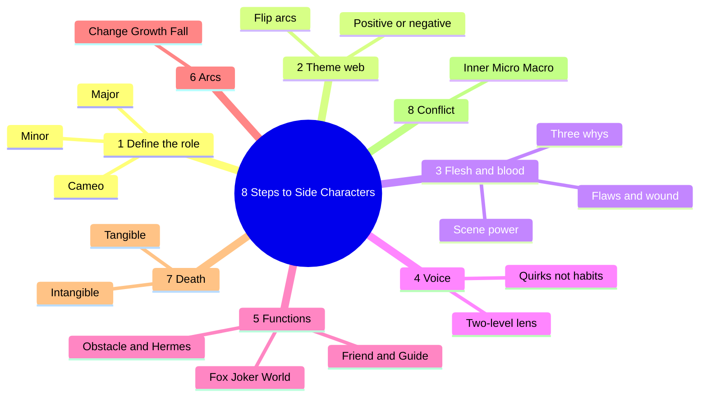
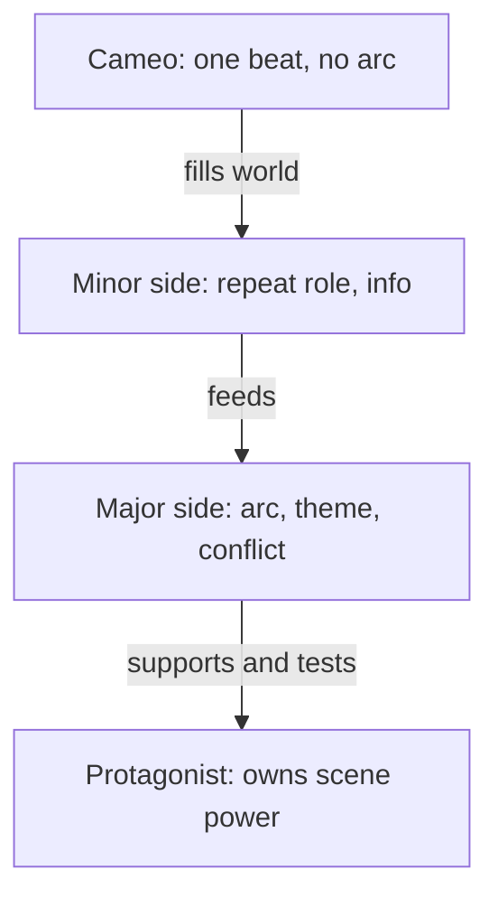
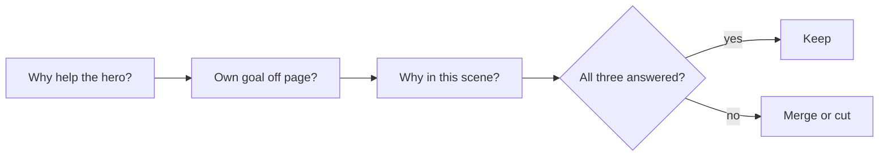
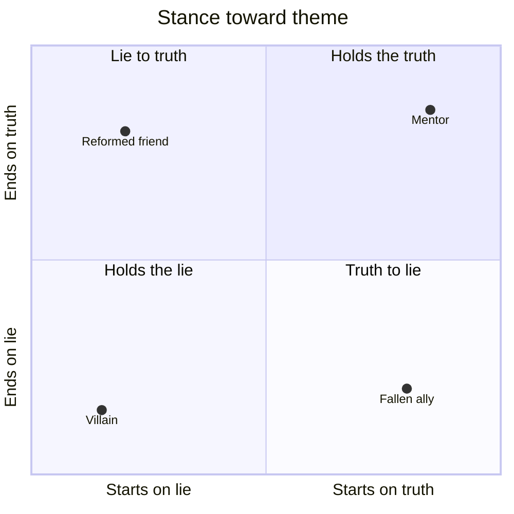

# BVX.0047 — 8 Steps to Side Characters — Sacha Black (2021)
### Knowledge Entry — Distill

A working-novelist craft book on supporting casts: what side characters are for, how to build them, and how to spend them. It is the craft basis for the script editors who judge supporting roles.

## TABLE OF CONTENTS
- [Core Thesis](#1-core-thesis)
- [Mind Models](#2-mind-models)
- [Framework](#3-framework--structure)
- [Key Concepts](#4-key-concepts)
- [Heuristics](#5-heuristics--decision-rules)
- [Invariants](#6-invariants)
- [Pitfalls](#7-pitfalls--myths)
- [Application](#8-application)
- [Cross-References](#9-cross-references)
- [Provenance](#10-provenance--confidence)

---

## 1 · CORE THESIS

Side characters are pillars that hold the protagonist's story up. Each one needs a distinct function, a link to the theme, a reason to exist beyond the hero, and a budget matched to page time. The protagonist keeps the scene power; supporting roles feed and test, never lead.

---

## 2 · MIND MODELS

**Diagram 1 — the whole argument.**
Read off the eight steps as one build order: define the role, tie it to theme, make it human, give it a voice, assign a function, weave its arc, decide its fate, and arm it with conflict.

**Diagram 2 — the central mechanism.**
Read off the cast as a page-time pyramid: the wider the layer, the shallower each member, and arcs only start at the major layer.

**Diagram 3 — the three whys test.**
Read off the order of questions to ask of any side character before it earns a scene.

**Diagram 4 — theme positions a cast should cover.**
Read off the four stances toward the theme question; a full cast usually fills every corner.

---

## 3 · FRAMEWORK / STRUCTURE

Eight steps, each ending in a short summary and "Questions to Think About."

1. **WTF is a side character.** Story is change; characters embody it. Three tiers (cameo, minor, major), a headcount rule, and a six-job description of what side characters do.
2. **Web of connectivity and theme.** Every element is a thread in one web; side characters are the pillar threads. Theme is the question; the moral lesson is the answer. Characters represent it positively, negatively, or by flipping.
3. **Flesh and blood.** Event plus reaction equals outcome. Salient features, the three whys, flaws with redeeming traits, origin stories, flashbacks, repeated introductions, humor, anchors, scene power, relationship variety.
4. **Voice.** Author voice is changeable; character voice is not. The four-part lens (actions, thoughts, dialogue, feelings) splits into two levels for non-POV characters.
5. **Functions.** Seven roles: Friend, Guide, Obstacle, Hermes, Sly Fox, Joker, World.
6. **Arc weaving.** Change, growth and fall arcs; who earns one; how to show it cheaply.
7. **Killing darlings.** Tangible and intangible death; bad and good reasons; pre-plot and off-screen deaths; required reaction and consequence.
8. **Fight to the death.** Conflict equals goal plus prevention. Inner, micro, macro layers, balanced, with consequences.

---

## 4 · KEY CONCEPTS

| Concept | What it is | Why it matters |
|---|---|---|
| Cameo / minor / major | Cameo: one beat. Minor: repeating role (barman, receptionist). Major: one step from the hero, shapes and sways them | Sets the depth budget; cameos are the most numerous, majors a handful |
| Cast pyramid | Cameos wide at base, then minor, major, one protagonist at the peak | Depth costs pages, so the count of majors is capped |
| Duplicate character | Two mentors, two foils doing one job | Wastes depth; merge them. Two allies are fine if their functions differ |
| Web of connectivity | Characters, theme, twists, arcs, subplots woven as one web | A side character with no thread to theme is dead weight |
| Theme stances | Positive, negative, lie-to-truth, truth-to-lie | Gives each major a variation on the hero's question; the hero's question stays biggest |
| E + R = O | Event plus reaction equals outcome | Side characters must react and feel, not only serve |
| Salient feature | One or two memorable traits per character | Relevance is king; show nothing the story does not use |
| Three whys | Why help the hero, own life goal, why in this scene | Makes a role feel whole without taking page time |
| Redeemable flaw kit | One positive trait, a relatable wound, a moral line, an expertise, kindness to others, capacity to change | Makes the unlikable appealing; capacity to change matters more than changing |
| Origin story | Backstory that explains the need to change | Keep it short, tied to the present, never the opening |
| Anchors | Items, places, emotions tied to a character | Memory hooks for the reader |
| Scene power | Who commands the room | Always the protagonist; side characters involve but never lead |
| Character lens | Level 1: action and dialogue. Level 2: feelings and thoughts | Non-POV characters show Level 1; Level 2 only by omniscient hint or speech |
| Quirk vs habit | Habit is a repeated routine; quirk is a deliberate, idiosyncratic behavior | Quirks must serve the story and be shown |
| Word bag | A personal vocabulary list per character | Keeps voices distinct; avoids "monomouth" (everyone sounds alike) |
| Seven functions | Friend, Guide, Obstacle, Hermes, Sly Fox, Joker, World | A shorthand for what a role does; roles can stack |
| Change / growth / fall arc | Full transformation, deepened same person, moral collapse | Match arc type to role: change to the hero, growth to side, fall to villains |
| Tangible / intangible death | Physical vs emotional, occupational, philosophical, psychological | More ways to "kill" than the body |
| Fridging | Killing a character only to motivate the hero | The named bad reason |
| Conflict equation | Goal plus prevention equals conflict; consequence is the key factor | Without consequence a fight is noise |

**The seven functions in short.**

| Function | Job | Watch for |
|---|---|---|
| Friend / sidekick | Motivation, conflict, conscience, company | Need not resemble the hero; usually a major with an arc |
| Guide / mentor | Teach, protect, bestow gifts; can be negative | One mentor, not two |
| Obstacle | Tests the hero's growth; not the true villain | Tie it to theme and the hero's flaw |
| Hermes | Carries messages, omens, prophecy; may be a letter or owl | Can be an object, not a person |
| Sly fox | Makes the hero doubt themselves; found early | Must be revealed for what they are |
| Joker | Lightens mood, hides truth in humor | Often flat so the humor survives |
| World | Setting as character with an arc, backstory, reputation | Ask how it pushes back against the hero |

---

## 5 · HEURISTICS & DECISION RULES

| Situation | Do this | Not this |
|---|---|---|
| Unsure of cast size | Count functions; merge repeats, check for blending | Hit a target number |
| Deciding who gets an arc | Arc only if they appear more than three times, sway the hero or plot, and carry many scenes | Give every major an arc |
| Side character takes over a scene | Hand the key action, plan and decision to the protagonist | Let the love interest or friend lead the plan |
| Showing a side arc cheaply | Show want and outcome; hint the middle in dialogue or one flashback | Flip the character with no justification |
| Unsure how a side character feels | Ask the emotion, the expected reaction, a subversion, five actions | Narrate their thoughts from a non-omniscient POV |
| Writing dialogue | Cut chat with no purpose; make each voice contrast the hero's | Everyone sounding alike |
| Introducing a character | Several introductions, each on a new trait | Repeat "bright blue eyes" |
| Origin story | Short, in the present, via a trigger, memory or dialogue | Open with it or give it a chapter |
| Humor | Use the type that fits the role; let it carry a truth | Treat jokes as filler |
| Writing a flawed ally | Add a wound, a moral line, an expertise | Make them perfect |
| Planning a death | Name the reason (motivate, dark night, realism, theme, plot, arc) | Shock value or tears |
| After a death | Add a reaction and a consequence soon after; use the loved one's quirks and objects | Move on in a line |
| Building conflict | Layer inner, micro, macro; tie each to theme | Only macro stakes |
| Macro conflict feels abstract | Layer from generic to specific connections to the cast | Describe wars in the abstract |
| Heroine vs hero journeys | A heroine's relationships carry her arc; a hero isolates | Same relationship shape for both |

---

## 6 · INVARIANTS

1. Story is change, and every character embodies the idea behind it.
2. The protagonist owns the biggest question and the scene power.
3. Every character has a function; a role with no function is cut or merged.
4. Depth costs page time, so the number of majors is small.
5. A character who stays as first conceived is cardboard.
6. Relevance is king: nothing shown that the story does not use.
7. Character voice is identity; it does not flex like author voice.
8. A death needs a reaction and a consequence.
9. Conflict needs a consequence to matter.
10. Rules bend for skill, but genre tropes are a promise to the reader.

---

## 7 · PITFALLS / MYTHS

- Treating side characters as jam in a sandwich: no why, no flaw, no reaction.
- Duplicate mentors, foils or friends.
- Perfect characters.
- Side characters that run the plan and steal scene power.
- Origin stories that open the book or swell past their weight.
- Flat before-and-after flips with no justification.
- Chit chat that serves nothing; monomouth casts.
- Quirks that do nothing, or are told rather than shown.
- Fridging, shock deaths, deaths that do not stick, or deaths with no reaction.
- Diversity used as the only reason to kill a character.
- Only macro conflict, or conflict with no stake in the cast.
- Reading the book's tone as rule: the author says all rules bend, yet insists you know five tropes of your genre cold.

---

## 8 · APPLICATION

- **Spine level:** TEXTURE. This is craft for execution, not story-spine structure.
- **12-layer character stack:** none directly. This is craft, not character psychology, so `feeds: []` stands.
- **plot_systems:** none.
- **Setting:** The "World" function gives a check that a setting pushes back on the hero.

The script editors can use three tests straight from the book. First, the three whys plus the function list as a cast audit: any role failing both is a merge or cut. Second, the scene power check for every scene: who decides, who drives? Third, the arc gate: appears three times or fewer, no arc. Reading cold, the character lens helps a reader tell what is shown (Level 1) from what the page asserts about interiority (Level 2). Death reviews can test for reason, reaction, consequence.

Limits for the Command: the book is aimed at prose novels and uses a single-POV frame. Scene power assumes one protagonist. For ensemble or multi-POV work the principle shifts to "one driver per scene" rather than "always the hero." The gendered hero/heroine claim is the author's generalization; treat it as a hypothesis, not a law.

---

## 9 · CROSS-REFERENCES

| Related entry | Relation |
|---|---|
| [[BVX.0064]] | Cast Map of dimensions by circle; same budget logic as the pyramid, with finer dimension types |
| [[BVX.0057]] | Archetypes and journey roles that overlap the seven functions |
| [[BVX.0045]] | Mythic models; source of archetype shapes behind Guide, Fox, Joker |
| [[BVX.0061]] | Characters and viewpoint; supports the lens and non-POV treatment |
| [[BVX.0056]] | Active setting; expands the World function |
| [[BVX.0044]] | Fiction blunders; overlaps the pitfalls list |

---

## 10 · PROVENANCE & CONFIDENCE

Source: pdftotext of the full book (`_PRIVATE/distill_wave/BVX.0047.txt`; PDF stays out of the repo). Read in full: the contents, the preface, Step 1 sections 1.0 through 1.6 (partial through 1.6 start), 1.5 in detail, 3.9 in detail, 6.2 in detail, and all eight step summaries (which restate each chapter's claims and are the main basis for Steps 2, 3, 4, 5, 6, 7, 8). The chapter bodies for Steps 2, 4, 5 and 7, and most of Step 3 (3.1 to 3.8, 3.10) and Step 8, were not read line by line; their content here comes from the step summaries. Unread in detail: examples and excerpts in those bodies.

Quadrant placements in Diagram 4 are illustrative, not from the book. Confidence medium for that reason. Status complete for the framework.

## META
- Template: BVX-LEARN-v4.0
- Source classification: craft book, popular, prose-focused
- Created / Updated: 2026-10-30
