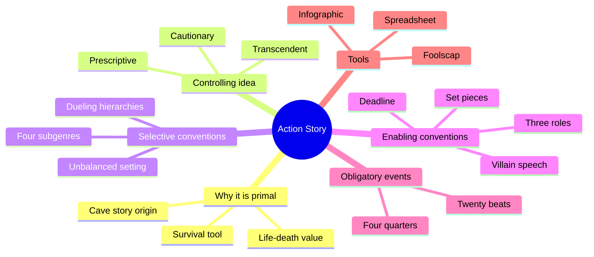
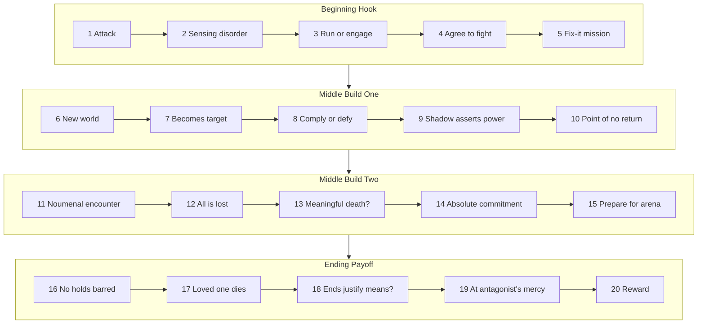
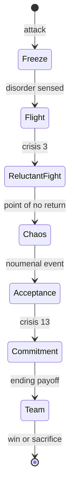
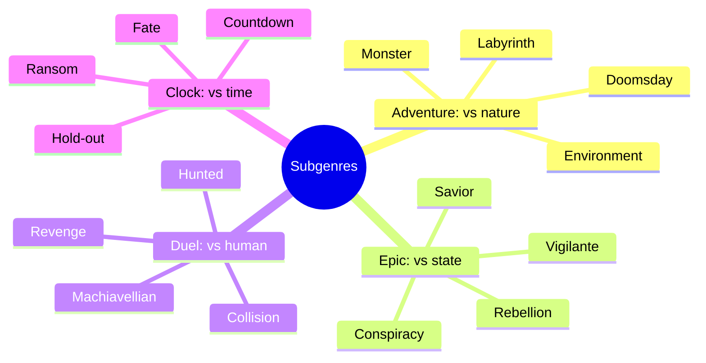

# BVX.0049 — Action Story: The Primal Genre (Beats) — Shawn Coyne (2020)
### Knowledge Entry — Distill

A short Story Grid guide to the Action genre: its life/death value, controlling ideas, conventions, four subgenres and a 20-beat obligatory-event map. It is in the library as craft basis for the OXO script editors.

## TABLE OF CONTENTS
- [Core Thesis](#1-core-thesis)
- [Mind Models](#2-mind-models)
- [Framework](#3-framework--structure)
- [Key Concepts](#4-key-concepts)
- [Heuristics](#5-heuristics--decision-rules)
- [Invariants](#6-invariants)
- [Pitfalls](#7-pitfalls--myths)
- [Application](#8-application)
- [Cross-References](#9-cross-references)
- [Provenance](#10-provenance--confidence)

---

## 1 · CORE THESIS

Action is the first story form: a survival tool. Every scene must move a character toward or away from death. Selective conventions (unbalanced setting, dueling hierarchies) and enabling conventions (three roles, villain speech, deadline, set pieces) set up twenty obligatory events across four quarters.

---

## 2 · MIND MODELS

**Diagram 1 — the whole argument.**
Read off the book's two halves: why Action matters (survival, life/death value, controlling idea) and how it is built (constraints, then events).

**Diagram 2 — the central mechanism (the 20 beats).**
Each quarter runs the Five Commandments (inciting incident, turning-point complication, crisis, climax, resolution); the midpoint is a point of no return, and the global crisis sits in the third quarter.

**Diagram 3 — the protagonist's fear and growth arc across quarters.**
Read the protagonist as moving from freeze, to flight, to reluctant fight, to chaos, to acceptance, to participatory sacrifice.

**Diagram 4 — the four subgenres and their plots.**
Each subgenre names what the shadow agent is; the plots are hook attractors inside it.

---

## 3 · FRAMEWORK / STRUCTURE

The book is ten short chapters, in three movements.

1. **Why (ch. 1-4).** Action stories came first because stories are survival psychotechnology. The core value is life vs death. The controlling idea (one sentence, names cause and the climactic value change) comes in three kinds.
2. **Constraints (ch. 5-7).** Selective constraints narrow the problem: an unbalanced setting and dueling hierarchies, divided into four subgenres. Enabling constraints give rise to solutions: the three roles plus the catalysts (villain speech, deadline, set pieces).
3. **Events and tools (ch. 8-10).** Twenty obligatory events across four 25-percent quarters, then the Foolscap page, spreadsheet and infographic to track them.

Genre question: will the luminary agent and the agency-deprived survive antagonism?

---

## 4 · KEY CONCEPTS

| Concept | What it is | Why it matters |
|---|---|---|
| Life-death value | Global spectrum from damnation and death, through homeostatic, to transcendent life | Every scene must shift it; this is what makes a scene "Action" |
| Micro and macro value | Scene-specific value (unconvincing to convincing) nested inside life/death | Pick one level per editing pass; the scene must carry both |
| Controlling idea | One sentence: climactic value change plus its cause | Stops the story being spectacle with no message |
| Prescriptive, cautionary, transcendent | Win by insight; die by lacking it; die sacrificially so others grow | Gives dark endings a meaning that still works |
| Phere | An unexpected event that drops into a life | Each quarter opens on one; the protagonist is the antagonist's phere |
| Unbalanced setting | Beneath-the-surface asymmetry of power | Without it, no believable conflict |
| Growth hierarchy | Ladder of skill and becoming, with mentors | The luminary agent's way |
| Power/dominance hierarchy | Pyramid of status that takes others' agency | The shadow agent's way; both pure poles collapse |
| Luminary agent | Protagonist who lights a path for the greatest common good | Role 1 |
| Shadow agent | Antagonist who deprives others of agency | Role 2 |
| Agency-deprived | Victim who cannot initiate or control action | Role 3; defines the stakes |
| Speech in praise of the shadow agent | Scene stating the antagonist's power | Sets the power gap that forces growth |
| Deadline | Time pressure device | Speeds choices and tension |
| Set pieces | Mini-action stories (chase, heist) | Show worldview and let the hero pick up a skill used in the climax |
| Noumenal encounter | Unexplainable event at the start of Middle Build Two | Hero accepts not-knowing; the antagonist insists on control |
| Obligatory events | Payoff scenes genre fans expect | Must be present and freshened, but may be reordered, shrunk or offstage |
| Shapeshifter, threshold guardian | Allies of uncertain loyalty; boundary figure | Show up in Middle Build One and the crisis of the ending |

---

## 5 · HEURISTICS & DECISION RULES

| Situation | Do this | Not this |
|---|---|---|
| Stuck on an action scene | Return to the core definition: a tool for surviving external change | Add spectacle |
| Writing a scene | Choose one value that shifts and stick to it | Chase several value shifts at once |
| Editing | Run macro (life/death) and micro (scene value) as separate passes | Both lenses at once, or editing while drafting |
| A scene has no life/death shift | Revise until it does, or reconsider the genre | Keep it because it is well written |
| Building the world | Seed hidden asymmetry and a power gap | A harmonious opening |
| Planning the antagonist | Give them confidence, an ideology and a persuasive case (speech in praise) | A bumbler or a cartoon |
| Midpoint | Let the chaos run with no solution offered | Resolve it fast |
| Ending with a death | Make it sacrificial for the survivors | Meaningless death |
| Final fight | Mirror the first phere at higher power; win by overpowering, outwitting, or both with a skill planted earlier | Deus ex machina |
| Crises | Make them best-bad-choice or irreconcilable-goods | An easy choice |
| Fresh Action | Keep the obligatory events, change how they are staged | Drop them, or repeat the classic version |

---

## 6 · INVARIANTS

1. Primary value is life vs death; each scene moves closer to one or the other.
2. The controlling idea names a cause and a climactic value change in one sentence.
3. Three roles exist at every nested level (beat, scene, sequence, act, global): luminary agent, shadow agent, agency-deprived.
4. The setting starts imbalanced.
5. Each quarter has the five commandments, and the whole sits on four quarters of about 25 percent each.
6. The protagonist's initial approach fails; the fear response runs freeze, flight, fight.
7. The Middle Build One resolution is the irreversible point of no return.
8. Someone the audience cares about dies in the ending payoff.
9. The global climax puts the protagonist at the antagonist's mercy and must surprise.
10. Constraints enable innovation; they do not block it.

---

## 7 · PITFALLS / MYTHS

- "Action is only entertainment." The book argues it is the most important genre.
- Spectacle without message: fast food with no nutrition.
- A hero who dies for nothing teaches that life is meaningless; the book says this does not endure.
- Nihilist worldviews can work for a niche audience but not "through time."
- Perfectly harmonious opening worlds.
- Antagonist weakness, or leaving out the speech in praise.
- Mixing macro and micro analysis, or editing while writing.
- Skipping a beat because it can be off stage. The writer must know exactly how each event is represented.
- Repeating the stock version of an obligatory event.
- Assuming one subgenre per story. Stories shift (The Threshing moves from Adventure to Epic to Duel to Clock).
- Pure growth or pure power worlds: both collapse into chaos.

---

## 8 · APPLICATION

- **Spine level:** TEXTURE. The book supplies telling craft and beat checklists, not a spine level.
- **12-layer character stack:** none directly; `feeds: []`.
- **plot_systems:** none.
- **Setting:** the unbalanced-setting and dueling-hierarchies lens applies to worldbuilding.

Use for the script editors: (1) a per-scene check that a life/death or equivalent stakes value turns; (2) a beat map to test whether an act has all five commandments; (3) a villain checklist (speech in praise, confidence, argument); (4) a midpoint test (no way back, no solution offered); (5) an ending test (skill planted in a set piece, caring death, sacrifice). Caution: the Action framing fits action-adventure material; other genres need other Story Grid genre guides. The philosophical framing (luminary and shadow agents, growth hierarchy) is Coyne's own and is optional for editing use.

---

## 9 · CROSS-REFERENCES

| Related entry | Relation |
|---|---|
| [[BVX.0043]] | Master plots; compare with the subgenre plot list |
| [[BVX.0054]] | Premise line; compare with the controlling idea |
| [[BVX.0064]] | Role and cast design; compare with the three-role cast |
| [[BVX.0089]] | Dramatica, a competing structural theory |
| [[BVX.0092]] | Dramatic structure primer; compare quarters and turning points |

---

## 10 · PROVENANCE & CONFIDENCE

Full text read: all ten chapters, the front matter and the author note, via pdftotext (about 1,750 lines). No unread chapters. Links to storygrid.com pages were not followed. The tools chapter (10) is only a pointer to online material, so its content is thin. Cross-references are confirmed to exist in KNOWLEDGE_AREAS but were chosen from titles, not from reading those entries. Application points are inference.

## META
- Template: BVX-LEARN-v4.0
- Source classification: book, craft guide
- Created / Updated: 2026-10-30
