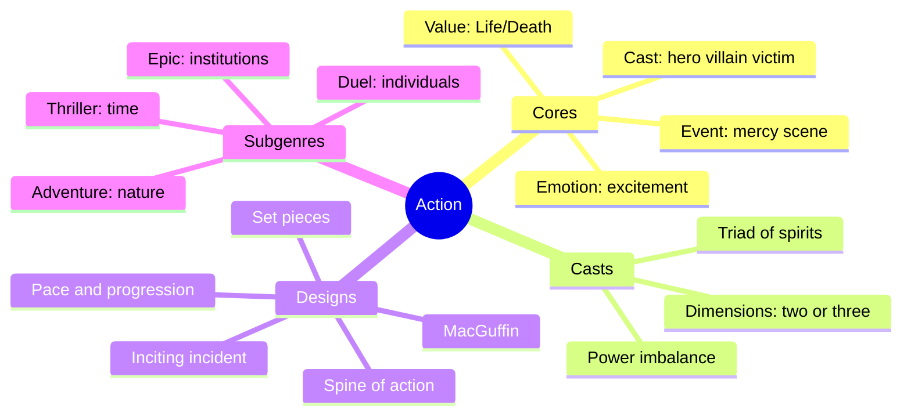
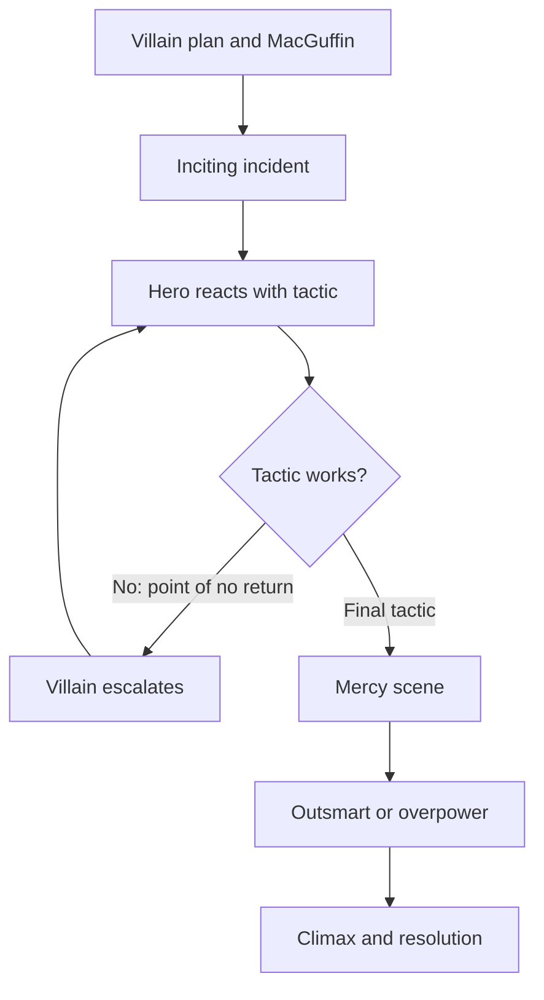
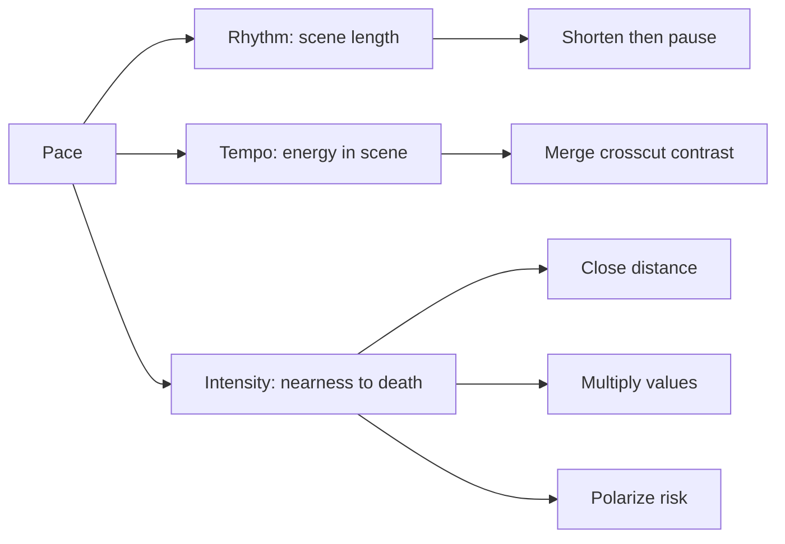
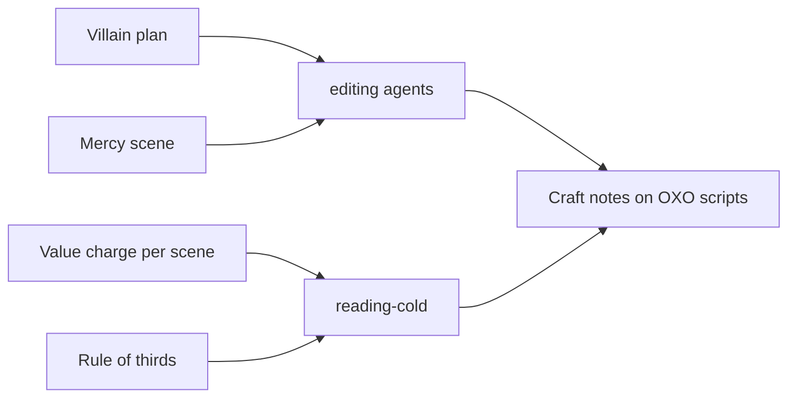

# BVX.0050 — Action: The Art of Excitement for Screen, Page, and Game — McKee and El-Wakil (2022)
### Knowledge Entry — Distill

McKee's genre manual for Action stories: the hero/villain/victim triangle, the mercy scene, the MacGuffin, set pieces, pacing, and sixteen plot types. It is the craft basis for the OXO script editors.

## TABLE OF CONTENTS
- [Core Thesis](#1-core-thesis)
- [Mind Models](#2-mind-models)
- [Framework](#3-framework--structure)
- [Key Concepts](#4-key-concepts)
- [Heuristics](#5-heuristics--decision-rules)
- [Invariants](#6-invariants)
- [Pitfalls](#7-pitfalls--myths)
- [Application](#8-application)
- [Cross-References](#9-cross-references)
- [Provenance](#10-provenance--confidence)

---

## 1 · CORE THESIS

Action is Life versus Death. A self-sacrificing hero, a self-obsessed villain and a helpless victim play it out. The villain's original plan drives the story. The hero's improvised tactics answer it. Excitement comes from an underdog beating an overdog in a way no one saw coming.

---

## 2 · MIND MODELS

**Diagram 1 — the whole argument.**
Read off the four parts: the core conventions, the cast, the event design, and the subgenres. Everything hangs on the villain being stronger than the hero.

**Diagram 2 — the central mechanism.**
Read off the engine: the villain acts, the hero reacts, each failure forces a harder tactic, and the loop ends in the mercy scene and a reversal.

**Diagram 3 — the excitement dials.**
Read off the three pacing dimensions and the lever on each. The writer tunes all three and never repeats a beat.

**Diagram 4 — mapped onto the Command's systems.**
Read off the mapping from McKee's roles to the OXO editor questions. The villain-first rule shapes what editors check first.

---

## 3 · FRAMEWORK / STRUCTURE

The book has four parts.

1. **Part One, Cores (ch. 1-5).** Every principal genre has four conventions: core value, core cast, core event, core emotion. Action's are Life/Death; hero, villain, victim; hero at the mercy of the villain; excitement. Ten principal genres are listed against Action. Ten presentational genres (tone, musical, sci-fi, history, ontology, documentary, animation, autobiography, biography, high art) dress any principal genre.
2. **Part Two, Casts (ch. 6-7).** Roles versus characters, dimensions, hybrid roles, and how power is built through the principle of antagonism.
3. **Part Three, Designs (ch. 8-16).** Inciting incident, spine, MacGuffin, tactics, set pieces, dialogue of praise and mockery, crisis and climax, pace, depth and breadth.
4. **Part Four, Subgenres (ch. 17-23).** Four subgenres by the villain's source of power, each with four intra-subgenres (sixteen total), then mixtures, High Adventure, and a warning against formulas.

| Subgenre | Villain's power | Intra-subgenres |
|---|---|---|
| Adventure | Nature | Disaster, Monster, Doomsday, Labyrinth |
| Epic | Institutions | Rebellion, Conspiracy, Vigilante, Savior |
| Duel | Individuals | Revenge, Chase, Collision, Machiavellian |
| Thriller | Time | Fate, Unraveling, Deadline, Holdout |

---

## 4 · KEY CONCEPTS

| Concept | What it is | Why it matters |
|---|---|---|
| Core value | Life/Death; the charge that must swing in every turning point | Without death at stake, violence is empty choreography |
| Hero spirit | Altruism; the center of good and the audience's empathy | Keeps pain at a safe distance, so danger reads as excitement not terror |
| Villain spirit | Narcissism; others are expendable tools | Separates Action from Horror (sadism) and Crime (can be bought off) |
| Victim spirit | Helplessness; cannot save herself | If she can, the hero is pointless. Gets sympathy, not identification |
| Mercy scene | Hero weaponless, villain triumphant, hero turns it by outsmarting and/or overpowering | The core event. The hardest scene in the genre to write well |
| Inciting incident | Hero discovers villain, villain's plan, MacGuffin (any one can open the story) | Usually lands inside the first 25 percent, once it can hit with full force |
| Villain's plan | Must be rational, probable, dangerous, rewarding, character-specific | Drives the whole spine. Plan quality equals story quality |
| Underdog/overdog | Villain vastly stronger; hero vulnerable to the villain's key tactic | Creates empathy and the "how will she do it" suspense |
| Tactical imbalance | Villain is immune to the hero's primary tactic | Forces new talents out of the hero |
| Negation of the negation | Evil worse than death: mass murder, death posing as life, damnation | Sets the ceiling of antagonism |
| MacGuffin | The thing both want; whoever holds it holds power | Gives conflict variety, progression, portability |
| Dimension | Two contradictory traits in one role | Action roles carry two or three at most; more slows pace |
| Hybrid roles | Hero-victim, hero-villain, victim-villain, all three | Complicates the mercy scene, which needs a separate villain |
| Set piece | Tension (nearness to danger) plus kinesis (sensory energy) | The arias. Must turn the Life/Death charge |
| Five set-piece movements | Toward danger, away, rescue, scramble for MacGuffin, confront | Vary them to avoid repetition |
| Five excitement techniques | Rebellion, exploring unknown, frustration, limits, taboo | Same five dress the set piece obstacles |
| Rhythm, tempo, intensity | Scene length, in-scene energy, proximity to death | The three pacing dials |
| Image system | Subliminal repeating category of imagery, varied each time | Deepens meaning and emotion. Fails if noticed |
| Form vs formula | Form is universal; formula is a rigid subset | Hero's Journey and Whammo Chart are formulas |

---

## 5 · HEURISTICS & DECISION RULES

| Situation | Do this | Not this |
|---|---|---|
| Starting a story | Design the villain and plan first, then the hero's reaction | Start with a hero and bolt on a threat |
| Inciting incident | Bring it as early as it can land with full impact | Open on it before the audience has what it needs |
| Heavy exposition | Dramatize it in a setup subplot, crosscut hero and villain, or stagger the discoveries | Front-load one exposition scene |
| Hero too strong | Give the villain immunity to the hero's main tactic and a weapon that works on the hero | Plant an Achilles' heel the audience sees coming |
| Killer-hero problem | Change the rules of engagement (Bond captures, does not assassinate) | Let the hero slaughter henchmen two at a time |
| Mercy scene | Hero and villain face to face; hero wins by wit and/or muscle from his own character | Henchman villain, coincidence, last-minute rescue, "look behind you" |
| Villain won't kill the hero | Use the villain's vanity and give a motive to gloat or torture | "I want you to suffer but can't be bothered to watch" |
| Villain power | Keep his abilities secret and reveal one at a time at the worst moment for the hero | Show everything early. Do not make him omnipotent |
| Villain secret | Make it change the spine when revealed | Reveal a name or backstory that changes nothing |
| Victim | Keep her helpless, one-dimensional, sympathetic | Give her skills that let her escape |
| Hero dimensions | Two or three, tied to the villain's pressure | Long inner-turmoil scenes that stall the duel |
| Praise and mockery | Praise the villain through warnings; mock the hero sparingly | Have the whole cast mock the villain (Loki in Avengers) |
| Set piece | Change the Life/Death charge; pick the movement; make choices that reveal character | Choreography with no turning point (Matrix Reloaded park fight) |
| Ordering set pieces | Open strong, back off, then build to the strongest (4-1-2-3-5-6) | Weakest to strongest in a straight line |
| Repeating a beat | Remember thirds: full effect, half, then the opposite | Three of the same chase, fight, or sad scene in a row |
| Scene charge | Alternate positive and negative within and between scenes | Cluster same-charge turns |
| Screenplay action | Write the turning point and who wins; "They fight" is often enough | Blow-by-blow choreography on the page |
| Meaning | Let it live in events: cause plus value change | Have a character state the moral |
| Long form | New villain and MacGuffin per episode, or an uber-MacGuffin | One simple MacGuffin stretched over years |
| Cliche check | Find the conventional beat, then research for a never-seen version | Copy the imitated version |

---

## 6 · INVARIANTS

1. The core value is Life/Death, and a real threat of death is on the table.
2. The core cast is hero, villain, victim. Without a victim the hero cannot be heroic.
3. The villain starts the fight. The hero reacts. The villain's plan drives the spine.
4. The villain must be more powerful than the hero, and the hero's tactics fail in turn until a final one works.
5. Every turning point passes a point of no return. The hero cannot reuse a tactic.
6. Heroes rarely change inwardly. Action arcs outer fortune; adding an inner arc means merging a character-change genre.
7. Most Action endings are positive because the genre promises a positive experience.
8. Mentors are not an Action role. They enter via a merged Maturation plot.
9. Emotion and meaning arrive together at a turning point; meaning is felt, never spoken.
10. Repetition always loses force; progression wins.

---

## 7 · PITFALLS / MYTHS

- **Absent villain.** Mercy scene run by a goon, so nothing is at stake.
- **Achilles' heel.** A visible flaw (Bane's mask) means the audience waits for the off switch.
- **Deus ex machina in costume.** Deus ex partner, lover, luck, traitor. Any shortcut that takes the key choice out of hero or villain hands.
- **Omnipotence.** T-X versus T-1000. Limits breed ingenuity; unlimited power looks dim-witted. Green Lantern's Hot Wheels rescue.
- **Doppelganger villain.** A mirror enemy often yields a dog-eat-dog stalemate.
- **Collision plot trap.** Two heroes who will not kill each other cannot honestly stake Life/Death; mind control and misunderstanding are weak fixes.
- **Missing victim.** 2012 and Thor: Ragnarok: spectacle without compassion.
- **Transparent villain.** If the plan is known, there is no menace.
- **Reactive villain.** A villain defending a fortress belongs to the War genre.
- **Corporate-CEO villain, Troy-horse escape, villain comes back to life.** Cliches born from good ideas.
- **Hero's Journey and Whammo Chart.** Formulas that mistake a part for the whole; the book treats Campbell's claims as discredited.
- **Games.** The avatar has no free will; the true character belongs to the player, so game film adaptations come out flat.
- **The Tyranny Myth.** Action can be perverted into propaganda: a leader descends, kills bad people, and rises. Know it to expose it.

---

## 8 · APPLICATION

- **Spine level:** TEXTURE. The book is genre and scene craft, not a spine-level model, so it keys texture and telling.
- **12-layer character stack:** none. It treats character as role and choice under pressure, not psychology. `feeds` stays empty.
- **plot_systems:** none directly.
- **Setting:** none.

**Use for the editors.** The OXO script editors can run this as a checklist.

1. **Villain first.** Ask whether the plan is rational, probable, dangerous, rewarding and character-specific, and whether the villain has a secret that moves the spine.
2. **Mercy scene audit.** Is the villain present? Does the hero win by outsmarting or overpowering, using something planted early and seen only in retrospect?
3. **Charge map.** List each scene's start and end charge. Flag three same-direction scenes in a row (the rule of thirds). Flag set pieces with no value change.
4. **Variety audit.** Tag every set piece with one of the five movements and the five excitement techniques. Flag repeats.
5. **Cast audit.** One to three dimensions on the hero, a helpless victim, polarized helpers and hinderers, and no neutrals.
6. **Reading cold.** Test whether an audience can feel the meaning without anyone saying it. Flag spoken morals.

OXO is a school story, so it is not a pure Action story. The useful carry-over is the merged-genre guidance: when an inner-change arc is merged with a threat plot, expect to trade some excitement for empathy and anxiety. Treat Chapter 21 as the rule for deciding which story line leads.

---

## 9 · CROSS-REFERENCES

| Related entry | Relation |
|---|---|
| [[BVX.0064]] | McKee's Character: roles, dimensions, and the six inner-change genres this book defers to |
| [[BVX.0054]] | Premise and story development; pairs with the meaning-as-cause-and-value-change idea |
| [[BVX.0053]] | Alternative scriptwriting; the counterweight to this book's genre conventions and formula warnings |

---

## 10 · PROVENANCE & CONFIDENCE

Sourced from the full pdftotext of the book at `_PRIVATE/distill_wave/BVX.0050.txt`, read front to back across all 23 chapters, the prologue, and the back matter. No chapter went unread. The text file is not valid UTF-8 (curly quotes and accents garbled), which did not affect content. Film and game examples are the authors' own; plot summaries are condensed, not checked against the works. Section 8's editor checklist is inference from the book's principles, not text from the source. Confidence is high on the extraction and medium on how well a school-drama fits the Action genre.

## META
- Template: BVX-LEARN-v4.0
- Source classification: book, craft and genre theory
- Created / Updated: 2026-10-30 / 2026-10-30
