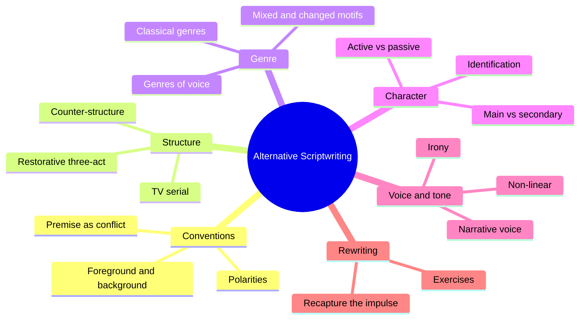
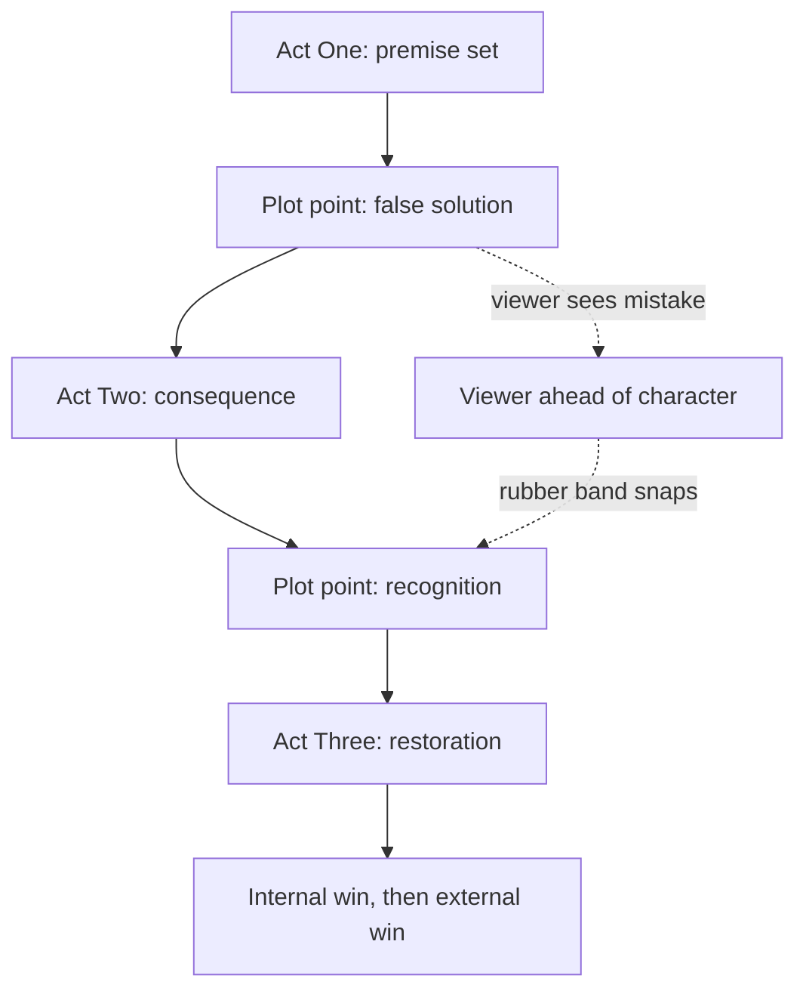
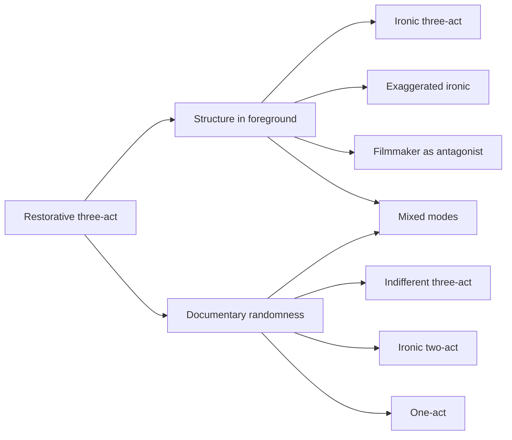
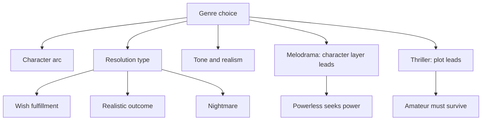

# BVX.0053 — Alternative Scriptwriting: Beyond the Hollywood Formula — Dancyger, Rush (2013, 5th ed.)
### Knowledge Entry — Distill

A screenwriting craft text that names the dominant three-act form, shows what it silently carries, and offers counter-structures, genre choice, character options, tone and rewriting tactics as deliberate alternatives. It is the craft basis for the script editors.

## TABLE OF CONTENTS
- [Core Thesis](#1-core-thesis)
- [Mind Models](#2-mind-models)
- [Framework](#3-framework--structure)
- [Key Concepts](#4-key-concepts)
- [Heuristics](#5-heuristics--decision-rules)
- [Invariants](#6-invariants)
- [Pitfalls](#7-pitfalls--myths)
- [Application](#8-application)
- [Cross-References](#9-cross-references)
- [Provenance](#10-provenance--confidence)

---

## 1 · CORE THESIS

Form is never neutral. The restorative three-act structure carries a worldview (free will, redeemable mistakes, history as backdrop), so choose structure, genre, character and voice on purpose. Learn the conventions fully, then bend them to fit your story. A script fails from lack of urgency and life, not from broken rules.

---

## 2 · MIND MODELS

**Diagram 1 — the whole argument.**
Read it as: convention first, then four independent dials (structure, genre, character, voice) you can turn away from the default, and a rewrite discipline that keeps the script alive.

**Diagram 2 — the central mechanism (restorative three-act).**
Read it as: each act break is a character stage, and the story is a transgression, recognition, redemption loop in which the viewer stays ahead of the character during Act Two.

**Diagram 3 — how a counter-structure departs from the default.**
Read it as: every alternative either makes structure loud (foreground) or flat (documentary), and most mix both.

**Diagram 4 — genre as meta-structure.**
Read it as: genre fixes the character arc and resolution, and splits into plot-led and character-led families.

---

## 3 · FRAMEWORK / STRUCTURE

The book moves in six bands.

1. **Conventions (Ch. 1).** Conflict, premise stated as a choice between two options, polarities between characters, discovery, reversal, turning points, subtext. Dialogue does three jobs: characterize, define plot, relieve tension. Atmosphere is accumulated detail that makes one coherent world on the page.
2. **Structure (Ch. 2 to 7).** Define restorative three-act, critique it, offer counter-structures, reframe the "three-act" argument with modern films, profile director-level choices (Spielberg, Soderbergh), then extend the model to long-form television serials built on theme and character lines.
3. **Genre (Ch. 8 to 13).** Genre is the "missing link": it sets arc, resolution, character population and tone. Classical genres fit three acts. Genres of voice (satire, fable, docudrama, experimental) do not.
4. **Linearity and fable (Ch. 14 to 15).** Non-linear films trade character energy for voice and sensation. The fable is the positive twin of satire and uses a two-world design.
5. **Character, subtext, form, agency, history (Ch. 16 to 23).** Active versus passive, identification tools, main versus secondary characters, foreground versus background story, screenplay form as expression, who has agency and who is "the other".
6. **Tone, voice, digital, rewriting, adaptation, personal work (Ch. 24 to 31).** Irony, dramatic versus narrative voice, mixed-media features, rewrite exercises, literary adaptation, the "edge".

---

## 4 · KEY CONCEPTS

| Concept | What it is | Why it matters |
|---|---|---|
| Restorative three-act | Well-made-play descendant: transgression, recognition, redemption, with time for restoration and no undercutting irony | The default to know cold; it implies a moral, tidy world |
| False solution | The Act One plot point that appears to solve the dilemma but opens a worse one | Creates the gap between viewer and character |
| Act of consequence | Act Two, ending when the character faces the false solution | Highest identification arrives at its curtain |
| Binary character psychology | Acts force either/or choices (Bud: Gekko or father) | Clarity, at the cost of nuance and unaccounted residue |
| Decision-making space | A moment emptied of distraction so the choice is unmistakable | Real choices are rarely this clean |
| Effaced narrator | Structure itself plays narrator; story seems to tell itself | Break the structure and the narrator becomes visible |
| Ironic / exaggerated ironic three-act | Build the restorative expectation, then foil it (Chinatown) or parody it (Blue Velvet) | Keeps satisfaction while adding distance |
| Indifferent / flattened structure | Cut the moment of decision; static, opaque scenes (Badlands) | Inexplicable distance reads as coldness |
| One- and two-act | One line, no turning plot points (Mean Streets) | Relentless power, hard to sustain |
| Genre as meta-structure | Genre fixes arc, resolution, population, tone | Chosen before writing, or the writer "stumbles" |
| Character layer vs plot | Melodrama favors the character layer; thriller favors plot | Tells you what to spend page time on |
| Amplitude of the arc | Steepness of the dramatic arc: soap opera, moral drama, tragedy | Sets the intensity of melodrama |
| Foreground / background story | Action line (external, conflict) vs interior issue (identification, subtext) | Deep satisfaction comes from the background |
| Active, energetic, intentional | The conventional main character traits | Convenient but not required |
| Narrative drive / urgency | Fate of a person, community or world is at stake | Substitutes for an active lead |
| Empathy vs sympathy vs antipathy | Feeling for, feeling like, and liking-to-hate | Choose the level deliberately |
| Moment of revelation | A vulnerable disclosure that earns tolerance for a bad lead | Cheapest bridge to a negative character |
| Charisma checklist (Schiffer) | Foreignness, subtle imperfection, mission, polarized intensity, sexual dimension, persuasion | Makes unlikable leads watchable |
| Voice | The writer's presence: narrative over dramatic | Central in satire, fable, non-linear |
| Taking the curse off | Give a character an overt reason not to say the thing | Cures on-the-nose explaining |

---

## 5 · HEURISTICS & DECISION RULES

| Situation | Do this | Not this |
|---|---|---|
| Story feels flat in Acts Two and Three | Check whether you gave the best away in Act One; hold the build | Pile on complications |
| Stuck at the end of Act Two | Plant the potential for change in Act One | Invent a late personality shift |
| Acts all push the same way | Modulate: Act One up and out, Act Two down and in, Act Three consolidation | Write one relentless act by accident |
| Mapping a plot | Run two parallel breakdowns, action and character, until they align | Trust a plot-only outline |
| Choosing genre | Decide it before drafting; let it set arc, resolution, tone | Stumble forward and name genre afterward |
| Lead is unlikable | Add a moment of revelation, a redeeming quality, heroism or charisma | Ask for love; settle for fascination |
| Lead is passive | Give the story urgency and a driven secondary character | Make every character quiet |
| Plot-heavy genre | Add a modest background story (The Package, Dave) | Promise depth you will not deliver |
| Scene explains itself | Write the thoughts under the lines; require a skew between speech and thought | Let dialogue restate thought |
| Too close to your character | Shift POV or write an unreliable scene; add irony | Fall in love with a paragon |
| Exposition is dead | Rewrite the early scene as a late scene; move the start to page 10 or 20 | Keep setup weight from old drafts |
| Outcome is obvious | Rewrite with an opposite outcome, then restore with minimal edits | Resolve the scene early |
| Critic says "fix scene X" | Find what expectation you set 20 pages earlier | Accept the fix at face value |
| Edit session feels rule-bound | Return to the initial impulse and a concrete image or moment | Check the script against a rules list |

---

## 6 · INVARIANTS

1. Every screen story needs conflict, surprise and turning points; the alternatives bend how, not whether.
2. Nothing in form is neutral; structure always implies a point of view.
3. There is always a storyteller; structure or voice performs the narration.
4. A story must be set up and must have confrontation; pure one-act is a fragment risk.
5. Discoveries should grow in scale as the story advances; reversals lose force when overused.
6. Genre expectations are the audience's contract; breaking them changes meaning and tone together.
7. The writer must know the rule fully before breaking it.
8. A script needs urgency and life; checklists cannot supply them.

---

## 7 · PITFALLS / MYTHS

- "Three acts are neutral." They carry free will, redeemable error, and history as backdrop.
- "Copy disorder to be real." Reproducing disorder is not writing about it; foreground the conflict between focus and confusion.
- "Passive leads never work." They work if the story or secondary characters supply drive.
- "A rules checklist makes a good script." Amateur scripts hit every act break and are dead.
- "Deeper characters improve every genre." A thriller's character layer often only slows it.
- "Imitate the breakout." Pulp Fiction's imitators lacked novelty; voice or difference is the fix.
- "The foreground story is the important one." Often the background carries the meaning.
- Serials over-foreshadow, so they lose the randomness of alternative films.
- Characters who explain the theme, with no counter-voice, cannot be played.
- Mixed genres fail when motifs fight without purpose (the book's case: Basic Instinct).

---

## 8 · APPLICATION

- **Spine level:** TEXTURE (scene, beat, voice and tone craft); not the L0 to L7 plot spine.
- **12-layer character stack:** none wired (`feeds: []`); character material is craft, not psychology.
- **plot_systems:** act breaks as character stages inform chapter-scale pacing.
- **Setting:** atmosphere as accumulated particular detail; two-world dialogue and atmosphere (Queens versus Upper East Side).

For the OXO script editors: the useful tools are the restorative-structure tests (does each plot point move both plot and character? is potential for change planted in Act One?), the foreground versus background audit, the identification toolkit for flawed leads, and the rewrite exercises. Keep a note that the book's examples are mostly 1950s to 2000s film; for long-form serial work use Ch. 7 (theme and premise in the pilot, character lines that spiral, juxtaposition across seasons). The reading-cold agent can use the "cross out the dialogue" test and the "skew between speech and thought" test as concrete checks.

---

## 9 · CROSS-REFERENCES

| Related entry | Relation |
|---|---|
| [[BVX.0054]] | Premise line; here premise is framed as two opposed options for the lead |
| [[BVX.0061]] | Characters and viewpoint; pairs with this book's voice and identification chapters |
| [[BVX.0064]] | McKee on character; contrast with binary character psychology critique |
| [[BVX.0075]] | Character creation for screen; pairs with active/passive and secondary-character chapters |
| [[BVX.0056]] | Active setting; pairs with atmosphere as accumulated detail |
| [[BVX.0066]] | Cinematic storytelling; pairs with voice carried by direction |

---

## 10 · PROVENANCE & CONFIDENCE

Sourced from the full text (pdftotext, 479 pages), read in sections: Ch. 1 in full, Ch. 2 (restorative form) in full, Ch. 4 and Ch. 6 in full, Ch. 8 opening and the Melodrama and Thriller sections of Ch. 9 and 10, Ch. 13 (satire/fable), Ch. 14 (non-linear issues), Ch. 16 (conventional character and passivity), Ch. 17 (identification), Ch. 19 (foreground/background), Ch. 24 opening and Ch. 25 opening, Ch. 28 (rewriting) in full, and the pilot and summary sections of Ch. 7.

Not read in running text, known from headings only: Ch. 3 (reframing the three-act discussion), Ch. 5 (Spielberg and Soderbergh), Ch. 11 and 12 (working against genre and the flexibility of genre), Ch. 15 (fable case study), Ch. 18, Ch. 20 to 23 (form, agency, history), Ch. 26 and 27 (digital features and narrative voice), Ch. 29 to 31 (adaptation and personal scriptwriting). Claims about these chapters are limited to what their titles and headings state. Confidence is medium because of that gap.

## META
- Template: BVX-LEARN-v4.0
- Source classification: craft textbook, book
- Created / Updated: 2026-10-30
