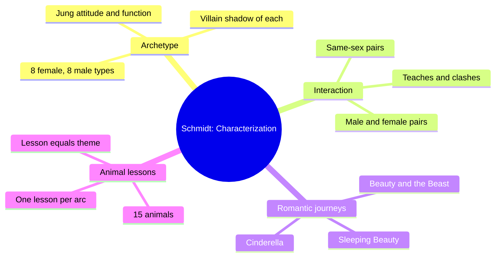
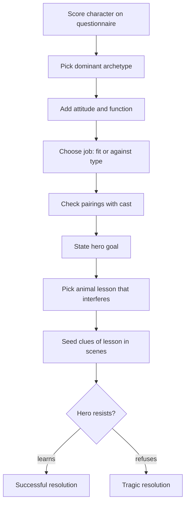
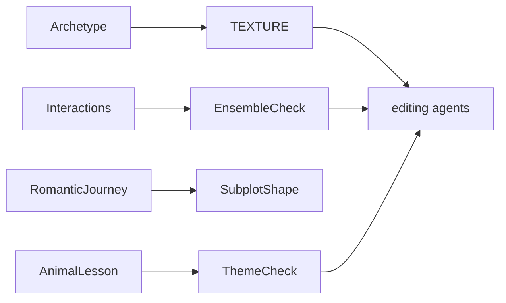

# BVX.0057 — A Writer's Guide to Characterization — Schmidt (2012)
### Knowledge Entry — Distill

A craft handbook that sorts characters into sixteen Jungian-flavored archetypes, predicts how any two will clash or teach each other, and gives each hero an animal-themed lesson to learn. It follows the author's *45 Master Characters* and sits in the library as a craft basis for script editors.

## TABLE OF CONTENTS
- [Core Thesis](#1-core-thesis)
- [Mind Models](#2-mind-models)
- [Framework](#3-framework--structure)
- [Key Concepts](#4-key-concepts)
- [Heuristics](#5-heuristics--decision-rules)
- [Invariants](#6-invariants)
- [Pitfalls](#7-pitfalls--myths)
- [Application](#8-application)
- [Cross-References](#9-cross-references)
- [Provenance](#10-provenance--confidence)

---

## 1 · CORE THESIS

A character's deepest layer is one dominant archetype, filtered through Jung's attitudes and functions. Pair archetypes to generate conflict and mutual teaching. Then give the hero one animal-coded lesson to learn. That lesson is the theme, left unsaid, so readers find it themselves.

---

## 2 · MIND MODELS

**Diagram 1 — the whole argument.**
Read off the three tools the book stacks: who the character is, who they collide with, what they must learn.

**Diagram 2 — the central mechanism.**
Read off the order of choices: archetype first, then partners, then the lesson that interferes with the goal.

**Diagram 3 — mapped onto the Command's systems.**
Read off where the book plugs in: it informs surface texture and editor checks, not the LEECHSEED layers.

---

## 3 · FRAMEWORK / STRUCTURE

The book has two parts and an introduction.

**Introduction: Jungian typology.** Introvert or extrovert is the core of the character: how they meet the world and how others see them. Four functions say how they take in and judge information: sensing, thinking, intuiting, feeling. Sensing and intuiting are "irrational" (perceiving). Thinking and feeling are "rational" (judging). Archetype comes first; the functions externalize it.

**Part 1: Archetypes and how they interact (chs. 1 to 5).**
- Ch. 1 and 3: eight female archetypes (Seductive Muse, Amazon, Father's Daughter, Nurturer, Matriarch, Mystic, Female Messiah, Maiden) and eight male (Businessman, Protector, Recluse, Fool, Woman's Man, Male Messiah, Artist, King). Each entry gives a hero profile, a villain form, a "centered" label (physical, mental, emotional, spiritual), attitude, functions, suited occupations, and a belief or mantra. Each chapter ends with a ten-question scored questionnaire.
- Ch. 2 and 4: all 28 pairings inside each sex. Each pairing is labeled by center (for example physical vs. mental), flagged get-along or clash, and ends with what each can teach the other.
- Ch. 5: all 64 male-female pairings, each opening with the two characters' Maslow motivations. Then the book covers love letters as a characterization exercise, three romantic journeys, and a short craft section on love scenes.

**Part 2: Animal archetypes (chs. 6 to 21).** Ch. 6 frames the method; chs. 7 to 21 give fifteen lessons: Bear (patience), Buffalo (gratitude), Cougar (assertiveness), Coyote (curiosity, play), Deer (awareness), Dolphin (harmony, purpose), Fox (cleverness), Horse (freedom), Whale (self-acceptance), Wolf (individual and group), Eagle (deep relationship), Hummingbird (inner peace), Tiger (mysticism), Snake (death and rebirth), Butterfly (joyful transformation). Every chapter uses roughly one template: the animal's nature, the character arc, story examples, why the hero resists, how others view the lesson, successful and tragic resolution, how to illustrate it, twists, audience interest.

---

## 4 · KEY CONCEPTS

| Concept | What it is | Why it matters |
|---|---|---|
| Dominant archetype | One type per fiction character, though real people mix several | Keeps characters consistent and believable; stress reveals the dominant one |
| Villain form | Each archetype has a shadow (Seductive Muse to Femme Fatale, King to Dictator, Protector to Gladiator) | Gives antagonists a shared root with heroes |
| Center | Physical, mental, emotional or spiritual | Predicts pairing friction without reading the whole table |
| Attitude and function | Introvert/extrovert plus sensing, thinking, intuiting, feeling | Drives decisions, dialogue, mannerisms, scene location |
| Against-type job | Putting an archetype in the wrong occupation | Source of comedy and subtext in character-driven stories (*Miss Congeniality*, *Kindergarten Cop*) |
| Interaction pair | Two archetypes, who teaches what, clash or ease | Builds supporting cast and ensemble conflict |
| Ensemble vs. single lead | Several near-equal leads vs. one hero plus supports | Decides how many pairings to work out |
| Maslow motive | Each archetype driven by a need level (survival, love, esteem, actualization, aesthetic) | Explains why two types want different things from each other |
| Romantic journey | Three fairy-tale love plots: Cinderella (hero holds power, she falls first), Beauty and the Beast (heroine holds power, he falls first), Sleeping Beauty (equals, both fall together) | A subplot template with its own acts |
| Romantic theme | Rags to riches, rescue, independence, love vs. honor, love conquers all, second chances | Names what the love plot is about |
| Animal lesson | A thematic lesson the hero learns, coded to an animal | The lesson is the theme, kept subtext |
| Resistance | A reason from the hero's past why he avoids the lesson | Makes the hero the source of conflict, not only the villain |
| Successful vs. tragic resolution | Lesson learned vs. refused or half-learned | Gives a choice of ending tone |
| Love letter exercise | Write a letter in the character's voice that no one will read | A subtext and backstory probe |

---

## 5 · HEURISTICS & DECISION RULES

| Situation | Do this | Not this |
|---|---|---|
| Choosing a lead's type | Score the questionnaire, then decide among top scorers which to emphasize | Assume the highest score is the only legal answer |
| A character believes something | Test whether she acts on it in the major scenes | Count a backstory belief as her archetype |
| Picking an occupation | Match type for realism, or go against type on purpose for comedy or friction | Choose the job without asking what it does to the story |
| Plot-driven story | Pair archetypes that get along (cop buddies: different personalities, same archetype family) | Burn page time on clashes the plot does not need |
| Character-driven story | Pair clashing archetypes so each teaches the other | Let both partners hold the same strength |
| Chosen scene location | Check introvert/extrovert fit (quiet library vs. talkative extrovert) | Place scenes arbitrarily |
| Deciding how the hero decides | Use the function: senses, logic, gut, or feeling | Give every hero the same reasoning style |
| Picking a lesson | Ask what the goal is, then which lesson best interferes with it | Pick a lesson that agrees with the goal |
| Lesson placement | Hero of main plot, supporting character, or subplot hero; use one or several, lightly | Stack every lesson into one arc |
| Showing a lesson | Use symbols, settings, imagery and dialogue topics that echo the animal | State the moral in dialogue |
| Hero resists the lesson | Find the past event that drives him; write it as backstory | Make resistance mere stubbornness |
| Transformation by grace (Butterfly) | Have the hero take an active role in creating the opening | Let help fall from the sky (deus ex machina) |
| Romantic subplot in an action story | Use the journey stages even if they take a page | Skip love because the genre is "manly" |
| Romance as main story | Use a traditional journey as the spine; the romantic journey supplies hardships | Make love the only structure |
| Love scene | Outline a beginning, middle and end; build from sensual to steamier; run all five senses | Open at maximum and add nothing after |
| Villain design | Take the hero's archetype shadow, or the opposite type | Write a villain with no archetypal root |

---

## 6 · INVARIANTS

1. One archetype dominates each fiction character; others may color it.
2. Stress and major scenes reveal the dominant archetype.
3. Any archetype can face any animal lesson.
4. The lesson is where the character is going, not the tone of the scenes. A joy lesson does not mean joyful scenes.
5. Theme is left unsaid; readers must work it out for satisfaction.
6. A hero must act to earn change, even in the grace-style transformation.
7. In every interaction pair, each side holds something the other lacks.
8. Love is present in some form (backstory, subtext, or plot) in most stories worth reading.
9. A romantic plot has a power holder, and who falls first sets that.

---

## 7 · PITFALLS / MYTHS

- Treating the questionnaire result as destiny. The book says high scores in several columns are fine and require an authorial choice.
- Confusing belief with archetype (an independent-minded Nurturer is not an Amazon).
- Reading archetype pronouns as gender limits. The book alternates he and she and says both sexes can cross over.
- Too many lessons, which blurs the arc ("be careful not to overdo it").
- Deus ex machina in transformation arcs.
- Letting the villain be the only source of conflict, when a resisting hero often does it better.
- Skipping the love thread in action or thriller work.
- Reading the interaction tables as fixed law. The book says some archetypes teach the same thing to everyone.
- Over-relying on the author's own assertions: much of the animal lore (totem sites, personal anecdotes) is folk symbolism, not evidence.

---

## 8 · APPLICATION

- **Spine level:** TEXTURE. Archetypes and lessons shape how scenes feel and how characters speak and behave, not the structural spine.
- **12-layer character stack:** none wired (`feeds: []`). The book is a craft tool, not a psychology model. An editor could use archetypes loosely as a vocabulary to describe a character, but they are not a LEECHSEED field.
- **plot_systems:** the three romantic journeys are act-level templates for a romance subplot.
- **Setting:** scene location can express introvert/extrovert fit.

For the OXO script editors the useful parts are three checks. First, **consistency**: does this character act from one dominant center under pressure, or from backstory claims? Second, **pairing**: when two characters share a scene, does the conflict follow what each would teach the other, or is it flat? Third, **theme**: is the lesson dramatized through behavior, setting and objects, or stated outright? A cold reader can ask "what is this character learning, and who in the story would make that hard?" and test the answer against the draft. Treat the type labels as a vocabulary for notes, not as a casting machine; they are broad and sometimes dated (the female list leans on 1990s sitcom touchstones and gendered occupations).

---

## 9 · CROSS-REFERENCES

| Related entry | Relation |
|---|---|
| [[BVX.0045]] | The author's earlier *45 Master Characters*; this book extends its archetypes and journeys and defers to it for depth |
| [[BVX.0064]] | McKee's cast design; contrast his dimension-based character with Schmidt's type-based one |
| [[BVX.0075]] | Another character-creation handbook for screen; compare methods |
| [[BVX.0061]] | Characters and viewpoint; pairs with function-based decision style |

---

## 10 · PROVENANCE & CONFIDENCE

Source: pdftotext of the full book (8,523 lines) at `_PRIVATE/distill_wave/BVX.0057.txt`, read by section. Read in full or near-full: introduction, chs. 1 and 3 (archetype lists and questionnaires), ch. 5 introduction and the romantic journeys and love-scene section, ch. 6, and ch. 7 (Bear). Sampled by opening pages and, for ch. 21, the whole chapter: chs. 8 to 20, whose shared template I inferred from ch. 7 and ch. 21 and from chapter openings. Interaction chapters (2, 4, 5 pairings) were read for their intros and several pairings each; the pairing table was not read line by line, so claims about individual pairs are limited to those quoted. Unread in detail: the middle of chs. 8 to 20 (arc details, story examples, resolution lists) and the center of ch. 5 pairings (lines roughly 2720 to 4480). Entry marked complete on framework and heuristics; confidence medium because of those gaps and because the text file has some legacy-encoding characters.

## META
- Template: BVX-LEARN-v4.0
- Source classification: craft handbook (book), distill
- Created / Updated: 2026-10-30
