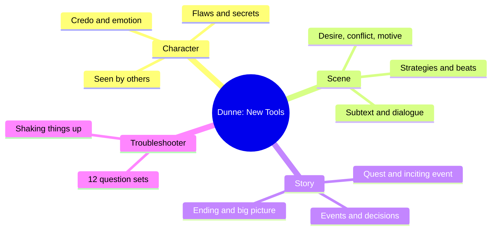
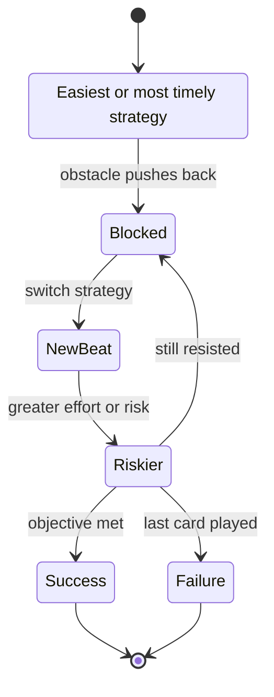
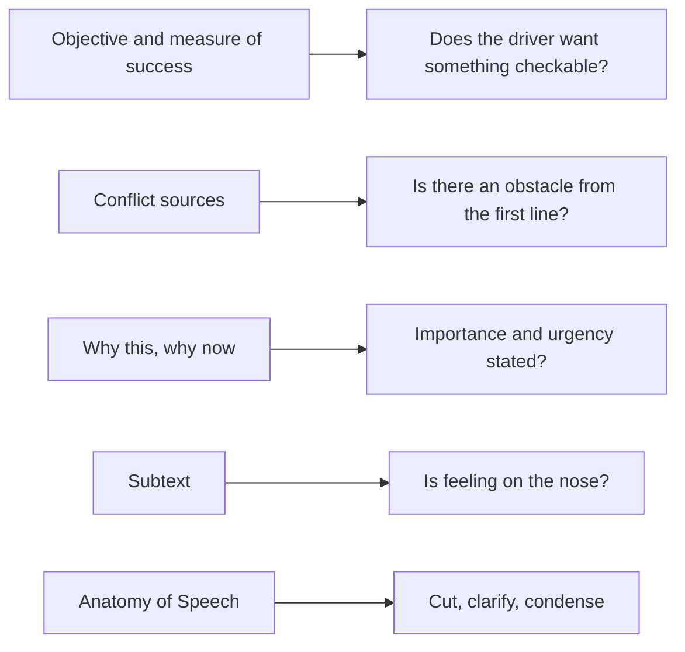

# BVX.0062 — Character, Scene, and Story: New Tools from the Dramatic Writer's Companion — Will Dunne (2017)
### Knowledge Entry — Distill

A workshop manual of about 40 self-contained writing exercises plus a 12-set scene troubleshooter. It is in the library as craft basis for the script editors: every exercise reduces to an objective, an obstacle, a reason it matters now, and a visible action.

## TABLE OF CONTENTS
- [Core Thesis](#1-core-thesis)
- [Mind Models](#2-mind-models)
- [Framework](#3-framework--structure)
- [Key Concepts](#4-key-concepts)
- [Heuristics](#5-heuristics--decision-rules)
- [Invariants](#6-invariants)
- [Pitfalls](#7-pitfalls--myths)
- [Application](#8-application)
- [Cross-References](#9-cross-references)
- [Provenance](#10-provenance--confidence)

---

## 1 · CORE THESIS

Character is the scene and the story. A scene happens because a character wants something important, faces obstacles, and cannot wait. Plot grows out of that want, so interrogate characters and scenes with concrete questions until each moment is shown through action, not explained in speech.

---

## 2 · MIND MODELS

**Diagram 1 — the whole argument.**
Three work zones, each with three stages, all rooted in one idea: character drives everything.

**Diagram 2 — the central mechanism (what makes a scene happen).**
Read left to right: desire plus obstacle plus stakes force strategies, each strategy is a beat, and the beats add up to the scenic event.

**Diagram 3 — the four behavioral objectives and how a scene escalates.**
A driving character cycles through the four verbs and moves from the easiest strategy to the riskiest.

**Diagram 4 — mapped onto the Command's script editors.**
Each tool family becomes a check an editor agent can run on a draft.

---

## 3 · FRAMEWORK / STRUCTURE

**Layout.** Three parts (Developing Your Character, Causing a Scene, Building Your Story), each in three stages: 1 starter (lay groundwork), 2 exploratory (learn what you have), 3 focusing (simplify and prioritize). A troubleshooting section follows, then a glossary.

**Chapter template.** Every exercise carries a Quick Version line, a Best Time for This line, an About the Exercise block with a worked example from a produced play or film, step prompts, a Wrap-Up, and a pointer to related tools in the earlier book. Exercises run about 30 minutes, can be done in any order, and can be repeated.

**Standard scene frame.** Nearly every scene exercise starts the same way: pick a scene, name Character 1 (who drives the action and makes the scene happen), name Character 2, define their relationship, and sum up the main event. Then fill the scenic context: setting, time, given circumstances (physical, psychological, social, economic, political, spiritual).

| Part | Stage 1 | Stage 2 | Stage 3 |
|---|---|---|---|
| Character | Interview, Credo, Emotions, Parents | Sense memory, Imperfections, Objects, Offstage, Side by Side | Fact Sheet, Two Views, Private writings, What Is the Character Doing |
| Scene | Real World, New vs Still True, Past, Levels of Desire, Conflict, Motivation, Strategics, French scenes | Color, Emotional Onion, Why This Why Now, Relationship Storyboard, Secrets | Phrase Book, Subtext, Anatomy of Speech |
| Story | Facts of Life, Beginning, Quest | Decisions, Living Images, Events, Continuum, Ending | Two arcs, Translation of topics, Lists, Perspectives, Poster |

---

## 4 · KEY CONCEPTS

| Concept | What it is | Why it matters |
|---|---|---|
| Character 1 | The character who drives the scene's action | Tells you whose want to write first |
| Superobjective | Story-level desire, aroused early, achieved late if at all | Underlies most of what the character says and does |
| Scenic objective | What the character needs here and now | Drives the scene and causes the event |
| Four behavioral objectives | Make the other feel good, feel bad, find out, convince | Gives a quick, checkable verb for any want |
| Measure of success | A sign that the objective is met (a word, an act, an event) | Focuses action; the character can tell when they won |
| Conflict | Any obstacle, not only argument | Without it the want is not dramatic |
| Motivation | What is at stake; apparent versus hidden reasons | Explains why the character cannot walk away |
| Strategy / beat | A tactic; each new one starts a new unit of action | Variety and rhythm; stops staleness |
| Action summary verbs | Each strategy named by a literal verb and a figurative verb ("to sell" and "to bedazzle") | Sharpens playable action |
| French scene | Unit marked by an entrance or exit | Each should hold a small event; pacing tool |
| Importance and urgency | Why the scene matters, why it cannot wait | Test for whether a scene is dramatic |
| Given circumstances | Six kinds of context | Source of pressure, per scene |
| Credo | A character's beliefs: shared, unique, mistaken, hidden, changing, new | Explains behavior; may link to theme |
| Subtext | Unspoken thought and feeling under the lines | Engages the audience by inference |
| Exposition | Explanation of what cannot be seen | Halts action unless someone needs to say it |
| Point of attack | The moment the story begins relative to the inciting event | Sets first impressions and backstory load |
| Inciting event | Event that upsets balance and starts the quest | Opening of the throughline |
| Quest | Somebody after something; best stated as a positive goal | Frame for the whole story |
| Decision point | A fork with Path A, B and often C, each viable to the chooser | Moment of truth that reveals character |
| Event types | Discovery, disclosure, beginning, ending, change for better, change for worse | Each event reveals and moves the journey |
| Dramatic continuum | Each event arises from a past and paves a future | The throughline |
| Arc as start and end state | "From injustice to revenge," a state of being, not a place | Compares the two lead characters |
| Living image | Visual image with movement and sound | Shows rather than tells |
| Facts of life | The operating rules of the story world | Keeps realistic or nonrealistic worlds consistent |

---

## 5 · HEURISTICS & DECISION RULES

| Situation | Do this | Not this |
|---|---|---|
| Scene feels flat | Name Character 1's objective as one of the four verbs, then find the obstacle | Add an argument and call it conflict |
| Conflict looks stale | Check each source in turn: self, other character, setting or object, past, future | Repeat the same strategy longer |
| Scene could be skipped | State why it matters (past, present, future impact) and why now (six circumstances) | Leave it as a transition |
| A strategy is not working | Have the character switch to a different verb, with rising risk | Let the character keep pushing the failed move |
| Character states a feeling | Convert it to subtext shown by behavior | "I'm really mad at you" |
| Long speech | Ask what the speaker wants from the listener; convert explanation to an objective | Tell the audience backstory for its own sake |
| Backstory needed | Make the past barge into the present as an intruder | Memory, dream, diary, or news bulletin dumps |
| Character seems dull | Add flaws, a worst secret, a contradiction, a delusion | Perfect, consistently nice characters |
| Choosing where to open | Test: too soon (nothing happens) or too late (so much happens we cannot care) | Starting wherever the draft happened to start |
| Stuck scene | Flip the objective, flip the outcome, lower the driver's power, add a hidden fact or object | Force characters to do what they do not want |
| Writing the quest | Frame as a positive goal with a measurable sign | A purely avoidance goal ("avoid pain") |
| Dialogue edit | Read one character's lines only, find where each strategy begins | Edit the scene as a block |
| Exposition unavoidable | Give it to someone who is forced to reveal it, in pieces, after the audience wants it | A speech announcing facts |
| Ending unknown | Draft happy, unhappy and mixed endings and compare with the beginning | Locking the first ending that came |

---

## 6 · INVARIANTS

1. Characters do not speak or act unless they want something.
2. A want is dramatic only when something stands in its way and something is at stake.
3. Objectives and motivation define what counts as a problem; the same fact is conflict only for a character who wants otherwise.
4. Every scene has some importance and some urgency.
5. Each beat is a unit of action built on one topic, behavior, or emotion; each new strategy opens a new beat.
6. Events reveal characters and move the journey, in both directions (good and bad).
7. Characters carry beliefs that may be wrong; answers reveal what they believe, not what is true.
8. Under the stated emotion there are layers; the deeper feeling usually drives behavior.
9. Absence of an answer means either it is irrelevant or the character needs more development.
10. A story is a quest: an important and difficult goal, a chain of events, a changed character, though some truths stay constant.

---

## 7 · PITFALLS / MYTHS

- **Plot-first writing.** Plot points dictating action produce false characters and melodrama.
- **Conflict means shouting.** An empty fridge is conflict only if the man is hungry; a starving man makes it urgent.
- **Talking characters.** Six warning signs: talking too much, too brilliantly, doing nothing, repeating the same thing, feeling remote, nothing to watch.
- **On the nose.** Characters who say what they feel and conclude leave nothing to infer.
- **Foil questions.** A character who asks all the right questions so the other can explain everything.
- **Over-using names, interruptions, or paragraph-long exchanges.** Choppy or inflated.
- **Darlings.** Lines kept because the writer is impressed.
- **Negative goals.** "Avoid" goals sap action.
- **Hiding the past inside speeches.** The intruder past works; the lecture past stalls.
- **Too many entrances and exits.** French scenes should each have an event; choppy ones should be merged.
- **Weak exits.** Leaving to get coffee is weaker than leaving too angry to stay.
- **Formula faith.** The author says there is no sure formula; "you learn how to write this play."

---

## 8 · APPLICATION

- **Spine level:** TEXTURE. Dunne works at the level of scene, beat, line and image; it is not a macro-structure book.
- **12-layer character stack:** none directly. The credo, emotion, secret, and flaw prompts are craft interviews, not a psychological model, so `feeds` stays empty.
- **plot_systems:** none.
- **Setting:** The Real World, Color of Drama, and Living Images give physical-life prompts. The Facts of Life and Phrase Book chapters are the book's setting tools for realistic and nonrealistic worlds.

For the OXO editors this is a checklist source. A cold reader or editor can run the Fixing That Problem Scene sets as a rubric: who drives the scene, what they want, what blocks them, why now, how strategies change, what the event is, what the audience sees. The Anatomy of Speech list (dramatic quality, clarity, exposition, subtext, unnecessary lines, inappropriate dialogue, monologues, overused speech patterns, line construction) maps one-to-one onto a dialogue pass. The book states craft as questions rather than rules, so editors should prompt, not prescribe. The examples are all stage and film drama; OXO prose or screenplay pages need the same logic translated, with "visible action" read as what the page can show.

---

## 9 · CROSS-REFERENCES

| Related entry | Relation |
|---|---|
| [[BVX.0064]] | McKee on character dimensions; Dunne supplies the exercises to build them |
| [[BVX.0084]] | Dialogue technique; pairs with Anatomy of Speech and Better Left Unsaid |
| [[BVX.0092]] | Dramatic structure at the macro level; Dunne covers the scene and beat below it |
| [[BVX.0061]] | Character and viewpoint; Dunne's Two Views and Different Sides exercises |
| [[BVX.0056]] | Active setting; compare The Real World and Color of Drama |
| [[BVX.0089]] | Dramatica theory of story; a formal contrast to Dunne's intuitive method |

---

## 10 · PROVENANCE & CONFIDENCE

Source is the pdftotext of the full PDF (`_PRIVATE/distill_wave/BVX.0062.txt`, about 10,600 lines; not committed). Read in full or in large part: the front matter and introduction, Character Interview, Beyond Belief, Emotional Character, Meet the Parents (first half), Sense Memory, Imperfect Character, Objects of Interest, Invisible Character, Side by Side, Fact Sheet, Two Views, Nothing but the Truth, What Is the Character Doing Now, and for scene and story the chapters Levels of Desire, Mother Conflict, Motivation, Strategics, Why This Why Now, Subtext, Anatomy of Speech, Facts of Life, In the Beginning, Character on a Mission, Decision Points, What Just Happened, An End in Sight, Fixing That Problem Scene.

**Coverage concerns.** Every chapter's opening (quick version, background, and first steps) was read, but the later steps were skimmed or unread in these chapters: Meet the Parents (father and dominant-parent steps), Imperfect Character (second half), Objects of Interest (end-of-journey half), Invisible Character, Fact Sheet (later categories), Two Views (middle and end rounds), Nothing but the Truth (later rounds), What Is the Character Doing Now (later rounds), Real World, What's New, Past Barges In, Scenes within the Scene (French scenes 2 to 4), Color, Emotional Onion (secondary layers), Relationship Storyboard (middle and end), Classified Information (secret steps), Phrase Book (later categories), Living Images (later steps), Dramatic Continuum (distant past and future), Two Characters in Search of a Story (later arcs), Found in Translation (second set), List It (later lists), Different Sides (Character 2 onward), Coming Soon (poster steps up to the still-life examples). The Glossary and Acknowledgments were not read. Claims in §4 to §7 rest on the read parts.

## META
- Template: BVX-LEARN-v4.0
- Source classification: craft handbook (exercise manual), secondary to Dunne's earlier Dramatic Writer's Companion
- Created / Updated: 2026-10-30 / 2026-10-30
