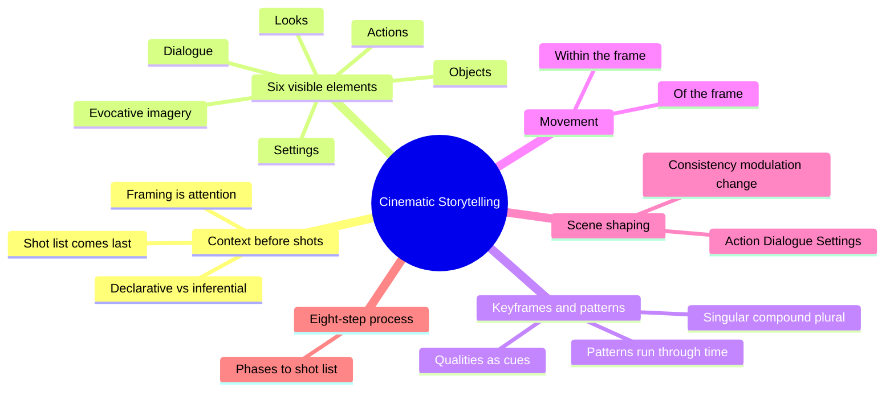
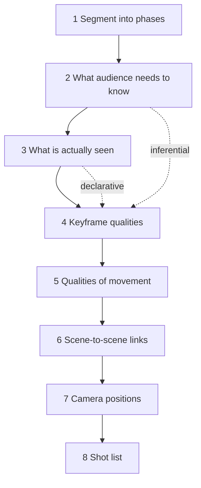
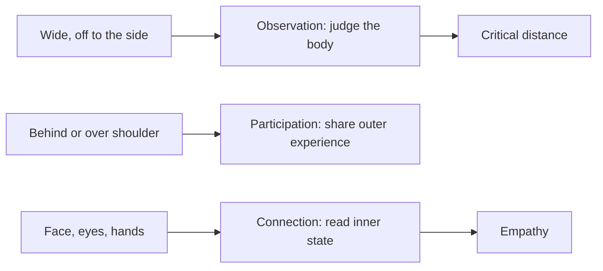
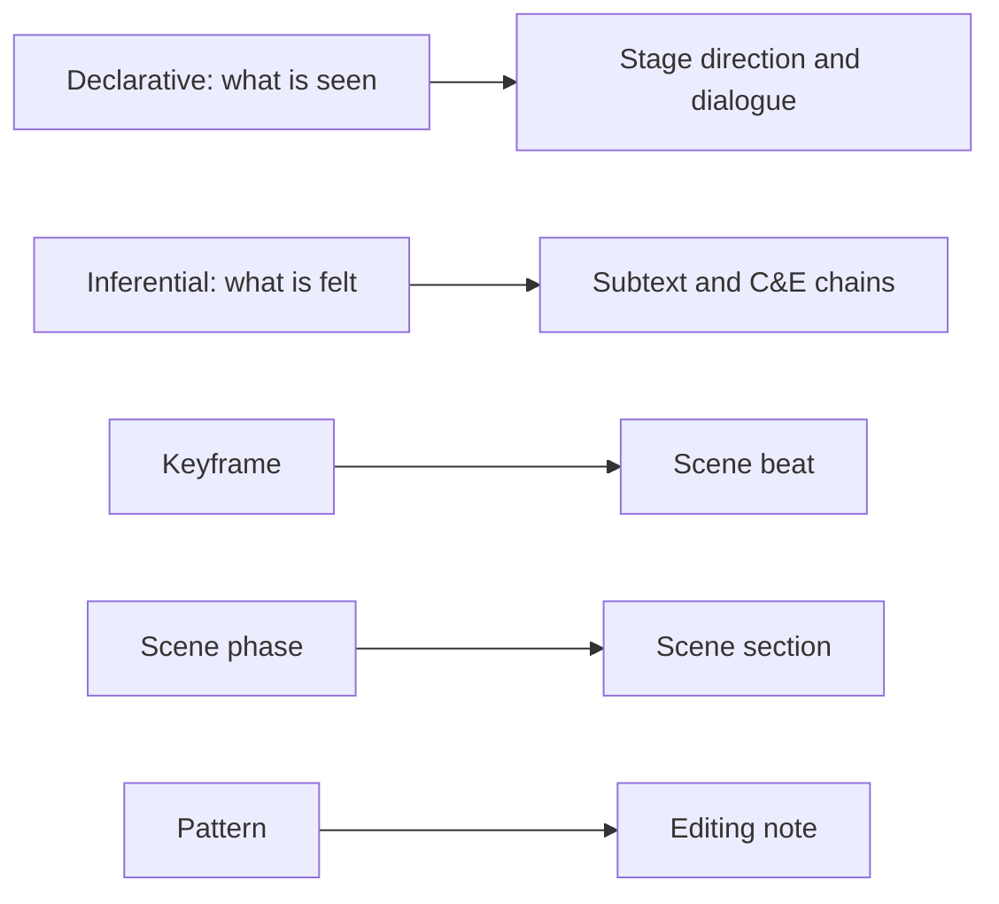

# BVX.0066 — Cinematic Storytelling — Thomas Robotham (2022)
### Knowledge Entry — Distill

A craft manual on planning film coverage from the script outward: what the audience must see, know and feel, decided before any shot is listed. In the library as the craft basis for the script editors and cold readers.

## TABLE OF CONTENTS
- [Core Thesis](#1--core-thesis)
- [Mind Models](#2--mind-models)
- [Framework](#3--framework--structure)
- [Key Concepts](#4--key-concepts)
- [Heuristics](#5--heuristics--decision-rules)
- [Invariants](#6--invariants)
- [Pitfalls](#7--pitfalls--myths)
- [Application](#8--application)
- [Cross-References](#9--cross-references)
- [Provenance](#10--provenance--confidence)

---

## 1 · CORE THESIS

Shots are the last decision, not the first. Frame what the script makes visible so the audience also feels what it only implies. Six kinds of visible element, each with a pattern of framing across time, carry that context. Plan keyframes and patterns first; the shot list falls out at the end.

---

## 2 · MIND MODELS

**Diagram 1 — the whole argument.**
Read off it: the book has one principle (context before shots), one vocabulary (six elements, keyframes, patterns), and one process (eight steps).

**Diagram 2 — the central mechanism.**
Read off it: analysis (steps 1 to 4) is separated from design (5 to 7), and shots appear only at step 8.

**Diagram 3 — Action perspectives vs proximity.**
Read off it: distance sets the perspective; the closer the frame, the more the audience reads inner state and the less it judges from outside.

**Diagram 4 — mapped onto the Command's systems.**
Read off it: the book's two kinds of information match what a script reader must separate on the page.

---

## 3 · FRAMEWORK / STRUCTURE

The book runs in four movements across 14 chapters plus a reference section.

1. **Premise (ch. 1 to 4).** Pictures help the audience feel the story. A script moves from symbolic words to sensory images with fixed screen time. Coverage defines attention. Thinking happens in keyframes, not shots.
2. **The six patterns (ch. 5 to 11).** Actions, Looks, Dialogue (two chapters: structure, examples), Settings, Objects, Evocative Imagery. Each has a typical framing logic and a typical story job.
3. **Movement and shaping (ch. 12 and 13).** Movement is "the last piece of the puzzle." Scenes are shaped by consistency, modulation and change; only Action, Dialogue and Settings structure a scene, while Looks, Objects and Evocative Imagery nest inside them.
4. **Process (ch. 14).** The eight-step coverage plan, worked on a three-phase farmhouse scene (arson victims arrive at a couple's door; a rift about their absent son).

The reference section covers pattern conversion (an Action pattern can become a Dialogue pattern and back), scene-to-scene links, and a twelve-item pitfall list.

---

## 4 · KEY CONCEPTS

| Concept | What it is | Why it matters |
|---|---|---|
| Coverage | All the shots that "cover" parts of a scene | The shared ground of director and cinematographer; this is the book's sole subject |
| Declarative information | What is plainly seen and heard on the page | It is the subject matter of every frame |
| Inferential information | What the audience feels or concludes: emotion, subtext, cause and effect | Cinematic craft adds no facts; it points at implications |
| Framing = attention | Frame centers on what is story-significant now | Frames act as an attention-magnet; story significance picks the subject |
| Keyframe | A landmark moment shown with deliberate contextual cues | Only highlight moments and moments of change need planning |
| Keyframe qualities | Angle, proximity, subject type, symmetry, movement | These bundle into the cues that steer interpretation |
| Singular / compound / plural subject | One thing, connected but distinct things, or an undifferentiated mass | Concentration of attention tells the audience where meaning lives |
| Pattern | Keyframes connected through time | Patterns, not single shots, carry context, "like music" |
| Observation / Participation / Connection | Three perspectives on action: outside judge, shared outer experience, access to inner state | They map roughly to angle relative to the character's facing |
| Look/See | A character's look followed by what they see | The gateway to subjectivity; places perspective in that character |
| Chain of C&E | Physical and emotional cause and effect | Must be clear; objects must be established before they act |
| Dialogue staging | Across, diagonal, side-by-side, in depth, offset | Each gives a different intensity, intimacy or masking of emotion |
| 2 + 1 | A three-person scene handled as a pair plus one | Keeps multi-person dialogue readable |
| 180 degree Line of Continuity | Side of the action the camera stays on | Cross it on purpose, ideally via a neutral front or back position |
| Settings as chapter marker | A setting shot that opens a new story thread | Segments the arc without dialogue |
| Evocative imagery | Imagery whose feeling outranks its information | Compresses mood shifts and gives time to process strong emotion |
| Frame movement | Within the frame (characters move) or of the frame (camera moves) | Single shots per keyframe give incremental progress; a moving frame strung through keyframes gives evolving progress |
| Hand-off | Camera leaves one character and lands on the next | Passes perspective without a cut |

---

## 5 · HEURISTICS & DECISION RULES

| Situation | Do this | Not this |
|---|---|---|
| Starting coverage for a scene | Break into phases, list what the audience must know, then decide what is seen | Open with a shot list |
| Deciding what deserves a keyframe | Pick highlight moments and changes; leave background action inside the master action | Cover every beat equally |
| A character's reaction carries the meaning | Include the Look (and reverse Look/See) | Assume the dialogue already says it |
| Reaction is already clear from words | Let it ride inside the action | Interrupt the flow with a special look shot |
| Scene is complex emotional dialogue | Keep camera work quiet; vary few variables (symmetry, proximity) | Fast, flashy, busy coverage that competes with performance |
| Scene is physical action | Fast cutting and movement are welcome; keep C&E direct and clear | Muddled angle changes that lose cause and effect |
| An object will matter in the heat of action | Establish it earlier in a calm moment | Introduce it mid-action |
| Wanting a peak emotional beat | Save the tightest close-up for it (the book's example: one ECU of the lead in a whole film) | Spend extreme close-ups early |
| Character isolation is the point | Close framing that loses the setting | Keeping the setting in when the character is alienated from it |
| Setting is merely functional | Treat as background; no Settings pattern | Cutting to establishing shots out of habit |
| Wanting a sense of "witnessing" | Mild handheld instability | Heavy shake unless showing agitation or physical impact |
| Three-person dialogue | Work as 2 + 1 | Treating all three equally by default |
| Scene ends on strong emotion | Let the moment settle before ending | Cutting the instant the emotion lands |

---

## 6 · INVARIANTS

1. Framing is attention; the center of story significance is always where the frame lands.
2. Cinematic choices add weight to what the script already contains. Meaning comes from script and performance.
3. Every visible element falls into one of six categories.
4. Patterns exist through time; one frame alone carries little context.
5. Reactions tell the audience how information is received in the storyworld.
6. Action patterns can flow into and out of Dialogue patterns at will.
7. Anything in a chain of cause and effect must be set up before it is used.
8. Social and psychological density is the hardest thing for an audience to follow in real time.
9. The same information can be presented in many ways; the choice must follow interpretation of the script.
10. Shot list is the product of the plan, never its source.

---

## 7 · PITFALLS / MYTHS

- **Shot-first thinking.** The reflex to name a shot size closes off fresh options and breeds ruts.
- **The beautiful shot that does not serve.** Compared to a lovely sentence that misses the idea.
- **Treating the shot as the basic unit.** Framing is the unit of decision; shots are only its containers.
- **Busy camera under complex dialogue.** Competes with the performance.
- **Neglecting the small inserts.** "Sacrificial" shots may carry critical story beats; the plan should record their significance.
- **Short holds on looks and objects.** Too short is useless, too long can be trimmed.
- **Blocking only the hard part.** Block to the last instant of the scene.
- **Crossing the line by accident.** Make any switch purposeful.
- **Rigid on-set staging.** Keep the context plan; let exact details be collaborative.
- **Treating the book as law.** The author states none of it is Truth; it systematizes what professionals already know.

---

## 8 · APPLICATION

- **Spine level:** TEXTURE. The book is about how story is presented, not about structure.
- **12-layer character stack:** none (`feeds: []`); character appears only as perspective and access to inner state.
- **plot_systems:** indirect. The chain of cause and effect, physical plus emotional, is the one structural idea that crosses over.
- **Setting:** the Settings chapter (chapter markers, character as feature of setting, time compression) is a usable checklist for scene headings.

Prose, kept separate from the extraction. The script editors do not shoot anything, but the book's split between declarative and inferential information makes a good reading test: what does this page show, and what must a viewer feel from it? A scene whose beats are all stated aloud has nothing for a camera (or an actor) to imply. The three-phase scene breakdown is a ready template for a cold reader's beat notes: phase boundaries, what the audience needs to learn, what is visible, and what remains inference. The Action versus Dialogue split gives a note vocabulary: heavy emotional exchange in a scene with busy physical business is a conflict of attention, and a note can say so. Establish-before-use of objects maps to setup and payoff checks. Flag any scene that never changes proximity or subject type, since the book treats consistency without modulation as flat shaping.

Limits: the book assumes a director with a camera. Where a draft is meant for prose, only the information model transfers, not the framing language.

---

## 9 · CROSS-REFERENCES

| Related entry | Relation |
|---|---|
| [[BVX.0064]] | McKee, Character: the inferential layer (subtext, true character) that Robotham's framing points at |

---

## 10 · PROVENANCE & CONFIDENCE

Sourced from the full pdftotext of the book: contents, preface, chapters 1 to 4 and 5 (action perspectives), chapter summaries for 11, 12, 13 and 14, the eight-step worked example (steps 1 to 4 read in full, 5 to 8 from the summary list), and the pitfall list. Chapters 6 to 10 (Looks, Dialogue, Settings, Objects) were taken from the contents page and the introductory overview, not read page by page; their detail here is thinner. Application prose is inference. Zotero key was not supplied in the brief.

## META
- Template: BVX-LEARN-v4.0
- Source classification: book, craft manual, full text (partial depth in ch. 6 to 10)
- Created / Updated: 2026-10-30
