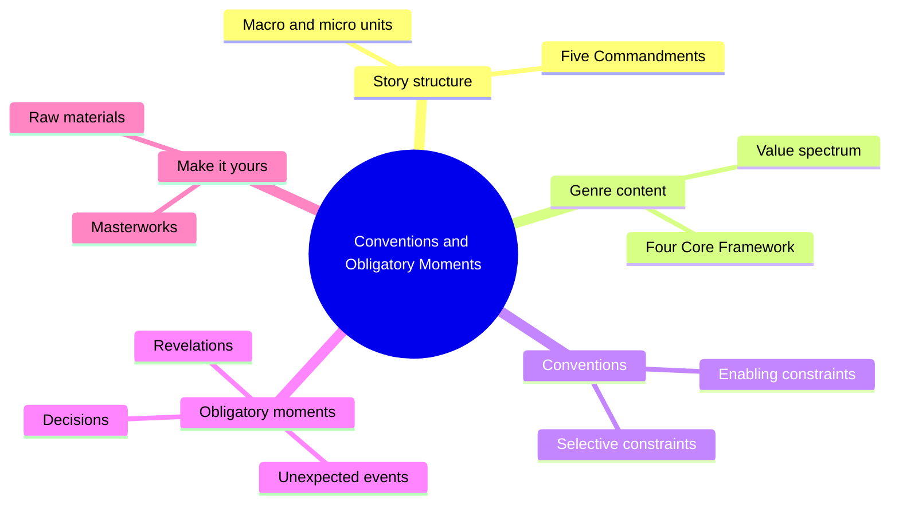
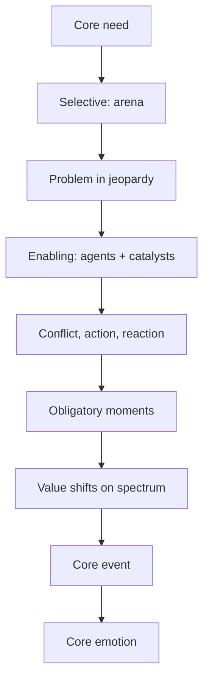
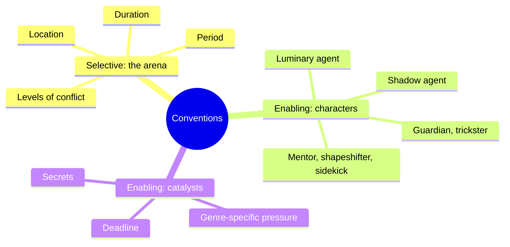
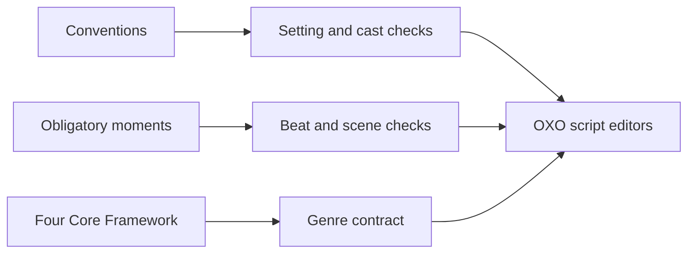

# BVX.0068 — Conventions and Obligatory Moments — Kimberly Kessler & Leslie Watts (2020)
### Knowledge Entry — Distill

A short Story Grid "Beats" primer on the two genre components every story needs: conventions (setup) and obligatory moments (payoff). It is in the library as craft basis for the OXO script editors.

## TABLE OF CONTENTS
- [Core Thesis](#1-core-thesis)
- [Mind Models](#2-mind-models)
- [Framework](#3-framework--structure)
- [Key Concepts](#4-key-concepts)
- [Heuristics](#5-heuristics--decision-rules)
- [Invariants](#6-invariants)
- [Pitfalls](#7-pitfalls--myths)
- [Application](#8-application)
- [Cross-References](#9-cross-references)
- [Provenance](#10-provenance--confidence)

---

## 1 · CORE THESIS

Readers carry built-in "narrative receptors" tuned to genre. Conventions (setting, character roles, catalysts) set up the possible change; obligatory moments (unexpected events, revelations, decisions) pay it off. Skip either and the reader feels cheated, however fresh the raw material is.

---

## 2 · MIND MODELS

**Diagram 1 — the whole argument.**
Read off the two halves of the bridge: conventions set up, obligatory moments pay off, all inside the Five Commandments.

**Diagram 2 — the central mechanism.**
Read off the order: arena narrows the problem, agents and catalysts supply conflict, moments of change pay it off at the core event.

**Diagram 3 — the two constraint families.**
Read off that selective constraints are place and time, enabling constraints are people and pressure.

**Diagram 4 — mapped onto the Command's systems.**
Read off that this book is craft texture for editors, not a feed into character psychology.

---

## 3 · FRAMEWORK / STRUCTURE

The book is ten short chapters plus introduction and conclusion, built as a bridge metaphor with three running examples: Treasure Island (Action, Duel, Hunted plot), Murder on the Orient Express (Crime, Master Detective), Pride and Prejudice (Courtship Love).

1. **Story structure (ch. 1).** A story has macro and micro units; scenes are the main micro unit. Change is incremental and follows the Five Commandments: inciting incident, progressive complications with a turning point, crisis, climax, resolution.
2. **Genre content (ch. 2).** Change is not random. It comes from human needs plotted on a spectrum of universal values. The Four Core Framework gives core need, core value, core emotion, core event per genre.
3. **Conventions (ch. 3).** Conventions narrow a general problem to a precise one and supply the means of solving it. Two kinds: selective and enabling constraints.
4. **Selective constraints (ch. 4).** The setting: location, period, duration, levels of conflict.
5. **Enabling constraints, characters (ch. 5).** Roles and agents: luminary and shadow agents plus mentors, shapeshifters, sidekicks, threshold guardians, tricksters, victims, helpers.
6. **Enabling constraints, catalysts (ch. 6).** Genre-specific pressure devices.
7. **Obligatory moments (ch. 7).** Unexpected events, revelations, decisions.
8. **Putting it together (ch. 8).** A full Treasure Island worked example across the four parts.
9. **Building your bridge (ch. 9).** A seven-question final checklist.
10. **Crafting your unique bridge (ch. 10).** Innovate through masterworks and interrogating the premise.

The four parts of a story (beginning hook, middle build one, middle build two, ending payoff) each run about 25 percent and each carry their own set of the Five Commandments.

---

## 4 · KEY CONCEPTS

| Concept | What it is | Why it matters |
|---|---|---|
| Narrative receptors | The reader's built-in sense of story shape | Explains why missing components register as "wrong" |
| Convention | Macro/micro component that sets up change | Tells the reader which genre promise is coming |
| Obligatory moment | Moment of change that pays off the setup (formerly "obligatory scene") | Can be a beat or a paragraph, not always a full scene |
| Four Core Framework | Core need, value, emotion, event per genre | Names what the story is about and how it ends |
| Selective constraints | Arena elements that narrow the possible problem | Makes the macro problem credible where it happens |
| Enabling constraints | Agents and catalysts that make solving possible | Source of conflict and forced change |
| Levels of conflict | Inner, personal, extrapersonal | Setting should emphasize the levels that matter |
| Agency | Ability to read change and decide a response | The point of a character role |
| Having mode vs being mode | Power/Dominance hierarchy vs Growth hierarchy | Separates shadow from luminary agents |
| Luminary / shadow agent | Protagonist / opposing force | Even internal-genre stories need a shadow source of outer pressure |
| Catalyst | Genre device that squeezes the luminary agent | Keeps them in the ring until the inner conflict is faced |
| Speech in praise of the shadow agent | Action catalyst that shows the power divide and the villain's want | Sets the odds before the fight |
| Set-piece sequences | Mini-stories showcasing the hero's skill and worldview | Pace the middle builds |
| Masterwork | Timeless top-of-genre story | Concrete models for placing and writing each element |

Genre catalyst examples named: Horror (the unreasoning monster), Society (the tyrant who must crush rebellion), Action (speech in praise of the shadow agent, deadline), Crime (ticking clock, red herrings), Love (secrets, rituals, banter).

---

## 5 · HEURISTICS & DECISION RULES

| Situation | Do this | Not this |
|---|---|---|
| Choosing a setting | Ask where this genre's core need could be in jeopardy; pick the place where the conflict already simmers | Pick a pretty location with no pressure on the need |
| Adjusting an old model to a new era | Re-derive the protagonist's problem from the new setting (Bridget Jones can earn money, so her obstacle becomes inner) | Copy the original obstacle into a world that removes it |
| Setting the conflict | Emphasize the level (inner, personal, extrapersonal) most central to the story | Treat all three as equal weight |
| Casting | Let one character hold several roles, or one role pass among characters | Add a body per role |
| Internal genres (Status, Morality, Worldview) | Still supply a shadow agent who creates outside pressure | Leave all conflict inside the head |
| Writing a payoff | Check that the moment actually moves the core value | Stage a loud scene with no value change |
| Scoping a payoff | Treat it as a moment; it may be a beat | Insist on a standalone scene each time |
| Unsure how to write one | Study how admired masterworks wrote theirs | Guess from the abstract definition |
| Making it unique | Brainstorm ten to twenty "what if" alternatives, then test each against the point | Run with the first idea |
| Process | Plot ahead, pants and plug in, or mix | Argue about process; readers only see the result |
| Revising | Run the seven-question checklist (genre, opening value, change conditions, risk to need, value change, core event height, clarity of setup and payoff) | Treat a yes as "done" |

---

## 6 · INVARIANTS

1. Conventions set up change; obligatory moments pay it off.
2. Every story has macro and micro units and follows the Five Commandments at each scale.
3. The change is on a spectrum of universal human values tied to a core need.
4. The arena must make the problem both possible and imminent, and must hold the means of solving it.
5. A shadow agent's desires always oppose the luminary agent's.
6. Agents and catalysts together generate the conflict that forces the luminary agent to change.
7. The core event is the height of stakes and evokes the core emotion.
8. Conventions are not a formula; the writer's raw materials still supply the content.

---

## 7 · PITFALLS / MYTHS

- "Constraints kill creativity." The book says they bridge imagination and reader; the novelty lives in how you write them.
- Reading one how-to book or taking one seminar will not make the craft; the authors push study plus repeated practice.
- Writing only to the writer's own meaning: the reader cannot decode raw material that is not arranged as story.
- Missing a component (no clues, no suspects, no exposure of the criminal) leaves genre readers unsatisfied even if structure is sound.
- Calling every payoff a "scene": the term was retired in favor of moment.
- Assuming a shadow agent must be a villain: in the Orient Express case the passengers are antagonists pursuing the Growth hierarchy, and the broken system is the true shadow.
- Imitating the masters instead of learning from them.
- Using a narrow set of masterworks; the authors want diversity of period, culture, and author background.
- Treating the checklist as completion rather than a minimum objective target.

---

## 8 · APPLICATION

- **Spine level:** TEXTURE. The book supplies genre-level setting, cast, and beat expectations for editing, not a level of the story spine.
- **12-layer character stack:** none directly. Roles (luminary, shadow, mentor, shapeshifter, and so on) are functional story roles, not psychology, so `feeds` stays empty.
- **plot_systems:** the four-part Five Commandments map and the core event are usable as an editor's audit grid.
- **Setting:** the four setting components (location, period, duration, levels of conflict) give a quick audit for any OXO location or era.

Use for editors: for a script under review, name the global genre, state its four core elements, then check (a) the arena creates risk to the core need, (b) the cast covers luminary, shadow, and the supporting roles needed, (c) each catalyst the genre expects is present, and (d) the payoff moments move the core value at the right part (hook, build one, build two, payoff). The Treasure Island walkthrough in ch. 8 is a template for a beat-by-beat table of inciting incident, turning point, crisis, climax, resolution per part. The having versus being mode split is a handy cold-read test of whether an antagonist's want truly opposes the lead's.

Limit: the book teaches the method through Action, Crime, and Love only; for other genres it points to Shawn Coyne's genre books and Story Grid Editor Roundtable episodes.

---

## 9 · CROSS-REFERENCES

| Related entry | Relation |
|---|---|
| [[BVX.0236]] | The Story Grid: parent method, Five Commandments and genre system |
| [[BVX.0049]] | Action Story: the primal genre; deeper dive on the genre used as the main example |
| [[BVX.0191]] | Anatomy of Genres: another genre-structure account |
| [[BVX.0175]] | McKee, Story: scene change, value shifts |

---

## 10 · PROVENANCE & CONFIDENCE

- Source: pdftotext of the full book (66 pages), read in full: introduction, all ten chapters, conclusion. No unread chapters.
- All content is from the full text; nothing is inferred from research.
- Section 8 application and the editor audit grid are my synthesis, marked as such.
- The pdftotext file carries a few legacy-encoding characters (value-spectrum arrows); meaning unaffected.
- Confidence high; it is a short, plain book.

## META
- Template: BVX-LEARN-v4.0
- Source classification: book, craft primer, Story Grid Beats series
- Created / Updated: 2026-10-30
