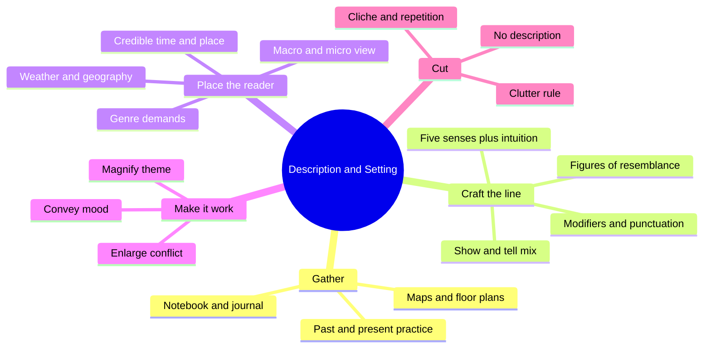
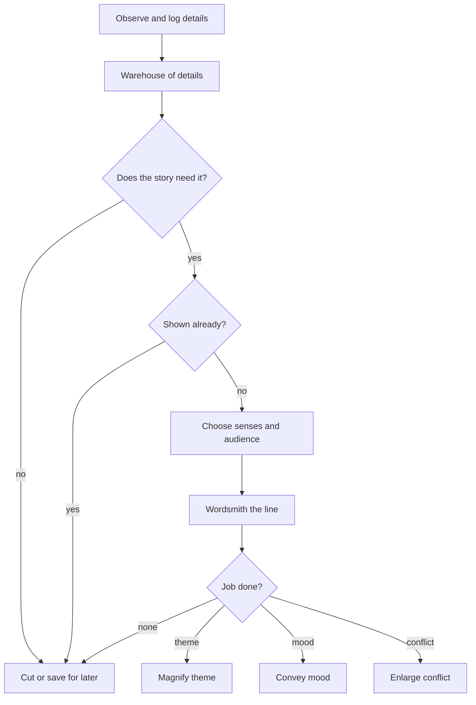
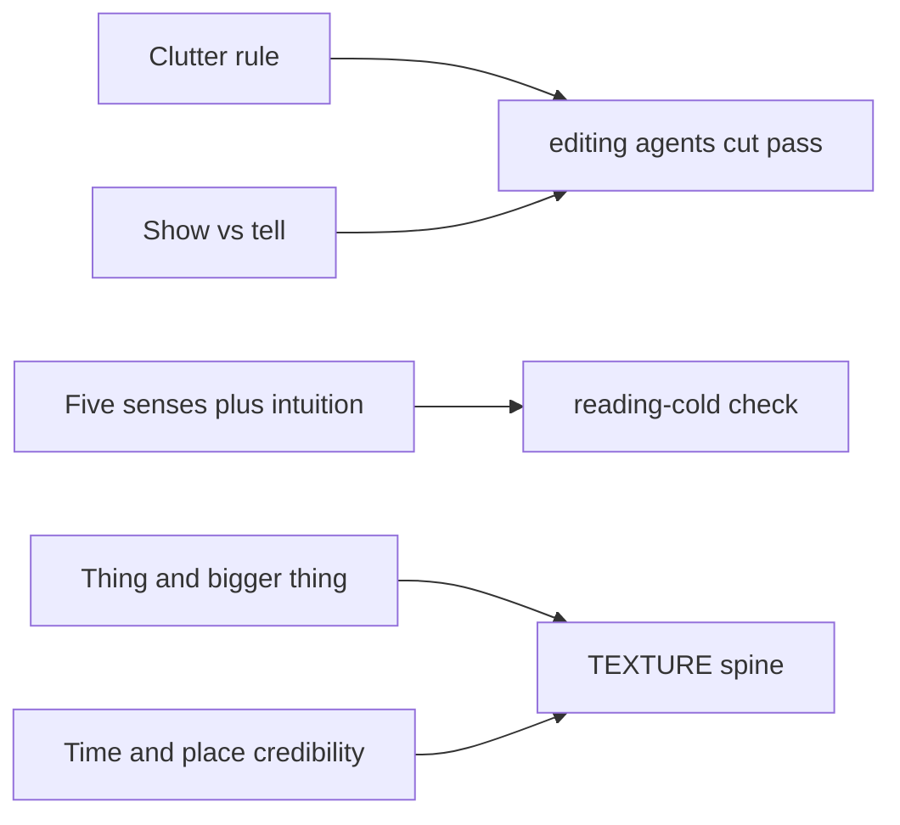

# BVX.0081 — Description and Setting — Ron Rozelle (2005)
### Knowledge Entry — Distill

A Writer's Digest craft manual on putting the reader into a time and place. It is in the library as a working-level checklist of description moves, used as craft basis for the OXO script editors.

## TABLE OF CONTENTS
- [Core Thesis](#1-core-thesis)
- [Mind Models](#2-mind-models)
- [Framework](#3-framework--structure)
- [Key Concepts](#4-key-concepts)
- [Heuristics](#5-heuristics--decision-rules)
- [Invariants](#6-invariants)
- [Pitfalls](#7-pitfalls--myths)
- [Application](#8-application)
- [Cross-References](#9-cross-references)
- [Provenance](#10-provenance--confidence)

---

## 1 · CORE THESIS

A story fails if the reader cannot see where and when it happens, so setting and description must be built from gathered, selected, sensory detail. Every detail must earn its place by serving theme, mood, or conflict. Show more than you tell, and cut the rest as clutter.

---

## 2 · MIND MODELS

**Diagram 1 — the whole argument.**
Read off the three tools Rozelle teaches (craft, models, wordsmithing) and the three jobs the detail must do once it is on the page.

**Diagram 2 — the central mechanism: the detail filter.**
Read off the order of operations: collect wide, select hard, then ask what each kept detail does. A detail with no job is cut.

**Diagram 3 — mapped onto the Command's systems.**
Read off where the book sits: it is a TEXTURE-level craft source, feeding editors, not the character stack.

---

## 3 · FRAMEWORK / STRUCTURE

Rozelle builds the book on a "trinity": **craft** (tools of the trade), **models** (published passages dissected), **wordsmithing** (choosing each word). Every chapter does all three, ends with a summary, then exercises. Voice and craft are treated as one thing, and setting and description as one topic.

| Ch. | Subject | What it delivers |
|---|---|---|
| 1 | Why setting matters | Four ways to open on place: lay of the land, intricate detail, sensory, tone. Sustain it past page one. |
| 2 | Paying attention | Harvest details; notebook, maps, journal vs diary; hunt for irony and surprise |
| 3 | Tools | Modifiers, punctuation, metaphor/simile/analogy, allusion, personification, symbolism, onomatopoeia, cadence, flashback, foreshadowing, sentence variety |
| 4 | Show and tell | Blend them; show mostly; never tell what you already showed |
| 5 | Senses | Sight, smell, touch, taste, hearing, plus a "sixth sense" of intuition |
| 6 | Characters | Physical, self-description, dialogue, motivation, mood, flaws, stereotypes |
| 7 | Time and place | Credibility, macro vs micro, weather, geography, impossible places, comfort zone, framework settings |
| 8 | Genres | Historical, mystery, SF/fantasy, western, romance, horror/suspense |
| 9 | Driving the story | Setting and description magnify theme, convey mood, enlarge conflict |
| 10 | Working the magic | Modify reality, title, first sentence, "the thing and the bigger thing", voice |
| 11 | Too little, too much | Clutter, tags, cliche, repetition, didacticism, verbosity, wandering, no description |
| 12 | Process | Idea, planning, writing, revision, feedback |

---

## 4 · KEY CONCEPTS

| Concept | What it is | Why it matters |
|---|---|---|
| The guy in Sheboygan | Rozelle's generic reader who has never seen your world | The test audience for every description |
| Clutter rule | Anything not advancing the story goes | The master filter; the whole book serves it |
| Warehouse of details | A logged store of observations, mostly unused | Selection needs surplus; you cannot cut what you never gathered |
| Show vs tell | Dramatize an image vs report it | Telling is allowed, but only well-wordsmithed and never after showing |
| Change-up | Long showing, then a short blunt tell | Bradbury's "They were not happy now" lands because of the build-up |
| Literary vs popular reader | Tolerance for long description differs | Sets how many details and how fast |
| Tone | Overall mood, set early in the opening description | Readers infer genre and stakes from it |
| Microcosm / macrocosm | Small specific world vs big frame | Open wide only once or twice; live in the small |
| The thing and the bigger thing | A scene tied to larger history or society | Makes a place feel real and keeps facts honest |
| Modifying reality | Reshaping real details to fit the story | Transcribed life is clutter; a coffee gripe becomes a hint of change |
| Setting as character | Place that acts on people | Allowed when the land matters (Steinbeck) |
| Sixth sense | Intuition, a felt wrongness | Use rarely, as real premonitions are rare |
| Quiet vs loud | Subtle vs blatant detail | Subtle often wins (the fading smell of Ireland) |
| Framework setting | A place that holds many stories across time | Michener's dig; keep the stories primary |
| Chekhov's gun | Described things must pay off | Description makes a promise to the reader |

---

## 5 · HEURISTICS & DECISION RULES

| Situation | Do this | Not this |
|---|---|---|
| Opening a story | Pick one approach: land, detail, senses, tone. Plant a question or foreshadow. | A geography report before anything happens |
| Reader is literary | Allow long, layered passages | Rush the prose |
| Reader is popular | Pick the strongest 2 to 3 images, move on | Stack every detail |
| Wanting to say a feeling | Show it through action and surroundings, then tell briefly if needed | "He was lonely." as an opener |
| Already showed it | Delete the telling sentence | Add a summary tag ("She was generous.") |
| Writing a scene with sensory weight | Spread across senses; sound, smell, touch, taste | Sight only (the Golden Gate student draft) |
| Stuck on a common phrase | Invent a fresh image once in the book | Reuse the clever phrase or reach for cliche |
| Pain or horror | Stress the character's reaction | Itemize the injury |
| Dialogue tag needed | Prefer none; cap them in two-person scenes | Adverb tags ("said sadly") |
| Real dialogue transcript | Rework it so each beat serves conflict | Paste it verbatim |
| Setting a scene indoors | Still know the weather outside | Treat windows as optional |
| Fantasy or impossible place | Fix the rules, keep them, anchor in human situations | Let the setting drive the plot |
| Historical scene | Keep facts verifiable; characters cannot know the future | Foreshadow with hindsight |
| Mystery | Stress those solving, not the crime | Lingering on the corpse |
| Best moment is terrifying | Consider no description ("Wolves.") | Describe every horror |
| Draft done | Print, rest a day, reread with pencil | Revise only on screen right away |
| Spent too long in a cozy stretch | Re-inject pressure | Pages of comfort-zone description |

---

## 6 · INVARIANTS

1. A story must be situated in a time and place the reader can picture, even if the story transcends it.
2. Setting and description serve theme, mood, or conflict, or they are clutter.
3. The writer must know more about the place than the page shows.
4. Show more than you tell; tell tersely and well.
5. A distinct detail beats a generic one; the unexpected beats the expected, once.
6. Described things create promises the story must keep.
7. Description is sustained across the whole work, not front-loaded.
8. The reader must be able to follow: dialect, allusion, and invention cannot become puzzles.
9. Genre readers bring expectations that description must meet.
10. Revision cuts more than it adds.

---

## 7 · PITFALLS / MYTHS

- **"Hemingway avoided adjectives."** He used them, precisely. Imitators strip them and produce bad prose.
- **"Always show, never tell."** O'Connor said "very seldom." Blend, and tell tersely for a change-up.
- **"Open with the setting."** Allowed only when the place is a character; otherwise it reads as a report.
- **Mixed metaphors** (aviation plus whale). Keep one image family per passage.
- **Obscure allusions.** An allusion nobody gets is dead weight; "Uncle Elmer" does not work.
- **Planted symbols.** Cardboard characters and places; let symbols surface from the story.
- **Isolated onomatopoeia** ("Squawk! Slosh!"). Weave sound words into the sentence.
- **Over-stuffed modifiers**, repeated pair patterns, a stack of "very".
- **Cliche and repeated rare words.** A fresh image goes stale on the second use.
- **Putting friends or yourself in as portraits.** Characters must be who the story needs, not honorees.
- **Dialect that blocks reading.** If decoding is a chore, you have gone too far.
- **Didacticism, sermons, history lessons.** Pass history via dialogue, letters, or scene, never lecture.
- **Passive voice and "grand" language** for effect.
- **Comfort-zone drift.** Cozy detail without forward motion stalls the plot.
- **Over-trusting the thesaurus.** Words are not interchangeable; match the attitude.
- **Writing a symbolic place** only to stand for something, so it is not a street where real people live.

---

## 8 · APPLICATION

- **Spine level:** TEXTURE. Operates at the line and scene-surface level, below plot structure.
- **12-layer character stack:** none directly. Chapter 6 offers surface cues (a speech pattern, a flaw, a self-image) but it is a craft guide, not psychology, so `feeds` stays empty.
- **plot_systems:** none.
- **Setting:** supplies method for rendering any OXO location, notably credibility checks and the "thing and bigger thing" tie to era and school.

Prose for the editors. Use this book as a pass-by-pass checklist.

**Cut pass (clutter).** For each descriptive sentence, ask three questions drawn from the book: does it advance the story, is it already shown elsewhere, is it the best word? Flag adjective strings, adverb tags, and "very". The "light blue phone" test is the cleanest: if the colour does not matter, remove it.

**Show-tell pass.** Look for telling sentences that follow a shown beat (the Martha Louise "She was a generous child" line). Leave short tells that follow a long showing as a deliberate change-up.

**Sensory pass.** Chart each scene across sight, sound, smell, touch, taste. A scene with only sight is flagged. Where the audience is a script reader, translate: sensory detail becomes action lines, props, and sound cues, since a script cannot hold interior narration.

**Cold-read pass.** The Sheboygan reader stands in for the cold reader: someone who has never seen the OXO world. Ask what they can picture after page one, and whether weather, era, and geography are fixed. The weather rule (know it per scene, even indoors) is useful for continuity.

**Purpose pass.** For each described setting, name which of theme, mood, or conflict it carries. Rozelle's own exercise (find one of the three, then check the other two) is a quick test. The Ethan Frome supper scene (a cat, tea, a remark about snow) is the model of conflict-by-setting.

Limits for scripts: the book is prose-fiction craft. Its narrative-voice advice (cadence, punctuation, parentheses) does not transfer to dialogue and action lines. The mood-via-surroundings, no-description, and Chekhov's gun rules do.

---

## 9 · CROSS-REFERENCES

| Related entry | Relation |
|---|---|
| [[BVX.0056]] | Active Setting: sibling craft source; deploys setting for jobs, matches Rozelle's theme/mood/conflict triple |
| [[BVX.0084]] | Dialogue techniques: pairs with the dialogue tag and dialect advice here |
| [[BVX.0044]] | Fiction writing blunders: overlaps the pitfalls list (clutter, telling) |
| [[BVX.0100]] | Fictional Worlds: theory behind the "impossible places need rules" rule |
| [[BVX.0064]] | McKee on character: complements Chapter 6 (flaws, cast tiers) |

---

## 10 · PROVENANCE & CONFIDENCE

Source: full text via pdftotext at `_PRIVATE/distill_wave/BVX.0081.txt` (PDF not in repo). I read chapters 1 through 12 in sequence in runs of about 700 to 1,000 lines. The closing "Point by Point" quick-reference recap was read through the chapter 5 bullets (to roughly line 7,500); the later bullets repeat chapter content already read and were not separately reviewed. No chapter was unread. Section 8 prose is application inference for the Command, kept separate from source extraction. The year 2005 comes from my knowledge of the Writer's Digest edition, not the text file; confirm against the Zotero record. The author name is the same.

Confidence is high on content, medium on bibliographic year.

## META
- Template: BVX-LEARN-v4.0
- Source classification: craft manual (prose fiction), exercise-driven
- Created / Updated: 2026-10-30
