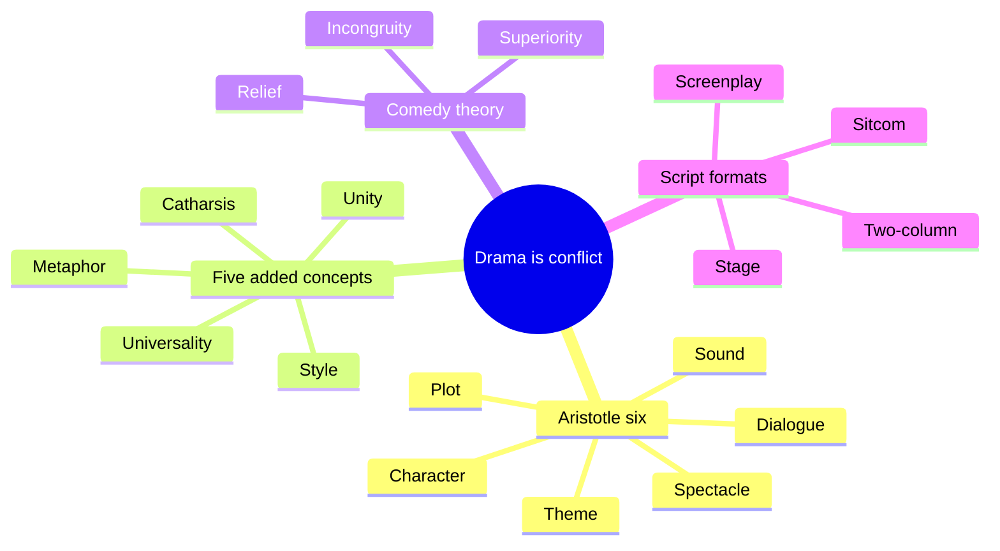
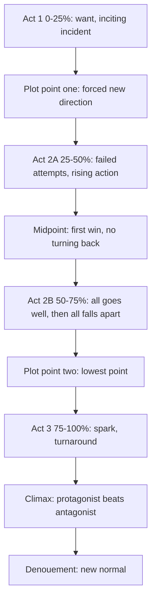
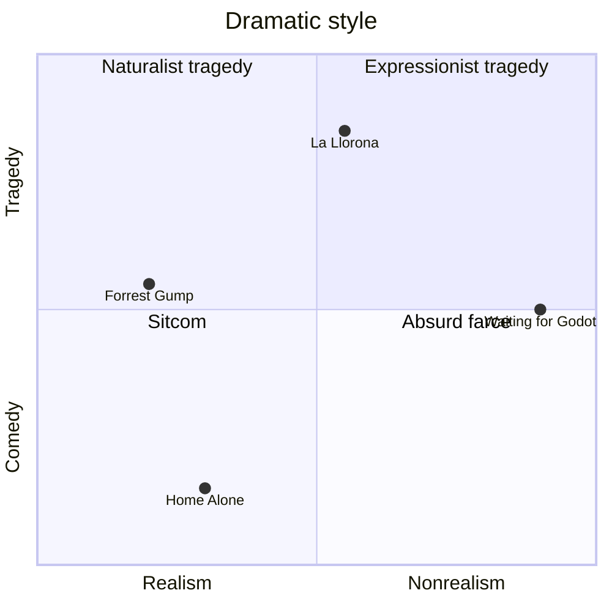

# BVX.0092 — Dramatic Story Structure: A Primer for Screenwriters — Fink (2014)
### Knowledge Entry — Distill

A short undergraduate primer that squeezes the dramatic-theory canon into eleven elements and one four-quarter plot template. It is in the library as the plain craft baseline the script editors can test a draft against.

## TABLE OF CONTENTS
- [Core Thesis](#1-core-thesis)
- [Mind Models](#2-mind-models)
- [Framework](#3-framework--structure)
- [Key Concepts](#4-key-concepts)
- [Heuristics](#5-heuristics--decision-rules)
- [Invariants](#6-invariants)
- [Pitfalls](#7-pitfalls--myths)
- [Application](#8-application)
- [Cross-References](#9-cross-references)
- [Provenance](#10-provenance--confidence)

---

## 1 · CORE THESIS

Drama means conflict: a person goes after something against obstacles. Every story, however scrambled, has a beginning, middle and end, laid out in four quarters. Eleven elements (Aristotle's six plus unity, metaphor, universality, catharsis, style) work as one organism, and the protagonist's arc is the theme.

---

## 2 · MIND MODELS

**Diagram 1 — the whole argument.**
Read it as one trunk (conflict) feeding eleven elements; the first six are Aristotle's, the last five are Fink's additions.

**Diagram 2 — the central mechanism.**
Read the page marks: act breaks fall at roughly 25, 50 and 75 percent, and each turn is a hit the hero did not see coming.

**Diagram 3 — how arc, theme and antagonist lock together.**
Read it as a loop: the weakness drives the antagonist, the antagonist forces the arc, and the arc is the theme.

**Diagram 4 — the style map.**
Read the corners: every work sits somewhere between tragic and comic and between realistic and not.

---

## 3 · FRAMEWORK / STRUCTURE

Fink organizes by Aristotle's Poetics. Ch. 1 defines drama and gives a four-page sample script, La Llorona, reused as the worked example everywhere. Ch. 2 to 7 take plot, character, theme, dialogue, sound, spectacle. Ch. 8 adds the five extra concepts. Ch. 9 covers comedy. Ch. 10 covers formats.

**Building blocks, shortest to longest:** shot (a word), scene (a sentence: one time and place), sequence (a paragraph: scenes showing one progression), act (a chapter), story (the manuscript).

**The twelve-point template** (Fink's merge of Selbo, Vogler, Edson):
1. Establish world and want/need. 2. Inciting incident. 3. Plot point one. 4. Launch into the journey. 5. Obstacles, escalation. 6. Midpoint win. 7. All goes well. 8. All falls apart. 9. Plot point two, lowest point. 10. Turnaround. 11. Climax. 12. Denouement.

**Page budget.** Act 1 is the first quarter, Act 2 the middle half split at the midpoint, Act 3 the last quarter. Feature scripts run 90 to 100 pages at about a page a minute. Action films may shorten Acts 1 and 3 (Speed, Finding Nemo at one-fifth and four-fifths).

**Three guru models compared** (all fit the same quarters):

| Author | Steps | Distinct idea |
|---|---|---|
| Selbo | 11 | Separates goal (immediate) from want (emotional) |
| Vogler / Campbell | 12 | Ordinary world to special world and back; archetype cast |
| Edson | 23 | Hero Goal Sequences of 3 to 7 pages ending in Fresh News; two "stunning surprises" |

---

## 4 · KEY CONCEPTS

| Concept | What it is | Why it matters |
|---|---|---|
| Drama | Conflict (Greek sense), not "serious" | Comedy and tragedy share one engine |
| Point of attack | Where the story opens: first event, a flash-forward frame, or a past event | Choose it for the reveal it allows (Citizen Kane, Forrest Gump) |
| Inciting incident | The event that makes this hero engage | Often scene one, but can follow a long setup (Witness) |
| Plot point one | Unforeseen obstacle ending Act 1; usual methods have failed | Forces the hero out of the comfort zone |
| Midpoint | Biggest obstacle so far, and the hero wins | Five jobs: crisis, recommit, half the arc, foreshadow climax, set up "all goes well" |
| Rising action | Tension rises and releases, each peak higher than the last | Rhythm holds attention; "sticks, knives, guns" |
| Plot point two | Last hope removed; the darkest hour | Makes Act 3's spark necessary |
| Turnaround | A spark (mentor, object, inner shift) revives the hero | Without it the story would end at the low |
| Denouement | Short glimpse of the new normal | Delivers the satisfaction of change |
| Protagonist | The character with the biggest arc; whoever learns the theme | Resolves "who is the lead" in buddy and ensemble stories |
| Achilles heel | Deficit the hero must fix to win | Source of both arc and antagonist |
| Arc | Change, or reaffirmation of what is right under pressure | Atticus Finch and Lincoln change by holding firm |
| Antagonist | Human, environment, or self; often the hero's flaw "in spades" | Hero meets own demon in the villain |
| Supporting cast | Complement the hero's gaps; carry B and C stories | Marlin/Dory, Thelma/Louise, Schindler/Stern |
| Functionary | Appears once, serves the beat | Should arrive organically, not to make a point |
| Unmasking | Backstory revealed layer by layer, "peeling the onion" | Builds sympathy |
| Ethos, pathos, hybris | Moral makeup; worth of pity; excess pride | The three levers of sympathy and downfall |
| Obsession (MacGuffin) | What the hero wants more than anything | Without it the hero could walk away |
| Theme | Lesson with a point of view; one word broad, one sentence specific | Lives in the arc, not in plot or cast list |
| Dialogue functions | Advance plot, reveal character, point to theme | Best lines do two or three at once |
| Subtext | Intended meaning under literal words | Needs setup to carry weight |
| Diegetic / nondiegetic / metadiegetic | Where music comes from | Writer flags only story-critical sound |
| Parallel vs counterpoint | Music matching or opposing the image | Counterpoint makes the viewer reconcile (Good Morning, Vietnam) |
| Spectacle | Sets, light, costume, makeup, props, shots, effects, editing | Writer states only what the story needs |
| Unity of theme | A, B and C stories all argue the same theme | The only unity still binding |
| Metaphor | Juxtaposition that makes a master image | Cheap, strong theme carrier (Lara's flowers) |
| Universality | Relevance to the audience | The overarching goal the elements serve |
| Catharsis | Emotional then intellectual release | The measure of whether it worked |
| Schadenfreude / mudita | Joy at others' harm / joy at others' good | Comedy needs no lasting harm to the invested |
| Setup and payoff | Plant a question, deliver the answer | Governs all drama, not just jokes |

---

## 5 · HEURISTICS & DECISION RULES

| Situation | Do this | Not this |
|---|---|---|
| Unsure who the protagonist is | Pick the one with the largest arc and who learns the theme | Pick by screen time or billing |
| Escalating Act 2B | Raise the stakes each ordeal (sticks, knives, guns) | Open with the gun and backtrack |
| Hero is losing every scene | Give a real win at the midpoint | Let them fail until they would quit |
| Hero stuck at the low | Supply a spark: mentor, found object, inner turn | Rescue by a contrived outsider (deus ex machina) |
| Stating theme | One broad word, then one sentence of treatment | Plot synopsis or cast list |
| Writing an antagonist | Give them the hero's flaw unchecked | Opposition with no link to the hero |
| Subplots | Put a B-story win beside an A-story win; unify by theme | Parallel plots with no thematic link |
| Revealing backstory | Layer it through action and dialogue | Dump it at the start |
| Dialogue | Show first; trim to what moves plot, reveals character or points to theme | Explain what the image already shows |
| Memorable line | Short, set up earlier, loaded with unspoken meaning | State the meaning literally |
| Sound and visuals in the script | Flag only what the story requires (the wind in La Llorona) | Specify every cue, costume, prop |
| Genre pacing | Longer "all goes well" for romance; shorter for action | One respite length for all |
| Comedy harm | Hurt villains and minor characters; heal or spare the lead | Permanent damage to someone we love |
| Comic beat | Two-beat pattern then a twist; add a second punch if it fits | Pad past the setup or use one setup beat |
| Repeating a gag | Running gag, planted and paid off | Repeat with no escalation |

---

## 6 · INVARIANTS

1. Every story has a beginning, middle and end, however scrambled in time.
2. Drama is a person pursuing a goal against obstacles.
3. A story is one person's story: one protagonist.
4. The protagonist's arc is the theme.
5. The usual methods must fail before the hero changes course.
6. Stakes escalate; the climax is the largest scene.
7. Screen stories can show only action and dialogue; inner states must be externalized.
8. Every story has a theme, even "a show about nothing."
9. Subplots must unite with the main plot in theme.
10. Setup precedes payoff in comedy and drama alike.
11. In comedy the sympathetic lead ends well; in tragedy ruin follows.

---

## 7 · PITFALLS / MYTHS

- Three acts are not three equal thirds; the real shape is four quarters.
- Drama does not mean heavy. Sitcoms are drama in Fink's sense.
- Confusing theme with plot or with character description.
- Treating the Hero's Journey or any guru list as law; Fink says they agree on the skeleton and differ only in step count. The summaries are oversimplified, so read the originals.
- Unity of time and place was a 16th-century gloss wrongly credited to the Greeks; only unity of theme (and action in the loose sense) still binds.
- Assuming no-plot works (Godot, Pulp Fiction, Memento) escape structure. They only rearrange or stall it.
- Mistaking a "double protagonist" romance for two leads. One lead always travels farther.
- Overwriting music, wardrobe or camera. The director, composer and designers decide.
- Using personality typologies (humors, Enneagram, MBTI, Freud, Jung) as more than a prompt for dimension.
- Expecting every rule to apply: rule of threes and double whammy are explicitly only guidelines.
- Unsympathetic leads (Brecht, There Will Be Blood) are exceptions that narrow the audience.

---

## 8 · APPLICATION

- **Spine level:** TEXTURE. Craft rules for scene and act design, not a spine event.
- **12-layer character stack:** none wired. The character chapter is a screenwriting toolkit, not a psychology source.
- **plot_systems:** a page-position checklist for OXO scripts and a way to test a pilot or episode outline.
- **Setting:** minimal; the spectacle chapter says to name a setting only when the story needs it.

For the script editors, this is the baseline. Run any outline against the twelve points and ask whether each of the five midpoint jobs is done. Test whether the antagonist carries the protagonist's flaw, whether B and C stories share the theme, whether the low point removes the last hope, and whether the climax requires the lesson the arc taught. For line editing, use the three dialogue functions and the show-don't-tell rule. For comedy, check that harm lands only on villains and extras.

A caution for the series work: this is a single-film model. Long-form arcs across episodes and eras need the heavier systems in the cross-references below. Treat Fink's page counts as feature-length defaults, not law for episodic work.

---

## 9 · CROSS-REFERENCES

| Related entry | Relation |
|---|---|
| [[BVX.0175]] | McKee, Story: deeper treatment of structure and gap; Fink quotes McKee on escalation |
| [[BVX.1124]] | Vogler, The Writer's Journey: Fink's 12-step source |
| [[BVX.0822]] | Mythology and the hero's voyage: Campbell lineage behind Vogler |
| [[BVX.1123]] | Egri, Art of Dramatic Writing: three-dimensional characters, premise |
| [[BVX.1126]] | Aristotle, Poetics: the six-element source text |
| [[BVX.0089]] | Dramatica: the software Fink mentions for decision-driven plot |
| [[BVX.0163]] | Save the Cat: beat-sheet comparison with Fink's page template |
| [[BVX.0193]] | Truby, Anatomy of Story: 22-step competitor |
| [[BVX.0064]] | McKee, Character: dimension and cast circles vs Fink's character chapter |

---

## 10 · PROVENANCE & CONFIDENCE

Source: full text via pdftotext, read in chunks of 700 to 1,000 text lines, chapters 1 to 9 read in full including all examples and summaries. Chapter 10 (script formats): read the screenplay, sitcom, two-column and stage-play rules and the summary, and skimmed the repeated La Llorona sample pages. Front matter and the index/references were not read (pages after the Chapter 10 discussion, roughly lines 7050 to 7706). Figures lost to OCR (humors, Enneagram, Freud/Jung charts, Fig 7.1, Fig 8.3) were reconstructed from the surrounding text. All chapters are covered, so no chapter is unread.

Inferences labeled in this entry: the Application section, the quadrant placement of the example works in Diagram 4, the heuristics table's phrasing, and the cross-reference relations (entry titles confirmed in the library, bodies not reopened). Confidence high on Fink's claims; medium on how well they fit episodic or serial work.

## META
- Template: BVX-LEARN-v4.0
- Source classification: introductory textbook, synthesis of secondary sources
- Created / Updated: 2026-10-30
