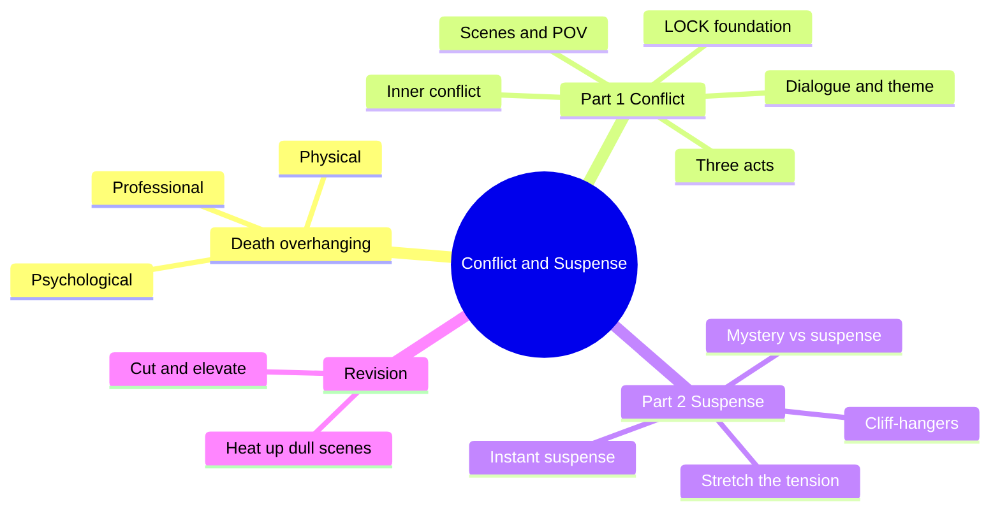
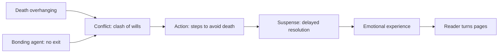
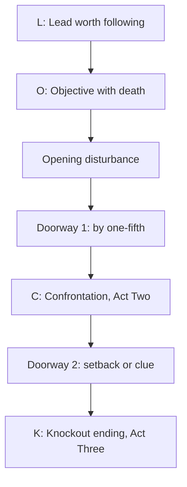
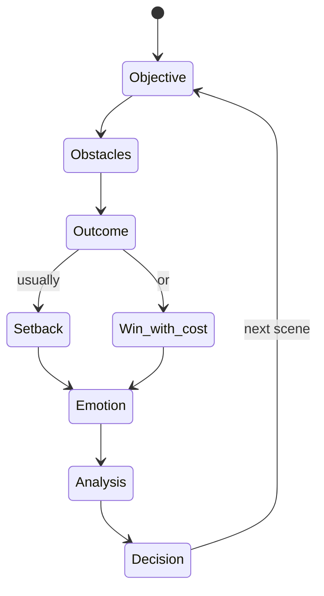

# BVX.0094 — Elements of Fiction Writing: Conflict and Suspense — James Scott Bell (2012)
### Knowledge Entry — Distill

A working novelist's toolkit for putting trouble on every page (conflict) and holding the answer back (suspense). It is in the library as craft basis for the OXO script editors: scene tests, dialogue tests, and a revision checklist.

## TABLE OF CONTENTS
- [Core Thesis](#1-core-thesis)
- [Mind Models](#2-mind-models)
- [Framework](#3-framework--structure)
- [Key Concepts](#4-key-concepts)
- [Heuristics](#5-heuristics--decision-rules)
- [Invariants](#6-invariants)
- [Pitfalls](#7-pitfalls--myths)
- [Application](#8-application)
- [Cross-References](#9-cross-references)
- [Provenance](#10-provenance--confidence)

---

## 1 · CORE THESIS

A story is a character facing death (physical, professional, or psychological) against an opposition that cannot be escaped. Conflict is the clash of two wills; suspense is the delay of its resolution. Build both on a locked foundation, then stretch every moment of tension.

---

## 2 · MIND MODELS

**Diagram 1 — the whole argument.**
Caption: the book has two halves, conflict as the soil and suspense as the delay; everything hangs off death overhanging.

**Diagram 2 — the central mechanism.**
Caption: read it left to right; the chain only runs if death is real and no exit exists (the bonding agent).

**Diagram 3 — the LOCK foundation on a three-act line.**
Caption: Lead and Objective are set up in Act One, Confrontation fills Act Two, the Knockout ending lands Act Three; the two doorways are the only hard outline.

**Diagram 4 — the scene engine.**
Caption: every scene is objective, obstacles, outcome; the outcome should usually be a setback, which feeds the reaction beat and the next scene.

---

## 3 · FRAMEWORK / STRUCTURE

The book has two parts and one appendix.

**Part 1, Conflict (chapters 1 to 14).**
- Ch 1: what a story is for. A novel is an emotional ride. The stakes must be death, in one of three kinds. The chain is conflict, then action, then suspense, then an emotionally satisfying experience.
- Ch 2: ten brainstorming games (What If, image, setting, story world, obsession, steal old plots, an issue, first lines, passionate center, dictionary game).
- Ch 3: the LOCK foundation (below), plus orchestration of the cast and the character grid, and a cover-copy test.
- Ch 4: three-act structure as a disturbance plus two Doorways of No Return. Character-driven versus plot-driven first doorways. A worked analysis of *The King's Speech*.
- Ch 5: point of view. First person needs attitude; third person needs one POV per scene.
- Ch 6 to 8: openings, the middle, and the scene (action and reaction, scene types), then subplots, flashbacks, backstory.
- Ch 9 to 12: inner conflict, dialogue, theme as argument, style.
- Ch 13 and 14: revising for conflict, and a toolbox (novel journal, dreams, ongoing mystery, irrationality, the guy with a gun).

**Part 2, Suspense (chapters 15 to 22).** Mystery versus suspense, cliff-hangers, stretching tension, dialogue and setting for suspense, sentence-level style, then "instant suspense" tools and a ten-step plan.

**Appendix.** Conflict analyses of *To Kill a Mockingbird* (psychological death, character-driven) and *The Silence of the Lambs* (professional death, plot-driven).

**LOCK.**
1. **L**ead worth following: positive, negative, or antihero.
2. **O**bjective with death overhanging: get something, or get away from something.
3. **C**onfrontation: an opposition stronger than the Lead, plus a bonding agent that blocks every exit.
4. **K**nockout ending: a final battle where the outcome is in doubt, with a fair twist and a resonant last line.

---

## 4 · KEY CONCEPTS

| Concept | What it is | Why it matters |
|---|---|---|
| Conflict | A clash between two incompatible sides, at least one exercising conscious will | Without it there is no drama, no interest, no reader |
| Suspense | A subset of the dramatic question; the delay of resolution ("to cause to hang") | It powers page turns; it works only if the reader cares |
| Three deaths | Physical, professional, psychological ("dying on the inside") | Pick one primary; a trivial goal works if the character believes it is death (the comedy rule) |
| Give-a-hoot factor | The reader's emotional investment in the Lead | Nothing in the plot matters without it |
| Positive, negative, antihero Lead | Aligned with, against, or apart from community values | Sets what the reader hopes for: victory, redemption or comeuppance, or a rejoin-or-reject choice |
| Two clashing feelings | A Lead built from two feelings that do not go together | Instant inner conflict (Riggs: suicidal yet superb) |
| Yearning | Something the Lead lacks that predates the story | Gives unpredictable actions from page one |
| Grit, wit, it | Guts, humor, a pull that draws others | Three traits that make a Lead jump off the page |
| Opposition | A stronger force, usually one person | A one-note villain deflates the book; justify his side |
| Bonding agent | The reason neither side can walk away: a reason to kill, professional duty, moral duty, or a place | If resignation solves it, there is no confrontation |
| Disturbance | Something unusual in the Lead's ordinary world on page one | Starts the bond with the reader |
| Doorway of No Return | An event that forces the Lead into Act Two and locks behind him | First by about one-fifth; second is a setback or clue that enables the finale |
| Action and reaction beats | Action: objective, obstacles, outcome. Reaction: emotion, analysis, decision | Reaction beats control pace |
| Fiction is not real life | Stylized rendition of reality for emotional effect | Licence to stretch a second into pages |
| Subplot vs parallel plot | Subplot interacts with the main plot (adds conflict); parallel plot runs in another POV (adds suspense) | Cap subplots by word count; none beyond five |
| Sidestepping | A reply that dodges the "on the nose" answer | The fastest dialogue conflict |
| Parent-Adult-Child | Transactional Analysis roles characters play | Lets you set and switch power positions in a scene |
| Thematic argument | Theme as an argument the character has with himself | Put the counterargument early in Act One |
| Strands of suspense | Macro, scene, hyper, paragraph | Suspense is built at four scales |
| Microobstacle | A small incident with big potential | Keeps a flat scene taut |
| Twist | A surprise that is unanticipated but justifiable | Justify it, or it reads as cheating |

---

## 5 · HEURISTICS & DECISION RULES

| Situation | Do this | Not this |
|---|---|---|
| Starting any story | Name the stakes and pick one primary death | Leave the stakes vague |
| Opening scene | Begin with a disturbance on page one; act first, explain later | Happy people in happy land; weather; a dream; a backstory dump |
| Lead feels flat | Pair two clashing feelings; add a yearning and a flaw | Make the Lead sure and perfect |
| Villain | Full backstory, a sympathy beat, a stated justification | Mustache-twirling evil |
| Opposition can be escaped | Add a bonding agent (duty, location, secret, kill reason) | Let the Lead resign or relocate |
| Planning without an outline | Fix LOCK, the disturbance, and the two doorways; list ten killer scenes | Start with no ending in mind |
| Writing a scene | Objective, obstacles, outcome; end on a setback | End every scene in a clean win |
| After a setback | Short beat of emotion, analysis, decision | Skip the reaction, or sit in it too long |
| Two allies talking | Give one of them tension from the story, or a hidden agenda | A friendly chat |
| Dialogue stalls | Sidestep, answer with a question, interrupt, go silent | Echo the line before |
| Needing to deliver information | Put it inside a confrontation | Have a character recite it |
| Dull stretch | Bring in "a guy with a gun": an arrival, a call, a death, a shock; justify later | Add more description |
| High-tension moment | Stretch it: slow motion, inner thoughts, description, clipped lines; "when in doubt, stretch it out" | Rush from stimulus to response |
| Chapter end | Leave a bad thing happened, about to happen, or might happen; cut the last paragraph | Wrap every scene up |
| Planning a twist | List what readers expect, then pick the un-anticipated item; layer the justification | Dump all the answers in the last chapter |
| Raising stakes | Climb three rungs: plot, character, society; add a ticking clock | Escalate only violence |
| Revision | Highlight neutral lines and heat them; cut anything a tired editor would put down; lift three scenes (conflict, emotion, surprise) | Smooth for polish only |
| Sentences in tense scenes | Active voice, short, stimulus then response; no adverb tags, no semicolons | Simultaneous-action sentences and stacked commas |

---

## 6 · INVARIANTS

1. Every scene needs trouble: opposed agendas, or inner conflict at the least.
2. Death must overhang the story, and one kind is primary.
3. The reader must care about the Lead before technique pays off.
4. The Lead must have no easy exit, or the confrontation fails.
5. The first doorway comes no later than about one-fifth in, and it closes behind the Lead.
6. A scene ends worse than it began, in general.
7. Suspense is unresolved tension tied to emotion, not only a ticking bomb.
8. Show a stimulus and its response in order; show emotion by making it, not naming it.
9. Surprise must be justifiable after the fact.
10. Dialogue is action: a character without an agenda in a scene should leave it.
11. One scene, one POV.

---

## 7 · PITFALLS / MYTHS

- **Myth of exposition.** Readers wait for backstory. Act first, explain later.
- **Black hole of happiness.** A calm domestic open drains interest; the late disturbance arrives too late.
- **Lure of the lyrical.** Style that does not carry a portent of trouble; style should weave into the conflict.
- **Fuzzy POV and head-hopping.** Cold narration with no one inside it; slipping into a second head mid-scene.
- **Information dumps** in the first thirty pages. Limit to a short paragraph at a time.
- **Rescue by coincidence.** Coincidence that worsens things is fine; coincidence that saves the Lead is a no-no.
- **Weak inner conflict** (a ticket to the game versus a national secret). Each side needs real weight.
- **Telling an emotion** at high intensity. Use the show/tell intensity scale: tell low, show high.
- **Strict plotline rotation** in two-plot books. Merge lines fast.
- **Using a flashback for exposition** or to show off language.
- **Opening on a dream**, or leaning on recurring premonition dreams.
- **Preaching.** Characters become mouthpieces; justify every position and stay fair to both sides.
- **Ending a book on a cliff-hanger.** Frustrating; save it for scene and chapter ends.
- **Reality as the excuse.** "It would not really take that long" is no defense against drama.

---

## 8 · APPLICATION

- **Spine level:** TEXTURE. This is craft at scene, beat, and sentence scale, not a story-spine model. Its three-act doorways map loosely to the spine's act turns, but the mapping belongs to the spine SSOT, not here.
- **12-layer character stack:** none directly; `feeds: []`. Its Lead-building advice (two clashing feelings, yearning, flaw, grit/wit/it) is craft, not a psychological layer.
- **plot_systems:** none.
- **Setting:** setting should oppose the Lead and do double duty, setting the mood while describing (ch 2, ch 19).

These notes tie the book to the Command and are separate from the source extraction above. The OXO script editors can use it as a test deck. For `reading-cold`, run the disturbance-on-page-one test and the "would a tired reader put it down" test. For a dialogue pass, the sidestep, agenda, and Parent-Adult-Child checks. For a scene pass, the objective, obstacles, and outcome check, with a setback by default. For a structure pass, the doorway placement (one-fifth) and the primary death statement. For a suspense pass, the macro-suspense sentence, the cliff-hanger end-of-chapter test, and the "stretch it 25 percent" drill. For OXO's psychological stakes, note the book's point that a trivial want works if the character treats it as death, which fits a school-age cast.

---

## 9 · CROSS-REFERENCES

| Related entry | Relation |
|---|---|
| [[BVX.0092]] | Dramatic structure primer; the three-act and doorway material here is the same ground, seen from the novel side |
| [[BVX.0084]] | Dialogue techniques; pairs with the sidestep, agenda, and subtext tools |
| [[BVX.0089]] | Dramatica; the formal model the spine uses, where this book is craft advice |
| [[BVX.0064]] | Character and cast design; pairs with orchestration and the character grid |
| [[BVX.0057]] | Characterization and archetypes; pairs with the Lead types and the villain rules |
| [[BVX.0056]] | Active setting; pairs with setting as opposition |
| [[BVX.0044]] | Common fiction blunders; overlaps the opening and exposition pitfalls |

---

## 10 · PROVENANCE & CONFIDENCE

Sourced from the full text (pdftotext, `_PRIVATE/distill_wave/BVX.0094.txt`), read in sections from the introduction through the appendix and index; every chapter was read. The OCR is rough in places (some headers and pull-quotes garbled), so page citations are not given; chapter numbers follow the book's contents list. Author and year are from the publisher front matter and general knowledge (J. S. Bell, Writer's Digest Books, 2012); treat the year as medium confidence. The §8 test-deck mapping and the trunk setting (BOTH) are inference, not source. Zotero key is `drop-new` (PDF came from the PDF drop and is not yet in Zotero). The PDF itself stays outside the repo. Cross-references list only entries confirmed to exist in KNOWLEDGE_AREAS; their relation lines are inferred from titles, not from reading them.

## META
- Template: BVX-LEARN-v4.0
- Source classification: craft book, working-novelist advice with film and novel exemplars
- Created / Updated: 2026-10-30 / 2026-10-30
