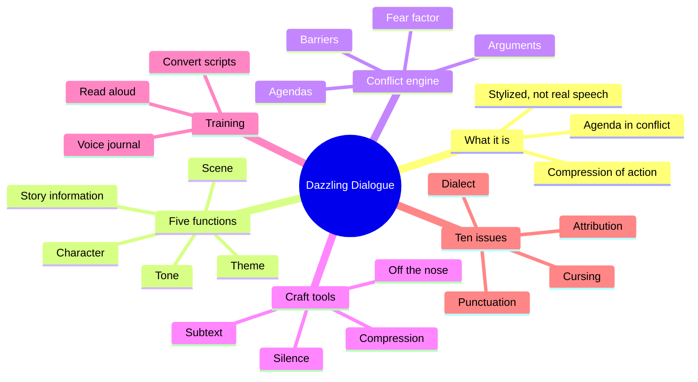
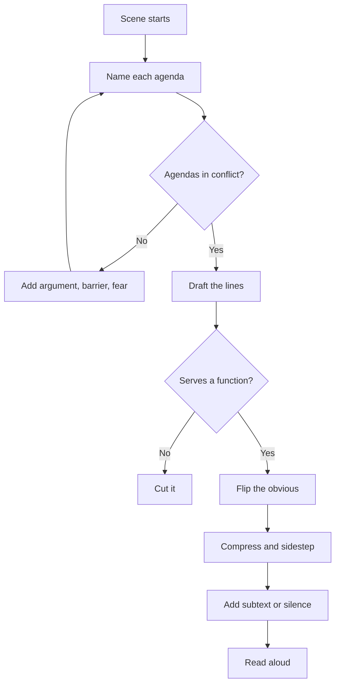
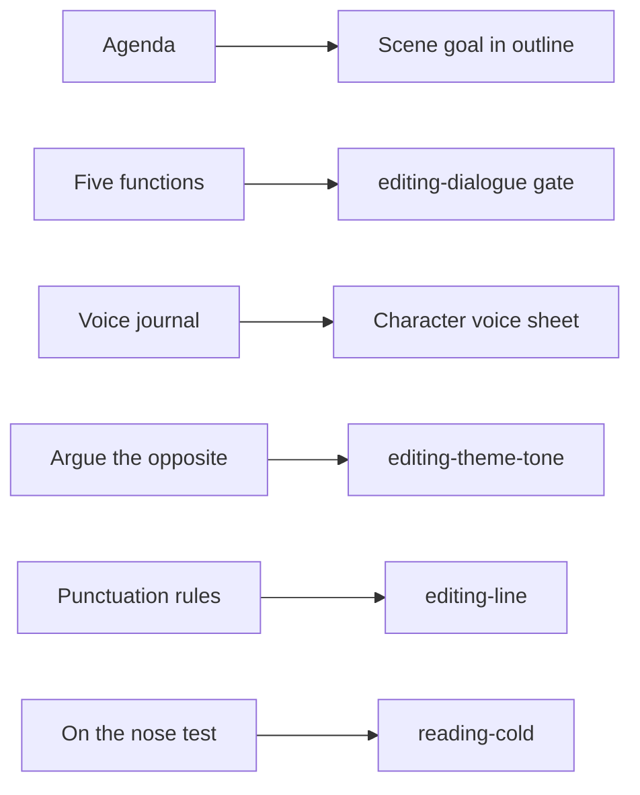

# BVX.0121 — How to Write Dazzling Dialogue — James Scott Bell (2014)
### Knowledge Entry — Distill

A short craft manual on fiction dialogue. It sits in the library as the working basis for the script editors (`editing-dialogue`, `editing-character`, `editing-line`) and for `reading-cold`: a test for whether a line earns its place, plus a mechanics reference.

## TABLE OF CONTENTS
- [Core Thesis](#1-core-thesis)
- [Mind Models](#2-mind-models)
- [Framework](#3-framework--structure)
- [Key Concepts](#4-key-concepts)
- [Heuristics](#5-heuristics--decision-rules)
- [Invariants](#6-invariants)
- [Pitfalls](#7-pitfalls--myths)
- [Application](#8-application)
- [Cross-References](#9-cross-references)
- [Provenance](#10-provenance--confidence)

---

## 1 · CORE THESIS

Dialogue is stylized speech, not recorded speech. It is "a compression and extension of action": each speaker wants something, and the wants collide. Dialogue shows a writer's skill fastest, so fixing it is the fastest way to improve a manuscript. Add conflict, subtext and compression, and cut anything that only informs the reader.

---

## 2 · MIND MODELS

**Diagram 1 — the whole argument.**
Read off the book's three moves: dialogue must do a job (five functions), must carry conflict (the engine), and must be shaped (the craft tools).

**Diagram 2 — the central mechanism.**
Read off the order of operations: a line is justified by an agenda, built by conflict, then shaped by the cut-and-sidestep tools. A line that fails the first test is cut, not polished.

**Diagram 3 — mapped onto the Command's systems.**
Read off where the book plugs in: it is texture-level craft, and it feeds the editors, not the character database.

---

## 3 · FRAMEWORK / STRUCTURE

The book has seven working chapters plus an author's note (the note is not in the extracted text).

1. **Why dialogue first.** Agents and readers judge skill from the opening pages; crisp dialogue buys confidence. Three openings are compared: a character alone thinking, bloated expository talk, and Connelly's tense interview.
2. **What it is and isn't.** Lawson's definition, then agendas in opposition (Scarlett vs Ashley, then Rhett; *All About Eve*). Not real speech, not an information highway, not a sermon.
3. **Five functions** (at least one must be live in every line): reveal story information, reveal character, set tone, set scene, reveal theme.
4. **Training.** Voice Journal, reading aloud, converting scripts to prose, improv (28 stock characters, one a day), plain practice with mismatched pairs.
5. **Conflict and tension.** Agendas, arguments, barriers (outer and inner), the fear factor.
6. **Eleven craft tools.** Orchestration, flip the obvious (plus the randomizer), subtext (character web), cheap champagne, Parent-Adult-Child, curving the language, off the nose, compression, silence, pace control, gems and spice.
7. **Ten issues** (reference): punctuation, attributions and tags, dialect, backstory, inner dialogue, experimental forms, cursing, thematic dialogue, comic relief, period dialogue.

---

## 4 · KEY CONCEPTS

| Concept | What it is | Why it matters |
|---|---|---|
| Agenda | What a character wants from this scene, even a glass of water | Every line must push an agenda; no agenda, no line |
| Compression and extension of action | Lawson: speech comes from energy, broadens and sharpens what people do | Treat speech as an act, not a report |
| Stylized speech | Dialogue that feels real but is shaped for effect | Licenses cutting the meander, the "Well," the greeting |
| Five functions | Information, character, tone, scene, theme | A line serving none is "just taking up space" |
| Hide exposition in confrontation | Deliver facts mid-fight, in pieces, with interruptions | Readers never catch the feed |
| Act first, explain later | Hold explanation back while action runs | Withheld reasons create mystery |
| Sitting-down-for-coffee scene | Two allies on one wavelength, nothing at stake | The dullest dialogue; fix it with conflict |
| Barrier | Outer (an interruption) or inner (a reason not to speak) | Makes communication hard, so the scene has to work |
| Fear factor | Fear as a continuum from worry to terror, in every speaker | Source of tension and subtext in calm scenes |
| Orchestration | A cast built to differ, each with an irritating quirk | Conflict is available between any pair, so dialogue arises from character |
| Subtext (iceberg) | What a speaker knows that the reader or the other speaker doesn't | Scene is more than what is said; the character web generates it |
| Parent-Adult-Child | Transactional roles; Parent commands, Adult reasons, Child feels | Role mismatch makes friction; Adult v Adult needs added fear |
| Curving the language | Rework a plain line until it has a twist (Danny Simon) | Memorable lines come from a second and third pass |
| On the nose | The direct, expected reply | Replace with a sidestep for interest |
| Sidestep | A reply that answers something else | Makes the reader ask why |
| Gems and spice | A moving speech (Bernstein's girl with the parasol) and flirt-as-banter (*Double Indemnity*) | Pleasure and theme in one beat |
| Inner dialogue vs inner monologue | Self-talk in two voices vs a single stated thought | A livelier way to give interiority |

---

## 5 · HEURISTICS & DECISION RULES

| Situation | Do this | Not this |
|---|---|---|
| Starting any scene | Jot each character's want; set them against each other | Write talk before you know who wants what |
| Dialogue that drags | Start an argument, even a playful one | Add description to fill the gap |
| Two allies talking | Give one a hidden reason (barrier, fear) | Let both be open and agreeable |
| Scene feels weak | Raise the conflict by 25 percent per character: quirk, interruption, sharper remark | Rewrite sentence by sentence |
| Facts the reader needs | Use the fewest; place them inside a confrontation, in pieces | Have a character say what both already know |
| Plot explanation needed | Make it interesting, break it with action, or let a lively speaker deliver it | A bored info dump |
| Line feels obvious | Flip it to the opposite and ask why a person would say it | Keep the expected reply |
| Stuck or tired | Randomizer: swap a line for the first line on a random page of a novel, then fit it | Stare at the page |
| Exchange is on the nose | Sidestep, or drop in a surprise (the "no pants" reply) | Reply to exactly what was asked |
| Emotion is too big for words | Silence plus a concrete image (bacon fat hardening) | Name the emotion |
| Wordy lines | Cut lead-in words ("Well," "Yes," "I am?") and echoes | Keep the filler for "realism" |
| Fluff words | Keep only if the speaker has a reason (a nervous psychologist's "Well") | Fluff by habit |
| Speed or depth | Fast: more white space, no description. Deep: add inner life between lines | Switch pace by accident |
| Tagging | Default to *said*; drop tags when the speaker is obvious; use action beats for variety only | Substitutes (*asseverated*), or beats on every line |
| Adverbs | Let words and action carry it; allow a rare economical adverb | Adverb on every tag |
| Dialect | Full flavor in the first line, then light reminders | Phonetic spelling throughout |
| Period speech | Neutral wording with a sprinkled period word defined by context; formal speakers skip contractions | Modern slang, or unreadable pastiche |
| Theme | Write each side's speech separately, then fuse into an argument | A character preaching |
| Changing protagonist | Have them argue the opposite of the theme in Act 1 | State the lesson early as truth |
| Cursing | Context, action in place of oaths, write it out then cut a day later | Rely on volume for realism |
| Voice sameness | Voice Journal per major character | Same register in every mouth |

---

## 6 · INVARIANTS

1. Every line serves at least one of the five functions.
2. Every speaker has an agenda in the scene, even in small talk (killing time still has a reason).
3. Dialogue is stylized, never pure transcription.
4. Opposed agendas make dialogue work; two aligned ones need an added barrier or fear.
5. Exposition must not state what both speakers already know.
6. Punctuation stays inside the close quote; an interruption ends with an em-dash then the close quote, nothing between.
7. Attribution is for clarity; *said* is invisible.
8. A cast whose members differ in voice and quirk produces conflict without effort.
9. Cutting improves dialogue more often than adding does.

---

## 7 · PITFALLS / MYTHS

- "Real people talk like this, so it's realistic." Real speech meanders; fiction compresses.
- The "character alone, thinking" opening with a slide into backstory.
- Characters telling each other what they both know (the *Perry Mason* train compartment).
- Characters as mouthpieces for the author's message ("preachy").
- The sitting-down-for-coffee scene with agreement and pleasantries.
- Reaching for thesaurus attributions and stacking adverbs on them.
- The opposite error: *said* after every line, or an action beat after every line. Each beat forces the reader to build a picture and ask its meaning.
- Adult v Adult with no fear or stake in it.
- Heavy phonetic dialect or authentic period speech that readers cannot parse.
- Semicolons and long formal sentences in speech.
- Exclamation points in a row.
- Onslaught cursing for "realism"; the author argues it costs readers and sales (a market claim, not a rule).
- Quote marks around thoughts or recalled speech; use italics or none.
- Experimental forms (no quote marks) read as work for the reader; the author is skeptical and says to know the cost.

---

## 8 · APPLICATION

- **Spine level:** TEXTURE. The book works at scene-line level, below the spine, though agendas map onto the scene want in any outline.
- **12-layer character stack:** none wired (`feeds: []`). The Voice Journal and the Parent-Adult-Child roles are tools for expressing character, not a psychology model.
- **plot_systems:** none.
- **Setting:** none, apart from "set the scene" through reaction lines.

Use for the OXO script editors:

- `editing-dialogue`: a three-question gate on any line. What does this speaker want? Which of the five functions does it serve? Is it the on-the-nose reply? Flag any line failing the first; flag runs of aligned characters agreeing.
- `editing-character`: voice check. Vocabulary, syntax, regionalism, peer group (the book's four levers). Test by covering the speaker labels; each voice should be identifiable. The Voice Journal is the creation-side tool.
- `editing-line`: the mechanics list in section 5 and chapter 7 (punctuation, tags, beats). Treat the novel-prose rules (italic thoughts, *said*) as prose only; script format has its own.
- `editing-theme-tone`: check that theme enters through argument, and that the changing character argued the opposite in Act 1. Tone: the set of dialogue lines should sound like one genre.
- `reading-cold`: the on-the-nose and expository-feed checks need no context, so they suit a cold read.

Caveat for adaptation: the book was written for novels (the attribution and beat rules). Screen and stage scripts carry attribution by format, so most of ch. 7 does not transfer; ch. 2 to 6 transfer fully, and Bell himself draws many examples from screenplays.

---

## 9 · CROSS-REFERENCES

| Related entry | Relation |
|---|---|
| [[BVX.0084]] | Another dialogue-technique manual; compare exercises and the tag rules |
| [[BVX.0064]] | McKee's character dimensions: the speech-as-choice-under-pressure basis behind agendas |
| [[BVX.0175]] | McKee, *Story*: scene as value change; the larger frame for an agenda in conflict |
| [[BVX.0236]] | Story Grid: scene analysis (want, obstacle, turn) which dialogue conflict executes |

---

## 10 · PROVENANCE & CONFIDENCE

Sourced from the full pdftotext of the book at `_PRIVATE/distill_wave/BVX.0121.txt` (about 4,000 lines), read in sequence across chapters 1 to 7. Every chapter and all ten issues were read. The extraction ends at the close of "Period Dialogue"; chapter 8 (Author's Note) is listed in the contents but its text is absent from the file, so it was not read. It is promotional back matter by the look of the table of contents, and no framework content is lost. Application notes (the editor mapping in section 8) are inference, not the author's. The cursing and market claims are the author's anecdote, not data. The 2014 date is from memory of the publication, not from the text, so confidence on the year is medium.

## META
- Template: BVX-LEARN-v4.0
- Source classification: craft manual (commercial how-to, single author)
- Created / Updated: 2026-10-30
