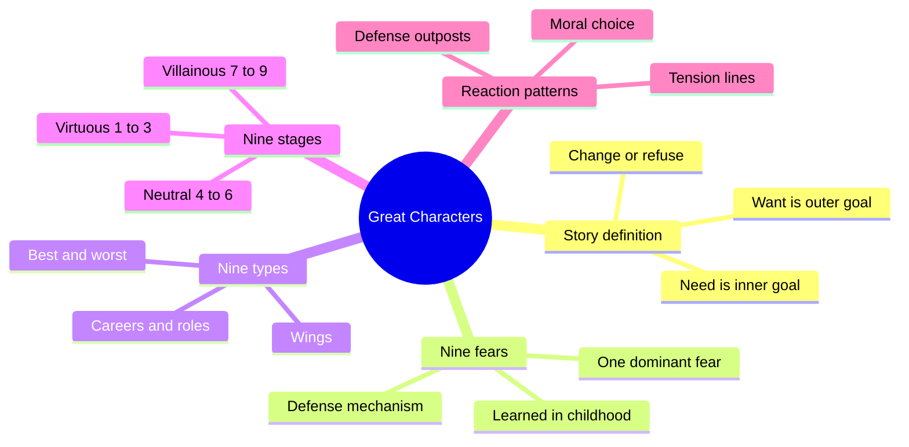
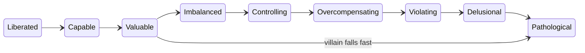
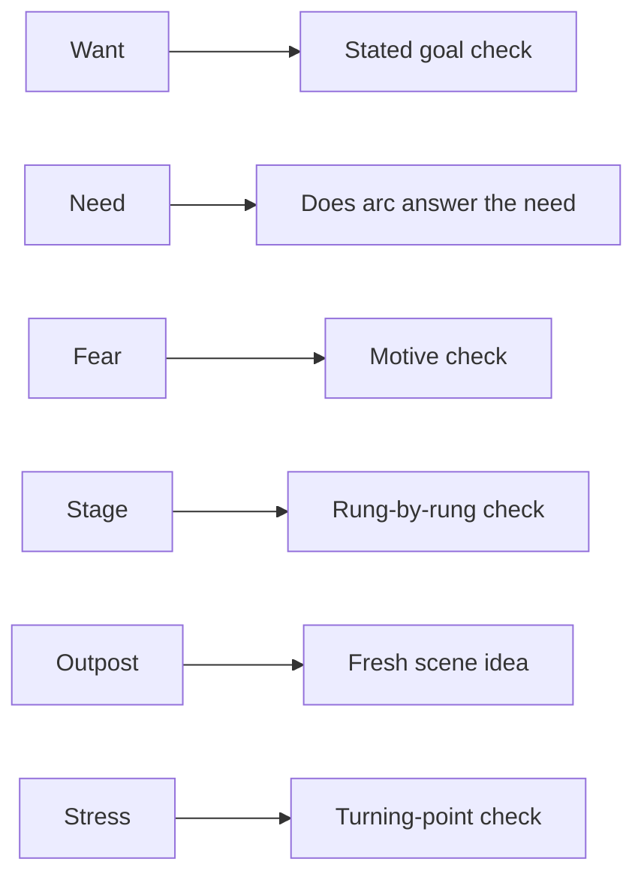

# BVX.0122 — How to Write Great Characters — David Wisehart (2015)
### Knowledge Entry — Distill

A short screenwriter's primer that uses the Enneagram as a working model for character: nine fears, nine types, nine moral stages, and a stress-driven route (the reaction pattern) for planning scenes. It is in the library as craft basis for script editing, not as psychology.

## TABLE OF CONTENTS
- [Core Thesis](#1-core-thesis)
- [Mind Models](#2-mind-models)
- [Framework](#3-framework--structure)
- [Key Concepts](#4-key-concepts)
- [Heuristics](#5-heuristics--decision-rules)
- [Invariants](#6-invariants)
- [Pitfalls](#7-pitfalls--myths)
- [Application](#8-application)
- [Cross-References](#9-cross-references)
- [Provenance](#10-provenance--confidence)

---

## 1 · CORE THESIS

A story is someone wanting something and having a hard time getting it. The want is outer and known; the need is inner and hidden behind one dominant fear. The plot exists to stress the character until they must change, and the Enneagram predicts how they react on the way.

---

## 2 · MIND MODELS

**Diagram 1 — the whole argument.**
Read off the book's three tools (fears, types, stages) and the one technique that joins them (reaction patterns).

**Diagram 2 — the central mechanism.**
Read off the loop: each major stress pushes the hero one step along the tension line into a borrowed type, where they learn something; the last stress returns them home at a different moral level.

**Diagram 3 — the moral ladder.**
Read off where a believable arc may move one rung at a time, and where a villain may drop fast.

**Diagram 4 — mapped onto the Command's editing work.**
Read off which book term becomes which question an editor asks of a draft.

---

## 3 · FRAMEWORK / STRUCTURE

The book is eleven short chapters (front matter, then the working chapters below). The argument runs as a stack, each layer built on the one before.

1. **Story definition.** "Someone wants something and has a hard time getting it." Break it into someone (character), wants (goal), hard time (obstacles), getting it (change or refusal).
2. **Why characters matter.** Audiences study themselves, others and survival through a character who acts human. The extended cave-tribe parable and the film *The Edge* ("what one man can do, another can do") make the point: a story hands the audience courage.
3. **Nine fears.** Each type has one dominant, mostly unconscious fear learned in early childhood. Only falling and loud noises are inborn. The fear produced a defense mechanism, which hardened into a personality, which is the lens the character sees through.
4. **Nine types.** Each fear yields one type with a best and worst version, typical careers, and film and history examples.
5. **Nine stages of arc.** A moral scale from Liberated down to Pathological. A character moves along it.
6. **Reaction patterns.** The Enneagram's inner lines become Tension Lines (move with the arrow under major stress) and Relaxation Lines (move against it at peace). Each stop is a "defense outpost" where the hero acts as another type.
7. **Worked example.** A Type 8 crime boss run through 8-5-7-1-4-2-8, then a case study of Maleficent (8, with a 9 wing) and her foil Stefan (3-9-6-3).

The tools are a model for writers, not clinical claims. The book says so openly.

---

## 4 · KEY CONCEPTS

| Concept | What it is | Why it matters |
|---|---|---|
| Want | The outer goal; the character knows it early | Drives the plot |
| Need | The inner goal; known only near the end | Drives the arc; a happy ending is possible by giving the need when the want is denied |
| Dominant fear | The one learned fear that shapes the type | Gives every choice a motive |
| Defense mechanism / false self | The mask built to manage the fear | Gives the character something to shed |
| Type 1 Reformer | Fears being evil; perfectionist, judgmental | Law, order, self-righteousness |
| Type 2 Helper | Fears being unloved; gives to get; may turn vindictive | The intimate villain pattern |
| Type 3 Achiever | Fears being worthless; image-driven | The usual Hollywood lead |
| Type 4 Artist | Fears being insignificant; seeks identity | Self-destruction risk |
| Type 5 Observer | Fears being incompetent; withdraws to master | The recluse and the planner |
| Type 6 Questioner | Fears being without support; tests others | Phobic and counterphobic subtypes |
| Type 7 Adventurer | Fears being deprived; escapes pain | Manic risk-taking |
| Type 8 Leader | Fears being controlled; asserts power | Protector or tyrant |
| Type 9 Diplomat | Fears separation; avoids conflict | Mirrors others, loses self |
| Wing | A neighboring type that colors the core type | Avoids flat, pure types (Maleficent is 8w9) |
| Minor vs major stress | Minor: normal tactics hold. Major: they fail | Major stresses are the plot points, midpoint and reversals |
| Tension / Relaxation Line | Direction of movement under stress or at peace | Predicts the next acting-out type |
| Defense outpost | A borrowed type the hero shelters in | Each one is a chance for a small change |
| Moral choice | The final stress forces a choice for good or ill | Decides the arc's direction |

---

## 5 · HEURISTICS & DECISION RULES

| Situation | Do this | Not this |
|---|---|---|
| Opening a story | Give a known want and a hidden need | Let want and need be the same thing |
| Naming the hero's flaw | Find the dominant fear, then the type | Describe only traits, looks and job |
| Hero faces minor stress | Show their usual tactics working | Change them for no reason |
| Hero faces first major stress | Have usual tactics fail, then act out along the Tension Line | Jump straight to the final change |
| Plotting scenes | Read the borrowed type's behavior and invent a scene from it | Fill the middle with unrelated incidents |
| Rewriting from notes | Check each reaction against the pattern | Patch the scene without testing the cause |
| Hero in a defense outpost | Show the negative traits first, then one integrated positive trait | Make the borrowed type fully good or fully bad |
| Sympathetic hero's arc | Move one stage at a time, show every rung | Skip from delusional to controlled |
| Villain's fall | May drop two or three stages quickly | Slow the fall unless the villain is a tragic hero |
| Tragic hero (Walter White) | Show every stage of the descent | Compress it |
| Final confrontation | Force a moral choice using everything learned | Solve it with luck or an outside rescue |
| Denied want | Give the need, which can still make a happy ending | Treat unmet want as automatic tragedy |
| Hero is a "trust me" speaker | Treat that line as suspect | Reward it |

---

## 6 · INVARIANTS

1. Story comes from character; the plot is the pressure that exposes the need.
2. Every character has one dominant fear, even though all nine are universal.
3. The hero is aware of the want and unaware of the fear until late.
4. Characters resist change, in fiction as in life. The writer's job is to force it believably.
5. A character arc is a moral arc: up or down the stage ladder.
6. Under major stress a character acts out as the next type on the Tension Line, not at random.
7. Each stop on the line is a chance to learn something new about the self.
8. Arcs end at the starting type, but at a changed moral level ("he can't go home again").
9. Audiences accept sympathetic upward change only if each step is shown.

---

## 7 · PITFALLS / MYTHS

- Describing a character by appearance, dialect, job and class only.
- Knowing the hero's want but not the fear behind it ("if you don't know your bad guy, it's you").
- A hero who changes with no motivating pressure; script readers mark this "no arc," "unmotivated," "unbelievable."
- Skipping rungs in an uplifting arc.
- Letting minor stresses do the work of major ones.
- Treating the type as a box. Wings and borrowed types are what round a character.
- Reading the book as science. The author concedes that most scientists and many therapists doubt the Enneagram; the claim is only that it is useful to a writer.
- Treating the plot as formula. The pattern is a guide and the writer supplies the details.
- Writing the Helper as always a woman or an effeminate man; the book notes film does this and ties it to social habit, which is a habit to question, not copy.

---

## 8 · APPLICATION

- **Spine level:** TEXTURE. The book shapes how a character feels and moves inside scenes, not the story's structural spine.
- **12-layer character stack:** none wired. `feeds: []` because the Enneagram is a writing aid here, not a psychology model for the stack.
- **plot_systems:** the reaction pattern is a scene-sequence generator and a diagnostic for turning points.
- **Setting:** none.

For the OXO script editors, use this as a check list rather than a lens to impose. Questions an editor or cold reader can ask of a draft:

1. What does the lead say they want, and does any scene show what they need?
2. Is there a stated or implied fear that explains the lead's choices?
3. Does each major stress cause a visible change of behavior, or does the lead keep using the same tactic?
4. If the lead moves from low to high on the moral ladder, is every rung on the page?
5. Does the last stress force a choice that uses what was learned?
6. Does the antagonist have a type and a fall that match the lead's rise (as Stefan mirrors Maleficent)?

Caution for the Command: the Enneagram is one model among several. It may sit beside, not replace, other craft sources and the project's own character notes. Do not retrofit named OXO characters into types without the Chief's word.

---

## 9 · CROSS-REFERENCES

| Related entry | Relation |
|---|---|
| [[BVX.0064]] | McKee, *Character*: true character revealed by choice under pressure; pairs with the major-stress and moral-choice ideas |

---

## 10 · PROVENANCE & CONFIDENCE

Read in full from the pdftotext file (`_PRIVATE/distill_wave/BVX.0122.txt`, about 2,000 lines, 68 pages): welcome, story definition, the cave parable, nine fears, nine types, nine stages, reaction patterns, the Maleficent case study and the conclusion. No chapter was left unread. The text file has stray non-UTF-8 bytes (an encoding artifact, no content lost that matters).

Confidence is medium. The mechanism and stage ladder are the author's own packaging of Enneagram ideas, and the book offers no empirical support. It also states "6-step" for a pattern that has seven stops (8 to 8). The type examples (historical and film) are the author's judgments and were not checked. Only BVX.0064 was confirmed to exist in KNOWLEDGE_AREAS before citing.

## META
- Template: BVX-LEARN-v4.0
- Source classification: self-published craft primer (popular, non-scientific)
- Created / Updated: 2026-10-30 / 2026-10-30
