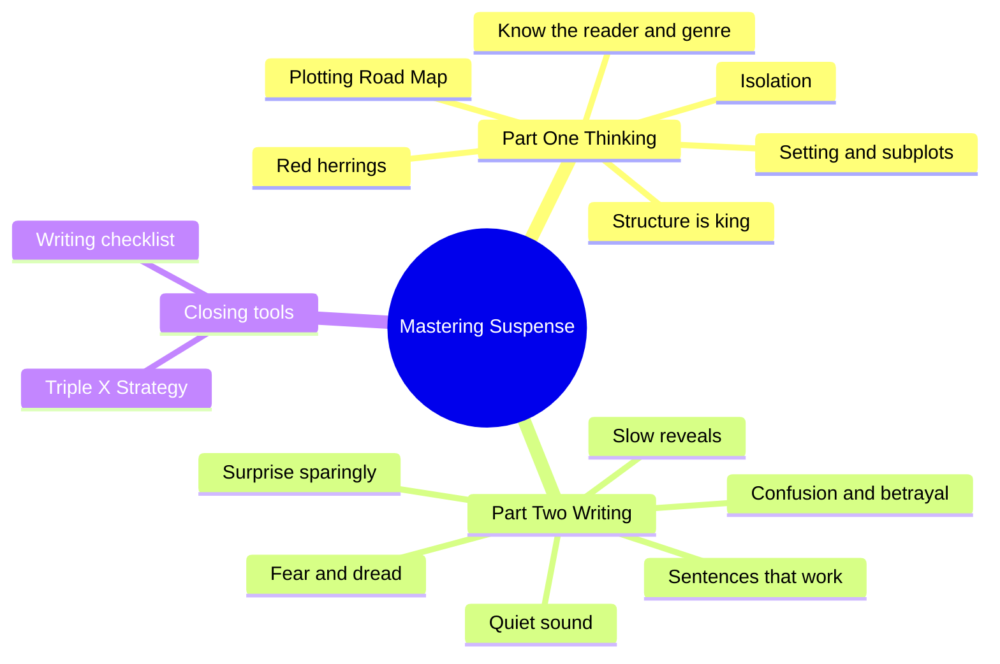
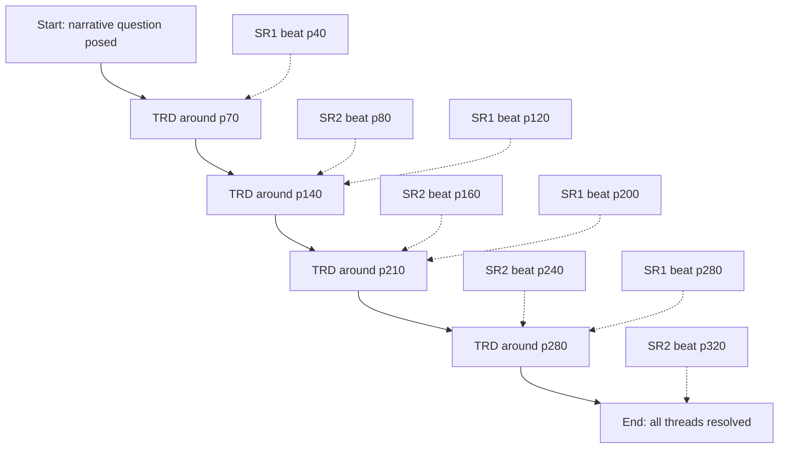
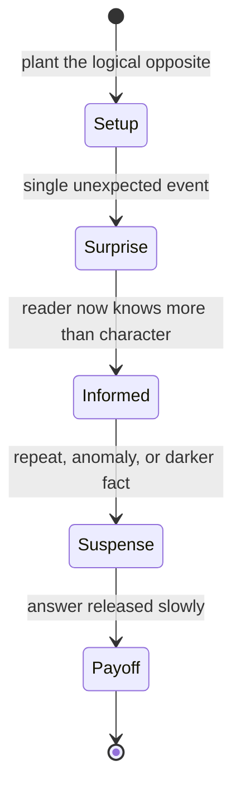
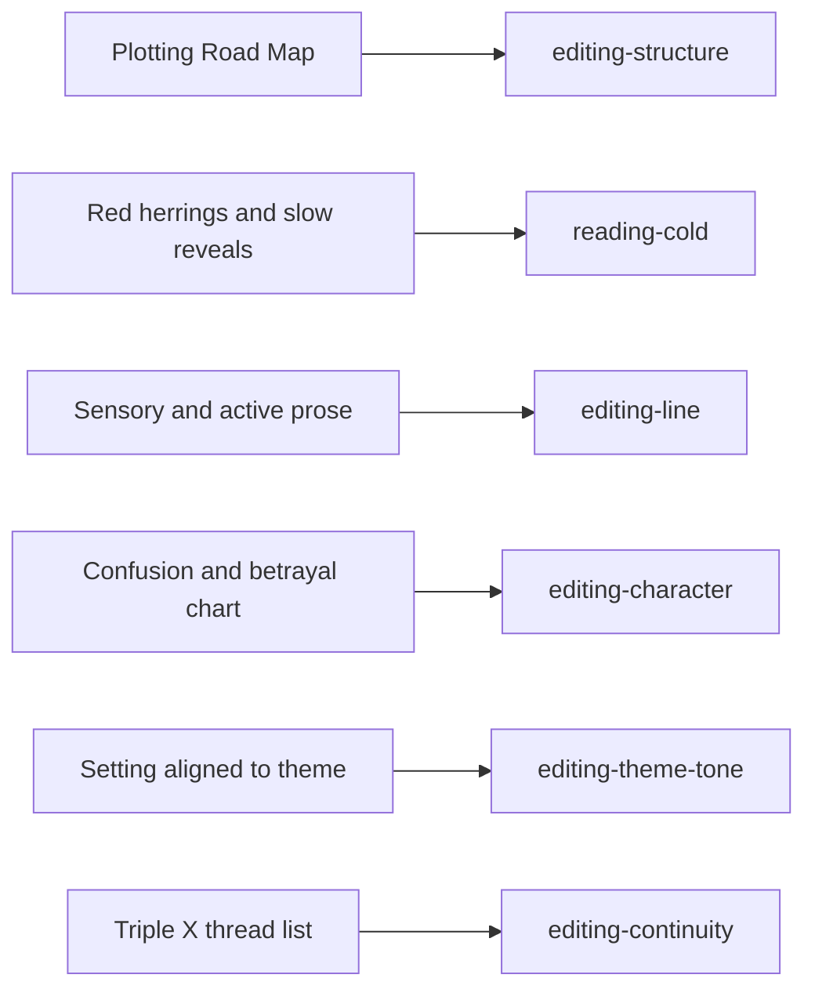

# BVX.0136 — Mastering Suspense, Structure, & Plot — Jane K. Cleland (2016)
### Knowledge Entry — Distill

A working novelist's craft manual: build suspense by planning (structure, a page-mapped plot, subplots) first, then by controlling what the reader knows sentence by sentence. It serves as the craft basis for the OXO script editors.

## TABLE OF CONTENTS
- [Core Thesis](#1-core-thesis)
- [Mind Models](#2-mind-models)
- [Framework](#3-framework--structure)
- [Key Concepts](#4-key-concepts)
- [Heuristics](#5-heuristics--decision-rules)
- [Invariants](#6-invariants)
- [Pitfalls](#7-pitfalls--myths)
- [Application](#8-application)
- [Cross-References](#9-cross-references)
- [Provenance](#10-provenance--confidence)

---

## 1 · CORE THESIS

Suspense is the reader knowing something is happening, or might happen, to a character they care about, without knowing what. Plan it with structure, a page-mapped plot and purposeful subplots. Then deliver it with sensory, active, unlabeled prose that releases answers slowly.

---

## 2 · MIND MODELS

**Diagram 1 — the whole argument.**
The book runs Thinking (plan for the reader) then Writing (control information at sentence level); read the two halves as plan, then execute.

**Diagram 2 — the central mechanism (Jane's Plotting Road Map).**
One main highway with a twist/reversal/danger (TRD) about every 70 pages, two service roads that each get a scene about every 80 pages (together, one subplot beat every 40), all converging at the end.

**Diagram 3 — surprise becomes suspense.**
A surprise is a one-off event; it only earns its place when it hands the reader information that creates anticipation.

**Diagram 4 — mapped onto the Command's systems.**
The book's levers land on editor agents and the TEXTURE spine, not on LEECHSEED layers.

---

## 3 · FRAMEWORK / STRUCTURE

**Part One: Thinking (plan).**
1. Know your readers: genre conventions, "fresh and familiar," the narrative question (an implicit contract, introduced early, answered by the end).
2. Structure: linear or nonlinear, single or multiple perspective, plus enhancements (bookends, categories, flashbacks, flash-forwards).
3. Jane's Plotting Road Map: highway, two service roads (subplots), TRDs, pace.
4. Setting: aligned to character traits, genre and theme; revealed through action.
5. Two subplots with a stated purpose.
6. Isolation, physical and social, as plot point, theme or backstory.
7. Red herrings: human nature, details, expertise.

**Part Two: Writing (execute).**
8. Surprise, sparingly, as a route into suspense.
9. Confusion and betrayal as prime motivators; a 25-plus question character chart exposes knowledge gaps.
10. Sound: whisper, silence, conditioned associations.
11. Fear and dread; dramatic irony.
12. Slow reveals; unreliable narrators.
13. Sentences: average under 20 words, varied, shorter under tension.
14. Conclusion: Triple X, writing checklist, "think, write, revise."

Two running case studies (a domestic thriller and a memoir) carry every worked example. The author's recurring order: define, show the cases, give a figure to fill in.

---

## 4 · KEY CONCEPTS

| Concept | What it is | Why it matters |
|---|---|---|
| Suspense | Reader knows something is happening or might happen to a character they care about, but not what | The organizing goal of every tool |
| Fresh and familiar | Meet genre expectations, layer the unexpected onto them | What publishers and readers both buy |
| Narrative question | Implicit overarching question posed early, answered by the end | A contract with the reader; Chekhov's gun applies to it |
| Structure vs POV vs perspective | Framework / voice / whose story | Three separate decisions, often conflated |
| Bookend | Open and close on the same motif | Anchors theme, gives symmetry |
| Plotting Road Map | Highway + SR1 + SR2 + TRDs against page count | Pace becomes a dial, not a mood |
| TRD | Twist (sideways), reversal (opposite), or heightened danger (physical or emotional) | The unit of plot; plan one at a time |
| Pace | Leisurely (TRD every 90-110 pp), steady (70-90), fast (30-50) | Genre sets it; fix it before plotting |
| Subplot with purpose | Mirrors, contrasts, reveals trait, or adds suspects; resolved by the end; never overtakes | A digression is not a subplot (the dog's tail is not a leg) |
| Thematic recurring subplot | In a series the subplot themes persist, incidents change | Carries the high concept across books |
| Isolation | Physical (cut off) or social (feel excluded) | Cheap, credible tension; also explains villains |
| Metaphor Machine | Abstraction + one of five senses + "like", brainstorm, find pattern, write | Makes emotion concrete |
| Red herring types | Human nature, details, expertise | Misdirection that stays fair |
| Halo and devil effects | One trait read as total goodness or badness | Hide a killer or unfairly damn a suspect |
| Surprise vs suspense | Bomb under the table (15 seconds) vs bomb the audience sees (15 minutes) | Informed readers wait; surprised readers merely jump |
| Confusion and betrayal | What the character fears most, defined personally | Motivates action; leads to TRDs |
| Knowledge gap | A blank on the character chart | A prompt to write, not a failure |
| Dread | Fear that cannot be vanquished | Works even when the outcome is known |
| Dramatic irony | Reader knows more than the character | Suspense without any twist |
| Slow reveal | Show a side, force an opposing act, show it in opposing light, reveal | Slow the reveal, never the pace |
| Triple X Strategy | Type "xxx" at every open thread; keep a thread list | Prevents dropped guns and coincidence |

---

## 5 · HEURISTICS & DECISION RULES

| Situation | Do this | Not this |
|---|---|---|
| Starting a project | Read 6+ best-sellers in the genre; chart motivation, question, theme, setting, pace, structure, suspense | Write from instinct and hope for an audience |
| Choosing structure | Pick what fits theme and reader expectation; change later if it fails | Pick nonlinear to look clever; skip structure |
| Single vs multiple POV | Single for fair-play mysteries and intimacy; multiple to show villain and cause-and-effect | Switch POV so often the villain is revealed early |
| Plotting overwhelms you | Plot the whole map, write only to the next TRD | Try to resolve the whole book in one sitting ("analysis paralysis") |
| Book feels slow | Add TRDs; one planned surprise near the middle | Add description or backstory |
| Book feels frantic or off-genre | Space TRDs out to the genre pace | Assume faster is always better |
| Picking a subplot | State its purpose; tie it to main plot or character | Promote an interesting minor character into a "subplot" |
| Subplot count | Two; more only for sagas | Three or more that confuse emphasis |
| Placing a suspense scene | Put the character where their traits would plausibly take them; retrofit traits if plot came first | Send someone alone up the haunted stairs |
| Describing a setting | Show it through a character acting in it, details only the story needs | A 10-page opening description |
| Raising tension | Isolate: remove allies, lock doors that trap, add social exclusion | Add noise and a louder villain |
| Heightened emotion | Lower the volume: small sounds, silence, the trembling hand | Have the character scream |
| Writing a surprise | Think of the logical opposite; follow it with suspense; use action and dialogue | "Suddenly," "out of nowhere," forms of "to be" |
| Planting a clue | Plant, flag as relevant without explaining, explain late; hide early mention mid-list | Explain at once; plant nothing |
| Red-herring a suspect | Use halo/devil, bandwagon, expert or detail; restore the innocent at the end | Leave a smeared character smeared |
| Writing perception | Replace look/see/hear/feel/know/realize with the sensory fact and reaction | "She realized he didn't love her" |
| Sentence length | Average under 20 words, vary; shorten during action; long for mood | All long, or a monotone of 20 |
| Revealing backstory | Few sentences, via dialogue or a short flashback tied to the scene end | Info dump |
| Cannot find your voice | Write to an imaginary friendly reader, draft raw, critique separately | Create and critique at once |
| Tracking threads | "xxx" marker and a thread list without page numbers | Trust memory |

---

## 6 · INVARIANTS

1. Structure is chosen; the only wrong choice is none.
2. Readers need relatable characters; suspense without care is noise.
3. Every raised question gets answered; every planted object gets used (Chekhov).
4. Character and incident are interdependent: incident reveals character, character dictates incident.
5. A surprise must be logically set up; coincidence, deus-ex-machina and alien killers are cheating.
6. Fair play: an unreliable narrator tells the truth as she sees it, or lies for a reason the story later shows.
7. Suspense needs an informed reader; surprise alone lasts seconds.
8. Show, don't tell. Emotion arrives through incident, sensory detail and reaction.
9. What counts as confusion or betrayal is personal to each character.
10. Reveals are slowed, never the pace; pace comes from action and dialogue.
11. By the end all primary and secondary plotlines resolve, and the ending feels "unexpected and inevitable" (Atwood).

---

## 7 · PITFALLS / MYTHS

- Mistaking an episode list for a plot (the foreword's memoir mistake).
- Writing for yourself and forgetting the genre contract; her dark cozy mistake.
- Nonlinear structure used for novelty.
- Omniscient narration that tells emotions instead of showing incident.
- Flashbacks as disguised info dumps; flash-forwards overused.
- Calling a digression a subplot; a subplot that outgrows the main plot.
- Description-heavy settings (Dinesen's 3,500-word opening is "cumbersome for today's readers").
- Contrived behavior: the haunted-attic trope, convenient phobias.
- Shouting: screams read as hysteria, silence reads as fear.
- Redundant modifiers ("loud boom"); vague descriptors ("frightening").
- Time-flags and "to be" verbs masquerading as urgency.
- Too many surprises; the book suggests about one per book, midway.
- Logical fallacies used carelessly: ad hominem, appeal to ignorance, non sequitur (non sequitur example is a rape-statistics line; handle with care).
- Myth that planning kills creativity; she calls the synopsis a sextant.
- Myth that faster is always better.
- Myth that writing for readers is pandering.
- Dropped threads and forgotten shrimp allergies.

---

## 8 · APPLICATION

- **Spine level:** TEXTURE. The book governs how scenes read and how information is paced, not what the story is about.
- **12-layer character stack:** none; `feeds: []`. The character chart (Fig. 9.1) and the isolation material touch LEECHSEED themes (social isolation as backstory, personal betrayal triggers) but as craft prompts, not psychology.
- **plot_systems:** the Road Map is a pacing grid the editors can audit.
- **Setting:** setting as theme-mirror (Fig. 4.2) and as character action, not backdrop.

For the editors:
- **editing-structure**: audit TRD spacing against declared pace; confirm exactly two named subplots, each with a purpose and a resolution; check bookends and the narrative question's early plant and late answer.
- **reading-cold**: test fair play. List what the reader knows vs the character; flag unexplained "relevant" details; check red herrings restore the innocent.
- **editing-line**: count labeling verbs (look, see, hear, feel, know, realize, notice), forms of "to be", "suddenly/out of nowhere", redundant modifiers; measure average sentence length per scene and shorter at peaks.
- **editing-character**: run the confusion/betrayal chart; list knowledge gaps; check traits justify where the character is when danger arrives.
- **editing-theme-tone**: does the setting contrast or echo the theme; does the tone match the genre contract?
- **editing-continuity**: keep a Triple X thread list for planted guns and details.
- **editing-dialogue**: every line must do something; backstory through dialogue in under 13-word sentences.

The book targets page-based novels (300-325 pages, 12-pt double-spaced). For scripts, convert pages to screenplay pages or percent-through-story; the proportions (TRD about every 22 percent, subplot beat about every 12 percent) are what carry over. This conversion is inference, not the author's.

---

## 9 · CROSS-REFERENCES

| Related entry | Relation |
|---|---|
| [[BVX.0054]] | Premise line and story development; pairs with the narrative question |
| [[BVX.0056]] | Active setting; setting through character action |
| [[BVX.0061]] | Characters and viewpoint; POV and perspective choices |
| [[BVX.0064]] | Cast design (McKee); complements the character chart |
| [[BVX.0084]] | Dialogue technique; dialogue that moves the story |
| [[BVX.0044]] | Fiction writing blunders; overlaps the pitfalls list |
| [[BVX.0089]] | Dramatica; a formal counterpart to the informal Road Map |

---

## 10 · PROVENANCE & CONFIDENCE

Full text read in sections from the pdftotext file (`_PRIVATE/distill_wave/BVX.0136.txt`): front matter, all fourteen chapters and the afterword's opening. The Afterword's remaining values (patience and later) were not read past the first two values; they are motivational and carry no framework. The Figure 1.2, 3.3, 9.1 and 9.2 worked tables were read but are summarized, not copied. Page-number proportions and the script conversion in §8 are inference. Publication year 2016 inferred from internal citations (latest cited 2016); verify against Zotero if it matters. The author's recurring examples (Josie Prescott series, two case studies) are not reproduced. Confidence high on content, medium on the year.

## META
- Template: BVX-LEARN-v4.0
- Source classification: craft manual, full-text distill
- Created / Updated: 2026-10-30 / 2026-10-30
