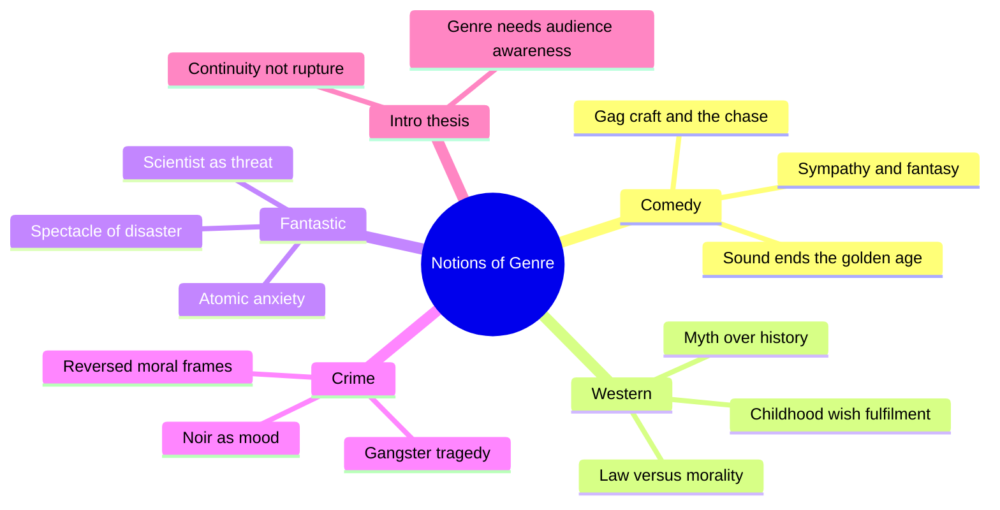
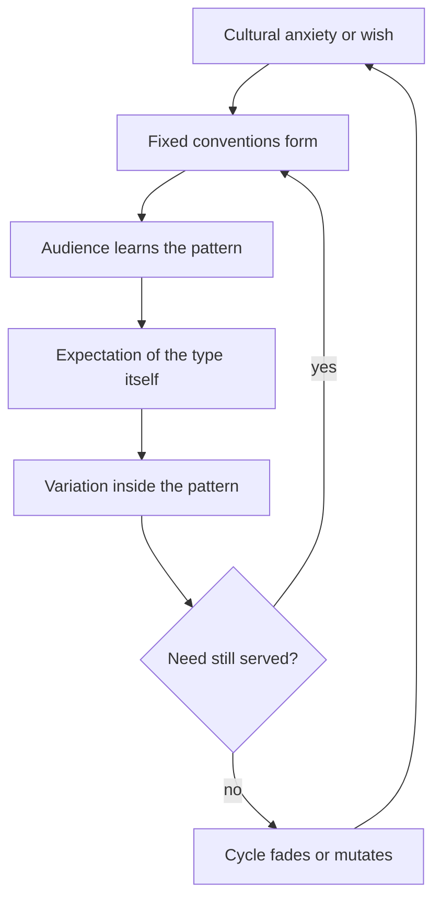
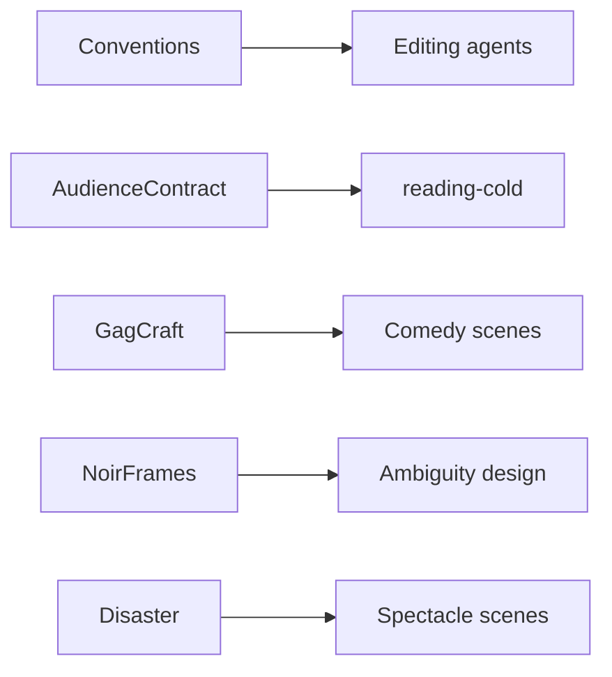

# BVX.0142 — Notions of Genre: Writings on Popular Film Before Genre Theory — Grant and Kurtz (2016)
### Knowledge Entry — Distill

An anthology of 23 critics' essays (1945 to 1970) on comedy, the western, the fantastic and crime film, written before film studies had a genre theory. It sits in the library as craft basis for the script editors: what each genre promises its audience, and why.

## TABLE OF CONTENTS
- [Core Thesis](#1-core-thesis)
- [Mind Models](#2-mind-models)
- [Framework](#3-framework--structure)
- [Key Concepts](#4-key-concepts)
- [Heuristics](#5-heuristics--decision-rules)
- [Invariants](#6-invariants)
- [Pitfalls](#7-pitfalls--myths)
- [Application](#8-application)
- [Cross-References](#9-cross-references)
- [Provenance](#10-provenance--confidence)

---

## 1 · CORE THESIS

A genre is a set of repeated conventions that the audience knows in advance, and each new film gets meaning from the earlier ones. The early critics already asked the later theory's questions: what the conventions are, what cultural need they serve, and what the audience expects.

---

## 2 · MIND MODELS

**Diagram 1 — the whole argument.**
Read the four parts as four genres, each with its own audience contract.

**Diagram 2 — the central mechanism.**
Read it as a loop: a genre is a fixed form that serves a cultural need, and it changes only when the need changes.

**Diagram 3 — mapped onto the Command's systems.**
Read it as the editors' use: genre rules become checks on a draft.

---

## 3 · FRAMEWORK / STRUCTURE

The editors give a short introduction (genre as a haunted system, after T. S. Eliot; the case that early criticism is continuous with later theory) and then four parts, each with its own headnote.

1. **Comedy (ch. 1 to 6).** Agee on silent comic craft; Kracauer on slapstick as alienation from machines; Eyles and Macdonald on why sound-era comedy decayed and the rules it broke; McCaffrey on how the chase evolved; the Gedulds on the little man against "the heavy."
2. **The Western (ch. 7 to 12).** Elkin (children's psychology), Bazin (myth and landscape), Schein (ritual), Bluestone (dime novel to adult western), Nussbaum (masculinity and the gun), Homans (Puritan allegory).
3. **The Fantastic (ch. 13 to 18).** Tyler on the supernatural; Brustein's horror typology; Hodgens against film science fiction; Sontag on disaster spectacle; Rogers on extrapolation; Dillard on Universal horror.
4. **Crime and Punishment (ch. 19 to 23).** Warshow's gangster as tragic hero; Chabrol on the thriller; Borde and Chaumeton and Durgnat on noir; Baxter on the gangster film.

The headnotes pre-label the shared concerns: definition, representation, ideology, audience, industry.

---

## 4 · KEY CONCEPTS

| Concept | What it is | Why it matters |
|---|---|---|
| Genre as relation | A genre film shows a relationship to other films of the type, and both maker and audience know it (Ryall, quoted in the intro). | The audience's prior knowledge is part of the text. |
| The ladder of laughs | Agee: titter, yowl, belly laugh, boffo; a good gag climbs by "cruelly controlled degrees." | A gag has a measurable shape, so it can be edited. |
| Build, milk, top | Set the gag up clearly, extend it, then cap it with a bigger turn (the tall men leave the car, then the midget, then the car collapses). | Names the three jobs of a joke and the failure of Bob Hope's duel. |
| The principle of the brick | Capra's rule for Langdon: help may arrive by accident, but the hero never causes it. | An innocent protagonist stays innocent only if the plot does the work. |
| Macdonald's three rules | Humor is guerrilla warfare (light, sudden, fast). The comic hero must be attractive or grotesquely stylized. Comedy is sadistic and needs fantasy to hide it. | A diagnostic for dead comedy. |
| Myth over history | Bazin: the western's formal signs (horses, fights, set) are symbols of a deeper myth, the Manichean order of law, morality and the woman as guardian of virtue. | Explains why the genre survives change of cast and country. |
| Wish fulfilment for the child | Elkin: simple world, strong hero, release of aggression sanctioned by justice. | A readable model of what a simple story gives a young viewer. |
| Law versus morality | Bazin: the sheriff's star works as a sacrament whatever the man is; law and virtue clash. | Sources the moral gray inside a "clean" genre. |
| Mad doctor / atomic beast / teen monster | Brustein's horror types, with the scientist's role shifting from villain to hero and the monster from his extension to an independent threat. | The same character slot reflects the era's fear. |
| Imagination of disaster | Sontag: science fiction films are about spectacle and scale of destruction, with locales shown "intact and destroyed"; the "five phase" model scenario. | Gives a checklist of beats and a reason the pleasure is not scientific. |
| Gangster as tragic hero | Warshow: the genre voices the American sense of failure; rise and fall lets the viewer fail by proxy ("it is his death, not ours"). | The double satisfaction of a doomed protagonist. |
| Noir as mood or series | Borde and Chaumeton: a shared emotional state, anguish from "the disappearance of psychological bearings"; Durgnat: noir is classification by motif and tone, not a genre. | Noir is a tone laid over other genres. |
| Police documentary vs noir | Procedural looks from outside with incorruptible cops; noir looks from the criminals' side with dubious police. | Point of view decides the genre. |

---

## 5 · HEURISTICS & DECISION RULES

| Situation | Do this | Not this |
|---|---|---|
| A joke is not landing | Check set-up clarity, then milk, then top; make sure the laugh serves the main line. | Add a bigger laugh that breaks the comic line (Agee's "tyro" error). |
| A comic lead is unlikable | Make him attractive, or so stylized that he becomes wish fulfilment (Fields, Groucho). | Play him realistic and hope sympathy follows. |
| A comic cruelty scene feels bad | Move it into fantasy; make sure no one is really hurt. | Mix real pain and real emotion into the gag. |
| An innocent hero needs rescue | Let chance or the world do it (the brick). | Have the innocent engineer his own luck. |
| A gag is long | Cut it light and fast; do not let the audience anticipate. | Spell the joke out twice for slow readers. |
| Writing a simple hero genre | Keep the world clear: no stray characters, no unresolved problems, justice at stake. | Add complexity the audience did not come for. |
| Writing a monster or disaster story | Plan the spectacle in locale pairs (intact and destroyed) and the human cost. | Rely on dialogue about science to carry the film. |
| Writing a doomed protagonist | Show the rise as a drive for success, then a swift fall; let the audience watch from safety. | Soften the ending to match public optimism (Warshow: it fails). |
| Making noir | Disorient: moral ambiguity, unclear motives, killers the audience likes, victims who are suspect. | Fix clear heroes and villains and add shadows. |
| Using a scientist character | Decide which type he is (mad, hero, or victim) and what the era fears. | Give him a lab coat and no relation to the threat. |

---

## 6 · INVARIANTS

1. A genre works because the audience already knows its conventions.
2. Convention intensifies the expected experience; originality is welcome only to that degree (Warshow).
3. Genre reflects a cultural need, and when the need changes the form mutates (Bazin's "vaccine": influences change but the type absorbs them).
4. Comedy needs a protected fantasy space so cruelty stays funny.
5. A tonal genre (noir) cuts across plot genres and is defined by feeling.
6. Critics of every era mourn a golden age (silent comedy, 1930s gangsters, the classic western); treat such claims as taste, not law.

---

## 7 · PITFALLS / MYTHS

- Defining a genre by its props (horses, fedoras). Bazin: those are signs, the myth is the substance.
- Assuming the audience wants realism. Warshow and Elkin show they want the type.
- Calling noir a genre. Durgnat and Borde/Chaumeton disagree on its category, so state which sense you use.
- Treating nostalgia as measurement. The essays judge new comedy against the silents without much evidence.
- Treating mass-culture readings as fact. Kracauer's national psyche and Homans's Puritan allegory are interpretation, and the editors call such claims essentialist.
- Forgetting the sample. All contributors are white men writing mostly about Hollywood before 1970; the editors say so.
- Trusting the scientist stereotype. Brustein and Hodgens read the science as black magic; the films often use science only as a trigger.

---

## 8 · APPLICATION

- **Spine level:** TEXTURE. The book informs scene and genre craft, not the story spine.
- **12-layer character stack:** none (`feeds: []`). The scientist and gangster typologies are role patterns, not psychology.
- **plot_systems:** none directly.
- **Setting:** none.

For the OXO script editors (`.claude/agents/editing-*.md`, `reading-cold.md`), the book supplies a vocabulary for genre checks. In a comedy pass, an editor can ask whether each laugh sets up, milks and tops, and whether the lead is attractive or stylized. In a thriller or crime pass, the editor can ask whose point of view the film takes (the criminals', as in noir, or the police's). In any genre pass, the editor should ask which conventions the reader expects and whether the draft keeps its contract. The cold reader can use Sontag's five-phase model as a beat checklist for disaster stories.

This is craft opinion from critics, not research. Use it as lenses, and do not use it as rules the OXO writers must obey.

---

## 9 · CROSS-REFERENCES

| Related entry | Relation |
|---|---|
| [[BVX.0191]] | Genre as story forms; a structural counterpart to these critical essays. |
| [[BVX.0576]] | Genre for the screenwriter; applies convention to writing. |
| [[BVX.0581]] | Genre theory overview; the later theory this book precedes. |
| [[BVX.0064]] | Character types and dimension, for the roles (hero, villain, comic) the essays list. |

---

## 10 · PROVENANCE & CONFIDENCE

Source type: book, pdftotext at `_PRIVATE/distill_wave/BVX.0142.txt`. Not read in full; the book is 23 essays on about 300 pages.

**Read fully:** the introduction; the four part headnotes (comedy, western, fantastic, crime), which summarize every essay; ch. 1 (Agee), ch. 4 (Macdonald), ch. 7 (Elkin, first half), ch. 16 (Sontag, first half), ch. 19 (Warshow), ch. 21 (Borde and Chaumeton). **Read in part:** ch. 2 (Kracauer, opening), ch. 8 (Bazin, first third), ch. 14 (Brustein, first two thirds), ch. 22 (Durgnat, opening and first cycle).

**Not read (summarized from headnotes only):** ch. 3 Eyles, ch. 5 McCaffrey, ch. 6 the Gedulds, ch. 9 Schein, ch. 10 Bluestone, ch. 11 Nussbaum, ch. 12 Homans, ch. 13 Tyler, ch. 15 Hodgens, ch. 17 Rogers, ch. 18 Dillard, ch. 20 Chabrol, ch. 23 Baxter, and the second halves of the partly read chapters. Statements about those essays rest on the editors' descriptions. Confidence is medium and status is draft.

## META
- Template: BVX-LEARN-v4.0
- Source classification: anthology of critical essays; craft basis for editing
- Created / Updated: 2026-10-30
