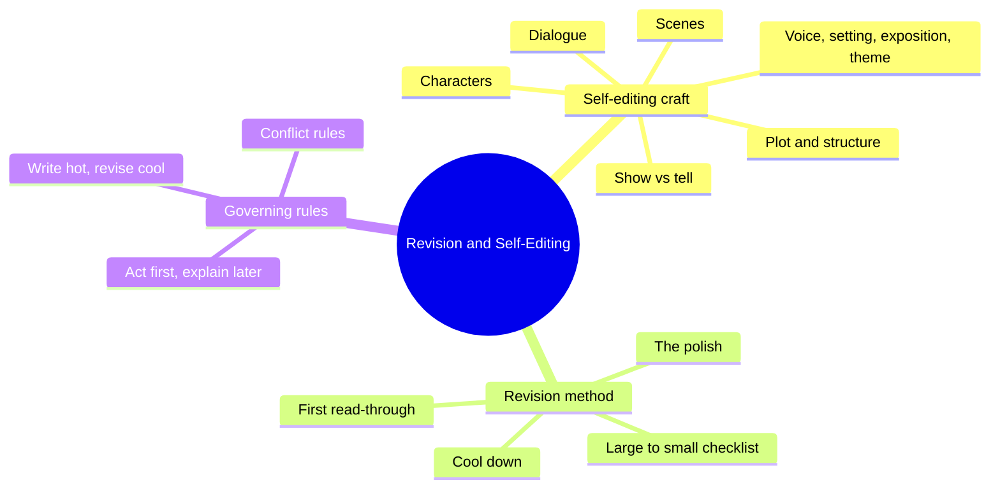
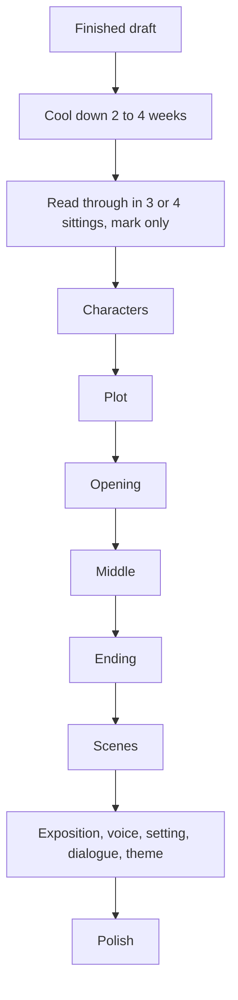
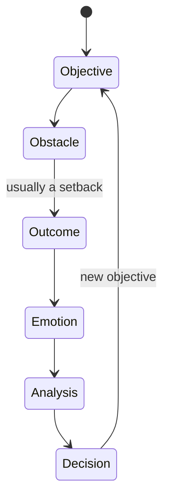

# BVX.0159 — Revision And Self-Editing — James Scott Bell (2008)
### Knowledge Entry — Distill

A working novelist's craft manual in two parts: twelve chapters of self-editing technique, then a large-to-small revision checklist. It sits in the library as the craft basis for the script-editor agents (editing and cold-reading passes).

## TABLE OF CONTENTS
- [Core Thesis](#1-core-thesis)
- [Mind Models](#2-mind-models)
- [Framework](#3-framework--structure)
- [Key Concepts](#4-key-concepts)
- [Heuristics](#5-heuristics--decision-rules)
- [Invariants](#6-invariants)
- [Pitfalls](#7-pitfalls--myths)
- [Application](#8-application)
- [Cross-References](#9-cross-references)
- [Provenance](#10-provenance--confidence)

---

## 1 · CORE THESIS

Fiction works when a bonded Lead wants something badly and a stronger opposition blocks it, scene after scene. Write hot to find the story; revise cool, from large problems (character, plot, opening, middle, ending) down to small ones (scenes, prose, polish), using a fixed checklist.

---

## 2 · MIND MODELS

**Diagram 1 — the whole argument.**
Read it as two halves: learn the craft elements (Part One), then run them as a revision pass in a fixed order (Part Two).

**Diagram 2 — the central mechanism (LOCK).**
The story engine is four parts. When a draft drags, check Objective and Confrontation first; the ending (Knockout) pays off the same objective.

**Diagram 3 — the revision order.**
Work large to small and never fix a comma before a plot hole. Each stage has its own key questions and its own fixes.

**Diagram 4 — one scene, one loop.**
Action scenes end badly for the Lead; reaction beats turn that setback into the next objective. That loop is the pulse of the book.

---

## 3 · FRAMEWORK / STRUCTURE

**Formula:** CONCEPT + CHARACTERS x CONFLICT = NOVEL. The "x" means each factor pushed past average.

**Part One, self-editing, by chapter:**

| Ch | Topic | Core claim |
|---|---|---|
| 1 | Philosophy | Train an inner editor; write by feel, analyze later. Story selection: many ideas, big idea, back-cover copy |
| 2 | Characters | Leads need grit, wit, "it"; minor characters are allies or irritants; opposition needs sympathy |
| 3 | Plot and structure | LOCK; three acts joined by a disturbance and two doorways; mythic structure; plot patterns |
| 4 | Point of view | POV is a scale of intimacy; one scene, one POV |
| 5 | Scenes | Action, reaction, setup, spice; HIP (hook, intensity, prompt); summary and flashback rules |
| 6 | Dialogue | 8 essentials, 12 tools, dialogue as weapon, said as default |
| 7 | Beginnings, middles, ends | Open on disturbance; hold the middle with LOCK; five ending types plus resonance |
| 8 | Show vs tell | Show above intensity 5, tell below; telling for transitions |
| 9 | Voice and style | Emerges from craft; exercises to widen it; cut clutter |
| 10 | Setting and description | Setting as character; telling details; "double duty" |
| 11 | Exposition | Select, anchor in POV, dialogue it, drip it |
| 12 | Theme | Characters before theme; weave, never lecture |

**Part Two, revision, by chapter:** 13 philosophy of revision (long view, mental game); 14 before you revise (write the draft, 20,000-word step back, tools, critique groups); 15 the first read-through (cool down, prepare, read, analyze, summary method, the mess factor); 16 the Ultimate Revision Checklist (Character, Plot, Opening, Middles, Endings, Scenes, Exposition, Voice/Style/POV, Setting/Description, Dialogue, Theme, then The Polish). An epilogue (the "trick that cannot be explained") and an answer appendix close the book.

**Three-act skeleton:** Act I (Lead, story world, tone, hook, opposition) ends at a first doorway by one-fifth; Act II deepens relationships and sets up the final battle; the second doorway comes about three-quarters in; Act III is the final battle, loose ends, resonance.

---

## 4 · KEY CONCEPTS

| Concept | What it is | Why it matters |
|---|---|---|
| No wimps | A Lead must act, not just take it | Passive Leads are the first place to look when a book drags |
| Grit, wit, it | Guts in action; self-deprecating humor; magnetism shown by others' reactions | Fast way to make a Lead memorable |
| Prepare, then prove | Plant a small courage test early, pay it off big | Makes later grit credible |
| LOCK | Lead, Objective, Confrontation, Knockout | The diagnostic for any sagging story |
| Bond | Identification, sympathy (jeopardy, hardship, underdog, vulnerability), likeability, inner conflict | Why readers follow a Lead |
| Adhesive | Duty, place, or self that keeps Lead and opposition in the fight | Without it, "why not just leave?" |
| Death overhanging | Physical, professional, or psychological death at stake | Raises stakes for any genre |
| Disturbance and two doorways | Opening change, then the two thresholds between acts | Stitches the three acts |
| Mythic structure | Ordinary world, call, tutor, allies, talisman, final test, return | Template for hero stories |
| Pull-back technique | Brainstorm outrageous trait actions, then pull back 25 percent | Gives surprise without breaking character |
| Allies and irritants | The only two jobs for supporting cast | Cuts dead weight |
| Pet the dog | A strong person's moment of care for something weak | Cheap sympathy that can also add trouble |
| Scene/sequel units | Objective, obstacle, outcome; then emotion, analysis, decision | Continuous plot motion |
| HIP | Hook, intensity, prompt for each scene | Page-turn engineering |
| In medias res | Start a scene at its hot spot | Cuts flab |
| Marbling | Spread description, setup, backstory through action | Avoids dumps |
| Double duty | Every detail also sets mood, tone, or character | Efficient prose |
| Intensity scale | 0 to 10 per beat; show above 5, tell below | Decides show vs tell |
| Subtext | Story, character background, theme under the lines | Depth in dialogue |
| Sidestep | Non-response, question, unexpected line, interruption, sudden punch | Kills on-the-nose talk |
| Parent/Adult/Child | Transactional roles assigned to speakers | Quick conflict grid |
| Curve the language | Tweak a plain line until it is specific and funny | Memorable lines without joke-jokes |
| Resonance | A last note that outlasts the ending | The final-page target |
| Three O questions | Objective, Obstacle, Outcome for a weak scene | Core scene-repair test |

---

## 5 · HEURISTICS & DECISION RULES

| Situation | Do this | Not this |
|---|---|---|
| Book drags | Check Objective and Confrontation; put the Lead in action | Add description or backstory |
| Lead feels flat | Opposite-sex exercise, switch casting, color the passions, voice journal | Add more traits as a list |
| Villain is one-note | Write his sympathetic mother's biography; give him competence, charm, a wound | Mustache twirler |
| Opening is slow | Start at the disturbance; try the chapter-two switcheroo | Warm-up pages of routine |
| Need backstory | Act first, explain later; drip it in dialogue or thought | Page-long backdump |
| Scene is weak | List the ten weakest; cut number one; run the Three O questions on the rest | Polish its sentences |
| Scene outcome | Let the Lead come out worse, then get him back in trouble | A string of wins |
| Talking heads | Add motion: walk and talk, a working setting | Two chairs and an info swap |
| Dialogue line | Ask: plot, character, or theme? Is there tension? Can it be cut or sidestepped? | Real-life small talk |
| Attribution | Default to "said"; use action tags or none | Adverbs and synonyms |
| Exposition chunk (2+ sentences) | Cut what is not needed; move rest into confrontational dialogue or tense thought | Quotation marks around an info dump |
| Flashback | Ask if it is necessary; write it as a dramatic scene; trigger in and out with a sensory detail; minimize "had" | Information dump in past perfect |
| Back story in a pinch | Back flash: one line of dialogue or thought | Full flashback by default |
| Intense moment | Show with action, metaphor, dialogue; slow it to beats | Summary |
| Transition | Summary, fast | Tracing every step |
| Weather or setting | Have a character react to it | Standalone weather report |
| Theme | Build characters first; write an essay on the theme after drafting | Starting from a message to prove |
| Speech or monologue | Break with thought, action, interruption | Several paragraphs of author voice |
| Ending | Write several last pages; echo an earlier line; tie loose ends in reverse order | Anticlimactic epilogues |
| After the draft | Cool down 2 to 4 weeks, read in 3 or 4 sittings, mark only | Fixing as you read |
| Stuck on a problem | Ask the question on paper at bedtime; list answers on waking | Staring at it |
| Time-box | 55-minute work blocks, hardest task first | Open-ended rewriting |
| Last pass | Word search for tics, "very", "suddenly", adverbs; read aloud | Skipping the polish |

---

## 6 · INVARIANTS

1. Conflict or tension belongs in every scene and every dialogue exchange, even between allies.
2. The Lead wants something crucial; opposition stronger than the Lead stands in the way.
3. A scene needs a clear POV character, an objective, an obstacle, and an outcome.
4. Most scenes should leave the Lead in a worse position.
5. Dialogue is action; it is not real speech and it is not an info channel.
6. The more intense the moment, the more you show.
7. Act first, explain later.
8. Opening, middle, ending each have one job: grab, hold, satisfy.
9. Revision runs large to small; first drafts are never finished products.
10. Characters come before theme.
11. Never let a coincidence rescue a main character.
12. Every major character gets a secret and a justification in his own mind.

---

## 7 · PITFALLS / MYTHS

- Revising as you draft: major rewrites mid-draft derail the story that is still forming. A quick edit of yesterday's pages is fine.
- Passive Lead: "taking it" for ten chapters reads as a wimp.
- Info dumps: in narration, in quotes, in the opening, in the first chapter.
- Cliche minor characters (bartender polishing a glass) used only to hand over information.
- Head-hopping and POV leaks: a first-person narrator describing his own flashing eyes; a third-person POV seeing behind its back.
- Over-evil villains and spotless heroes.
- Real-life dialogue: hesitations, small talk, phonetic dialect, bloated speeches.
- Synonyms for "said" and adverb tags.
- Flashback by default, especially right after a present-tense opening.
- Starting from theme: yields preachy, cardboard cast.
- Over-showing: showing every trivial step; the book bloats.
- Minimalism's ambiguity as an alibi; take only its economy.
- Perfectionism and endless rewriting that finishes nothing; both extremes lack a quality detector.
- Treating critique groups as mandatory; they help some, hurt others.

---

## 8 · APPLICATION

- **Spine level:** TEXTURE. The book governs prose, scene, and dialogue craft, with structure advice (LOCK, three acts) that serves outline checks but does not define the Command's spine.
- **12-layer character stack:** none wired (`feeds: []`). Character advice here is craft (grit, wit, pull-back, character arc template by act), not psychology.
- **plot_systems:** LOCK and the five ending types are usable as a checklist beside the existing plot work.
- **Setting:** setting as character, telling details, mood by double duty.

Use it as the checklist spine for the script-editing agents. A reading-cold pass maps to the first read-through (mark drag, confusion, additions, cuts; answer the analyze questions). Editing passes map to the Part Two order, large to small: character, plot, opening, middle, ending, scene (Three O questions), exposition, POV, dialogue, theme, polish. Dialogue editors can use the 8 essentials plus the sidestep, compress, and orchestrate fixes. The "ten weakest scenes" drill gives a bounded way to rank scene problems before touching any line. The book is prose-fiction craft; film and script examples are used throughout, so most rules carry over, but format-specific script rules are not covered. Under the Command's ruling that ideation research stays outside canon, nothing here changes any fabula record; it is an editing standard only.

---

## 9 · CROSS-REFERENCES

| Related entry | Relation |
|---|---|
| [[BVX.0084]] | Bell's own Write Great Fiction: Dialogue; deeper treatment of chapter 6 |
| [[BVX.0121]] | Dialogue as the fastest manuscript upgrade; same thesis, more tools |
| [[BVX.0236]] | The Story Grid; a competing editor's diagnostic for scenes and genre |
| [[BVX.0064]] | McKee on character; the theory beneath Bell's craft advice on cast design |
| [[BVX.0056]] | Active setting; extends chapter 10 |
| [[BVX.0200]] | Copyediting fiction; takes over where The Polish ends |
| [[BVX.0044]] | Common fiction blunders; overlaps the pitfalls list |

---

## 10 · PROVENANCE & CONFIDENCE

Full text read in sections (pdftotext, `_PRIVATE/distill_wave/BVX.0159.txt`): front matter, introduction, chapters 1 to 12, Part Two chapters 13 to 16, epilogue, and the exercise-answer appendix. The back-of-book index was skimmed only. No chapter is unread. The text file has OCR noise (running-header artifacts) that did not obscure content. Year 2008 is from the Library of Congress record; the text mentions self-publishing, so the scanned copy may be a later edition. Zotero key is `drop-new` (PDF from the PDF drop, not yet in Zotero). Cross-referenced BVX ids were confirmed present in KNOWLEDGE_AREAS; relation labels are inferred from titles, not read.

## META
- Template: BVX-LEARN-v4.0
- Source classification: book, craft manual, single author
- Created / Updated: 2026-10-30 / 2026-10-30
