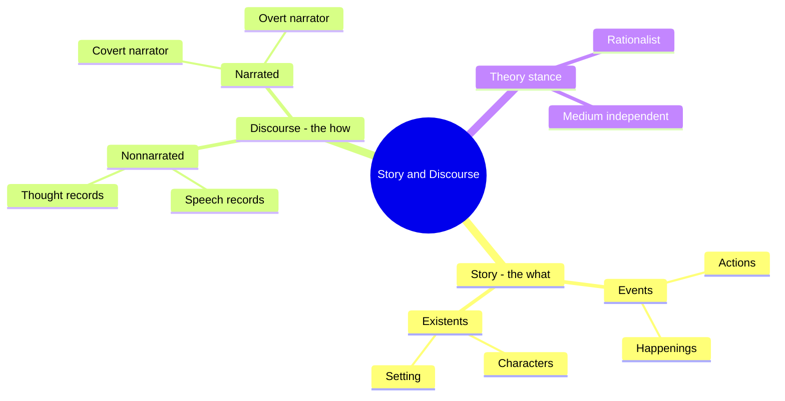
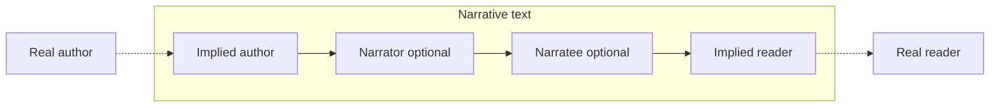
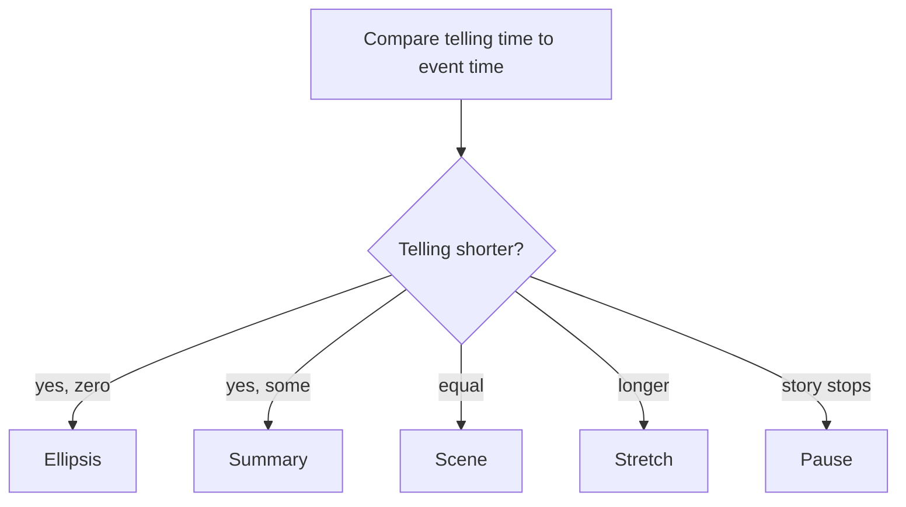
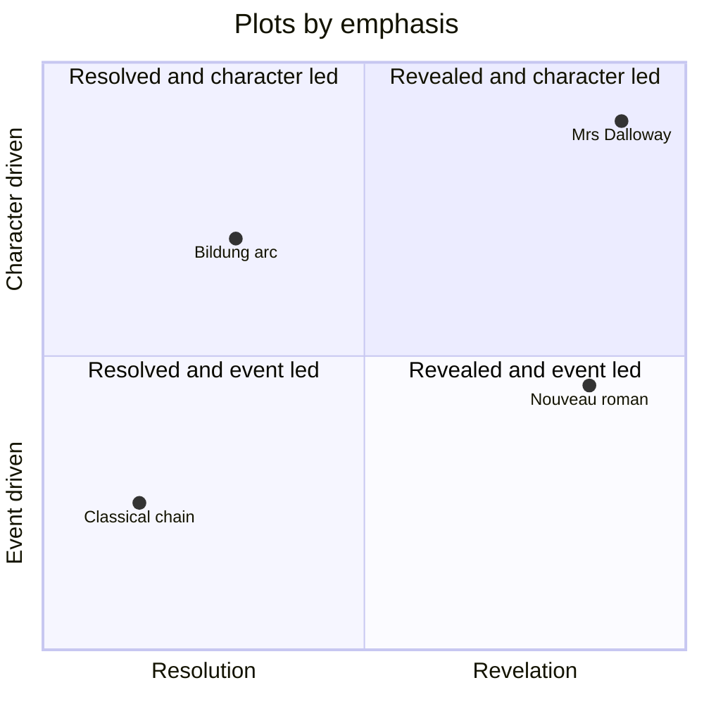

# BVX.0167 — Story and Discourse — Seymour Chatman (1978)
### Knowledge Entry — Distill

A structuralist theory of narrative that splits every story into WHAT is told (story) and HOW it is told (discourse), across fiction and film. It is the craft vocabulary for telling-versus-showing, point of view, and narrator reliability that the script editors need.

## TABLE OF CONTENTS
- [Core Thesis](#1-core-thesis)
- [Mind Models](#2-mind-models)
- [Framework](#3-framework--structure)
- [Key Concepts](#4-key-concepts)
- [Heuristics](#5-heuristics--decision-rules)
- [Invariants](#6-invariants)
- [Pitfalls](#7-pitfalls--myths)
- [Application](#8-application)
- [Cross-References](#9-cross-references)
- [Provenance](#10-provenance--confidence)

---

## 1 · CORE THESIS

Every narrative has a story (events plus existents: the what) and a discourse (the means of telling: the how). Story can move between media; discourse cannot. Most craft problems, such as timing, point of view, and voice, are discourse choices acting on a fixed story, so name which layer you are editing.

---

## 2 · MIND MODELS

**Diagram 1 — the whole argument.**
Read off it: two halves (story, discourse), each split in two, and the book's five chapters walk those four boxes in order.

**Diagram 2 — the central mechanism (the communication chain).**
Read off it: only the boxed middle belongs to the text; real author and real reader reach each other only through their implied counterparts.

**Diagram 3 — time: discourse-time against story-time.**
Read off it: five speeds. The ratio of the two clocks is a pacing dial the writer sets per beat.

**Diagram 4 — the plot-type quadrant, as the book frames it.**
Read off it: Chatman sorts plots by what moves (events or character) and by outcome type (resolved or revealed).

---

## 3 · FRAMEWORK / STRUCTURE

**The book's order.** Ch 1 sets the story/discourse split. Ch 2 covers story-events. Ch 3 covers story-existents. Ch 4 covers nonnarrated discourse. Ch 5 covers narrated discourse (covert and overt). A short conclusion lists open questions. Chatman says the theory "must be read as a whole."

**Narrative = story + discourse.**
- Story: events (actions by an agent, happenings to a patient) and existents (characters, setting).
- Discourse: the expression, the means by which the content is communicated.
- Manifestation: the medium (words, film, comic strip). Story is abstract and "no manifestation is privileged"; any paraphrase is itself another manifestation.

**Statements.** Discourse "states" story through two kinds of statement: process (DO or HAPPEN) and stasis (IS: identify or qualify). A text of only stasis statements implies a narrative but does not tell one.

**Events chapter.**
- Sequence is not enough. Readers infer cause even from bare order ("the king died, then the queen died").
- Kernels (hinge events that open branching paths) versus satellites (elaboration that can be cut without breaking the chain).
- Resolved plots (a question raised and answered) versus revealed plots (a state of affairs displayed, character-oriented).
- Time, after Genette: order, duration, frequency.
- Macrostructure: plot typologies from Aristotle, Crane, Friedman, Propp, Todorov, Bremond are surveyed, then doubted.

**Existents chapter.** Story-space versus discourse-space; character as a "paradigm of traits"; kinds of character; setting.

**Discourse chapters.** Nonnarrated forms (records of speech, soliloquy, interior monologue, stream of consciousness) versus narrated forms (covert and overt narrators, free indirect style, commentary).

---

## 4 · KEY CONCEPTS

| Term | What it is | Why it matters |
|---|---|---|
| Story / discourse | Content versus expression (Russian fabula/sjuzet, French histoire/discours) | Lets you say what stays when a script is adapted and what you may rework |
| Existent | Character or setting element | A character is defined by what the audience can infer, not by a fixed essence |
| Kernel | Major event; a node that forces one path over another | Cut a kernel and the plot breaks; it is the structural spine |
| Satellite | Minor event that fills in a kernel | Can be deleted without changing the story; it carries texture and character |
| Contingency | Modern replacement for strict causality: an event depends on something not yet certain | Explains stories that do not run on tight cause and effect |
| Verisimilitude, naturalization | The audience fills gaps using cultural codes of the "probable" | Shows what you can skip and what must be shown; it changes by era |
| Order | Story sequence versus telling sequence (flashback, flash-forward, in medias res) | The cheapest way to change an audience's knowledge |
| Duration | Summary, ellipsis, scene, stretch, pause | Pacing as a ratio of two clocks |
| Frequency | Told once, told n times, told once for n events (iterative) | Repetition is itself meaning (Rashomon-style retellings) |
| Trait | A relatively enduring personal quality read from behavior | The unit of characterization; it persists across scenes |
| Real / implied author | Person versus the textual principle that sets the norms | Lets you talk about the work's values without guessing the writer's |
| Narrator, narratee | The teller and the addressee, both optional | Tests whether the telling has a visible voice |
| Point of view | Three senses: perceptual (slant), conceptual (filter), interest (benefit) | Separates who sees, who judges, and who gains; films often split these |
| Covert versus overt narrator | Effaced narration versus a narrator who describes, summarizes, comments | Decides how much the audience sees the hand telling it |
| Free indirect style | Narrator and character voices blended in one sentence | A way to enter a mind without announcing it |
| Reliable / unreliable | Whether narrator reports and judges in line with the implied author | Gap between narrator and implied author makes irony |
| Mimesis versus diegesis | Showing (enactment) versus telling (recounting) | The craft question behind "show, don't tell" |

---

## 5 · HEURISTICS & DECISION RULES

| Situation | Do this | Not this |
|---|---|---|
| A scene feels slow | Locate the discourse-time/story-time ratio; compress to summary or ellipsis if it is stretch with no kernel | Trim lines blindly |
| Deciding what to cut | Test: if cutting an event breaks the causal chain, it is a kernel; else a satellite | Cut by length alone |
| A confusing reveal | Check what the audience can infer from existents (a dejected king implies he lost) | Spell out what readers already infer |
| Wanting a hidden event | Leave it in the gap and project it with a stasis detail | Show the event if the aftermath tells it better |
| Mixed up "who sees" | Split point of view into slant, filter, and interest; assign each | Say "POV" without saying which |
| Film has no narrator voice | Check where the camera sits; eye-line match shares a character's view | Assume visible camera means a narrator |
| A flashback confuses | Mark the anachrony: reach (how far back) and amplitude (how long) | Drop it in with no anchor to the story's NOW |
| Interior access is needed | Choose a mode on the scale from quoted thought to free indirect to narrator report | Default to voice-over |
| A scene is a recap | Convert to summary or an ellipsis, and use the saved space on a kernel | Replay the full scene |
| Naming a character trait | Show it recurring and persistent across scenes; say it once if at all | Rely on a single act to establish a trait |
| Setting up an unreliable narrator | Give the audience a norm (implied author) to measure the narrator against | Make narrator unreliable with no cue |
| Reviewing a plot type | Read it as the audience's contract with conventions of the genre | Force the plot into a universal formula |

---

## 6 · INVARIANTS

1. Every narrative has both story and discourse; neither exists alone.
2. Story is medium independent and transposable (novel to film to ballet); discourse is not.
3. A narrator is optional, an implied author is not: some principle always set the norms.
4. Only implied author and implied reader are immanent to the text; real author and real reader are outside it.
5. Audiences supply causal links between events unless blocked; a narrative without any plot is "a logical impossibility."
6. Events carry a hierarchy: kernels carry the chain, satellites decorate it.
7. Discourse time and story time are always two different clocks; all pacing is their ratio.
8. A film cannot leave visual detail unspecified; a verbal narrative can ("a man came in" must be dressed in film).
9. Characters are read from traits that persist; traits are inferred, not announced.
10. Plausibility is cultural and moves by era; what the audience finds "natural" is a convention.

---

## 7 · PITFALLS / MYTHS

- Treating story as the paraphrase. The English retelling is just one more weak manifestation.
- Calling the author the narrator. Overt or absent, the narrator is the teller on the page, not the writer.
- Equating "narrator" with "first person." A covert third-person narrator is still a narrator.
- Equating point of view with narrative voice. Who sees and who speaks are separate (free indirect style mixes them).
- Equating unreliable with lying. Unreliability is a gap from the implied author's norms (naive, deluded, self-serving all count).
- Assuming events must be linked by strict causality. Modern work uses contingency and gaps the audience fills.
- Believing one plot formula covers all stories. Chatman argues taxonomies work genre by genre and become reductive when stretched; art narratives resist formulas.
- Believing a character is a closed list of traits (Formalist reading); Chatman prefers an open construct that audiences keep inferring.
- Seeing a flashback as only memory. It is an anachrony defined by reach and amplitude, usable for any information release.

---

## 8 · APPLICATION

- **Spine level:** TEXTURE. The book governs the telling layer (voice, time, point of view), not the structural beats.
- **12-layer character stack:** none (`feeds: []`). Trait theory gives a vocabulary but not psychology.
- **plot_systems:** kernel/satellite is a usable tag for beat sheets; resolved/revealed plot is a useful label.
- **Setting:** story-space versus discourse-space informs how a scene's location is staged.

**For the script editors (`editing-*.md`, `reading-cold.md`).** Separate every note into a story note (what happens, who exists) or a discourse note (order, speed, whose view, what the narrator knows). Most "this is confusing" notes are discourse notes about order or point of view, not story problems. When reading cold, ask what a first-time audience can infer, since that decides whether a gap is productive. Use the five speeds to diagnose pacing: ellipsis and summary buy room; stretch and pause spend it. In OXO scripts this means checking each flashback or time cut for reach and amplitude, and checking whose perception a scene uses before praising "voice." Use Diagram 2 to settle what the work believes (implied author) versus what a narrator claims.

---

## 9 · CROSS-REFERENCES

| Related entry | Relation |
|---|---|
| [[BVX.0089]] | Dramatica: another theory of story structure; Chatman's existents/events split is a lighter parallel |
| [[BVX.0175]] | McKee, Story: practitioner craft on scene and gap; Chatman gives the theory beneath it |
| [[BVX.0092]] | Dramatic Story Structure primer: beat-level structure that Chatman's kernels explain |
| [[BVX.0195]] | Architecture of Story: technical writer's companion to the story/discourse split |
| [[BVX.0066]] | Cinematic storytelling: practical film grammar for Chatman's film point-of-view sections |
| [[BVX.0064]] | McKee, Character: characterization as traits, compared with Chatman's open construct |

---

## 10 · PROVENANCE & CONFIDENCE

Source: pdftotext of the Cornell paperback (OCR text, noisy; many pages two-up, so the 138 PDF pages hold about 280 book pages). Path: `_PRIVATE/distill_wave/BVX.0167.txt`.

Read in sequence: preface, contents, Chapter 1 (introduction, comic-strip example), the opening of Chapter 2 through kernels and satellites, and the conclusion. Read by keyword sampling, not continuously: the time section (order/duration/frequency), plot macrostructure (Propp, Todorov, Bremond), Chapter 3 (space, character, traits, Aristotle, Bradley), Chapter 4 (implied author, point of view), and Chapter 5 (covert narrators, free indirect style). Sections drawn from sampling and prior knowledge of the book (flagged inference): the point-of-view three-way split, the full list of speech/thought modes, the narratee section, and the quadrant placements in Diagram 4, which are illustrative, not the author's own chart.

**Unread in full:** Chapters 3, 4 and 5 (existents, nonnarrated discourse, covert and overt narrators), and the time section of Chapter 2. Confidence is medium for those parts.

## META
- Template: BVX-LEARN-v4.0
- Source classification: book, theory, full text partly sampled
- Created / Updated: 2026-10-30
