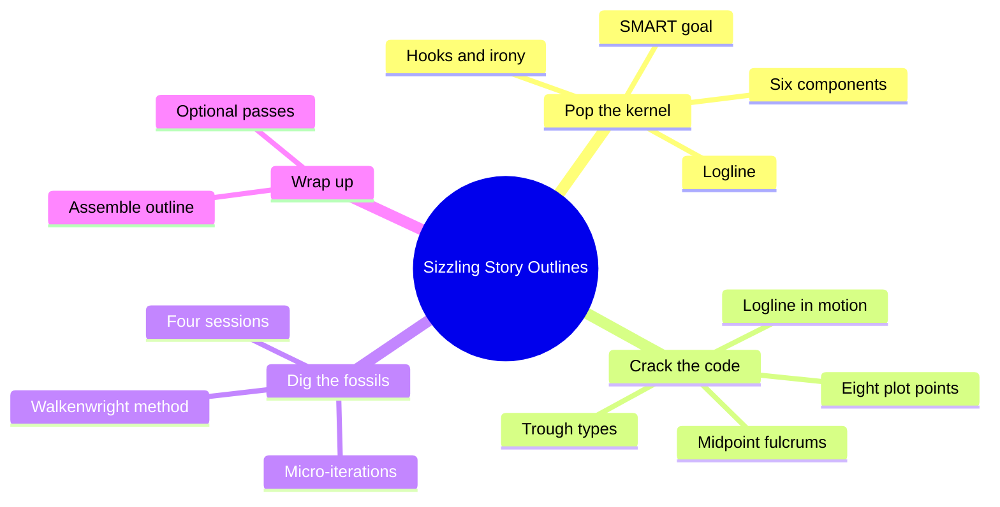
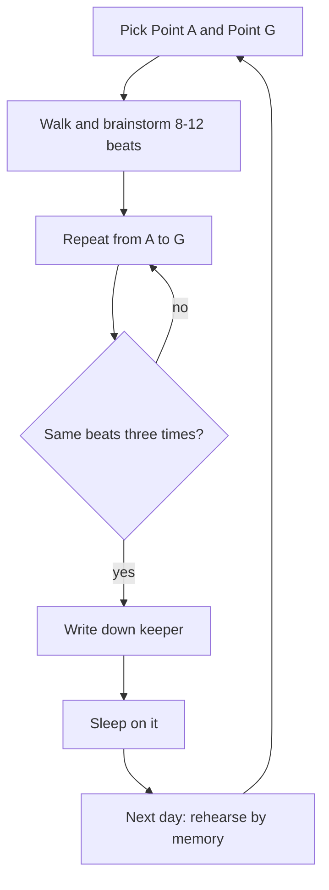
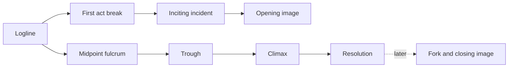
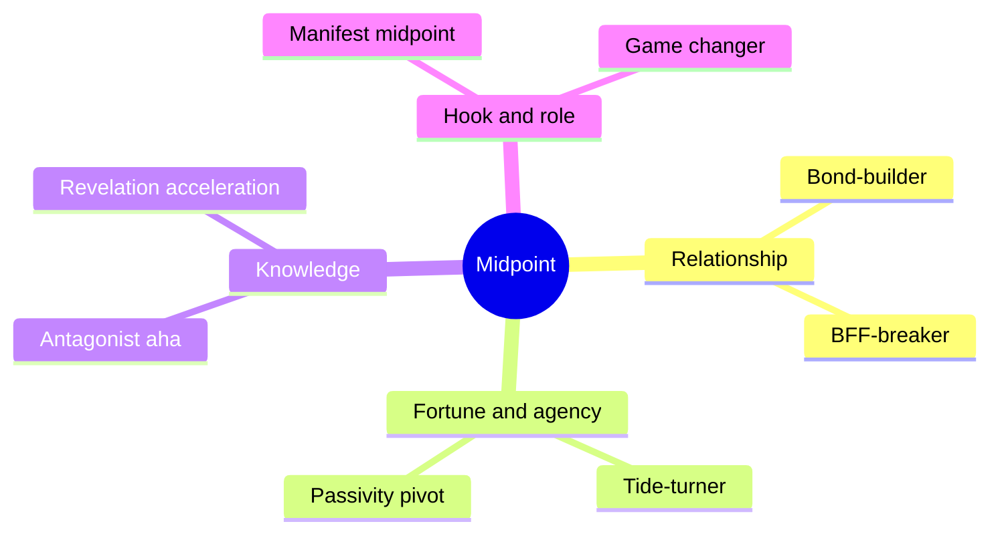

# BVX.0169 — Sizzling Story Outlines — D'Costa (2015)
### Knowledge Entry — Distill

A short craft manual (Iterative Outlining #1) that covers stage 1 only: take a raw idea to a full list of plot points in about two hours. It is in the library as a working outline method and a set of structure heuristics for the script editors.

## TABLE OF CONTENTS
- [Core Thesis](#1-core-thesis)
- [Mind Models](#2-mind-models)
- [Framework](#3-framework--structure)
- [Key Concepts](#4-key-concepts)
- [Heuristics](#5-heuristics--decision-rules)
- [Invariants](#6-invariants)
- [Pitfalls](#7-pitfalls--myths)
- [Application](#8-application)
- [Cross-References](#9-cross-references)
- [Provenance](#10-provenance--confidence)

---

## 1 · CORE THESIS

Test the idea first (protagonist, SMART goal, antagonist, stakes, genre, hook). Then fix eight structural plot points. Then fill the gaps by walking and brainstorming, unwritten, until a version repeats three times. A story you can see end to end stops you stalling.

---

## 2 · MIND MODELS

**Diagram 1 — the whole argument.**
Read off the three parts of stage 1: kernel, code, fossils. Each part ends in something you can write down.

**Diagram 2 — the central mechanism (one walkenwright session).**
Read off the loop: the writing is delayed on purpose, so weak material dies before it reaches paper.

**Diagram 3 — order in which the eight plot points are solved.**
Read off the dependency chain: each point is derived from the one before it, so none is a blank-page problem.

**Diagram 4 — the eight midpoint fulcrums by what changes.**
Read off which fulcrum fits your premise: relationship, power, knowledge, or hook.

---

## 3 · FRAMEWORK / STRUCTURE

**Iterative outlining (the series).** Stage 1 starter outline ("say it"), stage 2 intentional outline ("say what you mean"), stage 3 working outline ("say it well"). This book is stage 1 only. Principle: a flawed plot point still gives you material to fix; raw material beats a blank page.

**Part I, pop the story kernel.** Isolate one kernel (situation, character, or theme) and shelve the other "story seeds" in a seed bank. Build the six components: protagonist, goal, antagonist, stakes, genre, hook. Theme is deliberately left out. Compress into a logline: because of the stakes, a protagonist must accomplish a goal despite the antagonistic force.

**Part II, crack the structural code.** Eight plot points: opening and closing images, inciting incident, first act break, midpoint, fork in the road, trough of hell, climax, resolution. They are solved in a working order, not story order (Diagram 3). The fork and closing image are the least essential and are deferred.

**Part III, excavate the fossils.** The walkenwright method (walk + brainstorm, no notes) fills the beats between solved points. Four sessions: Act One, Act 2A, Act 2B, Act Three; an optional fifth runs the whole story. One session per day, consecutive days, 20 to 25 minutes each.

**Part IV, wrap up.** Assemble the keepers, re-check midpoint alternatives, then optional passes: time frame, need-to-know and accounting lists, seed bank, theme, fork and closing image, worldbuilding. A 37-step checklist closes the book.

---

## 4 · KEY CONCEPTS

| Concept | What it is | Why it matters |
|---|---|---|
| Story kernel | The one seed (situation, character or theme) you expand; the rest go to the seed bank | Stops the outline carrying every early idea; seeds return later as problem-solvers |
| SMART goal | Specific, Measurable, Actionable, Realistic, Time-bound goal for the protagonist | Gives narrative drive and focus; vague goals ("redeem himself") make episodic vignettes |
| Want vs. need | Protagonist chases a want, must switch to a need; the one accepted goal switch | Both must be SMART; the want's pursuit carries the plot, the need often a romance |
| External antagonist | A person (nemesis, rival, amorous opponent), never a flaw alone | Gives the climax a visible confrontation; screens cannot show thoughts |
| Credibility strategy | Profession, mentor, long time frame, latent trait, partner, prophecy, ally's faith, sacrifice | Makes an underdog's final win believable |
| Stakes ("in order to") | Consequence of failure attached to the goal | Reason to keep going despite rising obstacles; lets an unlikeable lead work |
| Genre | Promise of a specific emotional experience | Sets many choices; same plot in two genres plays opposite |
| Hook | Audience attractor: setting, character, origin, tone, title, irony (intrinsic); cover, creator, star, word of mouth (extrinsic) | Extrinsic hooks grow out of intrinsic ones, and only intrinsic ones are in your control |
| Irony | Juxtaposition of opposites the audience would not expect together | Curiosity engine; five combinations listed in §5 |
| Hook overload | More hooks than the plot can serve | A new hook that the story cannot use is dead weight (terrorist-on-the-bus) |
| Logline | One sentence, 30 to 50 words, from the six components | Touchstone for cutting scenes; source of the first act break |
| First act break | The logline "in motion"; the hook manifests here | Defines when the premise starts; about 25 percent of runtime (less in novels and comedy) |
| Need-to-know list | Only what the audience must know now to understand or care later | Prevents bloated, slow openings |
| Inciting incident | Cause-and-effect predecessor of the first act break | Found by working backward; replaceable |
| Midpoint fulcrum | Event that makes Act 2B differ in kind from 2A | Prevents a monotone middle |
| Trough of hell | End of Act Two: painful, emotionally resonant, paradoxical | Re-engages audiences when attention sags |
| Momentous climax | Setting, urgency (ticking clock) or crucial choice | The last memory colours the whole story |
| Hallmark of change | A beginning element turned on its head at the end | Cheap, clear way to show change |
| Accounting list | Loose ends, red herrings, setups to be paid off | Resolution must tie them, and entertain doing it |
| Micro-iteration / keeper | One mental pass A to G; the one that repeats three times | The unit of the method |
| Walkenwright | Walking-and-brainstorming without notes | Stanford walking result (about 60 percent more creative output) |

---

## 5 · HEURISTICS & DECISION RULES

| Situation | Do this | Not this |
|---|---|---|
| Burst of inspiration | Isolate one kernel, shelve other seeds | Crowbar every seed into the outline |
| Character-driven idea | Give the flawed hero a SMART pursuit; derive plot from it | Build on ghost, flaw or quirks alone |
| Theme-first idea | Reverse engineer a concrete setting, then a goal; park the theme in the seed bank | Let the message outrun the plot |
| Tempted to switch the goal | Ask whether it changes direction audiences will welcome or dodges a hard middle | Switch goals to escape sustaining the idea (exception: want vs. need) |
| Underdog lead | Choose several credibility devices | Rely on luck for the final win |
| Hero too safe | Raise the antagonist ("set the bar high"), then refine the hero to match | Weaken the villain to ease the hero's path |
| Weak concept | Layer irony: most competency + least likely; varying competency + new waters; untested competency + least likely; competent with others, not self; attraction + least likely | Irony via proxy; hook count without cohesion |
| Choosing hooks | Check they coexist; match count to medium (films need more than novels) | Stack hooks until the plot distorts |
| Worried about extrinsic hooks | Return attention to intrinsic ones and next project | Obsess over reviews, stars, studio moves |
| Finding the first act break | Put the logline's key event in motion; one location change is typical | Hook delivered in the first ten pages |
| Opening act | List need-to-know items; check runtime near 25 percent | Dump backstory and mini-flashbacks |
| Choosing a midpoint | Match logline to fulcrums, list implied characters, pick one; if two cannot merge, outline twice | Juggle several fulcrums at once |
| Choosing a trough | Try obvious types, then force an unlikely one, then combine | Soften the damage |
| Writing the climax | Use setting, urgency or choice; sketch a map, intercut a clock, state the choice | Perfunctory showdown after a taxing Act Two |
| Explaining loose ends | Dramatise it (Holmes hanging from the ceiling) | A dry question-and-answer scene |
| Early structure choices | Commit; they are scaffolding and may change | Wait for a perfect inciting incident or opening |
| Stuck mid-draft | Re-walk the gap; re-open the seed bank | Write forward blind |
| Brainstorming | Number slots in advance, count beats on fingers, 8 to 12 beats per gap | Record every pass |
| Quarter-story session | Keep to about 15 beats in memory | Over 8 sessions (cohesion drops) |
| Scheduling | One session per day, consecutive days, sleep between, rehearse by memory | Scatter sessions or re-read notes |
| Genre contamination | Genre fast about three weeks; other voices (news, social, podcasts) about four days | Consume your own genre mid-outline |

---

## 6 · INVARIANTS

1. Every story needs a protagonist's goal, an antagonist, stakes, genre and at least one hook.
2. The goal must be concrete and pursuable, or the plot turns episodic.
3. The antagonist is external, even in an internal story.
4. The first act break is the logline in motion; everything else upstream (inciting incident, opening) follows by cause.
5. The middle needs two things to stop sagging: a midpoint that changes the kind of story and a hard trough.
6. The climax and resolution are the last experience and weigh disproportionately in recommendations.
7. Every plot point chosen at stage 1 is provisional; the outline is a tool to expose problems cheaply, not a contract.
8. Extrinsic hooks derive from intrinsic ones.
9. An unfinished beat is still material.

---

## 7 · PITFALLS / MYTHS

- "Run with the burst of inspiration": the idea hits a wall about a third in, or is finished but unwanted.
- Gimmick without goal: What Women Want style antics run out; the plot stalls.
- Vague goals ("redeem himself") or goal-hopping: vignettes, not a story.
- Theme before plot: a message, not a story.
- Internal-flaw antagonist: nothing for the climax to confront.
- Irony via proxy: weaker than the full version.
- Hook overload: irony the plot cannot use.
- Delaying the hook too long (padding) or rushing it too early (no investment in character).
- Soft troughs: antsy audiences.
- "Outlines make paint-by-numbers stories": knowing the what frees energy for the how.
- Writing down every brainstorm: you settle for low-hanging fruit.
- Stage 1 treated as final: it is a first pass, to be rebuilt in stages 2 and 3.

---

## 8 · APPLICATION

- **Spine level:** TEXTURE. The book sits at craft and plot-beat level, below the story spine. It organizes beats, not character psychology.
- **12-layer character stack:** none. `feeds: []`. Antagonist and want vs. need touch character only as plot function.
- **plot_systems:** structural beats (opening image, first act break, midpoint, trough, climax, resolution) as a checklist.
- **Setting:** settle place, time and season early; worldbuild after the outline.

For the OXO script editors (`.claude/agents/editing-*.md`, `reading-cold.md`), the useful parts are the diagnostics, kept separate from the method:

- First act break test: is the logline's central hook in motion near 25 percent, with only need-to-know material before it?
- Midpoint test: does Act 2B differ in kind from 2A, and which of the eight fulcrums is it?
- Trough test: painful for the hero, resonant for the audience, paradoxical for the plot?
- Climax test: setting, urgency or choice; does victory grow from the trough's ashes?
- Accounting test: are all setups, red herrings and loose ends paid off, and is that payoff dramatised?
- Goal test: SMART goal present, goal switches justified?

The "story seeds shelved, kernel kept" rule maps cleanly to the Command's research-not-fabula discipline: ideation waits in a seed bank until promoted. The walkenwright method is a drafting aid, optional, and the author says to adapt it.

---

## 9 · CROSS-REFERENCES

| Related entry | Relation |
|---|---|
| [[BVX.0163]] | Save the Cat: opening and closing image idea comes from here; beat sheet counterpart |
| [[BVX.0175]] | McKee, Story: fuller treatment of structure and the climax |
| [[BVX.0193]] | Truby's 22 steps, named as an alternative method |
| [[BVX.1124]] | Vogler, Writer's Journey: named alternative; supplies the "airport runway" metaphor |
| [[BVX.0054]] | Premise line: close cousin of the logline step |

---

## 10 · PROVENANCE & CONFIDENCE

Source: full pdftotext of the book (`_PRIVATE/distill_wave/BVX.0169.txt`), all 21 chapters read in runs of about 20 pages equivalent, except the endnotes pages (not material). The text carries a few damaged characters (encoding), which did not affect the argument. Pages 197. The "60 percent more creative" claim and sleep studies are D'Costa's secondary summaries (Oppezzo and Schwartz, Wagner, Cai, Ellenbogen); the no-notes rule is her own experience, not backed by research (she says so). Cross-referenced BVX ids confirmed present in KNOWLEDGE_AREAS; cross-reference notes are inference from titles, not read entries.

## META
- Template: BVX-LEARN-v4.0
- Source classification: book, craft manual, stage 1 of a series
- Created / Updated: 2026-10-30
