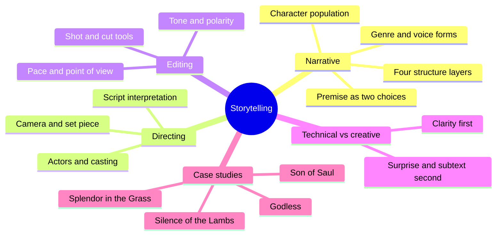
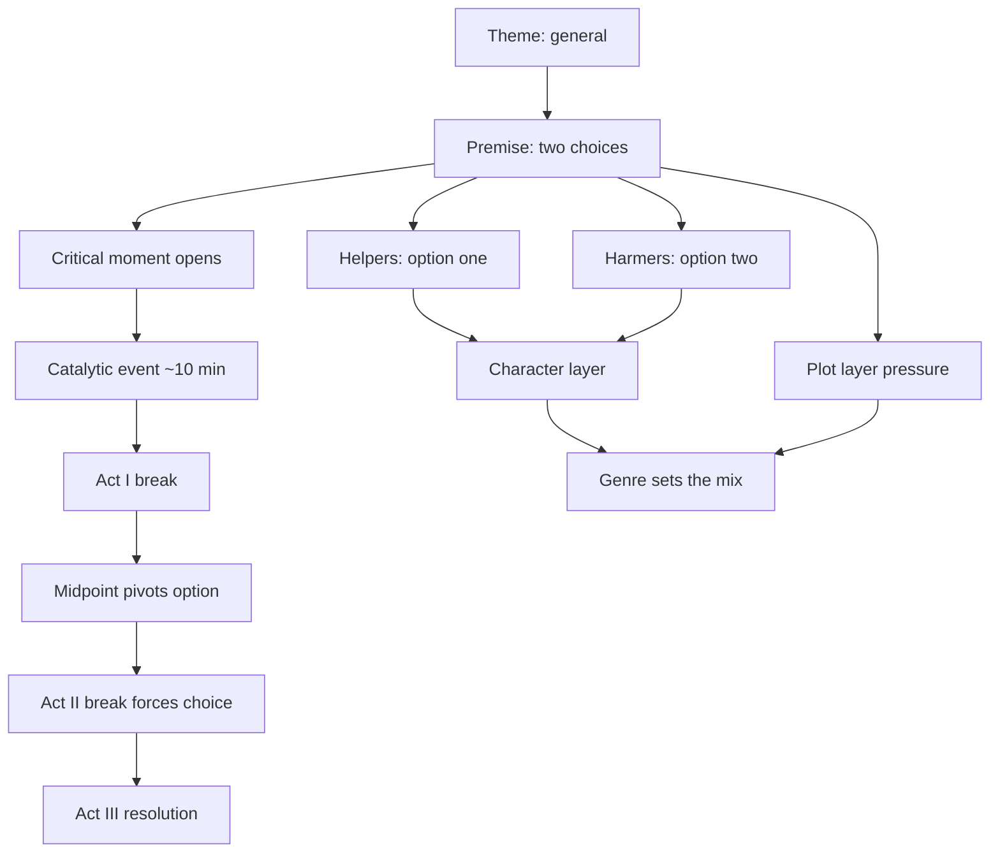
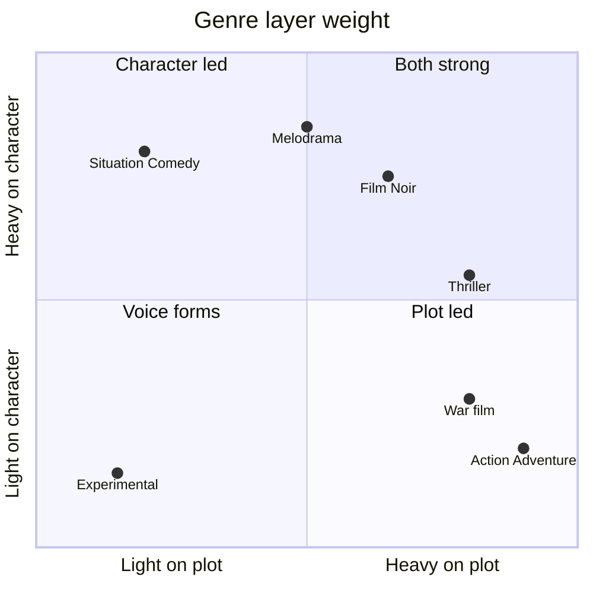
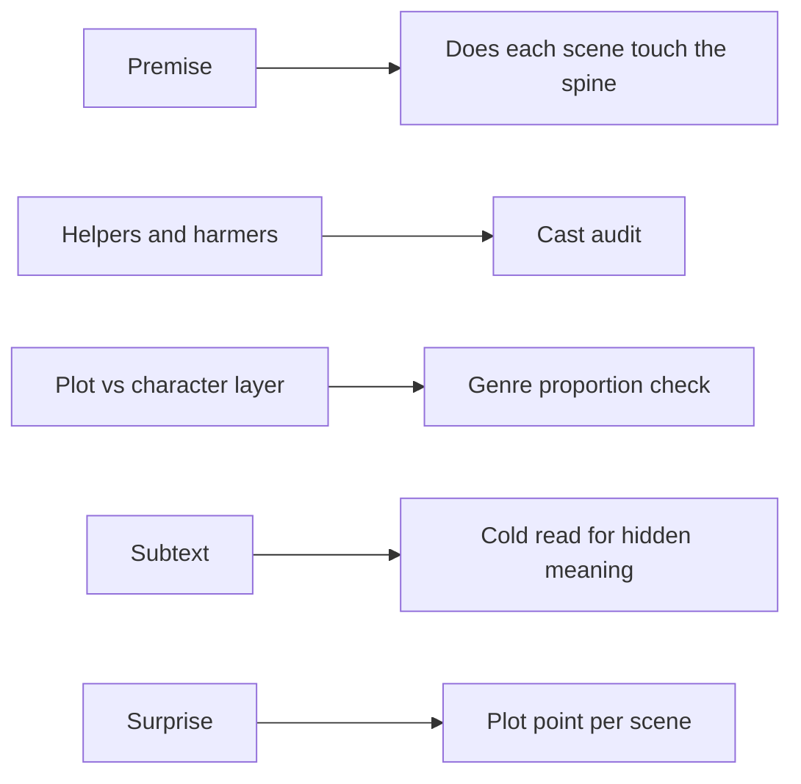

# BVX.0176 — Storytelling for Film and Television: From First Word to Last Frame — Ken Dancyger (2019)
### Knowledge Entry — Distill

A Tisch professor's craft text that treats writing, directing and editing as one act of storytelling, each phase with a "technical" floor and a "creative" ceiling. It is in the library as the craft basis for the script editors: the writing half (premise, character population, four-layer structure, genre proportion, subtext) is the usable core.

## TABLE OF CONTENTS
- [Core Thesis](#1-core-thesis)
- [Mind Models](#2-mind-models)
- [Framework](#3-framework--structure)
- [Key Concepts](#4-key-concepts)
- [Heuristics](#5-heuristics--decision-rules)
- [Invariants](#6-invariants)
- [Pitfalls](#7-pitfalls--myths)
- [Application](#8-application)
- [Cross-References](#9-cross-references)
- [Provenance](#10-provenance--confidence)

---

## 1 · CORE THESIS

Writing, directing and editing share one goal: telling the story. Each phase has a technical floor (clarity) and a creative ceiling (surprise). A screenplay's spine is its premise, two opposing choices for the main character, and every layer should serve it.

---

## 2 · MIND MODELS

**Diagram 1 — the whole argument.**
Read off the book's shape: one story goal, three phases, and a technical-then-creative ladder repeated in each.

**Diagram 2 — the central mechanism (premise to structure).**
Read off how one premise feeds every layer: the premise is the spine, and relationships carry it into scenes.

**Diagram 3 — genre decides the plot to character proportion.**
Read off where each family sits: wish-fulfillment leans plot, comedy and melodrama lean character, noir-type forms need both.

**Diagram 4 — mapped onto the Command's editor agents.**
Read off which book term becomes which edit check.

---

## 3 · FRAMEWORK / STRUCTURE

The book has four sections. Sections I to III walk one ladder three times: **tools**, **the technical dimension**, **creative possibilities**, then **three case studies of excellence**. Section IV applies all three phases to four whole works.

| Part | Chapters | Content |
|---|---|---|
| I Narrative | 1 to 5 | Purposes of story, the writer's tools, themes (revenge, redemption), creative reversals, cases: *The Kid with a Bike*, *Nightcrawler*, *The Silence of the Lambs* |
| II Directing | 6 to 9 | Script interpretation, camera, actors, set piece; themes justice/injustice and love/hate; cases: *Regarding Henry*, *Rachel Getting Married*, *Hunger* |
| III Editing | 10 to 13 | Shot catalogue, juxtaposition, continuity, point of view, pace; themes sacrifice and surviving the family; cases: *Nashville*, *La Guerre est Finie*, *The Departed* |
| IV Whole works | 14 to 17 | *Splendor in the Grass*, *Daniel*, *Son of Saul*, then a conclusion using *Godless* |

**The writer's structure is four layers (Ch. 2):**
1. Acts with turning points. Act I (setup) holds the critical moment, the catalytic event near minute 10, and the Act I break. Act II (confrontation) runs twice the length of the others, with a midpoint that pivots the main character from option one to option two and an Act II break that forces the choice. Act III (resolution) follows.
2. Plot layer: an external event pressing on the main character (a voyage, a career, a crime). Plot sensationalizes.
3. Character layer: two opposing key relationships, one per premise option. Relationships emotionalize.
4. Genre: the overlay that sets how much plot and how much character.

**The conclusion's five story strategies** that tie the phases: polarities, surprise, an emotional through line, tonal strategy, subtext. *Godless* is walked through all five.

---

## 4 · KEY CONCEPTS

| Concept | What it is | Why it matters |
|---|---|---|
| Premise | The main character's inner conflict stated as two opposing choices (Chris Kyle: dehumanized or still human). More specific than theme. | It is the spine; it must appear in every scene and in each secondary character. |
| Theme | General gateway idea (revenge, redemption, justice, sacrifice). Not genre, not editorial stance. | A starting point only; genre and tone decide what it becomes. |
| Critical moment | The crisis where we meet the main character. | Opens the character arc and poses "will they survive the journey." |
| Catalytic event | Surprise about 10 minutes in, often threat or opportunity. | Introduces the plot. |
| Character population | 6 to 10 characters in a feature, in two groups: helpers (one option) and harmers (the other). Characters can switch groups (Evelyn Mulwray, Fredo). | Keeps every figure serving the premise. Multiple mains work if they share one premise. |
| Antagonist | The most powerful harmer. | The stronger the antagonist, the more heroic the main character. |
| Own-antagonist | Walter White, Don Draper, Nucky Thompson are their own antagonist. | Internalizes conflict, draws the audience into their moral world. |
| Transformative character | A secondary character who makes the change credible (grandmother in *The Notebook*). May be the antagonist. | Change needs an incentive, not just a decision. |
| Character arc | Emotional state at open, change, and how it came (relationship, plot, or both). | The emotional spine; invites identification. |
| Plot point | The surprise embedded in each scene; a feature may carry about 60. | Surprise is the working unit of plot. |
| Voice-oriented genres | Non-linear, Satire, Fable, Docudrama, Experimental (about 10% of films). Open or argued rather than closed. | They break the three-act form for the writer's voice. |
| Fable vs Satire | Same imaginative treatment of a social issue; Fable ends hopeful, Satire catastrophic. | Gives two outcome dials for a "message" story. |
| Subtext | Meaning under act, plot, character and genre; reversals of a genre motif open it (Western land as threat in *The Revenant*). | The route from competent to creative. |
| Point of fusion | Plot and character meet in one beat (Lecter trades clues for Starling's backstory). | Stops a secondary plot swallowing the main one. |
| Polarity | Opposites inside a character (Roy Goode: killer and kind). | Makes a character credible and complex. |
| Tone | Visual and dramatic detailing that steers interpretation. | Must stay consistent; Dancyger calls consistency the editor's first duty. |
| Set piece | A long, scaled-up sequence that sets the film's tone (*Hurt Locker* opening, 25% of *Nightcrawler*). | Builds an epic feel and shows the film's rules. |

---

## 5 · HEURISTICS & DECISION RULES

| Situation | Do this | Not this |
|---|---|---|
| Writing the premise | State two opposing choices for the main character's inner conflict | Write a theme word ("ambition") |
| Casting the secondary cast | Sort into helpers and harmers; give each a stake in one option | Add characters with no premise function |
| Making the arc believable | Add a transformative secondary character; let the pressure of plot or relationship cause the change | Have the main character simply decide to change |
| Raising conflict | Add barriers; take the goal as near to impossible as it can go without becoming delusional | Soften the goal so it is easy |
| Opening the script | Start at the critical moment, a crisis, with the catalytic event near minute 10 | Open with warm-up or backstory |
| Choosing genre mix | Start from the genre's expected plot/character proportion, then stretch one layer (Chabrol, Eastwood) | Ignore the expectation and lose the audience |
| Writing a villain | Give the antagonist a humanizing private life (Abu Nazir as father) | Make the opponent a flat enemy |
| Likeable lead problem | Use engagement levers: weakest-in-family position, charisma, victimization by plot, strong goal | Rely on likeability alone |
| Handling a secondary plot | Fuse it with the main line at one point (Lecter's escape feeds the clue) | Let it run parallel and compete |
| Writing exposition-heavy long spans | Bookend with a dynamic prologue and epilogue; put a narrator or montage on the past (*Character*, *Daniel*) | Play every year at full scene length |
| Series teaser | Use a prologue as long as the story needs (*The Good Wife*: about 25% of the episode in the pilot) | Treat teasers as always short |
| Adding a hero-villain frame to a hard history | Check it fits; complex stories may need no hero-villain matrix (*Race* vs *12 Years a Slave*) | Force a hero/villain skeleton onto it |
| Making a scene energetic but static | Use movement, cuts and close-ups to add energy to talk scenes | Hold a flat master throughout |

---

## 6 · INVARIANTS

1. Every story needs a main character with a goal; a passive character is watched, not joined.
2. Drama is conflict from opposing goals; more barriers raise it.
3. The premise is in every scene.
4. Character change needs emotional credibility from powerful secondary characters.
5. Plot is external pressure; relationships are what carry feeling.
6. Genre sets proportions and the likely fate of the main character; reversals work because the expectation exists.
7. Ninety percent of features are three-act; the other 10% are voice-driven and need other editing and structural logic.
8. Technical effectiveness is the floor; creative surprise (usually subtext or a genre reversal) is the ceiling.
9. Tone must be consistent across writing, direction and edit.
10. The audience reads close and foreground as involving, distant and background as detached.

---

## 7 · PITFALLS / MYTHS

- "Three acts is the only form." The book calls it a baseline; seven-sequence, four-act television, and three-movement films all exist.
- Confusing theme with premise.
- Hero-villain frames on complex history (*Race*). The result "sidesteps the dramatic potential."
- Flat or victim-only genre figures, such as the immigrant who must be a victim in a Western; *The Salvation* refuses it.
- A lead the audience cannot admire and a world with nothing positive (*Too Late the Hero*); Dancyger calls this denying the audience a handhold.
- Over-stylized subjective gimmicks that distract from story (*Lady in the Lake*).
- A sociopathic or extreme role under-played; the performance must match the plot turns (*Leave Her to Heaven* critique).
- Writing a secondary plot that subsumes the main plot.
- Overreading the book: it is a survey by examples. Several readings (miscegenation in *The Searchers*, subtexts throughout) are the author's opinion, not rules.

---

## 8 · APPLICATION

- **Spine level:** TEXTURE. It is craft at the scene and script level (premise, layers, subtext), not a story-spine level model.
- **12-layer character stack:** none wired (`feeds: []`). The book is dramaturgy, not psychology.
- **plot_systems:** relevant as an editing yardstick, not as a source of fields.
- **Setting:** not applicable.

The weight is on §3, §5 and §7 for the editing agents. Four checks translate directly. First, a **premise test**: write the scene's stake as one of two choices the main character faces, and flag scenes that touch neither. Second, a **cast audit**: tag every secondary character helper or harmer and note switches. Third, a **layer balance** check: for the declared genre, is plot or character layer under-weight relative to the genre's expected proportion, and was any deviation chosen on purpose? Fourth, a **subtext pass** in the cold read: what does the script mean below its plot, and is a genre motif reversed anywhere to open it. The "transformative character" idea is also a useful probe for any arc that feels unearned.

Treat the directing and editing chapters as secondary reference. They matter if the Command ever briefs a director or editor, but for script editing the shot catalogue is context only.

---

## 9 · CROSS-REFERENCES

| Related entry | Relation |
|---|---|
| [[BVX.0175]] | McKee, *Story*: the closest cousin on structure and genre; Dancyger is lighter and more example-driven |
| [[BVX.0163]] | *Save the Cat*: a beat-sheet alternative to his four-layer structure |
| [[BVX.0193]] | Truby, *Anatomy of Story*: deeper on premise, desire and opposition |
| [[BVX.0236]] | *The Story Grid*: editor's method; complements the premise and scene-purpose checks |
| [[BVX.0089]] | *Dramatica*: compare its throughlines with helper/harmer and own-antagonist |
| [[BVX.0064]] | McKee, *Character*: the cast map vs Dancyger's character population |

---

## 10 · PROVENANCE & CONFIDENCE

Sourced from the full pdftotext of the book, read in runs of roughly 20 pages across every chapter (1 to 17) and the glossary; the index was not read. The text is a Routledge 2019 first edition. Chapters 6 to 9 (directing) and 10 to 13 (editing) were read in full but are distilled lightly because they are secondary to the script-editing use. The §4 definitions track the book's own glossary. Film plot details in the book were taken as the author states them; they were not checked against the films. Inference: the §5 rules are compressed from his examples and the glossary, and the §8 editor checks are mine, not the author's.

## META
- Template: BVX-LEARN-v4.0
- Source classification: book, craft textbook (screenwriting, directing, editing)
- Created / Updated: 2026-10-30
