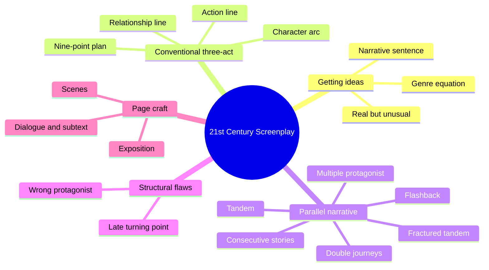
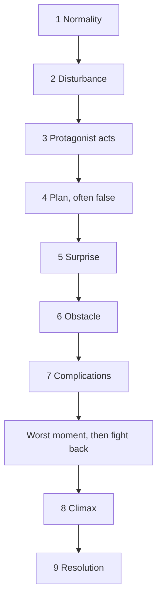
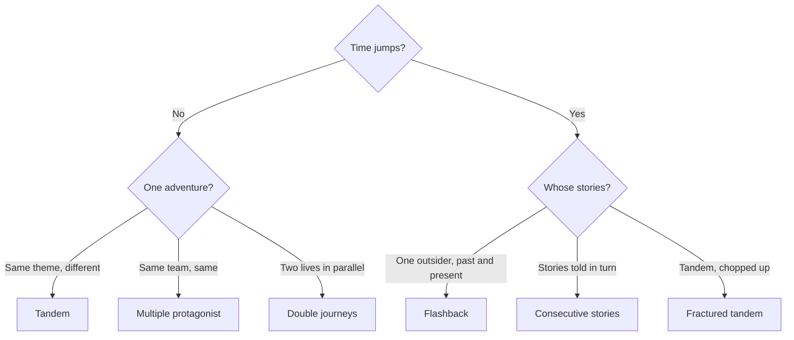
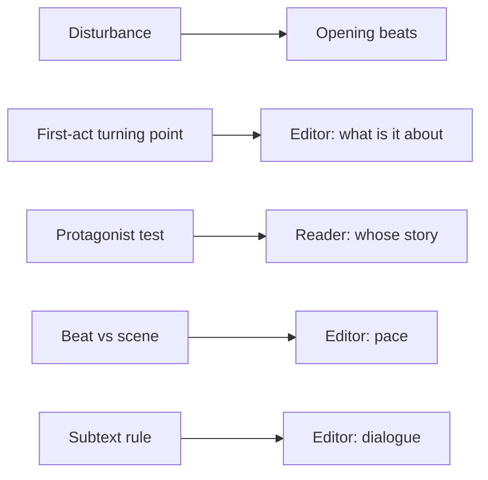

# BVX.0188 — The 21st Century Screenplay — Linda Aronson (2010)
### Knowledge Entry — Distill

A working screenwriter's manual that treats the one-hero three-act film as one structure among several, then gives a build recipe for each parallel form (ensemble, flashback, consecutive stories, fractured tandem). It sits in the library as craft basis for the OXO script editors and the cold reader.

## TABLE OF CONTENTS
- [Core Thesis](#1-core-thesis)
- [Mind Models](#2-mind-models)
- [Framework](#3-framework--structure)
- [Key Concepts](#4-key-concepts)
- [Heuristics](#5-heuristics--decision-rules)
- [Invariants](#6-invariants)
- [Pitfalls](#7-pitfalls--myths)
- [Application](#8-application)
- [Cross-References](#9-cross-references)
- [Provenance](#10-provenance--confidence)

---

## 1 · CORE THESIS

The one-hero, three-act film is the safest structure, not the only one. Parallel forms (ensemble, flashback, consecutive stories, fractured tandem) are built by splitting and rearranging three-act pieces. Pick the form whose shape carries your story and philosophy, then plan beats and turning points for it.

---

## 2 · MIND MODELS

**Diagram 1 — the whole argument.**
Read off the book's split: one default structure, six parallel alternatives, and the page-level craft that applies to all of them.

**Diagram 2 — the central mechanism (the nine-point plan).**
Read off the order of the protagonist's responses: each step is something the protagonist does, and the first-act turning point is where surprise becomes obstacle.

**Diagram 3 — choosing a parallel form.**
Read off the two questions that sort the six forms: does the film jump in time, and are the stories one adventure or many.

**Diagram 4 — mapped onto the Command's systems.**
Read off where the book's terms land on the spine and on the editor agents' checks.

---

## 3 · FRAMEWORK / STRUCTURE

The book has six parts.

1. **Getting ideas (ch. 1-4).** Creativity as lateral thinking against cliche. Triggers from screen models and non-narrative sources. "What film are we in?" fixes genre.
2. **Conventional narrative (ch. 5-15).** The one-protagonist, chronological, quick-start, brief-time-span film. Built from the nine-point Smiley/Thompson plan, 25 numbered Development Strategies, and a worked analysis of The Piano.
3. **Practical plotting (ch. 16-19).** Beats, interweaving and condensing. About 70 to 80 beats per 100 minutes, across all plotlines.
4. **Parallel narrative (ch. 20-51).** Six categories, one recipe each, with case studies: Nashville, American Beauty, Shine, Citizen Kane, Pulp Fiction, 21 Grams and others.
5. **Lost in the telling (ch. 52-53).** Films that fail for structural reasons, used as diagnostics.
6. **Getting it on the page (ch. 54-56).** Scenes, exposition, backstory, subtext, dialogue, treatments.

**The conventional skeleton.** Opening hook, then the disturbance, first-act turning point, midpoint (optional), second-act turning point (the protagonist's lowest moment, followed by a decision to fight back), and climax. Aronson holds that once you have the two turning points and the climax, "you have your film."

**Act versus beginning/middle/end.** Acts are the story in linear order. Beginning, middle and end are what the audience experiences. A non-linear film can move a late scene to the front and still has acts one to three underneath.

**The parallel forms.**

| Form | Motto | Typical material |
|---|---|---|
| Tandem | same theme, different adventures | social malaise across a cross-section (Traffic, Lantana) |
| Multiple protagonist | same team, same adventure | quest, reunion or siege (Full Monty, American Beauty) |
| Double journeys | two lives in parallel | two people moving together or apart (Brokeback Mountain) |
| Flashback | six varieties | illustration, regret, bookend, preview, life-changing incident, double narrative |
| Consecutive stories | stories in turn | walking into the picture; perspectives; consequences; portmanteau |
| Fractured tandem | tandem, chopped | accidental tragedy (21 Grams, Babel) |

---

## 4 · KEY CONCEPTS

| Concept | What it is | Why it matters |
|---|---|---|
| Disturbance | A physical action that breaks the protagonist's normality; Aronson prefers it to "inciting incident" | Implies many changes follow; a one-change story runs out of road in act two |
| First-act turning point | A surprise that turns into an obstacle and sets the film's question | It is what the film is "about"; the climax answers it |
| Second-act turning point | Protagonist at the worst moment, then decides to fight back | The decision splits non-linear films correctly |
| Beat | One step forward in the plot; a scene is not a beat | A slow film is usually stuck on one beat said twice |
| Action line | The adventure | Must move from causative action to causative action |
| Relationship line | Developing close relationships, with its own three acts | Often the real reason the script exists (Witness) |
| Character arc | The protagonist's changing heart, driven by both lines | Fixes characters in search of a plot |
| Inner/outer story | An inner flaw that generates the action line | Ties theme to plot |
| Misleading plan | A credible but wrong response to the disturbance | Makes the first-act turning point land as surprise |
| Real but unusual | The test for ideas, remedies, obstacles | Blocks cliche without losing credibility |
| Genre equation | genre = pattern + relevant emotion + real + unusual | Checks audience expectation is met |
| Narrative sentence | [Protagonist] faced with [problem] responds by [actions] and deals with the same problem by [climax] | Exposes an action line that lacks a driver |
| Mentor antagonist | Passive-protagonist film watching an enigmatic outsider | The Insider's fix; Shawshank-type |
| In medias res | Start at a crucial middle scene, backfill | Steals suspense for slow stretches |
| Sixth draft syndrome | Keeping a good scene made pointless by later changes | Source of drag |
| Watershed line | The line that changes the characters' world | Exit the scene after it |

---

## 5 · HEURISTICS & DECISION RULES

| Situation | Do this | Not this |
|---|---|---|
| Opening a draft | Establish protagonist, normality and a hint of flaw fast | Treat act one as mere set-up for the later good bit |
| Describing the disturbance | Use a verb of movement or disruption | Passive verbs: living, feeling, experiencing |
| Film feels slow | Find the beat that is repeated and cut one version | Add more scenes of the same normality (Guarding Tess) |
| Choosing a protagonist | Pick the character with the highest jeopardy | Default to the narrator or point-of-view figure (The Insider) |
| Planning act one | Insert a false plan before the first-act turning point | Telegraph the turn |
| Designing act-two trouble | Many different obstructions, each "real but unusual" | Many versions of one obstruction |
| Choosing the climax | Make it answer the first-act turning point's question | A climax detached from act one |
| Second-act turning point | Make it bigger than the first, then show the decision to fight | Stop at despair |
| Relationship film | Force the two leads into a joint enterprise | Separate them (kidnap, long absence) |
| Group story | Choose tandem, multiple protagonist or double journey by motto | Force it into one hero, leaving a redundant hero and a background cast |
| Building character | Work back from actions, then a character chart | Psychology in a vacuum, apart from plot |
| Scene entry and exit | Enter with a twist; leave on a question | Start early, linger after the point |
| Exposition | Hide it in action, sound, argument | "The story so far" speeches; talking heads |
| Dialogue | Delete the first two of a three-line workshop; short speeches | Conversation in real time |
| Subtext | Let a character voice every third or fourth thought | Voicing the whole thought chain |
| Conflict in a scene | Make something change | Redundant quarrel (X says yes, Y says no) |
| Any scene after later rewrites | Re-ask what it does for plot or character | Keeping it because it reads well |

---

## 6 · INVARIANTS

1. Film structure is a timing problem: a live audience sits through the whole thing and must be held.
2. Every film shows a beginning, middle and end to the audience, however it is ordered.
3. Every parallel form is made of three-act pieces, split, doubled or truncated.
4. A twist or turn arrives about every ten to fifteen minutes of screen time.
5. In a conventional film the audience walks every step with one protagonist, and the protagonist drives the action.
6. The climax answers the question the first-act turning point sets.
7. Protagonist and jeopardy are only as strong as the antagonist and the antagonist's allies.
8. In film a character is what it does; the plot has to show it.
9. A turning point is followed by a decision to act.
10. Form serves content: structure is chosen to carry the story and philosophy.

---

## 7 · PITFALLS / MYTHS

- "Three acts is the only structure." False; Odyssey, Citizen Kane, Pulp Fiction use others.
- "Ensemble films have subplots." There is no main plot to subordinate; they need their own structures.
- Forcing an ensemble story into one-hero shape leaves a redundant hero; skipping structure leaves characters in search of a plot.
- Tandem films risk plot-less characters; multiple-protagonist films risk extraneous heroes.
- Single-change disturbance, which stalls act two.
- Delayed first-act turning point and repeated normality (Guarding Tess).
- No first-act turning point, low jeopardy, weak antagonists (Falling in Love).
- Wrong protagonist (The Insider); unidentified protagonist for twelve minutes (Jaws 3).
- Monster film with no hunt, only attacks on strangers.
- Treating a scene as a beat; transition scenes that only move people.
- Redundant conflict, "The story so far" speeches, over-explained backstory.
- Treating any single structure method as "the method"; vertical thinking recycles your own cliches.
- Poor research; one chortling viewer can wreck the film.
- Voice-over narration that pulls a parallel narrative off course.

---

## 8 · APPLICATION

- **Spine level:** L3 to L5, plot and sequence structure. The turning-point skeleton and beat counts apply to episode and feature outlines; the parallel forms apply to the multi-strand OXO ensemble question.
- **12-layer character stack:** none wired (`feeds: []`). The character chapters are craft (character through action, arc, chart), not psychology.
- **plot_systems:** disturbance, two turning points, climax and decision to fight back are checkable plot fields.
- **Setting:** none.

For the editors (`.claude/agents/editing-*.md`) and the cold reader the book supplies concrete checks. Is the disturbance a verb of change? Is the first-act turning point a surprise that becomes an obstacle, and does the climax answer it? Does the second-act low point end in a decision? Whose jeopardy is highest? Is the film stuck on one beat? Does each scene enter on a twist and exit on a question? Does the dialogue state every thought? These can run as a pass list.

For the ensemble question, the mottos are the fast sort: an OXO-wide story reads as tandem or multiple protagonist depending on whether the cast shares one adventure. This book argues for naming the form before outlining. The check against the Command's own rulings belongs to the CDR; nothing here is canon.

---

## 9 · CROSS-REFERENCES

| Related entry | Relation |
|---|---|
| [[BVX.0064]] | McKee on character; complements Aronson's action-first view and the cast map |

---

## 10 · PROVENANCE & CONFIDENCE

Sourced from the pdftotext file read in sections: contents and development-strategy lists, ch. 5 (overview), ch. 11 (characterisation, strategies 14-15), ch. 17 strategies, ch. 20-22 (parallel overview, categories, form choice), ch. 52 (flawed conventional films, first four), and ch. 54-55 (scene, dialogue). Chapters 23-51 (the per-form recipes and case studies) and 53 were not read; the table of forms is from ch. 21-22 and is a summary. Zotero key and page count are not recorded; the Zotero record should be checked. Confidence is medium: strong on the conventional model and craft, thin on the individual parallel recipes.

## META
- Template: BVX-LEARN-v4.0
- Source classification: book, craft manual (screenwriting)
- Created / Updated: 2026-10-30
