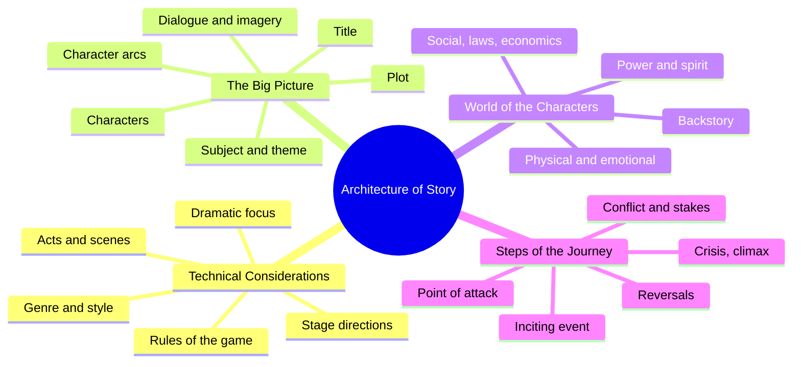
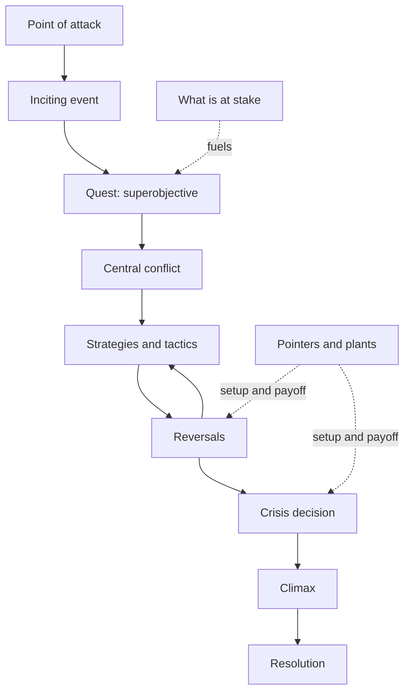
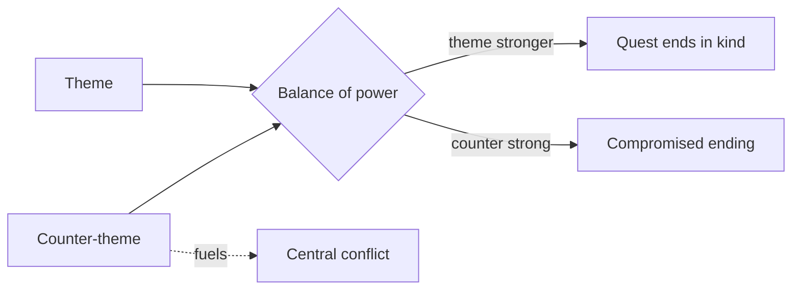
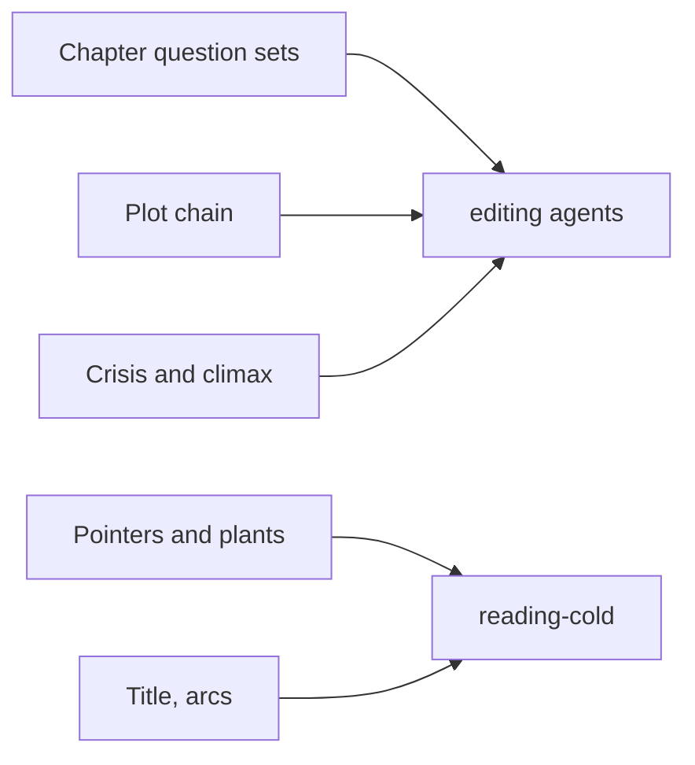

# BVX.0195 — The Architecture of Story — Will Dunne (2016)
### Knowledge Entry — Distill

A playwright's reference guide that dismantles three modern American plays into 28 craft components, each closing with a question set for auditing your own script. It is in the library as editor craft: a checklist engine for scripts, not a theory of story.

## TABLE OF CONTENTS
- [Core Thesis](#1-core-thesis)
- [Mind Models](#2-mind-models)
- [Framework](#3-framework--structure)
- [Key Concepts](#4-key-concepts)
- [Heuristics](#5-heuristics--decision-rules)
- [Invariants](#6-invariants)
- [Pitfalls](#7-pitfalls--myths)
- [Application](#8-application)
- [Cross-References](#9-cross-references)
- [Provenance](#10-provenance--confidence)

---

## 1 · CORE THESIS

No formula dictates what a play should be, so a writer learns to write this one play by taking it apart. Character is the foundation: each element (focus, world, quest, conflict, crisis) is read as a character exploration, and a hundred-plus questions test each part.

---

## 2 · MIND MODELS

**Diagram 1 — the whole argument.**
Four sections, one idea: every element is a lens on the character who drives the story.

**Diagram 2 — the central mechanism (the quest chain).**
Read the spine of the book: each step causes the next, and the crisis decision is the heart.

**Diagram 3 — theme against counter-theme.**
Conflict is strong only when the counter-theme has real force; the theme still decides the ending.

**Diagram 4 — mapped onto the Command's editors.**
The book is a question bank; each chapter feeds an editor's pass.

---

## 3 · FRAMEWORK / STRUCTURE

The guide has four sections, 28 chapters, and a fixed chapter shape: a principle paragraph, a sub-section per play (Doubt, Topdog/Underdog, The Clean House), then "Analyzing Your Story" questions. Chapters read in any order.

1. **Technical Considerations (ch. 1-7).** Genre, style, dramatic focus, rules of the game, framework, stage directions, script front/back matter. The decisions made before the first scene.
2. **The Big Picture (ch. 8-15).** Title, characters, offstage population, plot, character arcs, story arc and main event, subject and theme, dialogue, visual imagery. What the whole story is about and who it is about.
3. **World of the Characters (ch. 16-23).** Physical realm, emotional environment, social context, laws and customs, economics, power structure, spiritual realm, backstory.
4. **Steps of the Journey (ch. 24-32).** Point of attack, inciting event and quest, central conflict, stakes, strategies and tactics, pointers and plants, reversals, crisis decision, climax and resolution.

Chapter counts are approximate; the contents list is the authority.

---

## 4 · KEY CONCEPTS

| Concept | What it is | Why it matters |
|---|---|---|
| Genre | Comedy (rise in fortune) and tragedy (downfall from own flaws) are the two basic types; drama, tragicomedy, farce, melodrama, issue play derive from them | Sets audience expectations and marketing |
| Style | Realistic (representational) vs nonrealistic (presentational), often mixed | Decides how lifelike sets, speech, scenes must be |
| Dramatic focus | Whose story (single, dual, group protagonist) and point of view (objective, subjective; broad or limited) | Access limits create suspense; what is never shown can carry the theme |
| Rules of the game | What always, sometimes, never happens in this world | In a nonrealistic world, rules must be set early and obeyed |
| Act | Major unit of action triggered by a turning point and ended by a bigger one | Act breaks need a reversal big enough to change direction |
| Scene / French scene | Scene = one objective in one setting; French scene = unit marked by an entrance or exit | Each must add something essential |
| Story vs plot | Story is what happens; plot is how and why, the selected, ordered events | Each event should cause or be caused by another |
| Burning desire | What a character wants most | Drives conflict and keeps us watching |
| Dramatic function | Protagonist, antagonist, raisonneur, confidant, and so on | Every character needs a reason to be in the play |
| Offstage population | Unseen characters who influence the action | Absence can be more powerful than presence |
| Character arc | First impression to final impression | The before-and-after pair implies the transition |
| Main event | The single most important thing that happens | A structure to reveal and change character |
| Theme / counter-theme | Theme is a full sentence; counter-theme opposes it and fuels conflict | Weak conflict usually means an underdeveloped counter-theme |
| Exposition / backstory | Explanation of anything not observable here and now | Reveal the past only through a current objective |
| Inciting event / quest | The upset that arouses the superobjective | Strongest onstage, early |
| Central conflict | The biggest obstacle: inner, another character, or the world | If the quest feels unimportant, the conflict is too weak |
| Objective vs motivation | What the character wants vs why | Stakes must prevent giving up |
| Strategy / tactic | Plan vs steps; behavioral (make feel good, feel bad, find out, convince) or physical | Variety reveals character and keeps the story fresh |
| Pointer / plant | Pointer announces a future event (suspense); plant hides its purpose (credibility) | Both work as setup and payoff |
| Reversal | Event that turns the journey in a new direction | Too many, too close together, produce melodrama |
| Crisis decision | Choice between two goods or two evils, never good vs evil | Must be neither easy nor predictable |
| Climax / resolution | Peak of action, then brief wrap-up | Everything after the climax is anticlimactic |

---

## 5 · HEURISTICS & DECISION RULES

| Situation | Do this | Not this |
|---|---|---|
| Choosing a genre | State the ending (happy, unhappy, mixed) and the audience response you want, then name the genre | Pick a genre label first |
| Nonrealistic world | State each special rule, what it allows and limits, and where the audience first learns it | Spring the rule when you need it |
| Point of view is limited | Ask what the audience never sees, and whether the gap generates suspense | Show everything for convenience |
| Scene breaks feel choppy | Test whether each break needs a change of place or time; combine or cut | Break at every beat |
| Two acts feel alike | Heighten the end-of-act turning point | Add more events |
| Exposition needed | Give a character a here-and-now objective for telling it | Dump facts for the audience |
| Offstage character | Match the detail to the importance; drop names no one needs | Name every absent person |
| Weak conflict | Strengthen the counter-theme and the antagonist's stakes | Add arguments |
| Stakes feel low | Raise the gain, worsen the loss, or widen who is affected | Add noise |
| Audience may not believe a development | Plant the trait early and hide its purpose | Explain it in the moment |
| Building suspense | Use pointers: provoking statement, action, trait, loaded object | Reveal the outcome early |
| Strategies repeat | Make each approach truly different and riskier | Vary only the wording |
| Writing the crisis | Offer two goods or two evils, each with real reasons to pick | A right-vs-wrong choice |
| Ending | Cut after the climax as soon as outcomes are clear | Tie off every loose end |
| Stage direction wants to say how a line is delivered | Strengthen the dialogue so the direction is unneeded | Stack adverbs |

---

## 6 · INVARIANTS

1. Character is the foundation of story; the character and the story are the same thing.
2. Every event is a cause, an effect, or both. An event that is neither is a candidate for cutting.
3. A character always chooses what they perceive as good at the moment of choice.
4. Every character needs a distinct function and a reason that cannot be removed.
5. Rules of the game, once set, bind everyone, including the most rebellious character.
6. A quest ends only when the superobjective is achieved or lost.
7. Conflict is anything in the way of the objective, not only argument.
8. Every pointer or plant has two steps, setup and payoff, and a payoff can become the next setup.
9. Stage directions are not read by the audience; they serve production.
10. There is no formula, so the same technique can suit one play and fail another.

---

## 7 · PITFALLS / MYTHS

- Myth: a formula tells a play how many acts or scenes it needs. It depends on character complexity and journey size.
- Myth: conflict means argument. Inner and situational obstacles count.
- Pitfall: raising the curtain too soon (nothing engages) or too late (no time to know the characters).
- Pitfall: too many reversals too close together, which flattens credibility into melodrama.
- Pitfall: an obvious plant that announces itself.
- Pitfall: a crisis decision that is easy or predictable, removing suspense.
- Pitfall: stage directions that block the scene or dictate acting; also cluttering dialogue with typography.
- Pitfall: unestablished magic rules, or technical facts the audience cannot follow.
- Pitfall: lecturing backstory without a current objective.
- Limit: the guide analyzes three plays only, all contemporary American, all stage. Its model assumes a single quest line and a crisis near the end; it does not cover ensemble or serial forms.

---

## 8 · APPLICATION

- **Spine level:** TEXTURE. The book offers craft checks at scene and element level, not a story-spine level model.
- **12-layer character stack:** none wired (`feeds: []`). Burning desire, dramatic function, and arc touch character, but the book treats them as plot tools, not psychology.
- **plot_systems:** quest chain, reversal spacing, setup and payoff ledger.
- **Setting:** physical, emotional, social, economic, power, spiritual and backstory prompts can be run as a world audit.

Source extraction ends above. The following is the Command's use, kept separate.

The brief names the OXO script editors and the cold reader. Three uses stand out. First, run the Steps of the Journey questions as an audit on any outline: name the inciting event, the superobjective, the central conflict, each strategy and reversal, then the crisis decision. Second, keep a pointer/plant ledger of setup and payoff for each key event; unpaid setups and unplanted payoffs are the two findings an editor can make mechanically. Third, the point-of-view questions suit a serial story: decide what the audience is never shown, and check every scene against that rule. The French-scene method (list who is present and the one thing each unit adds) is a fast way to test whether a scene earns its length.

Format caveat: the book is written for stage. Pages translate when scene, entrance, and exit are treated as units, but stage-direction and set advice does not carry to prose or screen.

---

## 9 · CROSS-REFERENCES

| Related entry | Relation |
|---|---|
| [[BVX.0064]] | McKee-style Cast Map; same character-as-story premise |
| [[BVX.0175]] | Screen structure parallel to the quest and crisis chain |
| [[BVX.0193]] | Step-by-step story spine; compare quest steps |
| [[BVX.0196]] | Character construction; supplies the psychology Dunne leaves out |
| [[BVX.0100]] | Fictional worlds; compare the rules-of-the-game and world audit |

---

## 10 · PROVENANCE & CONFIDENCE

Sourced from full text (pdftotext, `_PRIVATE/distill_wave/BVX.0195.txt`, not committed). Read in full: front matter, contents, About This Guide, The Plays and Playwrights, and the whole Technical Considerations section, including all three play analyses. For the later chapters (Big Picture from Offstage Population on, World of the Characters, Steps of the Journey) I read each chapter's principle paragraphs and its full "Analyzing Your Story" question set, plus the Characters chapter play analyses and parts of the Story Arc chapter. **Unread:** the per-play analyses inside those later chapters (Plot synopses, Character Arcs, Story Arc, Subject and Theme, Dialogue, Visual Imagery, the eight World chapters, and the nine Steps chapters). The mind models, concepts, and heuristics rest on the principle text and question sets, so confidence is medium. Section counts in §3 are inferred from the contents list. The cross-references name entries confirmed to exist; the relation notes come from their titles only and are unverified against their contents.

## META
- Template: BVX-LEARN-v4.0
- Source classification: book, full-text with partial coverage
- Created / Updated: 2026-10-30
