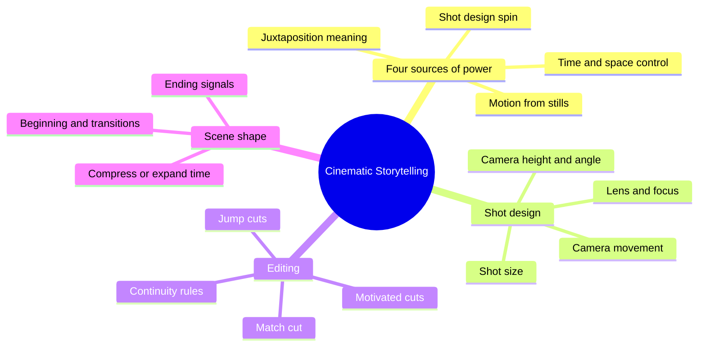
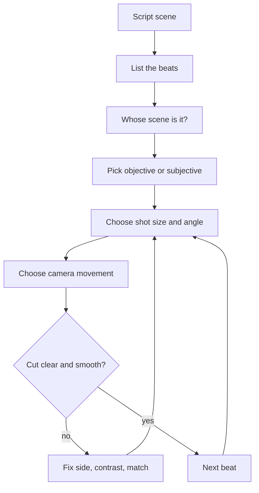
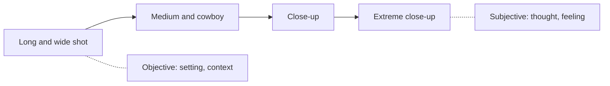
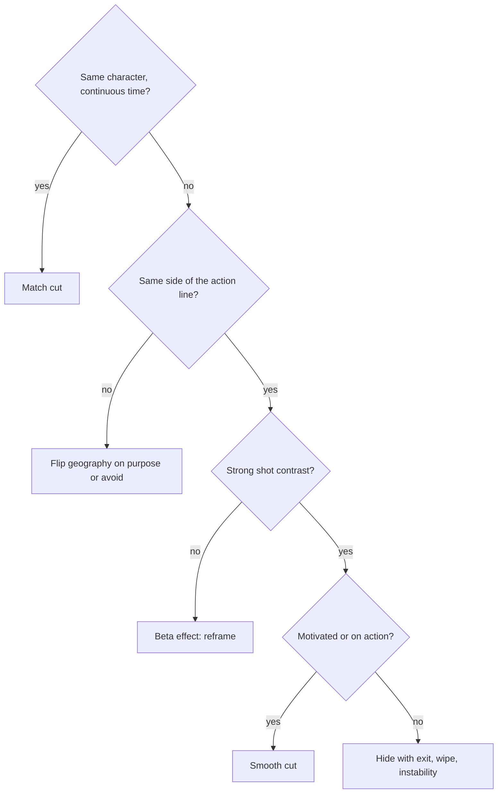

# BVX.0197 — The Art of Cinematic Storytelling — Kelly Gordon Brine (2020)
### Knowledge Entry — Distill

A storyboard artist's visual grammar of shots, cuts and transitions (Oxford UP). It is in the library as the craft basis for judging how a scripted scene will play on screen, and for the OXO script editors.

## TABLE OF CONTENTS
- [Core Thesis](#1-core-thesis)
- [Mind Models](#2-mind-models)
- [Framework](#3-framework--structure)
- [Key Concepts](#4-key-concepts)
- [Heuristics](#5-heuristics--decision-rules)
- [Invariants](#6-invariants)
- [Pitfalls](#7-pitfalls--myths)
- [Application](#8-application)
- [Cross-References](#9-cross-references)
- [Provenance](#10-provenance--confidence)

---

## 1 · CORE THESIS

Film is a story told in pictures. Where the camera sits, how big the subject is, and where the cut falls decide what the viewer feels and understands. Design every shot around one story beat and the character who owns the scene, keep space and time clear, and the direction becomes invisible.

---

## 2 · MIND MODELS

**Diagram 1 — the whole argument.**
Read it as: four sources of film's power, then the tools that control them, all serving the beat.

**Diagram 2 — the central mechanism.**
Read it as: every shot starts from a beat and a scene owner, and the choices that follow are filtered by clarity and a smooth cut.

**Diagram 3 — the objectivity dial.**
Read it as: the same action moves along one dial from detached to inside the head, and the scene owner gets the right end.

**Diagram 4 — a clean cut, decision flow.**
Read it as: a cut survives if the viewer wants it, the space stays the same, and the two shots look different enough.

---

## 3 · FRAMEWORK / STRUCTURE

The book moves from principle to craft to worked scene types.

1. **Introduction.** The four elements of film's magic: persistence of motion, juxtaposition, shot design "spin", and time and space manipulation. Worked example: one prison scene opened a dozen ways to show how camera position alone changes the story.
2. **Ch 1, the seven essentials.** Juxtaposition; beats; putting the audience where the story is; smoother cuts; motivated versus unmotivated camera moves; staying on one side of the action; starting a new scene.
3. **Ch 2, storyboards.** Drawing the plan: arrows, camera moves, labels, numbering, maps.
4. **Ch 3 to 5, the shot.** Composition, lenses, depth of field, focus, shot size, angle, height, direction of movement, mood.
5. **Ch 6 to 8, the cut.** Continuity editing, the beta effect, match cuts, jump cuts, eyelines, screen geography, crossing the axis.
6. **Ch 9 to 10, the scene.** Compressing and expanding time, ending a scene, opening a scene, transitions.
7. **Later chapters.** Applied coverage: dialogue, groups and crowds, driving scenes, and blocking, with the book's own list of classic approaches.

The author deliberately skips film history, writing, lighting and sound. Scope is visual storytelling for film, animation and games.

---

## 4 · KEY CONCEPTS

| Concept | What it is | Why it matters |
|---|---|---|
| **Story beat** | Smallest unit of story information, seen or heard | Each shot exists to show one or more beats clearly; a beat sheet catches ones the script omits (business, reactions, raindrops, a hand on a doorknob) |
| **Beat order** | The sequence in which information reaches the viewer | Wolf shot before the girl gives suspense; girl first, then wolf, gives shared surprise |
| **Whose scene is it** | The character the scene belongs to, not always the loudest | That character gets the tightest shots, the POVs, and the camera arriving and leaving with them |
| **Juxtaposition / Kuleshov** | Two shots side by side create meaning in neither | Viewers project their feelings into an expressionless face; a cut can span years |
| **Objective vs subjective** | Detached observer versus sharing a character's mind | Wide, still, off-eye-level is objective; close, moving with the character, POV is subjective |
| **Shot size** | Named sizes from very extreme close-up to long shot | The key indicator of how important a character is at that moment |
| **Clean vs dirty shot** | A close-up without or with foreground from another person or object | Clean isolates and is more subjective; dirty is a tie-up that keeps the relationship |
| **Tie-up shot** | One frame holding both characters or a character and object | Makes threat and space convincing |
| **Camera height** | High looks down, low looks up | High: small, weak, lost. Low: strong, defiant, threatening. Slightly below eye level flatters |
| **Motivated cut** | A cut that answers curiosity (look off screen, noise, exit, reference) | Hides the cut because the viewer wants it |
| **Cutting on action** | Action bridges two shots; about a third in shot one, two thirds in shot two | Hides the cut; masks punches that miss |
| **Stable vs unstable composition** | Unchanging frame versus rapid change in it | Exits, wipes, splashes make good cut points; viewers feel relief when stability returns |
| **Unmotivated camera move** | A move with no on-screen cause | Good for opening a scene and signaling a new place and passed time; bad mid-scene (reads as an unseen watcher) |
| **Action line / screen geography** | The imagined line between two characters; left and right placement | Stay on one side and the cuts hold; the three-walled set is the same rule |
| **Beta effect** | Similar adjacent shots read as one moving image | Makes people jump, pop or swap places at a cut |
| **Shot contrast** | How different two shots look | The cure for the beta effect between different subjects |
| **Match cut** | Same subject, continuous time: same screen position and look, new size and slightly more frontal angle | The normal cut within a scene |
| **Opposed looks** | Left look plus right look reads as looking at each other; same look reads as looking at one third thing | Eyeline logic for dialogue |
| **Jump cut (three kinds)** | Within a shot, within a scene, to a new scene | Compresses time, adds urgency or comedy; overuse costs believability |
| **Prelap** | Next scene's sound arrives before the current scene ends | Soft entry to a new setting |

---

## 5 · HEURISTICS & DECISION RULES

| Situation | Do this | Not this |
|---|---|---|
| Starting to plan a scene | List beats, name the scene owner, then imagine several ways to shoot it | Pick the first coverage that comes to mind |
| Scene builds to a climax | Start wide, tighten as drama rises | Open and stay in close-ups, or end on the wide with no reason |
| Scene needs empathy | Close, clean, camera in the character's space, a slow push | Wide shot from the hallway |
| Need distance, helplessness or detachment | High or wide, camera outside the space | Close, low, inside |
| Character should feel strong or defiant | Low angle | High angle |
| Unsure whether to move the camera | Move for a cause: follow an exit, find a look, push for a reaction | Float the camera mid-scene for no reason |
| New scene in a new place | Unmotivated reveal: pan, tilt, dolly from something hidden to the point of interest | Cut straight into a dull static wide with no hook |
| Wide shot with nothing moving | Slide the camera sideways, add crossing extras or vehicles | Leave it dead |
| Need a cut to disappear | Cut on an exit, a look off-screen, a door, a splash, or bridging action | Cut on a still, stable frame for no reason |
| Two shots of the same person | Match cut: same position and look, new size and a slightly different angle | Same angle, slightly tighter (reads as a pop) |
| Two shots of different subjects | Maximize contrast in size, line and tone | Two similar compositions in a row |
| Back-and-forth dialogue | Mirror the over-shoulder or close pair | Mismatched sizes and placement, which bounce |
| Compress time | Scan over the work done to land on the character; cut a walk into three pieces; cut away and return; jump cut | Show the full duration of dull action |
| Stretch a moment | Slow motion; replay from several angles | Slow motion on every beat |
| End a scene | Door closes, exit, close-up reaction, prelap, lights out, pull back | An abrupt stop with no signal |
| Enter memory or imagination | Slow push to extreme close-up on a reaction, then dissolve | A plain hard cut |
| Break a rule | Do it for a dramatic reason, and make the second shot look very different | Break it to look original |
| Want to learn | Watch scenes with the sound off, several times; make short films | Rely on set experience alone |

---

## 6 · INVARIANTS

1. Every shot serves a beat; clarity means knowing which beat, not spoiling the plot.
2. Closer feels more subjective and more important; wider feels more objective and more contextual.
3. The scene owner gets the most subjective coverage.
4. Viewers connect adjacent shots and project meaning and feeling across the cut.
5. Within a scene, the camera stays on one side of the action line unless the flip is designed.
6. A character moving left or right stays moving that way across cuts.
7. Cuts are hidden by motivation, bridging action, or compositional instability resolving to stability.
8. Unmotivated moves belong at the start of scenes, not the middle.
9. Space and time must always stay clear to the viewer, even when compressed.
10. The best direction is invisible; technique serves the story.

---

## 7 · PITFALLS / MYTHS

- **"Long takes and fancy shots show skill."** Simple common shots are the building blocks. Learn those first.
- **"Break the rules to be original."** Breaks that serve no drama pull attention to the camera.
- **A pretty wide master tells the scene.** It describes the setting but says little about the person and builds no empathy.
- **Giving the camera to the busiest character.** The scene may belong to an observer or victim.
- **Leaving beats to the script alone.** Reactions, business and time transitions are often missing from the page.
- **Same-looking shots in sequence.** The beta effect makes characters jump or transform.
- **Crossing the action line by accident.** Characters appear to trade places.
- **Mismatched dialogue pairs.** Repeated cuts bounce; one or two quick exchanges can ignore matching.
- **Overusing jump cuts.** Urgency turns into lost realism.
- **An unmotivated move mid-scene.** It reads as a hidden character's POV and distracts.
- **Stuffing the frame with the setting at a key emotional moment.** Tighter framing carries emotion; wide framing carries context.

---

## 8 · APPLICATION

- **Spine level:** mostly L5 and L6 (scene and sequence staging as it reaches the screen), plus TEXTURE for how scenes feel. The book does not touch story structure itself.
- **12-layer character stack:** none directly. Character psychology appears only as camera effect, so `feeds` stays empty.
- **plot_systems:** none.
- **Setting:** establishing shots, reveals and scene-opening pans bear on setting delivery.

The book gives the OXO script editors a screen test for a scene: does each beat have a visible, shootable form; does the scene have an owner; is the point of view consistent; can the time jump be done by a camera move or cut rather than by explanatory dialogue? A scene that only works as a witnessed wide shot is flat, and the book's assassin example (same action, two owners, one gives surprise and the other suspense) is the model for rewriting a scene's point of view. Its list of scene-ending and scene-opening devices is also a ready checklist for transitions in a written script, which often glosses them. The cold reader can use the sound-off method on its own as a check: if the pictures alone make the beat clear, the writing is doing visual work. For the writers, favour actions that can be seen, entrances and exits that can motivate a cut, and a stated owner for each scene.

Limit: this is a shooting guide for live action and storyboard. It says nothing about prose narration, so use it for script and screen-bound work only.

---

## 9 · CROSS-REFERENCES

| Related entry | Relation |
|---|---|
| [[BVX.0064]] | McKee, Character: the dimensional cast logic that this book's scene-owner idea complements on the screen side |
| [[BVX.0197]] | This entry |

---

## 10 · PROVENANCE & CONFIDENCE

Sourced from the pdftotext of the full book. Read in full: the front matter, introduction, chapter 1, the shot-size and camera-height sections of chapter 5, the beta-effect, match-cut and jump-cut sections of chapter 6, and the time and scene-ending sections of chapter 9. Chapters 2 to 4, 7, 8 and 10 onward are covered from the table of contents and the cross-references in the text read; the applied chapters (dialogue, groups, driving, blocking) are not detailed here. Pages and the Zotero key are not checked. Application section is inference for the Command's use.

## META
- Template: BVX-LEARN-v4.0
- Source classification: craft textbook, illustrated
- Created / Updated: 2026-10-30
