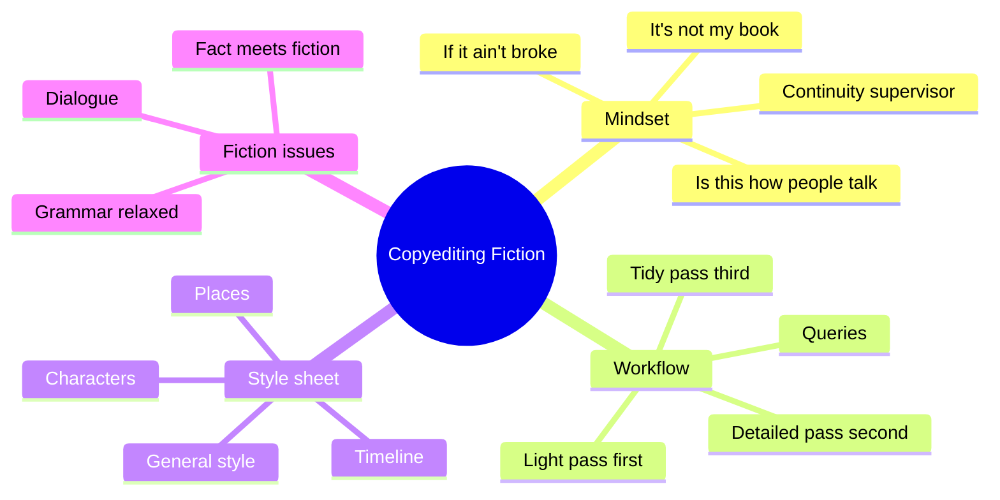
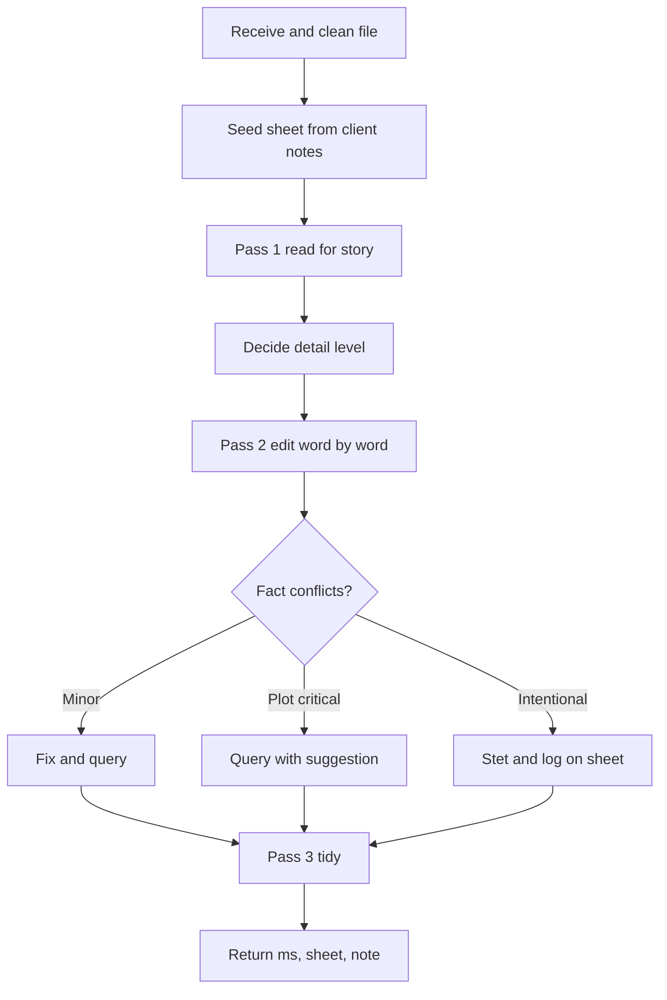
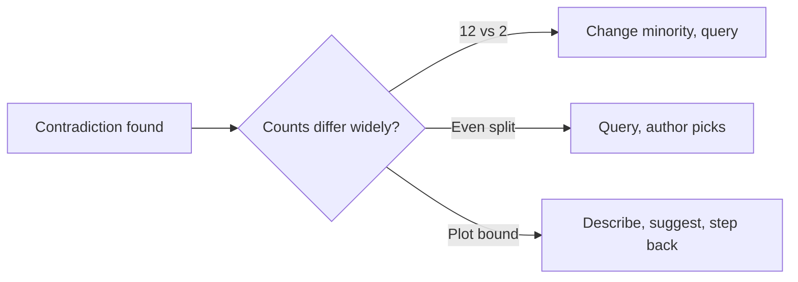
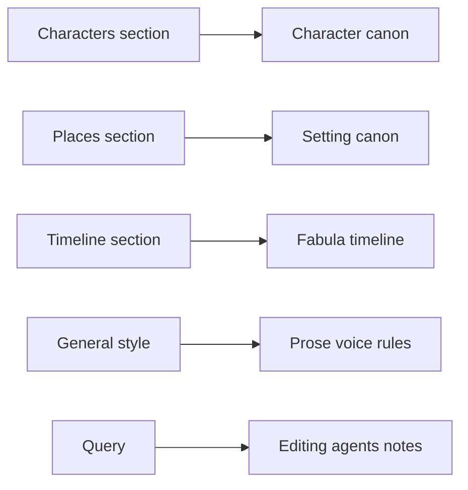

# BVX.0200 — The Chicago Guide to Copyediting Fiction — Amy J. Schneider (2023)
### Knowledge Entry — Distill

A working copyeditor's manual for novels and short stories. It sits in the library as the craft basis for the OXO script editors: a method for catching continuity, voice and mechanics errors without rewriting the author.

## TABLE OF CONTENTS
- [Core Thesis](#1-core-thesis)
- [Mind Models](#2-mind-models)
- [Framework](#3-framework--structure)
- [Key Concepts](#4-key-concepts)
- [Heuristics](#5-heuristics--decision-rules)
- [Invariants](#6-invariants)
- [Pitfalls](#7-pitfalls--myths)
- [Application](#8-application)
- [Cross-References](#9-cross-references)
- [Provenance](#10-provenance--confidence)

---

## 1 · CORE THESIS

A fiction copyeditor keeps the story consistent with its own world and lets the author's and characters' voices stand. The tool is a four-part style sheet (general style, characters, places, timeline). Every doubtful point becomes a gentle query, not a rewrite. "It's not my book."

---

## 2 · MIND MODELS

**Diagram 1 — the whole argument.**
Read off the three jobs (consistency, voice, reader) and the four-part style sheet that carries them.

**Diagram 2 — the central mechanism (the pass-and-query loop).**
Read off that the first pass decides what to track, the second pass logs and queries, and nothing is rewritten outright unless trivial.

**Diagram 3 — contradiction triage.**
Read off that the copyeditor's authority shrinks as a fix touches more plot.

**Diagram 4 — mapped onto the Command's systems.**
Read off that the four style-sheet sections already match the OXO continuity ledgers.

---

## 3 · FRAMEWORK / STRUCTURE

The book has three parts.

1. **Process (ch. 1-2).** Mindset, then workflow. Intake and cleanup, seed the style sheet, pass 1 (read, make no style decisions, flag), pass 2 (all decisions, build the sheet), pass 3 (mini-passes: flags, queries, repeated elements, spell check, consistency check). Optional cleanup round reviews the author's responses. Proofreading is lighter still.
2. **Style sheet (ch. 3-6).** Four documents. General style (numbers, punctuation, typography, abbreviations, usage, miscellaneous by category, alphabetical word list). Characters. Places. Timeline.
3. **Fiction issues (ch. 7-9).** Grammar and usage relaxed for fiction, plus point of view, tense and conscious language. Dialogue. Fact and fiction (physics, action, plot and factual bloopers, anachronisms, real people, trademarks, permissions).

Appendices: style sheet templates (gray boilerplate, red reminders), file management (numbered folders, versioned files), multiple monitors.

---

## 4 · KEY CONCEPTS

| Concept | What it is | Why it matters |
|---|---|---|
| Style sheet | Per-book record of style choices and story facts | The manuscript is its own reference; the sheet is the memory |
| Internal consistency | World obeys its own rules, real or invented | Suspension of disbelief breaks on one detail |
| Continuity supervisor | The copyeditor's film-set role | Objects and people must not move or change unexplained |
| Pass vs round | Pass = one trip for one task; round = receive to return | Scope and price are negotiated in rounds |
| Query | A tactful note to the author | The only route for anything beyond mechanics |
| Global query | One query at first instance for a repeated issue | Avoids burying the author in comments |
| (?) marker | Tags sheet entries queried in the manuscript | Later users know the question is open |
| (au pref), (series style) | Tags on locked choices | Marks decisions not to change |
| PB tag, chapter numbers | Mark facts from previous books; locate facts by chapter | Published facts cannot be edited; page numbers drift |
| Zombie rules | Outdated "rules" few observe (split infinitives, who/whom) | Dropping them avoids pedantry |
| Verb of utterance | Verb that describes making speech | Only these may be dialogue tags |
| Action beat | Narrated action that identifies the speaker | Separate sentence, not a tag |
| Garden-path sentence | Correct sentence that misleads on first read | Forces the reader to backtrack |
| Pet phrases | Unnoticed repeated gestures or phrases | Readers notice; query the first instance with a count |
| Narrative distance | this/here vs that/there, direct address | Leave alone unless it slips by accident |
| Conscious language | Bias in word choice or representation | Query politely; big issues go to the project manager |
| Chekhov's gun, "As you know, Bob" | Unfired setups; characters telling each other what they know | Usually too late to fix; flag to the manager |

---

## 5 · HEURISTICS & DECISION RULES

| Situation | Do this | Not this |
|---|---|---|
| Informal or "wrong" grammar in dialogue or first person | Stet; it is voice | Correct to textbook English |
| Doubt about a choice | Query with a reason in parentheses, offer options | Rewrite outright or issue an order |
| Same fact conflicts 12 to 2 | Change the minority and query at first instance | Query every instance |
| Fact split evenly | Query, ask which is correct, highlight each | Pick one yourself |
| Conflict is plot critical | Describe it, suggest a fix, hand to the author | Rewrite the scene |
| Detail that could be contradicted later | Log it, with chapter number, exact wording | Log only names |
| Where does a fact go (character, place, timeline)? | Let pass 1 decide by how often it recurs | Over-engineer entries |
| Absolute words (never, always, only) | Record them; they seed plot holes | Skip them as color |
| Negative traits (can't swim, hates smoke) | Track as carefully as abilities | Track only positives |
| Characters list | Group by affiliation | Alphabetize (alphabetize only on request) |
| Dialogue source facts | Annotate when a speaker lies or errs | Treat speech as truth |
| Repeated issue | Global query; highlight if unsearchable | A query per instance |
| Dialect you do not know | Research, ask a native, query | "Correct" it |
| Overwritten dialect | Suggest hints, vocabulary, a few spellings | Phonetic spelling of every word |
| Tag verb unsure | Move the verb before the quote and test it | Accept any verb |
| Long exchange, no tags | Add a tag or beat about every three or four lines | Leave readers lost |
| Outright indisputable error in pass 1 | Fix it now | Wait for pass 2 |
| Style decision needing research in pass 1 | Defer | Decide early and rework |
| Real phone, email, address in text | Query; suggest fictional or 555 | Leave it |
| Real person given actions or negative traits | Query and suggest fictional stand-in | Pass it |
| Song lyric or poem excerpt | Query for permission; suggest titles only | Assume fair use |
| Unsure whether to raise a conscious-language issue | Raise it | Stay silent |

---

## 6 · INVARIANTS

1. The author's book is not the copyeditor's: the job is mechanical plus advisory.
2. Fiction is judged against its own world first, the real world second.
3. Anything that could be contradicted later goes on the sheet.
4. Record what the text says, never extrapolate (attended UCLA is not a degree).
5. Published facts in earlier series books are fixed.
6. A diagram of the facts (map, family tree, calendar) beats memory.
7. Dialogue tag grammar is one of the few areas with firm rules.
8. Every edit that is not trivial carries a query.
9. Query tone: ask, suggest, explain the reader's view, never accuse.
10. Resurrections and silent changes must be intentional.

---

## 7 · PITFALLS / MYTHS

- Pretending to be the author, or applying your own taste or morals.
- Prescriptivism: forcing who/whom, no splices, no fragments, no semicolon rules onto speech.
- Over-correcting dialect until a character loses their voice, or a native speaker's usage is "fixed" wrong.
- Alphabetized character lists that hide name drift and missing siblings.
- Making style decisions on the first pass, then reworking.
- Trusting dialogue as fact without asking who is speaking.
- Treating "no semicolons" as proof of rule; running no final search for stray serial commas.
- Past-tense drift into present-tense narration and missing past perfect.
- Verbs of utterance that are not speech (grimaced, shuddered).
- Dialogue-like quotes that are only objects of verbs: `scribbled "Back in 5 minutes"` takes no comma.
- Counting floors wrong: fourth floor is three flights up; US first floor equals UK ground floor.
- Time zones and day-of-week traps (New York is behind London).
- Food words for skin tone, "exotic", assuming white as default.
- Treating autosave or the backup beside the machine as a backup.
- Relying on page numbers rather than chapter numbers.

---

## 8 · APPLICATION

- **Spine level:** TEXTURE. This is prose-surface and continuity craft, not story structure.
- **12-layer character stack:** none (`feeds: []`). The character list method tracks surface facts, not psychology.
- **plot_systems:** none directly.
- **Setting:** the Places method (relative position, right/left, floors, hours, distances) fits setting canon.

Prose below is the Command's reading, apart from source extraction.

The editing agents can borrow three things. First, a per-draft ledger: characters grouped by affiliation with exact phrases and chapter or scene tags, places grouped by location, and a calendar-style timeline with scene and point-of-view breaks. Second, the query register: cite the reader's possible confusion, ask a question, offer options, then stop. Third, the stet rule: unusual voice is presumed deliberate until it blocks meaning. For the OXO scripts, read the timeline and age arithmetic across eras as the same task; track negative attributes and absolutes in canon; and use the "who is lying?" annotation for unreliable speakers. The book speaks of prose, so script format (action lines, parentheticals) needs other sources.

---

## 9 · CROSS-REFERENCES

| Related entry | Relation |
|---|---|
| [[BVX.0084]] | Dialogue craft from the writer's side; this entry covers the editor's mechanics |
| [[BVX.0121]] | Same, writer-side dialogue improvement |
| [[BVX.0273]] | Point of view and narrative distance; companion to ch. 7 |
| [[BVX.0236]] | Editor's view of story; this book is the line-level stage after it |
| [[BVX.0100]] | Fictional worlds and internal consistency |

---

## 10 · PROVENANCE & CONFIDENCE

Sourced from the full text (pdftotext) of chapters 1 to 9, the introduction, conclusion and appendices A to C, read in sections of roughly 800 lines. Not read: the glossary's later entries, the Recommended Resources list and the index; they list tools and references rather than argument. Heuristics in §5 are compressions of the book's guidance. §8's prose is inference about OXO use, labelled as such. Page numbers are not cited. Confidence high on content; medium on the fit to script editing, since the book targets prose.

## META
- Template: BVX-LEARN-v4.0
- Source classification: published craft manual, US university press
- Created / Updated: 2026-10-30
