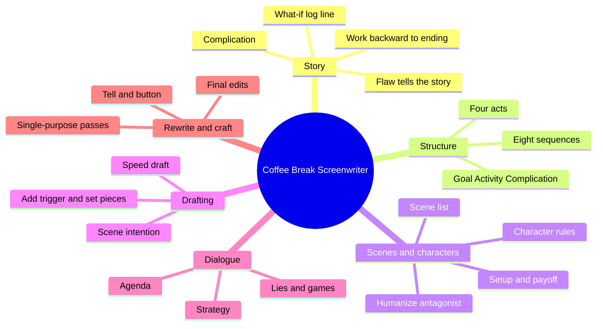
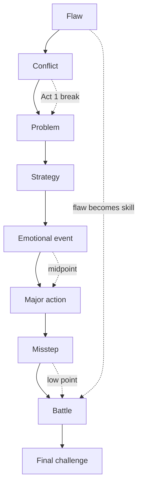
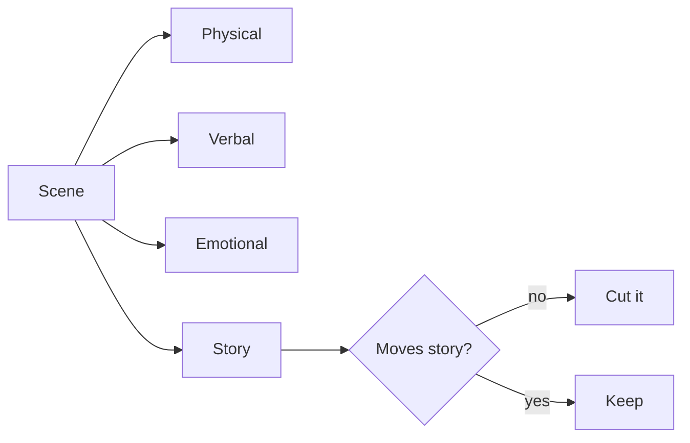

# BVX.0201 — The Coffee Break Screenwriter — Pilar Alessandra (2010)
### Knowledge Entry — Distill

A working screenwriting manual built from the author's On The Page classes. It breaks a script into ten-minute exercises, from log line to final edit. It is in the library as a craft basis for the OXO script editors, who can borrow its rewrite passes and test questions.

## TABLE OF CONTENTS
- [Core Thesis](#1-core-thesis)
- [Mind Models](#2-mind-models)
- [Framework](#3-framework--structure)
- [Key Concepts](#4-key-concepts)
- [Heuristics](#5-heuristics--decision-rules)
- [Invariants](#6-invariants)
- [Pitfalls](#7-pitfalls--myths)
- [Application](#8-application)
- [Cross-References](#9-cross-references)
- [Provenance](#10-provenance--confidence)

---

## 1 · CORE THESIS

A script gets written by small, finishable passes, each aimed at one job. Flaw drives story, story is a chain of goal, activity and complication, and scenes are written around intention. Rewrite one targeted pass at a time, and let deadlines stop overwriting.

---

## 2 · MIND MODELS

**Diagram 1 — the whole argument.**
Read off the order of work: story first, dialogue late, and rewrite as a menu of single-purpose passes.

**Diagram 2 — the central mechanism.**
Read off the eight-beat chain: each sequence triggers the next, and the flaw returns as the skill in Act 3.

**Diagram 3 — the rewrite menu.**
Read off the order: pick the widest pass that your problem needs, then work inward.

**Diagram 4 — scene intention.**
Read off the four things a scene must do, and that the story one decides if the scene stays.

---

## 3 · FRAMEWORK / STRUCTURE

The book follows the writing process in eleven chapters. Each chapter holds "Take Ten" exercises, each ending in "What You've Accomplished." The spine is as follows.

1. **Story (ch. 1).** Find the movie in ten-minute bursts. Main character, problem, activity, stakes. The flaw questionnaire yields a full structure (worst situation, first action, backfire, least-likely ally, new action, obstacle, flaw as skill, surprising final action). Then the "what if" log line, the secondary characters' own log lines, the complication ("and then what?"), a brief synopsis, a backward trigger chain to the ending, and a bedtime-story retelling by act.
2. **Structure (ch. 2).** Four equal parts, not three: Act 1, 2A, 2B, 3, about 25 pages each in a 100 to 110 page script. Title each act, then add a closing reveal and key events. Re-sort the titles to test other versions of the movie.
3. **Outline (ch. 3).** Split into eight sequences. Each gets three sentences: goal, activity, complication. Then rewrite the beat sheet for story development, supporting cast, extreme complications, midpoint, structure, nonlinear order and emotion. Build a scene list (up to eight synopsized scenes per sequence), and find more scenes through flaw, external obstacles, and object, event and line payoffs.
4. **Characters (ch. 4).** Biography via setup and payoff, memorable entrance, character rules in three dimensions, relationship rules, and a humanized antagonist.
5. **First draft (ch. 5).** Write around scene intention. Speed draft one scene per ten minutes, then add trigger scenes, relationship scenes, teaser, set pieces, then deepen existing scenes and add voice.
6. **Dialogue (ch. 6).** Agenda, strategy, the happy lie, dialogue as a game, voice by pretend casting.
7. **Rewrite (ch. 7).** Nine single-purpose passes (see Diagram 3).
8. **Craft (ch. 8).** Action-line placement, choreography, fights, emotional action lines, the tell, the button, transitions, narrative devices, essence plus action, tonal writing.
9. **Final edit (ch. 9).** Story intention, genre intention, line cut, scene trimming, general edit.
10 and 11. **Presentation and opportunity.** Binding, copyright, pitching, networking, new media. This part is career advice and is not distilled here.

---

## 4 · KEY CONCEPTS

| Concept | What it is | Why it matters |
|---|---|---|
| Ingredients | A main character with a problem engages in an activity with stakes | Smallest working movie description |
| Action triggers emotion; emotion triggers action | Event and feeling are married | Events without a felt result are inert |
| Flaw | The human fault that starts the trouble (even excess sweetness) | Generates plot; perfect characters are boring |
| Flaw becomes skill | Selfish becomes survivor, loose cannon becomes risk taker | Act 3 uses what made the MC interesting |
| Least-likely action | Final choice reverses the Act 1 wrong choice | Shows change as behavior |
| What-if / log line | One-line hook that survives the whole script | Concept test for every rewrite |
| Every character's movie | Each role believes the story is theirs | Gives villains and allies their own arcs |
| Complication | The major obstacle that answers "and then what?" | Drives the second act and midpoint |
| Trigger moments | A small clue or slip that sets off the big reveal | Reveals are earned by detail, not told |
| Four-part structure | Act 1, 2A, 2B, 3, equal length | Stops Act 2 sagging |
| Goal / Activity / Complication | Three sentences per sequence | Each sequence is a small story |
| Scene intention | Physical, verbal, emotional, story purposes | Keeps scenes tight; story intention decides survival |
| Setup and payoff | Objects, events, lines returned with new meaning | Rewards attention; finds Act 3 |
| Character rules | Things a character always or never does, in public, personal, private | Auto-generates scenes, comedy, complication and change |
| Rule breaking | A character breaks a rule | Shows change without on-the-nose lines |
| Relationship rules | Behavior fixed between two particular people | History conveyed without backstory |
| Verbal agenda / strategy | What a speaker wants, and how they go after it | Kills Q&A dialogue |
| Happy lie | Characters conceal or deflect | Source of subtext |
| Tell | The physical beat showing what the character wishes they could say | Subtext in action lines |
| Button | The last line or action of a scene, tuned to genre | Page-turning; sets tone |
| Set piece | Active, visual scene that uses the world originally and multitasks | Serves genre, character, problem or theme at once |
| Essence plus action | A short trait phrase plus a defining act at introduction | Cuts setup scenes |
| Fresh take | A stock genre scene changed in setting, cast or dialogue path | Avoids the seen-it-before note |

---

## 5 · HEURISTICS & DECISION RULES

| Situation | Do this | Not this |
|---|---|---|
| Frozen at the start | List main character, problem, activity, stakes | Wait for a complete idea |
| No story yet | Ask the eight flaw questions | Plot from the theme |
| Villain feels flat | Write his own log line, believing he is right | Make him pure obstacle |
| Beat sheet sags | Rewrite the midpoint: risk, antagonist's big move, emotional tie, payoff, ticking clock | Add more setup |
| Act 2B feels slow | Hunt for "they discuss" and "they plan"; replace with activity | Let characters talk the plot |
| Sequence 8 is a wrap-up | Give it a final hurdle with a physical or emotional goal | Tie a bow in a few lines |
| Reveal feels cheap | Work backward from the reveal through clue, line, event | Let the MC be told or simply remember |
| Scene is weak | Run the keep/lose/spiff test (new info, new emotion, holds sequence, set piece, insight, placement, intention, own story) | Polish lines first |
| Scene is stock | Change setting, cast, or the direction of the dialogue | Accept the genre default |
| Character action unclear | Ask what the character wishes she could say; add that as a tell | Write the thought as dialogue |
| Stuck mid-draft | Mark the scene in one line and move on | Stop to research or fix |
| Dialogue is flat | Set agendas, give each a different strategy, allow lies | Add backstory |
| MC is lost in own movie | Add reactions, let her end scenes, let her lead, give her one key solving move | Make her louder |
| Scene is overwritten | Ask: story of the scene, joke or dramatic moment, what must be shown | Trim lines blindly |
| Don't know where to start rewriting | Pick the one pass that would fix the script, and spend six chunks on it | Do all passes everywhere |

---

## 6 · INVARIANTS

1. Every scene must move the story; if it does not, delete it from the list.
2. Every new beat is triggered by the one before it (cause, effect, emotion, need).
3. An action needs a felt consequence, and an emotion needs a causing event.
4. Audiences invest in how a character solves a big problem; the solution cannot be a wimp-out.
5. The antagonist believes he is the hero of the film.
6. Setup without payoff is cut or paid; payoff without setup is cheating.
7. Showing a connection, not announcing it, is what makes stakes believable.
8. Dialogue is want served through strategy. People rarely say what they feel.
9. Structure is organization of story beats, not a fixed rulebook. Test it in the outline, where change is cheap.
10. A short deadline produces fresher work than extra time.

---

## 7 · PITFALLS / MYTHS

- **Long backstory biographies.** They produce exposition problems. Reveal character through small details and payoffs instead.
- **A perfect hero.** No flaw means no movie.
- **Three acts at 30/60/30.** The long Act 2 flat-lines; split it.
- **Twenty-five page outline.** It costs more time than the script and resists change.
- **Hanging the script on dialogue.** Good lines come from action; dialogue is saved for last in this method.
- **Real life as an excuse.** "Real life doesn't work that way" yields safe scripts. Movies play "what if".
- **Setup scenes for everything.** Active introductions cut whole first-act scenes.
- **Stopping the speed draft to fix.** It breaks momentum; the draft only has to finish.
- **Retreating from the concept.** The big idea has to hit act break, midpoint, final hurdle and ending.
- **Telling the reveal.** Memory and being told are both weak; use discovery.
- **Novelistic action lines.** Dense choreography buries the joke or the story of the scene.
- **Setting mistaken for set piece.** A library is a place; books that knock out a bad guy is the set piece.
- **Perfecting before moving on.** "Don't go back and make it perfect. Turn the page."

---

## 8 · APPLICATION

- **Spine level:** Mostly L3 to L7 on the story spine: beats, sequences, scenes, lines. The outline and rewrite tools sit at the middle levels. Dialogue and craft sit at the lowest.
- **12-layer character stack:** None directly. Character rules and flaw-as-skill are craft devices, not psychology, so `feeds` stays empty.
- **plot_systems:** The eight-beat trigger chain is a checkable model for any sequence list.
- **Setting:** Set piece guidance (use the world originally) is usable for DCUS scenes.

**For the editors.** These are test questions an editor agent can ask against a draft, so the book can be applied as a checklist.

- `editing-structure` can use the four-part sheet and the eight-beat chain (flaw, conflict, problem, strategy, emotional event, major action, misstep, battle, final challenge). It can use the backward beat check (start at the final challenge and ask what caused each step), the midpoint options, and the "they discuss / they plan" red flag.
- `editing-character` can use the character-rule triad (public, personal, private), relationship rules, flaw-to-skill, rule-breaking as change, entrance via essence plus action, and the antagonist's own log line. Also the "character focus" tools for a lost MC.
- `editing-dialogue` can ask for agenda, strategy and lie. Is any scene Q&A, on the nose, or missing a game?
- `editing-line` can use the tell and button tests, the line-cut question set (story of the scene, the joke or dramatic moment, what must be shown), and the action-line density flag.
- `reading-cold` can run the scene test (keep, lose, spiff up), the concept test, and the payoff match, and report where a reader would say "but why is he doing that?"

A note for the Command: the book's sequence length is for features. An episode would use its own segment counts (the book gives 12 to 15 pages for hour drama, 8 to 10 for half-hour), so the editors should scale, not copy page numbers.

---

## 9 · CROSS-REFERENCES

| Related entry | Relation |
|---|---|
| [[BVX.0064]] | McKee, Character; deeper theory behind the character rules and cast circles |
| [[BVX.0209]] | Another craft entry in the same subject area; compare approaches |

---

## 10 · PROVENANCE & CONFIDENCE

Sourced from the full-text pdftotext file, read in sections: introduction, chapters 1 to 6 closely, chapter 7 (concept, structure, story, scene passes, start of character), chapter 8 (tell, button, transitions, essence, tonal), and the opening of chapter 9. Not read in full: dialogue game and voice exercises (ch. 6 tail), rewrite passes on character, dialogue, format, element and holistic, the rest of ch. 8 and 9, and chapters 10 and 11 plus the addendum. Those are summarized from the table of contents and chapter reviews, so the Framework lists them without detail. Zotero key and page count were not in the brief. The text file has legacy encoding artifacts in dashes and some box titles. No inference was added beyond Application.

## META
- Template: BVX-LEARN-v4.0
- Source classification: book, full text, craft manual (screenwriting)
- Created / Updated: 2026-10-30
