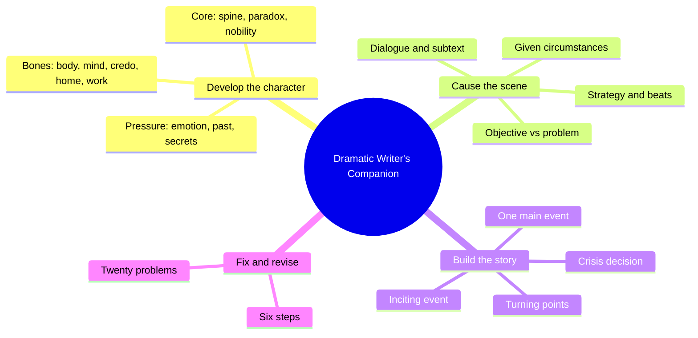
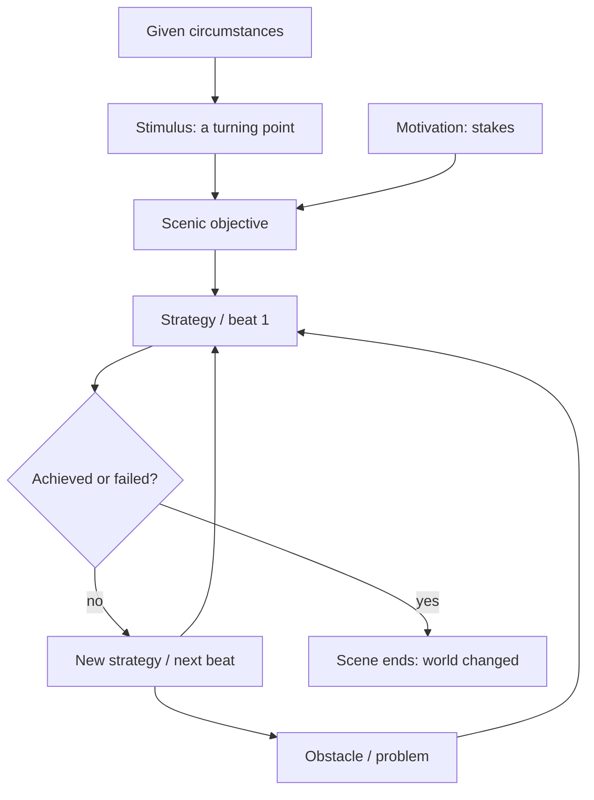
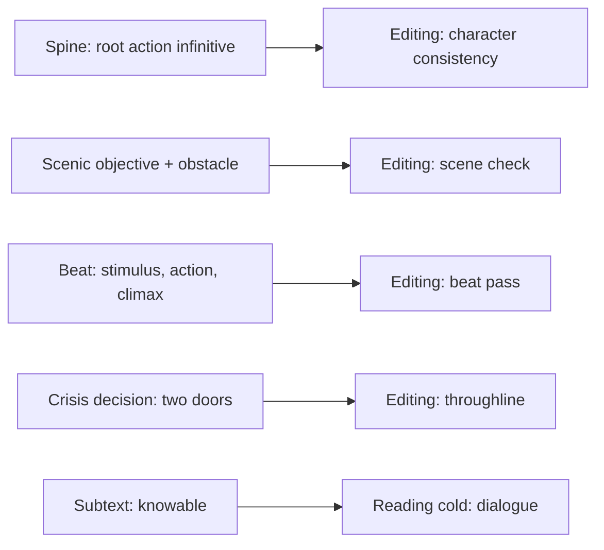

# BVX.0207 — The Dramatic Writer's Companion — Will Dunne (2009)
### Knowledge Entry — Distill

A playwright's workbook of sixty-two self-contained exercises in three sections (character, scene, story), plus a twenty-problem troubleshooter. It is in the library as craft basis for the OXO script editors: it gives a repeatable test for what a character wants, what blocks it, and what a beat is.

## TABLE OF CONTENTS
- [Core Thesis](#1-core-thesis)
- [Mind Models](#2-mind-models)
- [Framework](#3-framework--structure)
- [Key Concepts](#4-key-concepts)
- [Heuristics](#5-heuristics--decision-rules)
- [Invariants](#6-invariants)
- [Pitfalls](#7-pitfalls--myths)
- [Application](#8-application)
- [Cross-References](#9-cross-references)
- [Provenance](#10-provenance--confidence)

---

## 1 · CORE THESIS

The character is not added to the scene or story; the character is the scene and the story. Plot grows from what a character wants, what blocks it, and what is at stake. Know the character deeply and the scene and story become discoverable, testable, and fixable.

---

## 2 · MIND MODELS

**Diagram 1 — the whole argument.**
Read off the three nested scales (character, scene, story) and note that one engine, want against obstacle, runs through all three.

**Diagram 2 — the central mechanism (the scene engine).**
Read off the loop: want meets obstacle, strategy changes, and the scene ends only when the objective is won or utterly lost.

**Diagram 3 — the four-layer character test, mapped onto the Command's systems.**
Read off where each Dunne tool lands when used as an editing test on OXO drafts.

---

## 3 · FRAMEWORK / STRUCTURE

The book is deliberately non-linear: each exercise stands alone, can be repeated, and carries a "quick version" and a "best time for this" line. Three sections, each with stages 1 to 3 (early to late development, not difficulty).

| Section | Stage 1 | Stage 2 | Stage 3 |
|---|---|---|---|
| Developing Your Character | Fleshing out the bones: Basic Character Builder, Credo, Home, Work, Getting Emotional, Into the Past, Defining Trait | Knowing the character better: Allies, Adversaries, Contrast, Voice, Three Characters in One, Secrets | Who the character really is: Noble Character, Seven Deadly Sins, Dramatic Triangle, Spinal Tap, Paradox, Character You Like Least, In So Many Words |
| Causing a Scene | Making things happen: Scene Starter, Setting, Roots of Action, Want, Problem, Good Intentions, Strategy, Adjustments, Scene in a Sentence | Refining action: Seeing the Scene, Exposition (There and Then), Discoveries, Heating Things Up, Emotional Storyboard, Senses, Voice of Setting, Beats | Refining dialogue: Talking and Listening, Unspeakable Truths, Universal Truths and Lies, Bones of the Lines |
| Building Your Story | Triggering events: Whose Story, Point of View, World, Inciting Event, Grabbing | Throughline: Step Outline, Turning Points, Suspense, Pointing and Planting, Crisis Decision, Arc of Action, Before and After, Twelve-Word Solution | Big picture: Main Event, Story as a Dog, Shrinking Story, Big Idea, Name, Forest, Ready-Aim-Focus, Six Steps of Revision |

The back matter maps twenty script problems to the exercises that fix them.

---

## 4 · KEY CONCEPTS

| Concept | What it is | Why it matters |
|---|---|---|
| Character as scene and story | Character is the root function; plot should evolve from character | Prevents melodrama, where plot dictates and characters become puppets |
| Credo | A character's beliefs on twenty topics, written in the character's voice | Under stress, true values show; gives a predictor of choices |
| Ally types | Six types (close-powerful, powerful-distant, close-weak, weak-distant, dangerous, adversarial). Ally = intends to help, judged by intent not result | Maps relationships by resource and closeness; "adversarial ally" thwarts now to help later |
| Dramatic triangle | Every two-person relationship has a third party (present or absent) shaping it | Quadruples relationship material; explains offstage forces |
| Spine / root action | One infinitive ("to protect", refined to "to father") that all the character's doings flow from | Generates new traits, actions, and images consistent with the character |
| Paradox | A true self-contradiction ("success is failure") embodied by the character | Source of complexity and story ideas |
| Noble trait and deed | Each important character gets a lofty quality and an opportunity to act on it | Fixes two-dimensional villains and raises the story |
| Given circumstances | Physical, psychological, social, economic, political conditions at scene start, plus recent and distant past | Tells you how each character enters; helps pick the point of attack |
| Scenic objective | Five types: make feel good, make feel bad, find out, convince, complete a physical task. Can be conscious plus subconscious | Scenes are driven by wants; the scene ends when the objective is achieved or utterly failed |
| Conflict = obstacle | Other character's needs and traits, own inner world, external situation | Argument is only one kind; obstacles reveal character under stress |
| Good intentions | Each side fights for what it sees as good ("Comfort versus stability") | Gives complex conflict without a villain; stakes need urgency |
| Beat | Smallest unit of dramatic action: stimulus, action, climax, optional resolution; behavioral, physical, or inner-life | A beat is about one thing; scene problems usually trace to beat problems |
| Subtext / unspeakable truth | What cannot be said, made knowable through objective, behavior, emotion, physical clues, illogic | Dialogue gains depth without explaining |
| Turning point | Experience that forces a new, untried path; either happens to the character or is done by the character; "reversal" when large | Act ends and inciting events; active type grows important later |
| Crisis decision | Choice between two goods or two evils, framed as two doors; both must be viable | Where subject, theme, character, and plot converge |
| Main event | The one thing the whole story (and each scene) adds up to | Focus test for story and scene |
| Grabbing | The first ten pages tell whose story it is, what it's about, the rules of the world, and raise a big question | Audience commitment window |

---

## 5 · HEURISTICS & DECISION RULES

| Situation | Do this | Not this |
|---|---|---|
| Building a character | Choose facts that can affect story events; focus on who they are when the story begins | Pile up trivia; over-develop minor characters who may steal the show |
| Finding what a character is "really" after | List about a dozen verb-phrase doings, rank the top five, find the shared need, boil down to an infinitive | Infer the spine from what the character says about themselves |
| Two characters feel flat together | Name the third point of the triangle, present or absent | Treat the pair in isolation |
| Planning a scene | State the objective as a positive goal ("reach the shore") and the central conflict | Frame a want as a negative ("get away from the shark") |
| Scene feels talky or flat | Check for dropped conflict; raise the obstacle | Add more dialogue or exposition |
| Conflict feels weak | Raise stakes: a higher good, a rarer good, broader impact | Add shouting |
| Motivation versus objective | Match them: too small reads as melodrama, too large reads as illogical | Overstate stakes for a small act |
| Choosing a scene entry | Enter as late as possible, leave as soon as possible | Open with setup before the core action |
| Exposition is needed | Use small doses once a present-tense question makes us want the past | Stop the action so characters explain their lives |
| Writing a line | One idea per speech; put the operative word at the end; verbs of doing; rule of three for key facts | Pack two ideas in one speech; direct delivery with stage directions |
| Subtext | Make it knowable via objective, behavior, emotion, physical clues | Bury it so deep nobody can detect it |
| Characters collide | Give both a good intention and urgency (why now, why not avoid) | Make one a cartoon bad guy |
| Crisis decision | Make the door not chosen viable; check values, traits, events, knowledge, backstory, foreshadowing | Make the outcome obvious |
| Revision | Six steps: global read, one character at a time, structure, one scene at a time, technical cut, global read again | Polish lines before the throughline holds |
| Cutting | Cut beats, then speeches, then words, without harming voice or main event | Cut only at the word level |

---

## 6 · INVARIANTS

1. Characters act only because they want something, consciously or not.
2. Conflict is obstacle; drama needs the objective and the obstacle to be roughly matched.
3. Characters always move toward what they perceive as good at the time.
4. Character is revealed by behavior under pressure, not by explanation.
5. A beat is about one thing; a scene is about one thing; a story adds up to one main event.
6. A true turning point changes the direction of action; the first step may be small.
7. Every scene's world differs at the end from the start.
8. The crisis is a choice between goods or between evils, never good versus evil from the character's view.
9. Subtext needs to be knowable to carry meaning.
10. Dunne's rule: these are principles, not laws; Moss Hart: you learn only how to write this play.

---

## 7 · PITFALLS / MYTHS

- **False character:** plot-imprisoned, stock, mouthpiece, or foil who only asks questions.
- **Unnecessary character:** duplicates another's function or voice.
- **No one to care about:** neither likeable nor empathetic nor interesting; fix the balance of ordinary and extraordinary.
- **Unclear want, weak conflict, low stakes:** the three common scene killers.
- **Strategy gone stale:** same failed tactic held too long.
- **Retrospective elucidation:** all talk, no action; exposition without conflict.
- **Punches that don't land:** nobody is vulnerable.
- **Passive main character, offstage more interesting than onstage, weak throughline, crisis that isn't, theme that isn't, too many words:** listed in the troubleshooter.
- **Myth: conflict equals argument.** Love can be an obstacle.
- **Myth: the villain must be bad.** Good versus good gives the best collisions.
- **Myth: plot first.** Plot dictated by points produces melodrama.
- **Myth: peak early.** Conflict that leaps to crisis leaves nowhere to go.

---

## 8 · APPLICATION

- **Spine level:** TEXTURE. The book's tools work at line, beat, scene, and character level; story-level tools (inciting event, turning points, crisis) support but do not replace a spine framework.
- **12-layer character stack:** not wired (`feeds: []`). It is a writing-craft workbook, not a psychology source, though the credo, spine, and ally types could inform character notes.
- **plot_systems:** none directly.
- **Setting:** the setting exercises (Where in the World, Senses, Voice of the Setting) are physical-life prompts only.

For the OXO script editors the useful pieces are the scene-level and beat-level tests, because they can be run on a draft as yes/no checks: does each scene have a stated objective and a matching obstacle, is the stimulus identifiable, are the beats single-topic with a climax, and is the dialogue one idea per speech with knowable subtext. The troubleshooter's twenty problems work as an index of failure labels for reading-cold reports. The ally/adversary typing and the "adversarial ally" idea fit mentor and rival figures in OXO. The spine infinitive is a compact consistency check on a character across drafts.

Caution: the exercises are generative prompts for a writer, not scoring rubrics. Using them as a rubric is this library's adaptation.

---

## 9 · CROSS-REFERENCES

| Related entry | Relation |
|---|---|
| [[BVX.0064]] | Character role and cast design; complements spine and triangle with cast structure |
| [[BVX.0084]] | Dialogue technique; overlaps Dunne's dialogue stage 3 |
| [[BVX.0175]] | McKee, Story; overlaps on objective, obstacle, crisis, and turning points |
| [[BVX.0089]] | Dramatica; a formal system against Dunne's informal exercises |
| [[BVX.0236]] | Story Grid; editing-oriented scene and beat analysis |
| [[BVX.0075]] | Compelling characters for film, TV, and theatre; same medium and audience |

---

## 10 · PROVENANCE & CONFIDENCE

Full text read from the pdftotext file, but not every chapter in depth. Read closely: contents and guide intro, Basic Character Builder, Credo, Home, start of Work, Allies, Noble Character, Seven Deadly Sins, Dramatic Triangle, Spinal Tap, start of Paradox, Roots of Action, Want, Problem, Good Intentions, start of How It Happens, Thinking in Beats, Unspeakable Truths, start of Bones of the Lines, Art of Grabbing (first half), Turning Points (first half), Crisis Decision, Six Steps of Revision, and the first half of the troubleshooter.

Not read (only titles and contents blurbs): Getting Emotional, Into the Past, Defining Trait, Adversaries, Characters in Contrast, Voice, Three Characters in One, Secrets, Least-Liked Character, In So Many Words, Scene Starter, Where in the World, Adjustments, Scene in a Sentence, Seeing the Scene, There and Then, Aha!s, Heating Things Up, Emotional Storyboard, Senses, Voice of the Setting, Talking and Listening, Universal Truths and Lies, Whose Story, Point of View, World, Inciting Event, Step by Step, Suspense, Pointing and Planting, Arc of Action, Before and After, Twelve-Word Solution, Main Event, Story as a Dog, Shrinking Story, Big Idea, Name, Forest, Ready-Aim-Focus, the second half of the troubleshooter, and the glossary. Confidence is medium for that reason; claims about those chapters rest on the table of contents only. DONE_WITH_CONCERNS applies.

## META
- Template: BVX-LEARN-v4.0
- Source classification: book, craft workbook (playwright's perspective)
- Created / Updated: 2026-10-30
