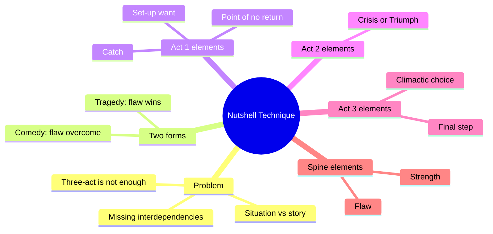
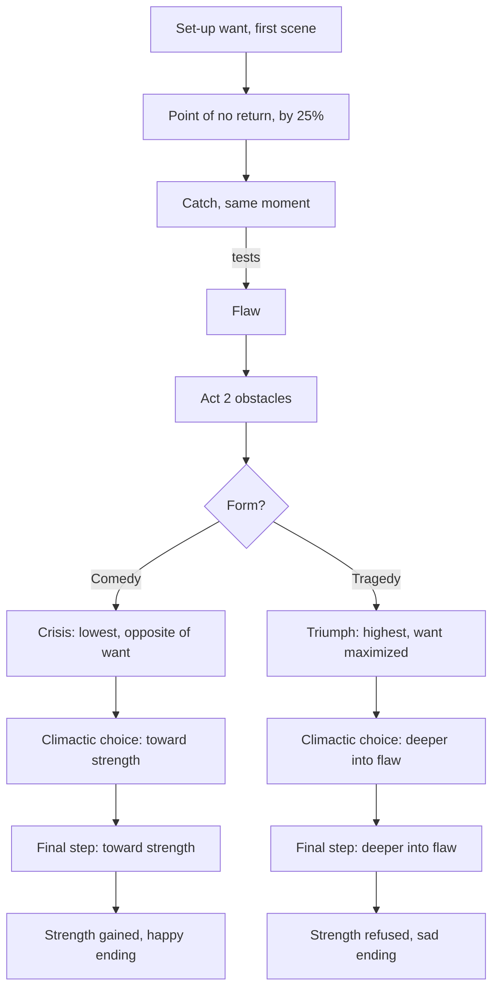
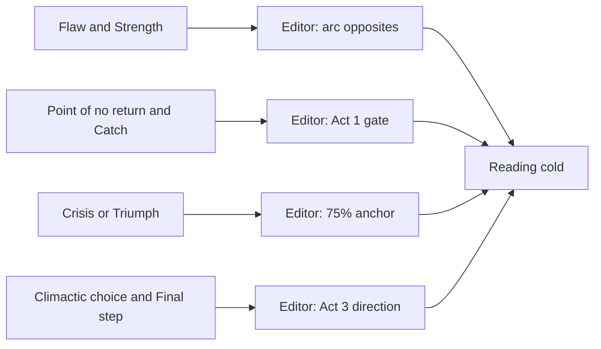

# BVX.0221 — The Nutshell Technique — Jill Chamberlain (2016)
### Knowledge Entry — Distill

A one-page, eight-element story-structure worksheet that tests whether a screenplay is a story or only a situation. It is in the library as the craft test for the OXO script editors.

## TABLE OF CONTENTS
- [Core Thesis](#1-core-thesis)
- [Mind Models](#2-mind-models)
- [Framework](#3-framework--structure)
- [Key Concepts](#4-key-concepts)
- [Heuristics](#5-heuristics--decision-rules)
- [Invariants](#6-invariants)
- [Pitfalls](#7-pitfalls--myths)
- [Application](#8-application)
- [Cross-References](#9-cross-references)
- [Provenance](#10-provenance--confidence)

---

## 1 · CORE THESIS

A screenplay is a story, not a situation, only when the protagonist's central flaw is tested by the catch at the first turning point, then resolved at the end. Eight elements, linked at fixed points near 25% and 75%, fuse plot to inner change.

---

## 2 · MIND MODELS

**Diagram 1 — the whole argument.**
Read off it: eight elements split into three zones (setup, Act 2 test, Act 3 resolution), with the flaw and strength as the spine underneath.

**Diagram 2 — the central mechanism.**
Read off it: want and catch arrive together at about 25%. The catch tests the flaw through Act 2. At about 75% the story forks by form, and both Act 3 steps follow that fork.

**Diagram 3 — mapped onto the Command's systems.**
Read off it: the book's elements slot into the editors' checks at story-spine levels, with no character-stack wiring.

---

## 3 · FRAMEWORK / STRUCTURE

**Prior structure:** the book starts from the standard three acts (about 30 / 60 / 30 pages, one page per minute). It says that is the floor, not the answer. Three camps of other books fail: bare-bones, scattered observations, or a fixed 12 to 22 beat template.

**Two forms, from Aristotle.** Tragedy: the protagonist fails to overcome the flaw and falls from good fortune to bad. Comedy (not the genre): the protagonist overcomes the flaw, learns its opposite, and rises from bad to good. About 95% of films are Aristotelian comedies.

**The eight elements, in running-time order:**

| # | Element | Where | Job |
|---|---|---|---|
| 1 | Set-up want | First dialogue scene | One thing wanted, which they will get at the Point of No Return |
| 2 | Point of no return | By 25% (pages 20 to 30) | Event that happens to the protagonist; gives the want |
| 3 | Catch | Same moment as 2 | Unwanted result; the perfect test of the flaw |
| 4 | Crisis (comedy) / Triumph (tragedy) | About 75% | Lowest point / highest point |
| 5 | Climactic choice | Start of Act 3 | First move toward (comedy) or away from (tragedy) strength |
| 6 | Final step | Last major scene | Second move, same direction |
| 7 | Flaw | Seeded in Act 1, no fixed slot | Source code of the story |
| 8 | Strength | Learned or refused in Act 3 | Exact opposite of the flaw |

**The interdependencies (the actual point):**
- Want is gained in the Point of No Return.
- Catch is attached to that point and tests the flaw.
- Want is the opposite of the Crisis (comedy), or the Triumph is its ultimate form (tragedy).
- Flaw and strength are exact opposites.
- Both Act 3 moves go the same way as the form.

**Form use:** one page, one sentence or a phrase per box. Use it before writing a script, or to diagnose a draft.

---

## 4 · KEY CONCEPTS

1. **Situation vs story.** A situation is a clever premise placed on any protagonist. A story is unique to its protagonist; swap the lead and it breaks. Why it matters: it is the book's main test.
2. **Plot vs story.** Plot is the sequence of events. Story is the emotional journey and inner change. Wizard of Oz: the plot is a road to a wizard; the story is a girl who runs from problems.
3. **Set-up want.** One want among many, often a "throwaway" line. A set-up, in the sense of "be careful what you wish for". Find it last.
4. **Point of no return.** A happens-to event that makes this story this story. Distinct from the Inciting Incident (pages 5 to 10), which the book leaves off the form because nothing depends on it. Write it passively so the protagonist is not the subject.
5. **Catch.** What the protagonist got but did not want, inside the same event. It front-loads Act 2 with a problem, since without it the story is over once the want is met.
6. **Flaw.** The one weakness the Catch tests. Not the greatest flaw; the one that is overcome (or not) by the end. It must exist before the story starts.
7. **Crisis.** Lowest point, partly self-made, and the opposite of the set-up want ("what they once wanted, they now hate").
8. **Triumph.** The tragic mirror of the Crisis: peak success, the want taken to its ultimate form, and the turn begins there.
9. **Climactic choice.** The Act 3 decision from a corner of two bad options. The best is the "banana": a third option unseen but seeded earlier. It can repeat several times in a row.
10. **Final step.** The last scene's second move in the same direction as the climactic choice.
11. **Strength.** The learned opposite of the flaw. In a tragedy, name the strength the protagonist failed to learn so the audience can imagine the better ending.
12. **Protagonist by flaw.** The protagonist is not the lead with the most screen time. In comedy it is whoever changes most; in tragedy, whoever most fails to change.
13. **Secret protagonist.** A minor-seeming character who fits the form when the obvious lead does not (Crimes and Misdemeanors, with Cliff).
14. **Anchors.** Percent of running time, 25% and 75%. Both are tied to page count in the screenplay.

---

## 5 · HEURISTICS & DECISION RULES

| Situation | Do this | Not this |
|---|---|---|
| Starting a Nutshell | Fill Point of No Return and Flaw first; set-up want last | Start with the want you think you know |
| Finding the Point of No Return | Ask what event, if cut, makes the film another film | Pick an early striking scene (Bourne's police fight) |
| Writing it down | Make it passive: "a safe-deposit box reveals..." | Make the protagonist's choice the subject |
| Finding the catch | Ask: what did they get that they did not want? Why isn't the story over? | Use a later Act 2 complication |
| Judging catch vs flaw | Check whether the catch would sustain 60 pages of the flaw | Accept any problem as the catch |
| Setting the Crisis | Make it the absolute low and the opposite of the want | Settle for a bad moment that is not the opposite |
| Setting the Crisis cause | Let the flaw cause part of it | Hit the lead with pure bad luck |
| Writing the climactic choice | Look for the banana; check Act 2 for seeds | Pick one of the two bad options |
| Naming flaw and strength | Choose one strength; flip it to get the flaw; wording must be exact opposites | Leave a mismatched pair (Argo) |
| Tragedy | Name the strength that was refused and the happier ending | Give the lead only bad luck |
| Uncertain protagonist | Test each candidate for change versus the flaw | Choose by screen time or action drive |
| Children as leads | Look to the adult who needs the change (Richard, Malcolm) | Make a pre-teen the protagonist |
| Nonlinear story | Anchor to the order of the screen, not chronology | Re-order and expect it to work |
| Draft stalls in Act 2 | Check the flaw-catch link first | Add more obstacles |

---

## 6 · INVARIANTS

1. The protagonist gets the set-up want at the Point of No Return, along with the catch.
2. The Point of No Return lands by 25% of runtime and happens to the protagonist.
3. The Catch tests the Flaw.
4. Comedy reaches its lowest point and tragedy its highest near 75%.
5. The Crisis is the opposite of the set-up want; the Triumph is its extreme.
6. Comedy: both Act 3 moves go toward the strength. Tragedy: both go deeper into the flaw.
7. Flaw and Strength are exact opposites.
8. The protagonist is identified by relationship to the flaw, and there is one.
9. The outcome (fortune) follows largely from the protagonist's own flaw or change.
10. Each element is a sentence or less. This is a structural spine, not a nuance record.

---

## 7 · PITFALLS / MYTHS

- Premise and a great protagonist do not make a story; the link between them does (Rita's Groundhog Day, Big Tootsie).
- The Inciting Incident is not the Point of No Return, and the form skips it.
- A big turning point is not the Point of No Return unless cutting it kills the story.
- Mistaking the set-up want for the deepest want. It is a single want, even a throwaway one.
- Using a later "catch" or a realization that resembles the Strength (Tootsie's "shoes aren't pleasant").
- Calling someone else's act the flaw (the producer's "he screwed up").
- Naming a flaw that does not reverse by the end (Michael being "difficult").
- A Crisis that is only low, or caused by luck.
- Assuming Aristotelian comedy means funny, or tragedy means anyone's death. Braveheart and Titanic are comedies; Ben in Crimes and Misdemeanors suffers but is not a tragedy.
- Thinking the form makes stories formulaic. The book argues it pushes writers to less predictable choices.
- Reordering a nonlinear script to the order of events.
- Treating the main character as the protagonist by default.

---

## 8 · APPLICATION

- **Spine level:** L2 to L6 as setup, turn into Act 2, test, midpoint-to-low/high at about 75%, resolution. It is a structural checker, not a character model.
- **12-layer character stack:** none wired (`feeds: []`). Flaw and strength are an arc pair, but the book states that character development is out of scope.
- **plot_systems:** the want, catch and flaw triple suits a per-protagonist check.
- **Setting:** none.

For the OXO script editors and the cold reader, this book supplies a yes/no checklist. Run the comedy or tragedy checklist (seven questions each) on any outline or draft, and report the first failing link. Weight the Act 1 pairing, the 75% anchor, the opposite-pair wording, and the direction of both Act 3 steps. Because the book rates the flaw as the story's seed, the editors should ask for the flaw statement before judging any scene.

Limits: it covers single-protagonist feature films, uses film runtime as a clock, and does not address pacing or dialogue. An ensemble or long-form story needs one protagonist chosen per the flaw test, and each season or arc needs its own anchors. Treat 25% and 75% as strong defaults and decide deliberately before departing.

---

## 9 · CROSS-REFERENCES

| Related entry | Relation |
|---|---|
| [[BVX.0064]] | McKee, Character: dimensional character and unity of opposites; compare Chamberlain's flaw/strength opposites |

---

## 10 · PROVENANCE & CONFIDENCE

Sourced from the pdftotext of the full book: front matter, Parts 1 and 2 (protagonist, want, point of no return, catch, flaw, crisis, climactic choice, strength), and the nonlinear and secret-protagonist chapters of Part 3. Read in sections. Triumph, Final Step and the film Nutshells in Part 4 were not read in full; they are inferred from the Part 1 form walk-throughs and the chapter openers. The 220-page count is an estimate. The Zotero key is unset.

## META
- Template: BVX-LEARN-v4.0
- Source classification: book, craft, full-text with gaps
- Created / Updated: 2026-10-30
