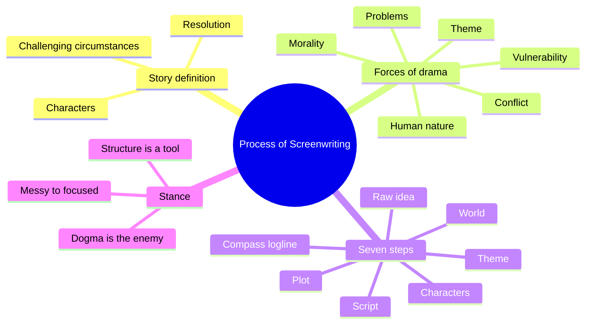
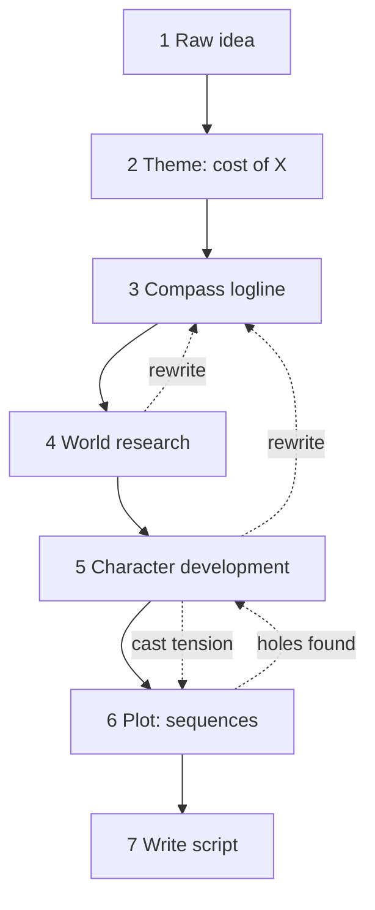
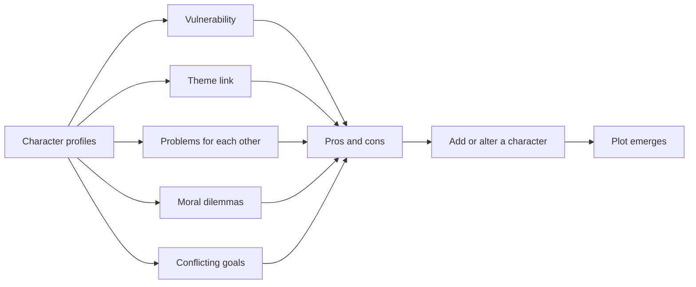
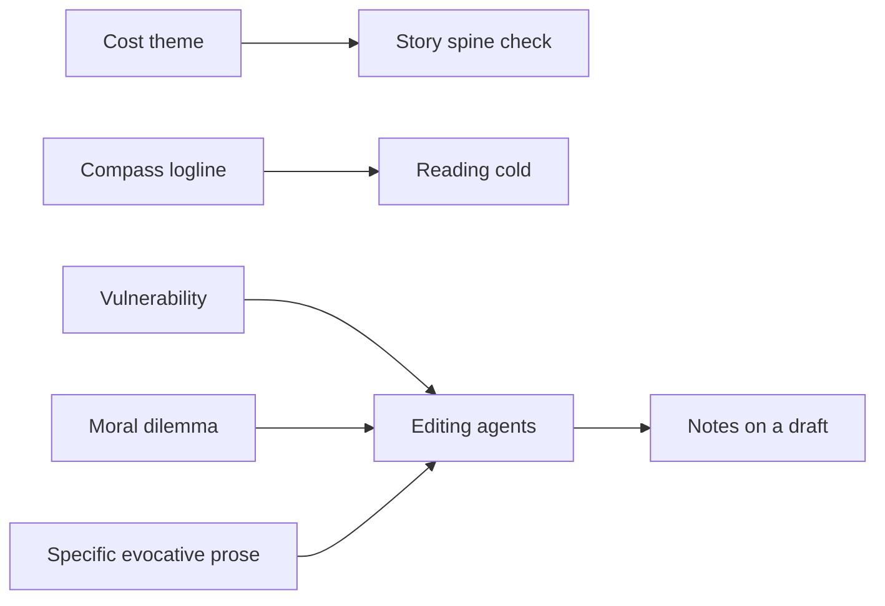

# BVX.0228 — The Process of Screenwriting — Clive Frayne (2019)
### Knowledge Entry — Distill

A seven-step planning method for film and TV scripts, built on a definition of drama. It is in the library as the craft basis for the OXO script editors: it gives them a vocabulary for judging a draft before and after it is written.

## TABLE OF CONTENTS
- [Core Thesis](#1-core-thesis)
- [Mind Models](#2-mind-models)
- [Framework](#3-framework--structure)
- [Key Concepts](#4-key-concepts)
- [Heuristics](#5-heuristics--decision-rules)
- [Invariants](#6-invariants)
- [Pitfalls](#7-pitfalls--myths)
- [Application](#8-application)
- [Cross-References](#9-cross-references)
- [Provenance](#10-provenance--confidence)

---

## 1 · CORE THESIS

A story is what happens when a specific group of characters is forced to face challenging circumstances. Drama needs conflict, stakes, vulnerability, moral dilemmas and theme. A writer should make those choices in planning, before the script, instead of paying for them in rewrites. Structure is a tool, never a formula.

---

## 2 · MIND MODELS

**Diagram 1 — the whole argument.**
*Read off the book's spine: a definition of story, the forces of drama, seven planning steps, and a stance against dogma.*

**Diagram 2 — the central mechanism.**
*Read off the order of the steps and the loop-back arrows: the compass logline is rewritten whenever the world, cast or plot changes the story.*

**Diagram 3 — the drama engine test for a cast.**
*Read off the six checks Frayne runs on a cast; each check yields a pro, a con and a fix (usually: add a character).*

**Diagram 4 — mapped onto the Command's editors.**
*Read off where the book's checks land in the editing agents: pre-draft checks, scene checks, and draft-level notes.*

---

## 3 · FRAMEWORK / STRUCTURE

The book has 27 chapters and three movements.

**Why a process (ch. 1-4).** Writers sit on a scale from messy (write with little preparation, discover on the page) to focused (decide in advance). Three typed writers: the instinctive writer (Helen) drafts many times and patches in steps between drafts; the structural writer (Peter) plans plot tightly but leaves character and theme to chance; the process-driven writer uses all steps, in flexible order, and expects about two drafts. A script is a production document for a team, so format and clarity matter, but it is also read, so it must hold a reader.

**What drama is (ch. 5-6, 13).** Six forces, each answered before writing: conflict, the exploration of human nature, morality, forced problem-solving, vulnerability, and theme. Frayne ranks vulnerability above conflict.

**The seven steps (ch. 14-25).** Each step has a "Practical Tools" chapter. Four phases group them: ideas (steps 1-3), research (4), planning (5-6), writing (7).

1. **Raw idea.** Collect, connect, abandon the hunt for originality, test. The 20-to-1 ratio governs this step.
2. **Theme.** Phrase it as "the personal and emotional cost of" a human experience. Tools: use instinct, list alternatives, word cloud, combine themes.
3. **Compass logline.** Who, where, when, what is the big problem. Not the pitch logline; it is a heading for the writer, rewritten freely.
4. **World.** Research until you can visualise. Seed scenes and prose are play, not script.
5. **Characters.** Intuitive, exploratory (seed scenes, prose) or focused (a profile sheet). The cast is the unit, not the single character.
6. **Plot.** Messy on-the-page plotting, beat sheets, file cards, treatments, or the spreadsheet method. Plot is the ordered list of sequences.
7. **Write.** Specific, simple, evocative prose; only what can be seen and heard; format as a tool for the production team.

**Structure (ch. 13).** Logic gives beginning, middle, resolution. Three-act adds first-act break, mid-point and second-act break. The hero's journey adds four transformations. Frayne treats all as vocabulary for notes and for deadlines, not as laws.

---

## 4 · KEY CONCEPTS

| # | Concept | What it is | Why it matters |
|---|---|---|---|
| 1 | Process-driven screenwriting | Planning steps taken before the script, in flexible order | Better first drafts, fewer rewrites |
| 2 | Messy vs focused | Scale from no preparation to full preparation | Both are creative; the choices happen on the page or in planning |
| 3 | Idea vs concept | A concept answers who, where, when, and what it is really about | Same raw idea gives different films (the Jaws and Darwin example) |
| 4 | Story definition | Specific characters forced to face challenging circumstances, to reach a resolution | Character and plot are one thing; all stories are character driven |
| 5 | Conflict | Any opposing force that challenges a character | Need not be a fight; nature, limits and duty count |
| 6 | Stakes and jeopardy | What the character stands to lose | No stakes, no drama |
| 7 | Vulnerability | The harm that this character in particular can suffer, physical or emotional | The key to tailoring problems; the stakes character (damsel) is the weakest form |
| 8 | Moral dilemma | A choice that exposes the character's code ("stuffed if you do") | A hero and a villain differ by the choice made |
| 9 | Theme as cost | "The personal and emotional cost of X" | Turns a vague subject into an engine; every scene must explore it |
| 10 | Compass logline | A first statement of characters, place, time and big problem | Fixes direction; rewritten as research changes the story |
| 11 | 20-to-1 ratio | Twenty bad ideas to find one good one | Quantity first, then choose |
| 12 | Seed scene / prose | Exploratory writing never meant for the script | Finds character and world cheaply |
| 13 | Drama engine | Characters designed to expose each other's vulnerabilities | Plot comes from the cast |
| 14 | Sequence | The action needed to play out a plot-point, written as several scenes | The writer's unit; the production team's unit is the scene |
| 15 | Spreadsheet method | Character profiles plus a beat sheet per major character on one sheet | Handles multi-protagonist plots; red blocks mark who is absent |
| 16 | Specific and evocative style | Verbs and nouns that carry intent ("stomps", not "walks") | A script must win the reader page by page |

---

## 5 · HEURISTICS & DECISION RULES

| Situation | Do this | Not this |
|---|---|---|
| A scene feels flat | Ask what the character is in conflict with and what is at stake | Add an argument or a fight |
| Writing a protagonist's problems | Tailor each problem to this character's vulnerability and inner struggle | Hand any hero a generic obstacle |
| Raising stakes | Ask for the emotional cost | Default to risk of death or a person to rescue |
| Choosing a theme | Prefix a human experience with "the personal and emotional cost of" | Pick "love" or "jealousy" alone |
| Testing a scene against theme | Ask if it explores the character's struggle with the theme; cut it if not | Keep it because it is good in isolation |
| A new fact changes the story | Rewrite the compass logline now | Defend the old logline or wait for draft two |
| Ideas stall | Generate 20 and choose; try different central characters, combine loglines, move the when and where | Commit to the first concept |
| Judging a cast before drafting | Run the pros and cons check on vulnerability, theme, problems, morality, conflict | Judge a plot against a template |
| Cast has no pressure | Add a character who threatens each lead differently | Rely on the existing pair to expose each other |
| Many character arcs | Use file cards or the spreadsheet method, link arcs by one thematic thread | Hold four arcs in your head |
| Tight deadline or cautious producer | Plan with a familiar structure | Plot messily on the page |
| Reading a character on a page | Write only what is seen or heard, with specific verbs | Write thoughts, or "walks and leaves" |
| Using a treatment | Keep it story-focused; check each paragraph still serves the main arc | Drift into a favourite side detail (the bears' marriage) |
| Structure note from an editor | Translate it into act breaks and stakes changes | Treat it as objective truth |

---

## 6 · INVARIANTS

1. A story needs characters, challenging circumstances and a resolution; remove the middle or the end and it stops being a story.
2. Characters are the illusion of a person built for dramatic effect, not real people.
3. The same plot point with a different character gives a different story.
4. If nothing is at stake and no challenge exists, it is not drama.
5. Stories always explore what it means to be human, and show the writer's beliefs.
6. Every scene is judged by the same forces: conflict, human nature, problems, vulnerability, morality, theme.
7. Every sequence turns into several scenes; reordering sequences forces rewrites because each sequence depends on the one before.
8. A script shows only what can be filmed.
9. Idea changes are cheap before the draft and expensive after it.
10. Structure exists in every story as vocabulary; it becomes a formula only when used dogmatically.

---

## 7 · PITFALLS / MYTHS

- **"Plot-driven vs character-driven."** A flawed argument; plot is the set of problems for the character.
- **Conflict as fighting.** Literal arguments and fights are the least interesting conflict.
- **The stakes character.** The vulnerable person to rescue is lazy, and Frayne calls it misogynistic.
- **Risk of death as the only vulnerability.** Emotional cost drives better drama (Chinatown).
- **Invulnerable heroes.** Superman in a gunfight has nothing at stake.
- **Cloned heroes and villains.** Copying heroism without thinking gives cliche. The Dark Knight works because the Joker has a coherent worldview.
- **Generic themes.** A subject alone is too broad.
- **Writing to a theme with no plan.** Tied to the "dangers of writing to a theme" discussion: the theme must serve scenes, not preach.
- **Commit to the first concept.** The first idea is usually the cliche.
- **The monomyth as universal law.** Calling all stories one pattern is "ludicrous and damaging".
- **Reverse-engineering formulas.** If a formula worked, studios would not make bad films.
- **Writing "what you know."** Frayne prefers "write what you care about".
- **Information-free description.** "EXT. BRIDGE. NIGHT" with tourists leaves every question open.
- **Interior thought on the page.** Prose is fine for exploration, not for the script.
- **Plot drift in treatments.** A writer follows the fun detail and loses the protagonist.

---

## 8 · APPLICATION

- **Spine level:** TEXTURE. The book supplies craft vocabulary for scene and sequence work, not a spine-level model. Its structure section is a menu, not a prescription.
- **12-layer character stack:** none wired (`feeds: []`). Its character section is about dramatic design, not psychology. The vulnerability and dilemma fields touch LEECHSEED indirectly, but nothing is extracted as a variable.
- **plot_systems:** the sequence as unit and the spreadsheet method (one arc per character, linked by a shared thread) suit multi-protagonist work such as OXO.
- **Setting:** step 4 (world) and "seed scenes" are a method for building setting before writing.

The book is most useful to the editing agents as a checklist of questions to ask a draft. For any scene: what is the conflict, what is at stake, which vulnerability is being pressed, what moral choice is forced, how does it explore the theme? For any pair of leads: do they expose each other's vulnerability, or only enable each other (Frayne's Malcolm and Betty "cons")? For any pitch line: is it a concept (who, where, when, what is it really about) or only a raw idea? For any page of action: is it specific, filmable and evocative?

Frayne's pros and cons analysis of a cast is explicitly "the tone of feedback a script editor might give", applied before drafting. That makes it a ready template for a pre-read audit of OXO ensembles. Treat his "cost of" theme phrasing as a prompt, not a rule. The Command's own rulings on theme and canon override anything here (for example the research-not-fabula rule applies to ideation work).

---

## 9 · CROSS-REFERENCES

| Related entry | Relation |
|---|---|
| [[BVX.0064]] | McKee, Character: also treats cast structure; Frayne's cast-as-engine is a lighter, design-first version |
| [[BVX.CRE]] | Other craft-subject entries; compare on structure as tool versus structure as law |

---

## 10 · PROVENANCE & CONFIDENCE

Sourced from the pdftotext file `_PRIVATE/distill_wave/BVX.0228.txt` (27 chapters, about 8,600 lines). Read in full or in substance: preface and chs. 2-3, ch. 5 (drama), ch. 13 (structure), ideas chapters (20-to-1, compass loglines), ch. 22 (character analysis), ch. 24 (plotting), ch. 25 (writing style), and the scene definition. Skimmed by headings only: theme tools, world-research tools, script formatting rules, and later chapters on developing a process. Table and diagram content in the PDF did not survive text extraction (three-act, hero's journey tables). Application and the Diagram 4 mapping are inference, kept separate from extraction. Zotero key and page count were not given in the brief, so those frontmatter fields are placeholders.

## META
- Template: BVX-LEARN-v4.0
- Source classification: craft book, practitioner method
- Created / Updated: 2026-10-30
