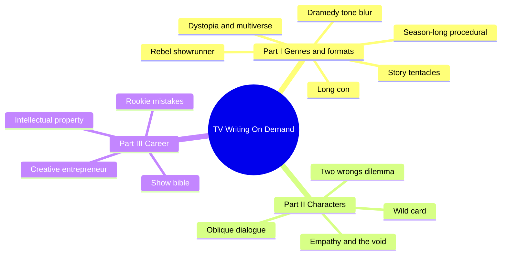
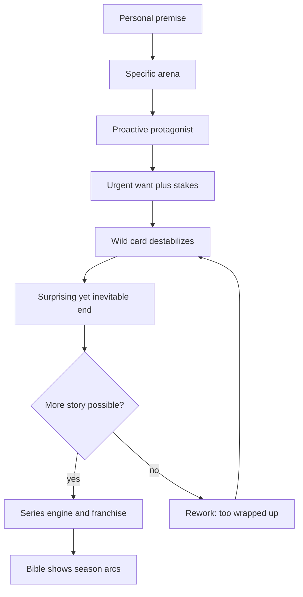
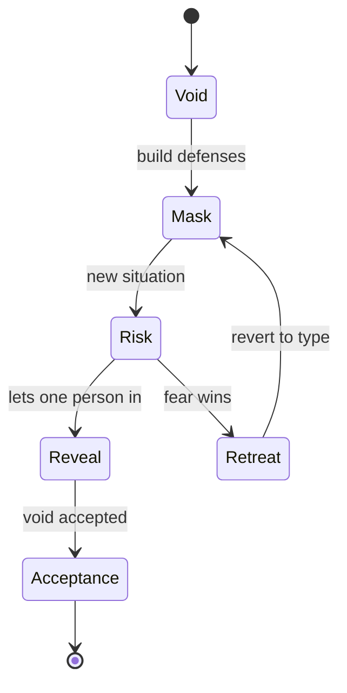

# BVX.0250 — TV Writing On Demand — Landau (2018)
### Knowledge Entry — Distill

Neil Landau's 2018 craft-and-market guide to scripted TV in the streaming era (a follow-up to his TV Outside the Box). It is in the library as a pilot-script diagnostic and a source of working rules on stakes, empathy, wild cards, dialogue and series engines.

## TABLE OF CONTENTS
- [Core Thesis](#1-core-thesis)
- [Mind Models](#2-mind-models)
- [Framework](#3-framework--structure)
- [Key Concepts](#4-key-concepts)
- [Heuristics](#5-heuristics--decision-rules)
- [Invariants](#6-invariants)
- [Pitfalls](#7-pitfalls--myths)
- [Application](#8-application)
- [Cross-References](#9-cross-references)
- [Provenance](#10-provenance--confidence)

---

## 1 · CORE THESIS

On-demand viewing rewards authenticity and story that keeps generating more story. A pilot is a prototype of the series: a proactive, rootable protagonist with real stakes, a specific world, and choices that open paths instead of closing them. The end of the pilot is the beginning of the series.

---

## 2 · MIND MODELS

**Diagram 1 — the whole argument.**
Read it as three bands: what is being written (genres), who it is about (characters), and how the writer survives the market.

**Diagram 2 — the central mechanism: a pilot that yields a series.**
Read it as a loop: every pilot choice is judged by whether it produces more story; choices that finish the story are sent back.

**Diagram 3 — the empathy dance (Ch. 7).**
Read it as a cycle: a character risks change, fear pulls them back to their coping power, and growth is slow acceptance of the void.

**Diagram 4 — the long-con stages as a season skeleton.**
Read it as the five con stages doubling as a season shape, with the audience as the willing mark.

---

## 3 · FRAMEWORK / STRUCTURE

The book says it is built "like an on-demand app": read any chapter in any order. Three parts.

**Part I, new genres and formats (Ch. 1-6).** Each chapter takes one trend and a handful of case-study series, then lists lessons.
- Ch. 1 Dramedy: comedy and drama blur; tone follows the creator's sensibility, authenticity beats easy laughs.
- Ch. 2 Season-long procedural: one mystery for the season, hybrid case-of-the-week plus serial arcs.
- Ch. 3 Long con: the grifter as antihero; each case series is analysed by marks, investigators, open or closed con, and blow off.
- Ch. 4 Dystopia, multiverse, magic realism: a global event made hyper-specific and personal.
- Ch. 5 Story tentacles: choices that yield more story.
- Ch. 6 A showrunner profile (Ryan Murphy): tone, outsider ambition, reviving dead genres.

**Part II, iconic characters (Ch. 7-10).** Empathy versus sympathy, the two-wrongs dilemma, the wild card, and dialogue.

**Part III, career strategy (Ch. 11-14).** Intellectual property, the show bible, a numbered checklist of pilot faults, and the creative entrepreneur path.

Writer-side rules sit mostly in Ch. 5, 7, 8, 9, 10 and 13; Ch. 11, 12 and 14 are market and legal practice.

---

## 4 · KEY CONCEPTS

| Concept | What it is | Why it matters |
|---|---|---|
| Story tentacle | A story choice that leads to more story, e.g. Alex being in the same prison as Piper at the end of the Orange Is the New Black pilot | Sustains seasons without repeating; judge any plot choice by what it opens |
| Inevitable yet unpredictable | End state feels earned in hindsight but could not be guessed (Groundhog Day) | The target for pilot and season endings |
| Void | What a character lacks (love, power, validation); drives defenses and aggression | Every show explores a character's relation to their void; injured-beast logic: the most wounded are the most hostile |
| Mask / coping power | The persona and strength a character reaches for under threat (Don Draper: persuasion; Elizabeth: duty) | Find the coping power, then give it an opposing force (Peggy's truth against Don's persuasion) |
| Reverting to type | Characters take a risk, then snap back like a rubber band | Prevents fake fast change; fear outweighs the need to change |
| Empathy vs sympathy | Empathy is identification; sympathy is pity | Both keep viewers returning; empathy shifts with point of view |
| Two wrongs | A moral choice is not right versus wrong but between two wrongs (Mamet) | Gives dilemma, ripple effects, a season of story from one decision |
| Characters cannot unlearn | Past choices stay as living history | Serial memory; audience anticipates by pattern, then you subvert |
| Wild card | A character or element who destabilizes the protagonist more than anyone | Shakes familiar genres; the wild card's own wild card refreshes later seasons |
| Long con stages | Put up, play, rope, touch, blow off (via Konnikova) | Season skeleton; the audience is the mark who wants to be wrong |
| Stakes | Consequences of failure, as opposed to want | Needed even in comedy; must feel life-and-death to the character |
| Franchise / story engine | What the show is every week, differently each time | Answers "what's the series" |
| Arena | Principal setting and time period | Specificity is authenticity; fantasy needs a mythology document |
| On the nose (OTN) | Dialogue that states the truth directly | Write it as a first pass, then bury it |
| Raking | Cutting unneeded words after drafting (Bochco) | Keeps the essence of each line |
| Series bible / story area | Sales roadmap of arcs; mini-bible for dramas, story area document for half-hour comedies | Buyers want to see where it goes |

---

## 5 · HEURISTICS & DECISION RULES

| Situation | Do this | Not this |
|---|---|---|
| Choosing between plot options | Pick the one that gives more story, even if another is flashier | Burn through plot in the first season |
| Plotting an episode or outline | Dig deeper into one main event: effect on one character, decisions, ripple effects, logistical and emotional together | Pile on events until it flattens into "this happens, then this" |
| Giving the lead a goal | Give an urgent, proactive want with stated consequences | A passive protagonist, or a want with no price |
| Opening a pilot | Spend at most about half on setup, then an A-story showing what characters will do weekly | Pure orientation; "cool people doing cool shit" must be visible |
| Ending a pilot | End on a surprise that feels inevitable and leaves questions | Too wrapped up; a finished feature in disguise |
| Wanting a lead to grow | Withhold the want at first (Hailey does not get the orchestra chair) | Hand the goal over in the pilot; desperation fuels comedy |
| Writing a flawed lead | Put a first impression on the surface and something beyond the mask | A character who is exactly what they seem |
| Building conflict | Name the coping power, then its opposing force | Opposition with no matching strength |
| Dialogue pass 1 | Write the scene on the nose, then track where each character comes from and goes | Shipping the first draft |
| Dialogue pass 2 | Bury the information in subtext, action, and what is left unsaid | Characters announcing feelings |
| Scene boundaries | Get in late, get out early; cut the first two and last two lines and see | Entrances, hellos, goodbyes |
| Testing voice | Cover character names and read; lines should identify the speaker | Interchangeable voices |
| Quiet moments | Try the scene with no dialogue first, then add only what is essential | Four expressions, then a look and a think |
| Information in a scene | Use who knows more; power is information | Everyone knowing the same things |
| Fantasy or sci-fi world | Write a short, consistent mythology document | Rules that change mid-pilot |
| Antagonist | Show one vulnerable beat (Fisk in "Shadows in the Glass") | Pure villainy with no connection point |
| Script length | About 30-35 pages single-camera half-hour, about 60 for a one-hour | Long scripts when unknown |
| Research | Interview, visit, then stop and write | Endless research as procrastination; fudged facts |
| Reveals in a mystery | Reveal the whodunit by the end of season one (the lesson of The Killing) | Withholding past what the audience will bear |

---

## 6 · INVARIANTS

1. A story exists because a character is incomplete: a void is the engine.
2. A character's past decisions and knowledge stay with them.
3. Stakes are consequences of failure; a want without stakes is half a drive.
4. Truth in dramatic storytelling must be proactively earned: no deus ex machina, helpful coincidence or easy remedy.
5. Audiences want to be surprised without being cheated: the ending is inevitable in hindsight.
6. First impressions of characters are mostly wrong, and should be.
7. What a character needs most is often what they defend against most.
8. Dialogue is heightened, not real speech; most communication is non-verbal (the book cites the 7/38/55 split, a popular and contested figure).
9. Every sustained show is a family or family-like unit with a patriarch or matriarch role and entry points for audiences.
10. The pilot is a prototype and a writing sample; style on the page counts from page one.

---

## 7 · PITFALLS / MYTHS

- "Great pilot, but what's the series?" The most common student trip: all setup, no sustained engine.
- Too wrapped up, no legs; reads like a movie or a limited series.
- No franchise: cannot answer what the show is each week.
- Passive protagonist or nobody to root for; "rootable" means invested in, not liked.
- Generic arena ("any city"); specificity gives authenticity.
- Confusing mythology and inconsistent powers.
- Weak premise made of piled-on tropes; "write the pilot that only you could write."
- Fudged expertise: some reader will know the subject.
- No signature style: heavy action blocks, adverbs where a stronger verb works ("sprints down the alley"), a man "in his 30s" with no defining trait. Elmore Leonard: "If it sounds like writing, rewrite it."
- Tone swings: "all over the place."
- Tepid plotting: the reader guesses the ending and is right.
- Stakes too low; in comedy, forgetting that stakes must feel fatal to the character.
- Further checklist items exist (too long, too many characters, good stuff too late, too superficial) but the last four were not read in full; see §10.
- Myth: you need a big agent first. The book says a great script draws agents; managers nurture, but only agents or attorneys negotiate deals.
- Myth: formula is safe. The book argues serialization and ambiguity now beat resolved procedurals, while noting broadcast still runs closed-ended shows.
- Writing in a genre you have not studied is how scripts end up unintentionally derivative; become an expert in the genre first.

---

## 8 · APPLICATION

- **Spine level:** TEXTURE. The book supplies telling craft (scene, dialogue, pilot diagnosis), not a spine level.
- **12-layer character stack:** none wired. The void, mask and coping-power material is craft vocabulary only, so `feeds: []`.
- **plot_systems:** the story tentacle and two-wrongs rules suit any plot-system design review.
- **Setting:** arena specificity and the mythology document apply to world-building notes.

This is a craft basis for the OXO script editors and the cold reader. For an editing pass, the most useful tools are the Ch. 13 checklist as a diagnostic list, the Ch. 10 dialogue passes (on the nose, bury, rake, cover the names), and the stakes test (state the consequence of failure in one line). For a cold read, ask: who is rooted for, what happens weekly, what is surprising at the end, and what in the first ten pages shows style. These are one teacher's market-facing rules; use them as a lens, not law. They fit pilots and serialized story, less so literary standalone pieces.

---

## 9 · CROSS-REFERENCES

| Related entry | Relation |
|---|---|
| [[BVX.0092]] | Dramatic story structure; the skeleton that this book's pilot checks sit on |
| [[BVX.0084]] | Dialogue technique; fuller treatment of subtext and voice that Ch. 10 summarises |
| [[BVX.0061]] | Characters and viewpoint; point of view and who-knows-what in a scene |
| [[BVX.0075]] | Character creation for film and TV; fits the void and mask material |
| [[BVX.0054]] | Premise line; premise strength is the Ch. 13 "premise is weak" test |
| [[BVX.0053]] | Alternative scriptwriting; companion to the "defy formula" argument |

---

## 10 · PROVENANCE & CONFIDENCE

Source: pdftotext of the full book (`_PRIVATE/distill_wave/BVX.0250.txt`, about 12,000 lines). Coverage was by window, not cover to cover:
- Read in full or near full: Introduction, contents, Ch. 7 first two-thirds (to the "Reverting to Type" section), Ch. 13 up to the stakes item.
- Read the opening 250-330 lines of: Ch. 1, 2, 3, 4, 5, 6, 8, 9, 10, 11, 12, 14.
- Not read: the later sections of every chapter (for example the Fargo, The Night Of and Search Party sections of Ch. 2; The OA and Man in the High Castle in Ch. 4; The Affair, Girls and Game of Thrones in Ch. 5; Ch. 7's Insecure, Big Little Lies, Westworld and 13 Reasons Why; Ch. 8's Legion, Jessica Jones and This Is Us; Ch. 9's Silicon Valley, Young Pope and Crown; Ch. 10's later dialogue topics; Ch. 11's remaining sections on adapting; Ch. 12's bible-drafting procedure; Ch. 13's last items (too long to superficial, too many characters, good stuff too late, temptation to rush); Ch. 14 after the agent section). Statements about those parts rest on the table of contents only.
- Bonus content on the companion website is not in the PDF text.

The series examples are the author's choices and 2017-era; her industry claims (networks, deals, who needs bibles) are dated. The 7/38/55 communication figure is repeated as given and is a popular simplification. Confidence is medium: the core craft rules come from direct reading; chapter-end material does not.

## META
- Template: BVX-LEARN-v4.0
- Source classification: craft and market guide, single-author
- Created / Updated: 2026-10-30
